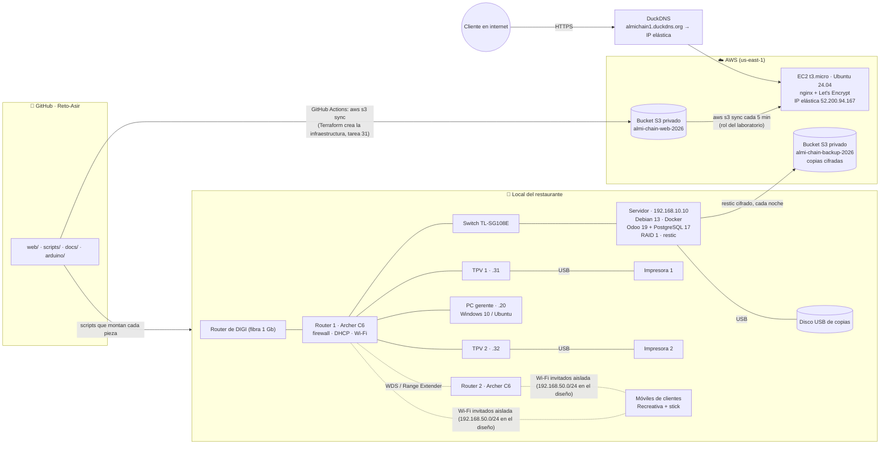
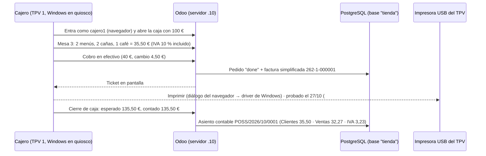
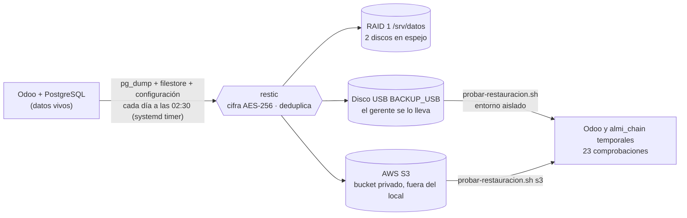
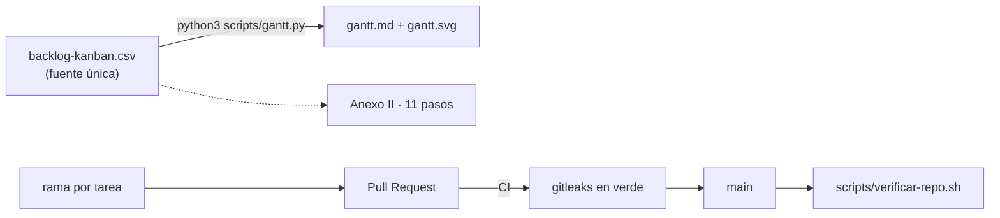
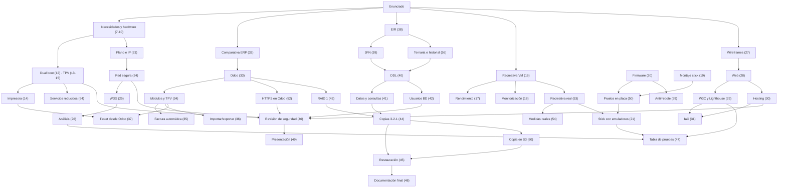
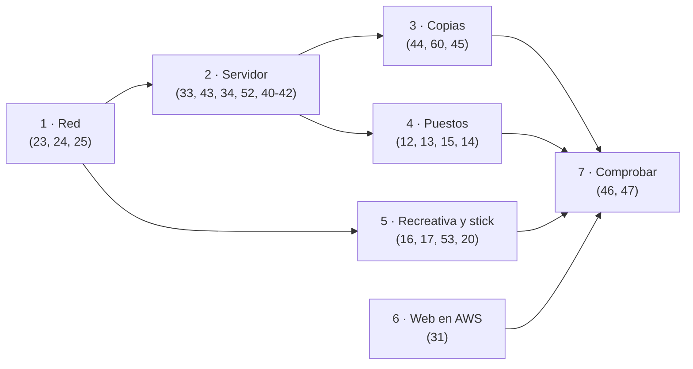

# Lógica del reto Almi-Chain

Este documento explica **cómo encaja todo**: qué pide el enunciado, qué pieza lo resuelve, cómo se conectan las piezas entre sí (la red, el ERP, la web, la base de datos, las copias, la recreativa…) y por qué se ha hecho así. Es el punto de partida para entender el proyecto y para defenderlo.

- Lo que está hecho y lo que falta: [Gantt](docs/gestion/gantt.md) (generado desde el [backlog](docs/gestion/backlog-kanban.csv)).
- Cómo se ha comprobado cada cosa: [verificación](docs/gestion/verificacion.md) (23/10, repasada el 04/11) y [tabla de pruebas](docs/gestion/47-tabla-pruebas.md).
- Cómo se evalúa: [rúbrica del Anexo VI](docs/gestion/rubrica-anexo-VI.md).
- Enunciado: [Reto_1_ASIR1_2026-2027.docx](Reto_1_ASIR1_2026-2027.docx) · Plan con herramientas: [almi-chain-plan.pdf](almi-chain-plan.pdf).

> Los números de tarea (#12, #34…) son los del backlog. Si una pieza está pendiente, se dice.
>
> **Al día el 10/11/2026** (49 de 64 tareas hechas). Para montarlo todo desde cero, en orden, ve a la [sección 15](#15-montarlo-desde-cero-en-orden).

---

## 1. El reto en pocas líneas

Una cadena de restaurantes nos contrata para montar la informática de un local. El enunciado pide, además de que todo sea **seguro, reproducible, verificado y documentado** para que lo siga un técnico nuevo:

| # | Qué pide el enunciado | Cómo lo resolvemos | Tareas | Carpeta |
|---|---|---|---|---|
| 1 | Equipo del gerente con arranque dual Windows 10 + Linux | Windows 10 + Ubuntu 26.04.1 LTS con GRUB, en una VM de VirtualBox, con BitLocker, `/home/gerente` cifrado y servicios reducidos | 7, 8, 12, 64 | [docs/so](docs/so/) |
| 2 | 2 TPV Windows de barra + impresoras de tickets, con configuración, presupuesto y diagrama | Todo en uno táctil Iggual N100 + Epson TM-T20IV por USB; el TPV es un navegador en modo quiosco contra Odoo | 7–11, 13–15, 37 | [docs/hardware](docs/hardware/) |
| 3 | Mínimos privilegios y seguridad por defecto | Cuentas separadas usuario/administrador en todos los sistemas, secretos fuera de Git, cifrado | 13, 42, 46, 52 | Transversal |
| 4 | Recreativa MAME en un equipo de 1 núcleo y 1 GB, optimizada y con pruebas de rendimiento | Debian 13 mínimo que arranca directamente en MAME; medidas antes y después; monitorización | 16–18, 51, 53, 54 | [docs/arcade](docs/arcade/) |
| 5 | Arcade stick compatible con cualquier emulador y con input personalizable | Arduino Leonardo (ATmega32U4) como joystick HID estándar; mapeo guardado en EEPROM | 19–21, 50 | [arduino](arduino/) |
| 6 | Línea WAN, esquema de conectividad y plano de red, cableado y Wi-Fi, red segura | Fibra DIGI 1 Gb, router principal + router WDS, plan de IP y segmentación, simulación en Packet Tracer | 22–26 | [docs/redes](docs/redes/) |
| 7 | Segundo router Wi-Fi por WDS, comprobando que funciona | Dos TP-Link Archer C6 en el diseño; probado con dos TL-WR841N, el 2 en modo Range Extender (en curso) | 25 | [docs/redes](docs/redes/) |
| 8 | Web unidireccional, atractiva, responsiva, accesible y rápida, con geolocalización, formulario placeholder y slideshow | HTML, CSS y JavaScript sin frameworks; mapa de OpenStreetMap incrustado | 27–29 | [web](web/), [docs/web](docs/web/) |
| 9 | Web por HTTPS, dominio propio, en la nube y con despliegue reproducible (a poder ser automatizado) | AWS: bucket S3 privado + EC2 con nginx, Let's Encrypt y `almichain1.duckdns.org`; Terraform en [`iac/`](iac/) y publicación con GitHub Actions (aplicado el 29/10) | 30, 31 | [docs/web](docs/web/), [scripts/web](scripts/web/), [iac](iac/) |
| 10 | ERP para facturas, clientes, personal, marketing, inventario… con un caso de uso automatizado de extremo a extremo | Odoo 19 Community con TPV de restaurante; emisión automática de facturas por API | 32–37, 52, 57, 63 | [docs/erp](docs/erp/) |
| 11 | Bases de datos de cada establecimiento: E/R, tablas, implementación y consultas | Modelo E/R en notación Chen (con relación ternaria e historial de precios) → 3FN → PostgreSQL con reglas y roles | 38–42, 56 | [docs/bd](docs/bd/) |
| 12 | BD en un dispositivo redundante, plan de copias y prueba de restauración | RAID 1 con mdadm, restic cifrado 3-2-1 (RAID, USB y S3), restauración aislada | 43–45, 60 | [docs/backup](docs/backup/) |
| 13 | Seguimiento (Gantt o Kanban) y control de versiones | CSV → Gantt generado por script; GitHub con PR, CI en verde y gitleaks | 1–6 | [docs/gestion](docs/gestion/) |
| 14 | Pruebas, documentación reproducible con diagramas, presentación | Tabla de pruebas, este documento, guías por tarea | 47–49 | — |

### 1.1 Resultados de aprendizaje → tareas

Los RA del enunciado, con las tareas que los demuestran y el criterio de la [rúbrica](docs/gestion/rubrica-anexo-VI.md) con el que se evalúan:

| Módulo | Resultado de aprendizaje | Tareas | Criterio |
|---|---|---|---|
| ISO | RA.1 Instala sistemas operativos, analizando sus características e interpretando la documentación técnica | 12, 13, 16, 33, 51, 53, 64 | Sistema operativo; recreativa |
| ISO | RA.2 Configura el software de base, analizando las necesidades de explotación del sistema | 13, 14, 15, 17, 18, 54, 55 | Sistema operativo; recreativa |
| ISO | RA.3 Asegura la información del sistema con copias de seguridad y sistemas tolerantes a fallos | 43, 44, 45, 60 | Copias y RAID |
| PAR | RA.1 Reconoce la estructura de las redes de datos, sus elementos y principios | 22, 23, 26 | Redes |
| PAR | RA.2 Integra ordenadores y periféricos en redes cableadas e inalámbricas, evaluando su funcionamiento | 23, 24, 25, 14 | Redes |
| PAR | RA.7 Conecta redes privadas a redes públicas | 22, 23, 24 | Redes |
| LMSGI | RA.1 Reconoce las características de los lenguajes de marcas | 27, 28 | Diseño web |
| LMSGI | RA.2 Utiliza lenguajes de marcas para transmitir información por la Web | 28, 29, 30, 31 | Implementación web |
| LMSGI | RA.7 Trabaja con sistemas empresariales: importación, integración, aseguramiento y extracción | 34, 35, 36, 44, 57, 63 | ERP |
| GBD | RA.1 Reconoce los elementos de las bases de datos y la utilidad de los gestores | 32, 38, 40 | Modelo lógico |
| GBD | RA.2 Diseña modelos lógicos normalizados a partir de diagramas E/R | 38, 39, 56 | Modelo lógico |
| GBD | RA.3 Realiza el diseño físico con el lenguaje de definición de datos | 40, 41, 42, 57 | Paso a tablas |
| GBD | Copias de la base de datos | 44, 45, 60 | Copias de la BD |
| Digitalización | RA.2 Caracteriza las tecnologías habilitadoras digitales y sus aplicaciones | 19-21, 30, 31, 35, 58, 59 | Tecnologías habilitadoras; arcade stick |

### 1.2 Tecnologías habilitadoras que usa el proyecto

| Tecnología | Dónde se usa | Para qué le sirve al restaurante |
|---|---|---|
| Computación en la nube | AWS: web en EC2 y S3 (#30), copia remota en S3 (#60) | Web siempre disponible sin servidor propio; una copia de los datos fuera del local |
| Infraestructura como código | Terraform y GitHub Actions (#31) | La web se reconstruye igual en minutos si se pierde |
| ERP | Odoo con TPV de restaurante (#33-37) | Ventas, facturas, clientes, personal e inventario en un solo sistema |
| Automatización por API | Factura automática por XML-RPC (#35) | Tareas repetitivas sin errores de tecleo |
| Sistemas embebidos / IoT | Arduino Leonardo como mando HID (#19-21, #59) | Hardware a medida, barato y reprogramable |
| Inteligencia artificial | Asistentes para redactar, revisar y programar ([registro de IA](docs/gestion/registro-ia.md)) | Más rapidez, siempre con revisión humana |

El análisis con sus características, alternativas y la comparativa que pide la rúbrica es la tarea 58 (pendiente).

---

## 2. Visión de conjunto

Hay **tres sitios** distintos donde "vive" el proyecto. Entender esto es la clave de casi todo lo demás:

1. **El local** (el restaurante): los equipos, la red, el servidor con Odoo y la base de datos, la recreativa. Es privado: desde internet no se entra.
2. **La nube** (AWS): la web pública y, desde el 04/11, una copia **cifrada** de las bases en un bucket S3 privado (tarea 60). La web no tiene datos de clientes ni de ventas, y la copia no se puede leer sin la contraseña de restic.
3. **El repositorio** (GitHub): el código, los scripts, la documentación y la planificación. Desde aquí se reconstruye todo lo demás.



**Lo más importante:** la web y Odoo **no están conectados**. Se explica en la sección 6.

---

## 3. Los equipos del local

Diagrama de todos los equipos: [tarea 11](docs/diagramas/11-arquitectura-equipos/DIAGRAMA.md). Las necesidades salen de la tarea 7 (requisitos RG para el gerente, RT para los TPV y RI para las impresoras, cada uno con su prueba prevista); los modelos y precios, de las tareas 8 y 10.

| Equipo | Modelo elegido | Sistema | Qué hace | Cómo se conecta | Dónde se ha probado |
|---|---|---|---|---|---|
| PC del gerente | Lenovo ThinkCentre Neo 50q Gen 4 + monitor Xiaomi A24i | Windows 10 + Ubuntu LTS (arranque dual) | Gestión y ofimática; entra en Odoo como `gerente` | Cable, LAN 2 | VM de VirtualBox (#12; instalada en VMware el 23/10 y migrada el 29/10) |
| TPV 1 y 2 | Iggual AIO B156.88.N100 táctil | Windows 10 IoT Enterprise LTSC 2021 restringido (las VM lo simulan con Windows 11 Pro) | Solo abre el TPV de Odoo en el navegador | Cable, LAN 3 y 4 | VM hechas a mano por Markel (#13); TPV provisional con Odoo por HTTPS probado (#52) |
| Impresoras de tickets | Epson TM-T20IV | Driver de Windows | Imprime el ticket del TPV | **USB** a su TPV (sin IP: no expone nada en la red) | Ticket de Odoo impreso desde un TPV provisional en una Samsung ML-1660 por IPP (#37, 27/10): no hay térmicas para todos. La guía de la térmica por USB queda para el local (#14) |
| Servidor | HP ProDesk 600 G5 MT reacondicionado + 2 discos WD Red Plus en RAID 1 + SAI ([tarea 10, sección 12](docs/hardware/10-presupuesto-hardware.md#12-elementos-que-faltaban-en-el-presupuesto)) | Debian 13 sin escritorio + Docker | Odoo, PostgreSQL, RAID y copias | Cable, switch (LAN 1) | VM de VirtualBox `ServidorERP` (#33–45) |
| Recreativa | Equipo de 1 núcleo y 1 GB | Debian 13 mínimo + MAME (Batocera descartada en la #51) | Juegos arcade para clientes | Wi-Fi de invitados (adaptador USB) | VM `Recreativa-53` de 1 núcleo y 1 GB con el stick (#53) y medidas antes y después jugando (#54, 29/10); se entrega en VM (decisión del 29/10) |
| Arcade stick | Keyestudio Leonardo (ATmega32U4) + 4 botones + palanca Sanwa | Firmware propio (palanca digital) | Mando de la recreativa | USB a la recreativa | Probado en la placa real (#50, 27/10), en MAME (#53, 29/10) y en Batocera (#21); antirrebote en el firmware (#59, 04/11) |
| Router 1 y 2 | TP-Link Archer C6 V3 (×2) | Firmware de fábrica | Router, firewall, DHCP, Wi-Fi; el 2 amplía la cobertura | WAN al router del operador | Los Archer C6 no se han montado: las pruebas se hacen con dos TL-WR841N. Red segura en el 1 (#24, 30/10); el 2 en Range Extender con la red del proyecto (#25, 04/11, en curso) |

Coste: **2.522,16 €** los puestos, los routers y las licencias de los TPV; con el servidor, el RAID, las copias, el SAI, el switch, el cable y las piezas de la recreativa y del stick, **3.889,56 €** de inversión y **4.249,56 €** el primer año con la fibra de DIGI (360 € al año) ([tarea 10](docs/hardware/10-presupuesto-hardware.md)). Software: Windows 10 Pro para el gerente (derechos de bajada desde el Windows 11 Pro del equipo) y, para los TPV, Windows 10 IoT Enterprise LTSC 2021 (soporte hasta 2032, 37,41 € por TPV; las VM la simulan con Windows 11 Pro); todo lo demás es libre o viene incluido ([tarea 9](docs/hardware/09-tabla-software-licencias.md)).

> **Simulación.** Los equipos no se han comprado: se simulan en máquinas virtuales (supuesto S-07 de la tarea 7). Lo que necesita hardware real (stick, routers, impresora, recreativa) está marcado como **Físico** en el backlog.

---

## 4. La red

### 4.1 De internet al local

```
Fibra DIGI 1 Gb ─► Router de DIGI (ONT) ─► WAN del Router 1 ─► LAN 192.168.10.0/24
                                           │
                                           ├─ Wi-Fi del personal (WPA3/WPA2 con el Archer C6; WPA2 en el TL-WR841N de pruebas)
                                           ├─ Wi-Fi de invitados aislada ◄── clientes y recreativa
                                           │    (192.168.50.0/24 en el diseño; en el TL-WR841N, dentro de la LAN con aislamiento)
                                           └─ WDS (sin cable) ─► Router 2 (amplía las dos Wi-Fi)
```

- **WAN:** fibra de **DIGI 1 Gb** a 30 €/mes, con su router (que hace de ONT), instalación gratuita y 3 meses de permanencia. Es el operador elegido en la comparativa ([tarea 22](docs/redes/22-comparativa-wan.md)) y el que usan el plano y el presupuesto. Antes de contratar hay que confirmar cobertura, si se puede poner su router en modo puente y si hay CG-NAT.
- **Por qué `192.168.10.0/24`:** los routers de operador suelen usar `192.168.1.0/24`; si la LAN usara la misma red, el router 1 tendría la misma red a los dos lados.
- **IPs fijas por reserva DHCP:** el router da siempre la misma IP a cada MAC, así todo queda en un sitio (servidor `.10`, gerente `.20`, TPV `.31` y `.32`, router 2 `.2`).

Detalle: [plano y plan de direccionamiento (tarea 23)](docs/redes/23-plano-direccionamiento.md). Necesidades de la línea y esquema de conectividad: [tarea 22](docs/redes/22-comparativa-wan.md).

### 4.2 Quién puede hablar con quién

| Desde ↓ / hacia → | Servidor Odoo | TPV | PC gerente | Internet |
|---|---|---|---|---|
| TPV | Sí (Odoo por HTTPS) | — | No | Sí |
| PC gerente | Sí (Odoo y administración) | No | — | Sí |
| Clientes | **No** | **No** | **No** | Sí |
| Recreativa | **No** | **No** | **No** | Sí |

**Decisión (24/10/2026): red plana con la Wi-Fi de invitados aislada** ([tarea 23, apartados 5.2 y 5.3](docs/redes/23-plano-direccionamiento.md#52-decisión-red-plana-con-red-de-invitados-aislada-24102026)). Clientes y recreativa van a la red de invitados, que solo sale a internet. TPV, gerente y servidor comparten la LAN, y lo que la red no separa lo separa **cada equipo**: el TPV tiene la entrada y la salida bloqueadas salvo Odoo (`configurar-tpv.ps1`), el gerente y el servidor tienen la entrada bloqueada (Firewall de Windows, `ufw`, [`cortafuegos-servidor.sh`](docs/erp/33-odoo-docker/cortafuegos-servidor.sh)), Odoo va por HTTPS y la administración (router, switch y servidor) solo se hace desde el PC del gerente. Se eligió así porque las VLAN de verdad exigían cambiar el firmware de los routers, complicaban el WDS, no se podían probar con el router de prácticas y obligaban a rehacer casi todo lo demás.

**Packet Tracer.** La simulación representa la red real: Internet y el router del operador, NAT, la LAN del personal, las dos Wi-Fi y el router 2 que amplía la de invitados. Hecha el 25/10/2026 con [la guía](docs/redes/23-packet-tracer-red-local.md): [23-red-local.pkt](docs/redes/23-red-local.pkt), 16 de 16 pruebas ([tarea 23, apartado 5.4](docs/redes/23-plano-direccionamiento.md#54-simulación-en-packet-tracer-de-la-red-real)).

### 4.3 Red segura y WDS

- Hecho en un TL-WR841N ([tarea 24](docs/redes/24-red-segura/DOCUMENTACION.md), cerrada el 30/10): LAN `192.168.10.0/24` con la reserva del gerente, administración remota cerrada y la local solo desde la MAC del gerente, WPA2-AES, WPS desactivado, firewall SPI y protección DoS.
- **Red de invitados aislada y probada** (30/10): desde un móvil de invitados hay Internet, pero el ping al PC del gerente y a otro invitado no responde.
- WPA3 queda como limitación: el TL-WR841N no lo tiene (el Archer C6 sí).
- **Invitados en el router real:** el TL-WR841N no da a los invitados una subred propia: van en `192.168.10.0/24` y los aísla con reglas internas (un móvil recibió `192.168.10.100`). El diseño con los Archer C6 y Packet Tracer usan `192.168.50.0/24`. El aislamiento, que es lo que importa, está probado en los dos ([tarea 23, 4.4](docs/redes/23-plano-direccionamiento.md)).
- Las contraseñas que se vieron en capturas (Wi-Fi, administración y PIN de WPS) se cambiaron el 26/10 y el 29/10 y están en KeePassXC.
- **Análisis con nmap y Wireshark hecho** (#26, 30/10): desde invitados no se ve ningún equipo de la LAN y el panel y el SSH del router salen filtrados.
- **WDS** (#25, en curso): el 04/11 el router 2 funciona en Range Extender en `192.168.10.2`, sin DHCP y con ping al router 1 sin pérdidas. Falta que amplíe la Wi-Fi de clientes: en Range Extender el TL-WR841N repite una sola red y se enlazó a la del personal; se cambia a la de invitados, como en el diseño de Packet Tracer. Y medir la cobertura antes y después ([tarea 25, sección 7](docs/redes/25-wds/DOCUMENTACION.md#7-lo-que-falta-hoja-de-trabajo)).
- Falta desactivar UPnP en el router (S-25 de la #46), en la misma visita que la #25. El firmware no se actualiza: el router de prácticas se sustituye por el Archer C6.

---

## 5. El ERP: Odoo, la pieza central del local

### 5.1 Por qué Odoo

Comparado con ERPNext y Dolibarr ([tarea 32](docs/erp/32-comparativa-erp.md)): cubre todo lo que pide el enunciado (facturas, CRM, empleados, marketing, inventario) **y trae un TPV táctil de restaurante**, usa PostgreSQL, tiene localización española y es gratuito en su edición Community.

### 5.2 Cómo está montado

```
Servidor Debian 13 ─ Docker
 ├─ contenedor odoo (odoo:19.0) ── puerto 8069 publicado en la LAN (hoy, en el servidor del equipo)
 ├─ nginx (#52, probado en VM) ── HTTPS en el 443, 80 redirige y el 8069 deja de abrirse a la LAN
 │     volumen odoo-web-data: adjuntos y PDF (filestore)
 └─ contenedor db (postgres:17) ── SIN puerto publicado: solo lo ve Odoo por la red Docker "interna"
       volumen odoo-db-data: la base de datos "tienda"
```

- [`docker-compose.yml`](docs/erp/33-odoo-docker/odoo/docker-compose.yml) define los dos servicios; [`desplegar-odoo.sh`](docs/erp/33-odoo-docker/odoo/desplegar-odoo.sh) instala Docker, **genera contraseñas aleatorias** en `/opt/odoo/.env` (fuera de Git), crea la base `tienda` en español sin datos de demostración y cambia la contraseña por defecto de `admin`.
- Seguridad por defecto: gestor web de bases de datos desactivado (`list_db = False`), solo la base de la tienda (`dbfilter`), registro libre de usuarios desactivado, el usuario del sistema no está en el grupo `docker`.
- [`configurar-odoo.py`](docs/erp/34-configurar-odoo/configurar-odoo.py) lo configura todo **por la API XML-RPC**, sin clics y de forma idempotente: empresa en España con euros, plan contable PYMES, módulos, dos TPV de restaurante con su caja cada uno y los usuarios.

| Usuario de Odoo | Puede | Para qué |
|---|---|---|
| `admin` | Todo | Solo mantenimiento |
| `gerente` | Ventas, facturación, inventario, TPV, crear productos | Gestión diaria |
| `cajero1`, `cajero2` | **Solo el TPV**: no cambia precios, facturas ni usuarios | Cobrar en la barra |

### 5.3 Una venta en la barra, paso a paso

Probado de verdad el 23/10 ([tarea 34, sección 8](docs/erp/34-configurar-odoo/DOCUMENTACION.md)):



- La carta de ejemplo (15 productos, salas y mesas) la carga [`cargar-carta-y-mesas.py`](docs/erp/34-configurar-odoo/cargar-carta-y-mesas.py). La carta real la importa desde un CSV el script de la tarea 36 (en curso: falta ejecutarlo contra Odoo con evidencias).
- **Stock:** los productos de la carta no tienen activado el seguimiento de inventario, así que una venta **no descuenta stock** en Odoo. Se puede activar si el cliente lo quiere; el descuento por receta sí está en la BD de la tarea 40 (sección 7).
- **HTTPS:** el proxy de la tarea 52 ([`docs/erp/52-https-odoo`](docs/erp/52-https-odoo/DOCUMENTACION.md)) pone nginx con certificado propio delante y Odoo deja de escuchar en la LAN. Probado entero el 26-27/10 en una VM nueva (venta, venta sin red y ticket impreso por HTTPS); **falta activarlo en el servidor del equipo** (S-02 de la #46), donde Odoo sigue por HTTP en la LAN. Además permite al TPV seguir cobrando si se cae la red (el *service worker* solo funciona con HTTPS).

### 5.4 El caso de uso automatizado: emitir una factura

[`factura_automatica.py`](docs/erp/35-factura-automatica/factura_automatica.py) hace, con el usuario `gerente` y sin tocar la pantalla, lo mismo que haría el gerente a mano:

```
cliente (busca o crea) → producto (busca o crea, IVA 10 % de hostelería) → pedido de venta confirmado
   → factura creada y validada (numeración correlativa INV/2026/xxxxx) → cobro registrado ("paid") → PDF descargado
```

Es el caso de uso de extremo a extremo que pide el enunciado: una empresa reserva una **comida de grupo** y pide factura completa (el TPV solo da factura simplificada). Se probó el 23/10 en una instalación limpia con la primera versión (otro producto, al 21 %); el 27/10 se repitió con el menú de grupo: `INV/2026/00004` = 660,00 €, con el IVA del 10 % comprobado por el script, y la factura errónea anterior anulada con la rectificativa `RINV/2026/00001` (#35). No envía la factura por correo ni descuenta stock (eran ideas de ampliación del plan).

**Facturación electrónica:** el restaurante está en Bilbao, así que le aplica **TicketBAI (Batuz, Bizkaia)**, no Veri\*Factu. El módulo existe en Odoo, pero necesita el certificado digital de la empresa, que no tenemos: queda documentado cómo se configuraría ([tarea 34, sección 6](docs/erp/34-configurar-odoo/DOCUMENTACION.md)).

---

## 6. Cómo se relaciona Odoo con la web

**No se relacionan: están separados a propósito.**

| | Web pública | Odoo |
|---|---|---|
| Para quién | Cualquiera en internet | Personal del restaurante |
| Dónde está | AWS (EC2 + S3) | Servidor del local |
| Qué datos tiene | Solo texto e imágenes públicas | Clientes, ventas, facturas, empleados, contabilidad |
| Accesible desde internet | Sí, por HTTPS | **No**: solo desde la LAN |
| Dirección | `https://almichain1.duckdns.org` | `http://192.168.10.10:8069`; con el proxy de la tarea 52 (probado en VM, falta en el servidor del equipo), `https://192.168.10.10` |

Por qué:

1. **El enunciado pide una web unidireccional**: «que, de momento, sea únicamente unidireccional (es decir, solo exponga información)». No tiene que recibir ni guardar nada, así que no necesita hablar con el ERP.
2. **Seguridad:** si atacan la web, en ella no hay ventas, facturas ni datos de clientes. Y como Odoo no está publicado en internet, no hay un camino desde la web hasta el ERP.
3. **Odoo trae su propio módulo de sitio web y se desinstaló** ([tarea 34, incidencias 4 y 5](docs/erp/34-configurar-odoo/DOCUMENTACION.md)): convertía a Odoo en una web pública y activaba el registro libre de usuarios.

Lo que sí comparten es la **información de negocio**, que hoy se mantiene a mano en los dos sitios: el nombre de la empresa, la dirección y los platos. Los platos del slideshow de la web y la carta del TPV son contenidos distintos; si cambia la carta, hay que cambiar la web a mano y volver a publicarla (sección 11).

**Si en el futuro la web dejara de ser unidireccional**, el camino natural sería que el formulario de contacto creara una *oportunidad* en el CRM de Odoo. Habría que hacerlo con un intermediario (por ejemplo, una función en AWS que llame a la API de Odoo con un usuario con permiso solo para crear oportunidades), nunca abriendo Odoo a internet. Hoy el formulario es un placeholder que no envía nada.

---

## 7. Cómo se relaciona Odoo con la base de datos del establecimiento

El enunciado pide **diseñar** las bases de datos de cada establecimiento (E/R, tablas, implementación y consultas). Eso es un ejercicio de diseño de la asignatura de Bases de Datos, distinto de la base que usa Odoo por dentro. Por eso hay **dos bases de datos**, las dos en PostgreSQL:

| | Base `tienda` (Odoo) | Base `almi_chain` (nuestro diseño) |
|---|---|---|
| Quién la diseña | Odoo (cientos de tablas) | Nosotros: E/R en notación Chen → 3FN → DDL (tareas 38–40 y 56) |
| Versión | PostgreSQL 17, en Docker | Probada en PostgreSQL 16 y 18 (#40-42, #56); en el servidor del equipo, en el mismo PostgreSQL 17 de Odoo desde el 27/10 |
| Alcance | Un local | Base **central** de la cadena con los datos de cada establecimiento ([tarea 38, apartado 1.1](docs/bd/38-modelo-er.md#11-una-base-central-para-toda-la-cadena)) |
| Tablas | Las de Odoo | 17: establecimiento, empleado, cliente, modelo_equipo, equipo, plato, plato_alergeno, historial_precio_plato, articulo, proveedor, stock, suministro (la relación ternaria), receta, factura, linea_factura, campana_marketing, envio_campana |
| Para qué | Funcionamiento real del restaurante | Demostrar el diseño: claves, normalización, reglas y permisos |
| Datos y consultas | Los del restaurante | `06-datos.sql` (2 locales, 8 ventas) y `07-consultas.sql` (12 consultas), ejecutados el 24/10 ([evidencia](docs/bd/evidencias/41-datos-y-consultas.txt)); usuarios `tpv_app` e `informes` con sus pruebas (#42, [evidencia](docs/bd/evidencias/42-usuarios-y-permisos.txt)) |
| Copia de seguridad | Sí (restic, tarea 44) | Sí: creada en el servidor del equipo el 27/10 y en la copia diaria; restaurada el 04/11 desde el RAID y desde S3 con tablas, filas, importes y permisos comparados (#45, #60) |

Las dos modelan **el mismo negocio**, así que sus entidades se corresponden:

| Nuestra tabla | Equivalente en Odoo |
|---|---|
| establecimiento | `res.company` / `stock.warehouse` |
| empleado | `hr.employee` |
| cliente | `res.partner` |
| plato | `product.template` disponible en el TPV |
| articulo, stock, receta | `product.product`, `stock.quant`, listas de materiales (no se usan) |
| factura, linea_factura | `pos.order` / `account.move` y sus líneas |
| equipo, modelo_equipo | `pos.config` (los TPV); Odoo no inventaría los equipos |
| campana_marketing, envio_campana | `mailing.mailing` (Email Marketing) |

Las reglas de negocio de nuestra base se aplican en el propio gestor ([tarea 40](docs/bd/40-scripts-ddl.md)):

| Regla | Qué garantiza | Cómo |
|---|---|---|
| R-01 | El empleado y el TPV de una factura son del mismo local | Disparador |
| R-02 | Solo un TPV emite facturas | Disparador |
| R-03 | Una impresora solo se conecta a un TPV de su local | Disparador |
| R-04 | Las facturas emitidas no se modifican ni se borran | Permisos: `rol_aplicacion` solo tiene INSERT |
| R-05 | Numeración correlativa y sin huecos por serie | Disparador con bloqueo por serie |
| R-06 | Cada venta descuenta del stock los artículos de la receta del plato | Disparador |

Odoo aplica las equivalentes por su cuenta (numeración de facturas, no modificar facturas validadas, permisos por grupo). **Decisión (24/10):** `almi_chain` va en el mismo PostgreSQL que Odoo, como otra base con sus propios roles, para que esté en el mismo RAID y entre en las mismas copias ([tarea 40, sección 2](docs/bd/40-scripts-ddl.md)).

---

## 8. Los datos no se pierden: RAID, copias y restauración



| Pieza | Protege contra | No protege contra |
|---|---|---|
| **RAID 1** ([#43](docs/backup/43-raid1/DOCUMENTACION.md)) | La avería de un disco: el servidor sigue funcionando y el espejo se reconstruye (27 s en la prueba). **La BD viva está en el RAID desde el 27/10** (datos de Docker en `/srv/datos`), y el fallo se repitió con Odoo funcionando: con un disco quitado se guardó una venta y el espejo volvió a `[UU]` | Borrados, virus o un incendio: el RAID copia el error a los dos discos |
| **Copias 3-2-1** ([#44](docs/backup/44-backup-3-2-1/DOCUMENTACION.md)) | Todo lo anterior: **3** copias (datos vivos, RAID, USB), **2** soportes, **1** fuera del local (el USB se renueva cada lunes; aviso si pasan más de 7 días), y desde el 04/11 un **tercer repositorio en AWS S3** (#60), privado y cifrado. Retención 7 diarias, 4 semanales y 6 mensuales. Copia de Odoo (`tienda`) y de `almi_chain` | — |
| **Prueba de restauración** ([#45](docs/backup/45-restauracion/DOCUMENTACION.md)) | Copias que parecen buenas y no lo son: se restaura de verdad en un entorno aislado y se compara con producción, y el 10/11 en una máquina nueva desde cero | — |

- **RPO** (datos que se pueden perder): hasta 24 h. **Restauración:** 63 s desde el RAID (27/10) y 166 s desde S3 (04/11, 23 comprobaciones, Odoo y `almi_chain`), pero en el mismo servidor. **RTO real: unos 14 min** (832 s, 10/11): de una máquina vacía a Odoo por HTTPS con los datos del USB, con el preseed y [`recuperar-servidor-nuevo.sh`](docs/backup/45-restauracion/recuperar-servidor-nuevo.sh) ([tarea 45, sección 6](docs/backup/45-restauracion/DOCUMENTACION.md)). La mitad es instalar Debian; casi todo lo demás, descargar las imágenes de Docker.
- La contraseña de cifrado está en el servidor y **fuera de él**, en KeePassXC; el fichero de texto que se usó durante la prueba se borró del PC del técnico el 27/10. Sin ella, las copias no sirven.
- Todo se identifica por UUID o etiqueta, nunca por `/dev/sdX`: al conectar el USB los discos cambiaron de nombre y no se rompió nada.

---

## 9. La recreativa y el arcade stick

```
Botones y palanca ─► Arduino Leonardo (firmware HID, mapeo en EEPROM)
                        │ USB: se presenta como un joystick estándar, sin drivers
                        ▼
Equipo de 1 núcleo y 1 GB ─ Debian 13 sin escritorio
   arranque ─► autologin del usuario "arcade" (sin sudo, contraseña bloqueada) en tty1
            ─► startx ─► MAME a pantalla completa en bucle (4,7 s desde el encendido)
   red: Wi-Fi de invitados (aislada del TPV y del servidor); se administra desde su consola
```

- **Antirrebote** (#59, 04/11): cada botón y dirección solo cambia si la lectura lleva 5 ms estable, sin `delay()`.
- **Por qué un joystick HID** (decisión del equipo): cualquier emulador y cualquier sistema (Linux, Windows) lo reconoce sin drivers, que es lo que pide el enunciado («compatible con cualquier emulador»), y no interfiere con un teclado de mantenimiento. El mando tiene 4 botones (indicación del profesor); Moneda y Start se asignan una vez en MAME a los botones 3 y 4 ([STICK-ARDUINO.md](docs/arcade/16-recreativa-mame/STICK-ARDUINO.md)). El mapeo se cambia por el puerto serie (`MAP`, `INV`, `GUARDAR`…) y se guarda en la EEPROM con número de control y checksum: eso es el «input personalizable» ([firmware](arduino/mando-joystick/README.md)).
- **Optimización** ([tarea 17](docs/arcade/17-rendimiento-mame/DOCUMENTACION.md)): sin escritorio, arranque a `multi-user.target`, GRUB sin espera, fuera las tareas en segundo plano que dan tirones (índices, comprobaciones de disco), `swappiness` bajo y menos disco. Las actualizaciones de seguridad **se mantienen**, a las 5:00 con el local cerrado. Se mantienen AppArmor y SSH (solo con clave).
- **Pruebas de rendimiento:** antes y después con `systemd-analyze`, `free`, `ps` y `mame -bench`. El método se puso a punto en una VM de 2 núcleos y 1,5 GB (#17); las medidas de la **VM de 1 núcleo y 1 GB** que pide el enunciado, también **jugando** 10 minutos, están en la [tarea 54](docs/arcade/54-medidas-equipo-real/DOCUMENTACION.md) (29/10): CPU máxima 65 %, siempre más de 460 MB libres y sin swap. La recreativa se entrega en VM (decisión del 29/10).
- **Monitorización** ([tarea 18](docs/arcade/18-monitorizacion-recreativa.md)): `monitor-recreativa.sh` toma CPU, carga, RAM, swap, temperatura y consumo de MAME a un CSV mientras se juega, y `resumen-monitorizacion.sh` lo resume.
- **Alternativa descartada:** Batocera (#51, 26/10). Medida en 1 núcleo y 1 GB: 554 MB solo con el menú (ya con swap), 12,9 s hasta el menú, su guía pide 2 GB y guarda la contraseña de root en claro. Debian llega a la partida en 7,1 s con 400 MB.
- **ROMs:** solo las 5 que el equipo de MAME publica con permiso de sus autores para uso no comercial.

---

## 10. Los puestos Windows y Linux

### 10.1 Gerente (arranque dual)

Primero Windows y después Ubuntu (si se hace al revés, Windows borra el arranque de GRUB). Ubuntu se instala «junto a Windows Boot Manager» en el espacio libre y los dos comparten la partición EFI. Antes: BitLocker desactivado e hibernación apagada, para que Linux no estropee la partición de Windows.

| Sistema | Cuenta de uso diario | Cuenta de mantenimiento | Seguridad |
|---|---|---|---|
| Windows 10 | `gerente` (estándar) | `admin`; la cuenta integrada `Administrador`, desactivada | UAC pide la contraseña de `admin`; Firewall y Windows Update; BitLocker con contraseña de arranque; 12 servicios que no hacen falta deshabilitados (#64) |
| Ubuntu | `gerente` (sin sudo) | `administrador` (sudo; `admin` está reservado en Ubuntu) | `ufw` deniega lo entrante; actualizaciones de seguridad automáticas; `/home/gerente` cifrado con fscrypt; 5 servicios fuera y nada escuchando hacia la red (#64) |

**Servicios reducidos (#64, 09/11):** [`12-servicios-reducidos.ps1`](scripts/so/12-servicios-reducidos.ps1) y [`12-servicios-reducidos.sh`](scripts/so/12-servicios-reducidos.sh) apagan lo que un PC de oficina no usa (Xbox, fax, escritorio remoto, Bluetooth, Avahi, ModemManager…) y dejan la impresión. Windows pasa de 248 a 237 servicios activos y Ubuntu de 73 a 68 unidades; en un arranque normal Ubuntu solo escucha en `localhost`. Menos servicios es menos superficie de ataque y menos consumo.

[Guía y evidencias (tarea 12)](docs/so/12-dual-boot.md). La VM está en el PC de Adrian ([quién tiene cada VM](docs/gestion/maquinas-virtuales.md)); sus contraseñas, en KeePassXC y nunca en el repositorio.

### 10.2 TPV (#13 hecha a mano en VM; #15, los scripts, falta ejecutarlos)

[`configurar-tpv.ps1`](docs/so/13-tpv/configurar-tpv.ps1) deja cada TPV con usuario estándar `cajero`, UAC que no deja elevar, USB de almacenamiento bloqueado, firewall con entrada y salida bloqueadas salvo Odoo, DNS, DHCP y actualizaciones, Edge limitado a Odoo y actualizaciones a las 3:00. El **modo quiosco** (Acceso asignado con Edge) se pone a mano en 6 clics. [`comprobar-tpv.ps1`](docs/so/13-tpv/comprobar-tpv.ps1) comprueba los 16 puntos y guarda la evidencia ([guía](docs/so/13-tpv/DOCUMENTACION.md)).

Markel bastionó los dos TPV **a mano** el 26/10 en dos VM con Windows 11 Pro (usuario estándar, quiosco con Edge, USB bloqueado, firewall y Defender; [guía con capturas](docs/so/13-tpv/Tarea13_Markdown_GitHub/13-bastionado-tpv-windows.md)). Falta pasar los scripts en esas VM (#15).

**Edición de Windows** (decisión del 30/10): Windows 10 dejó de tener actualizaciones gratuitas el 14/10/2025, así que los TPV llevan **Windows 10 IoT Enterprise LTSC 2021**, con soporte hasta 2032 (37,41 € por TPV, [tarea 10, 4.1](docs/hardware/10-presupuesto-hardware.md#41-equipos-tpv)). Como la LTSC no se descarga sin contrato OEM, las VM la simulan con Windows 11 Pro; el bastionado es el mismo.

### 10.3 Impresoras (#14 y #37: hechas el 26-27/10)

Por USB al TPV: el ticket que genera Odoo en el navegador se imprime con el driver de Windows de la impresora. Así la impresora no tiene IP ni panel de administración en la red. Pasos y pruebas: [guía](docs/so/14-impresora/DOCUMENTACION.md). **Probado el 27/10** (decisión del 27/10: las térmicas del centro no llegan para todos) con una Samsung ML-1660 por IPP: el ticket de Odoo salió en papel desde el TPV provisional por HTTPS (#37).

---

## 11. La web y su publicación en AWS

### 11.1 La web

Una sola página ([web/](web/)) en HTML, CSS y JavaScript sin dependencias:

| Requisito | Cómo |
|---|---|
| Geolocalización | Botón «Usar mi ubicación» (`navigator.geolocation`) y mapa de OpenStreetMap; solo funciona con HTTPS |
| Formulario de contacto placeholder | Se valida en el navegador y muestra que no envía datos |
| Slideshow de platos estrella | Botones anterior/siguiente accesibles |
| Responsiva | Diseño adaptable con menú desplegable en móvil ([wireframes](docs/web/27-wireframes.md)) |
| Accesible y rápida | Lighthouse 98–100 en móvil y escritorio; W3C sin errores ([tarea 29](docs/evidencias/web/lighthouse-w3c.txt)) |

### 11.2 Cómo llega al navegador

```
web/ (repositorio) ──subida──► S3 almi-chain-web-2026 (privado, bloqueo de acceso público)
                                    │  aws s3 sync cada 5 min, con el rol de la instancia (sin claves guardadas)
                                    ▼
                              EC2: /var/www/almichain ─ nginx (HTTPS, HSTS, cabeceras de seguridad, sin versión)
                                    ▲
navegador ─► almichain1.duckdns.org (registro A → IP elástica) ─► 443 ─┘   (80 redirige a 443)
```

- **Por qué no CloudFront + ACM:** el dominio gratuito (DuckDNS) solo admite registros A, y CloudFront y ACM necesitan CNAME. Con una IP elástica basta un registro A y Let's Encrypt emite el certificado gratis (renovación automática).
- **Reproducible:** [`instalar-servidor-web.sh`](scripts/web/instalar-servidor-web.sh) monta el servidor en una EC2 nueva. La infraestructura se crea con Terraform ([`iac/`](iac/README.md)) y la publicación va con GitHub Actions ([`desplegar-web.yml`](.github/workflows/desplegar-web.yml)); el `apply` se ejecutó en el Learner Lab el 29/10, con sus evidencias en [`iac/evidencias/`](iac/evidencias/) (#31).
- **Learner Lab:** la EC2 se apaga al terminar cada sesión, así que la web solo responde con el laboratorio arrancado. Al terminar el reto hay que **liberar la IP elástica**.

---

## 12. Seguridad en toda la solución

| Capa | Mínimos privilegios | Secretos | Cifrado | Estado |
|---|---|---|---|---|
| Sistemas operativos | Usuario diario sin admin en gerente y recreativa; TPV con cajero estándar; servicios reducidos en el gerente (#64) | Contraseñas fuera de Git; robustas y en KeePassXC (#55) | BitLocker y `/home/gerente` cifrado en el gerente (29/10) | Gerente (con contraseñas robustas, #55, y servicios reducidos, #64), recreativa y TPV (#13, a mano) hechos; falta `comprobar-tpv.ps1` en los TPV (#15) |
| Red | Invitados y recreativa sin acceso a la LAN; administración del router cerrada desde fuera | Contraseña del router distinta de la Wi-Fi; las dos cambiadas el 26/10 y en KeePassXC (la Wi-Fi estuvo visible en capturas antiguas) | WPA2-AES; WPA3 no existe en el TL-WR841N de pruebas (sí en el Archer C6 del diseño) | Hecho (#24, 30/10; nmap y Wireshark en la #26). Falta desactivar UPnP (S-25) |
| Odoo | `admin` / `gerente` / cajeros; cajero solo TPV | `.env` generado con contraseñas aleatorias, permisos 600 | HTTP en la LAN; **HTTPS probado entero en VM** (#52: certificado con `nameConstraints`, venta y venta sin red en un TPV); falta activarlo en el servidor del equipo | En curso |
| Base de datos | `rol_aplicacion` sin DDL ni borrado de facturas; `rol_lectura` | Cuentas `tpv_app` e `informes` con login; contraseñas por variable, nunca en el repositorio (#42) | — | Hecho (probado 9/9 con cada cuenta) |
| Copias | Solo root lee la contraseña | Contraseña de restic fuera del servidor | AES-256 | Hecho |
| AWS | Bucket privado; la EC2 lee con su rol; SSH solo desde nuestra IP | Token de DuckDNS y credenciales del laboratorio fuera de Git | HTTPS + HSTS | Hecho |
| Repositorio | Cambios por Pull Request con CI (gitleaks); la norma es no escribir en `main` (se saltó el 04/11 y el 09/11 con subidas desde la web de GitHub; se corrigió por PR) | `.gitignore` de secretos; gitleaks en cada push y en el hook de pre-commit | — | Hecho |

La revisión transversal (#46, [documento](docs/seguridad/46-revision-seguridad/DOCUMENTACION.md)) tiene 26 hallazgos con responsable. Corregidos, entre otros: el certificado de Odoo sin límites (S-01), la administración del router y la red de invitados (S-04, S-06), las contraseñas Wi-Fi expuestas (S-05, S-24); S-03 (root de Batocera) no aplica porque Batocera se descartó. SSH sin contraseña y actualizaciones automáticas del servidor (S-08, S-09) están en el preseed y probados en el laboratorio desde el 04/11. Los más importantes que siguen abiertos: activar HTTPS en el servidor del equipo (S-02) y UPnP y firmware del router (S-25). Las contraseñas de la VM del gerente ya se cambiaron (#55).

**Regla para todas las contraseñas del proyecto:** nada de contraseñas por defecto ni en texto plano. Se generan con el gestor (KeePassXC), son distintas en cada cuenta y nunca entran en Git (lo vigilan el `.gitignore` y gitleaks).

---

## 13. Cómo se gestiona el proyecto



- **Seguimiento:** el enunciado pide Gantt o Kanban; se usa el Gantt. El tablero de GitHub Projects existe pero no se usa.
- **Planificación:** cada tarea tiene responsable, fechas, dependencias, **tipo** (Software, Físico, Documentación, Gestión), estado, evidencia y observaciones en el [CSV](docs/gestion/backlog-kanban.csv). El script valida el CSV (ciclos, fechas, fines de semana, evidencias que existen) y genera el [Gantt](docs/gestion/gantt.md) con las tareas hechas separadas de las que faltan.
- **Reparto** ([roles.md](docs/gestion/roles.md)): reparto revisado el 26/10 al volver Eneko.P, para que cada persona tenga 4-5 tareas abiertas; las tareas físicas, cualquiera. El 04/11, con la rúbrica, se añaden las tareas 56-63 que suben cada criterio ([rúbrica](docs/gestion/rubrica-anexo-VI.md)).
- **Git** ([CONTRIBUTING.md](CONTRIBUTING.md)): una rama por tarea y Pull Request con el CI en verde (gitleaks). Los secretos nunca entran (`.gitignore`, gitleaks en CI y hook de pre-commit con `bash scripts/instalar-hooks.sh`).
- **Anexos:** [I, contrato de equipo](docs/gestion/anexo-I-contrato-equipo.md) y [II, 11 pasos](docs/gestion/anexo-II-11-pasos.md) (análisis, requisitos, decisiones, incidencias y pruebas).
- **IA:** permitida por el enunciado; cada uso se anota en el [registro de IA](docs/gestion/registro-ia.md) con lo que se comprobó a mano.
- **Comprobaciones:** `bash scripts/verificar-repo.sh` repite las pruebas automáticas (enlaces, Gantt, sintaxis, firmware, SQL, W3C, gitleaks).

### Organización del repositorio

| Carpeta | Contenido |
|---|---|
| `docs/gestion/` | Anexos, rúbrica, backlog, Gantt, reparto, inventario de VM, tabla de pruebas (47), registro de IA, verificación |
| `docs/hardware/` | Necesidades, hardware, software y presupuesto (tareas 7–10) |
| `docs/diagramas/` | Diagrama de arquitectura (11) y wireframes (27) |
| `docs/so/` | Arranque dual (12), TPV (13 y 15) e impresora (14) |
| `docs/arcade/` | Recreativa, rendimiento, Batocera y monitorización (16–18, 51), recreativa de 1 núcleo y 1 GB y sus medidas (53, 54) |
| `docs/redes/` | WAN (22), plano, direccionamiento y Packet Tracer (23), red segura (24), WDS (25) y análisis con nmap y Wireshark (26) |
| `docs/web/` | Wireframes (27) y hosting (30) |
| `docs/erp/` | Comparativa, Odoo, configuración, factura automática, importar y exportar, y HTTPS (32–36, 52) |
| `docs/bd/` | Modelo E/R en notación Chen (38, ampliado en la 56), 3FN (39), DDL (40) y scripts SQL con evidencias (41, 42) |
| `docs/backup/` | RAID (43), copias en RAID, USB y S3 (44, 60) y restauración (45) |
| `docs/seguridad/` | Revisión de seguridad transversal (46) |
| `docs/evidencias/` | Capturas del arranque dual, la web y el hosting |
| `arduino/` | Firmware, esquema, prueba del antirrebote y scripts de prueba del arcade stick (19–21, 50, 59) |
| `web/` | La web publicada |
| `scripts/` | Gantt, verificación, hooks, servidor web y monitorización de la recreativa |
| `iac/` | Infraestructura como código: Terraform de la web (tarea 31) |

---

## 14. Qué depende de qué



---

## 15. Montarlo desde cero, en orden

Es el camino para un técnico que no ha visto el proyecto y tiene que dejar el local funcionando. Cada paso dice qué script o guía usar y cómo saber que ha salido bien. Si un paso no sale, la guía de su tarea tiene una tabla de problemas encontrados y cómo se resolvieron.

**Antes de empezar:** la base de KeePassXC del proyecto (`Contraseñas.kdbx`, en Drive; la contraseña maestra la tiene el gerente). Todas las contraseñas salen de ahí, y las nuevas se guardan ahí. Ninguna va a Git ni a un `.txt`.



### Paso 1 · La red (tareas 23-25)

1. Router 1: [guía de red segura](docs/redes/24-red-segura/configurar-red-segura.md). Contraseña de administración nueva, administración solo desde la MAC del gerente, WPS fuera, WPA2-AES (WPA3 en el Archer C6), red de invitados aislada y **UPnP desactivado**.
2. Reservas de DHCP del [plan de direccionamiento](docs/redes/23-plano-direccionamiento.md): servidor `.10`, gerente `.20`, TPV `.31` y `.32`, router 2 `.2`.
3. Router 2 en Range Extender o WDS, sin DHCP: [tarea 25](docs/redes/25-wds/DOCUMENTACION.md).
4. **Está bien si:** desde la Wi-Fi de invitados un `nmap` no ve nada de la LAN ([tarea 26](docs/redes/26-analisis-conectividad/DOCUMENTACION.md), `analizar-red.sh invitados`).

### Paso 2 · El servidor (tareas 33, 43, 34, 52 y 40-42)

1. **Debian 13** con el [preseed](docs/erp/33-odoo-docker/preseed-servidor.cfg): crea `tecnico`, deja SSH solo con clave y sin root, y activa las actualizaciones automáticas. Antes hay que poner la clave pública del PC del gerente donde dice `CLAVE_PUBLICA_SSH` ([tarea 33](docs/erp/33-odoo-docker/DOCUMENTACION.md)).
2. **RAID 1** con los dos discos de datos: [`crear-raid1.sh`](docs/backup/43-raid1/crear-raid1.sh) ([tarea 43](docs/backup/43-raid1/DOCUMENTACION.md)).
3. **Odoo y PostgreSQL** con [`desplegar-odoo.sh`](docs/erp/33-odoo-docker/odoo/desplegar-odoo.sh): genera el `.env` con contraseñas aleatorias. Después, [`mover-docker-al-raid.sh`](docs/backup/43-raid1/mover-docker-al-raid.sh) lleva los datos de Docker al RAID. **Está bien si** `docker info` da *Docker Root Dir* `/srv/datos/docker`.
4. **Configurar Odoo:** [`configurar-odoo.py`](docs/erp/34-configurar-odoo/configurar-odoo.py) (empresa, IVA, TPV, usuarios), [`cargar-carta-y-mesas.py`](docs/erp/34-configurar-odoo/cargar-carta-y-mesas.py) y [`restringir-menus-cajero.py`](docs/erp/34-configurar-odoo/restringir-menus-cajero.py). Las contraseñas de los usuarios van a KeePassXC y se borra `/root/.credenciales-usuarios` (S-26). La carta real se importa con la [tarea 36](docs/erp/36-importar-exportar/DOCUMENTACION.md).
5. **HTTPS y cortafuegos:** el [runbook de la tarea 52](docs/erp/52-https-odoo/RUNBOOK.md) en su orden: [`activar-https.sh`](docs/erp/52-https-odoo/activar-https.sh), [`fijar-url-y-qr.sh`](docs/erp/52-https-odoo/fijar-url-y-qr.sh) y [`cortafuegos-servidor.sh`](docs/erp/33-odoo-docker/cortafuegos-servidor.sh). **Está bien si** `https://192.168.10.10` abre sin avisos en un equipo que tiene el certificado y `nmap` desde la LAN solo ve 22, 80 y 443.
6. **Base de datos propia** `almi_chain`: [scripts](docs/bd/scripts/) 01 a 03 (tablas, reglas y roles), 06 (datos) y 08 (usuarios, con las contraseñas de KeePassXC). **Está bien si** `05-pruebas.sql` da 49 de 49 y `09-pruebas-usuarios.sql` 9 de 9 ([tareas 40-42](docs/bd/40-scripts-ddl.md)).

### Paso 3 · Las copias (tareas 44, 60 y 45)

1. [`instalar-backup.sh`](docs/backup/44-backup-3-2-1/instalar-backup.sh): restic, la contraseña de cifrado, el repositorio del RAID, el USB `BACKUP_USB` y el timer de las 02:30. **La contraseña de restic se guarda en KeePassXC en ese momento:** sin ella las copias no sirven.
2. Copia en S3 (opcional, [tarea 60](docs/backup/44-backup-3-2-1/DOCUMENTACION.md)): `/root/.config/backup-odoo/s3.env` desde [`s3.env.example`](docs/backup/44-backup-3-2-1/s3.env.example).
3. **Está bien si** `sudo ./probar-restauracion.sh usb` ([tarea 45](docs/backup/45-restauracion/DOCUMENTACION.md)) termina con «RESTAURACIÓN CORRECTA». Repetirlo una vez al mes.
4. **Si se pierde el servidor:** máquina nueva con el preseed, el USB conectado y [`recuperar-servidor-nuevo.sh`](docs/backup/45-restauracion/recuperar-servidor-nuevo.sh) con la contraseña de KeePassXC. Es lo que se cronometró como RTO: unos 14 min (sección 8).

### Paso 4 · Los puestos (tareas 12, 13, 15 y 14)

1. **PC del gerente:** [tarea 12](docs/so/12-dual-boot.md). Primero Windows, luego Ubuntu; al final BitLocker ([`12-bitlocker-sin-tpm.ps1`](scripts/so/12-bitlocker-sin-tpm.ps1), o con TPM en el equipo real), fscrypt ([`12-cifrar-home-gerente.sh`](scripts/so/12-cifrar-home-gerente.sh)) y los servicios reducidos ([`.ps1`](scripts/so/12-servicios-reducidos.ps1) y [`.sh`](scripts/so/12-servicios-reducidos.sh), tarea 64).
2. **TPV:** [`configurar-tpv.ps1`](docs/so/13-tpv/configurar-tpv.ps1) con `-PuertosOdoo 443`, el certificado del servidor y el quiosco a mano (6 clics) contra `https://192.168.10.10/pos/ui` ([tareas 13 y 15](docs/so/13-tpv/DOCUMENTACION.md), [runbook de la 52, sección 4](docs/erp/52-https-odoo/RUNBOOK.md)). **Está bien si** [`comprobar-tpv.ps1`](docs/so/13-tpv/comprobar-tpv.ps1) da los 16 puntos en OK.
3. **Impresora** por USB al TPV con su driver: [tarea 14](docs/so/14-impresora/DOCUMENTACION.md). **Está bien si** un ticket de venta sale en papel desde el TPV de Odoo.

### Paso 5 · La recreativa y el stick (tareas 16, 17, 53 y 20)

1. Debian con el [preseed de la recreativa](docs/arcade/16-recreativa-mame/preseed-recreativa.cfg) e [`instalar-arcade.sh`](docs/arcade/16-recreativa-mame/instalar-arcade.sh): arranca directo en MAME con el usuario `arcade`, sin contraseña ni `sudo` ([tarea 16](docs/arcade/16-recreativa-mame/DOCUMENTACION.md)); en un equipo de 1 núcleo y 1 GB, [`preparar-preseed-fisico.sh`](docs/arcade/53-recreativa-fisica/preparar-preseed-fisico.sh) ([tarea 53](docs/arcade/53-recreativa-fisica/DOCUMENTACION.md)).
2. [`optimizar-arcade.sh`](docs/arcade/17-rendimiento-mame/optimizar-arcade.sh) y medir antes y después con [`medir-rendimiento.sh`](docs/arcade/17-rendimiento-mame/medir-rendimiento.sh) ([tareas 17 y 54](docs/arcade/54-medidas-equipo-real/DOCUMENTACION.md)).
3. Stick: firmware con [`subir.sh`](arduino/mando-joystick/subir.sh) y comprobar cada control con [`ver-mando.py`](arduino/mando-joystick/ver-mando.py) ([README del stick](arduino/mando-joystick/README.md)). **Está bien si** MAME lo ve como joystick y se puede jugar una partida.

### Paso 6 · La web (tareas 30 y 31)

`terraform apply` en [`iac/`](iac/README.md) crea el bucket, la EC2 con nginx y la IP elástica; cada push a `main` que toque `web/` la publica por GitHub Actions. **Está bien si** `https://almichain1.duckdns.org` responde con candado. Al acabar el curso, `terraform destroy` (la IP elástica cuesta dinero aunque la EC2 esté parada).

### Paso 7 · Comprobar el conjunto (tareas 46 y 47)

Las comprobaciones de la [sección 5 de la tarea 46](docs/seguridad/46-revision-seguridad/DOCUMENTACION.md) (nmap desde invitados y desde la LAN, certificado en el TPV, SSH sin contraseña rechazado, actualizaciones activas, cifrado del gerente) y las filas de la [tabla de pruebas](docs/gestion/47-tabla-pruebas.md). En el repositorio, `bash scripts/verificar-repo.sh` tiene que terminar con «Todo correcto».

---

## 16. Glosario rápido

| Término | Qué es |
|---|---|
| **TPV** | Terminal punto de venta: el ordenador de la barra donde se cobra |
| **ERP** | Programa de gestión de la empresa (facturas, clientes, stock, personal…) |
| **HID** | *Human Interface Device*: clase USB de teclados y mandos; funciona sin drivers |
| **WDS** | *Wireless Distribution System*: une dos routers por Wi-Fi para ampliar la cobertura |
| **VLAN** | Red virtual: separa grupos de equipos aunque compartan switch |
| **RAID 1** | Dos discos con los mismos datos (espejo) |
| **3-2-1** | 3 copias, 2 soportes distintos, 1 fuera del local |
| **RTO / RPO** | Tiempo hasta recuperar el servicio / datos que se pueden perder |
| **3FN** | Tercera forma normal: tablas sin redundancias ni dependencias transitivas |
| **IaC** | Infraestructura como código (Terraform): la infraestructura se crea desde ficheros |
| **Idempotente** | Que se puede ejecutar varias veces y deja el mismo resultado |
| **Modo quiosco** | Windows abre una sola aplicación a pantalla completa y no deja salir de ella |
