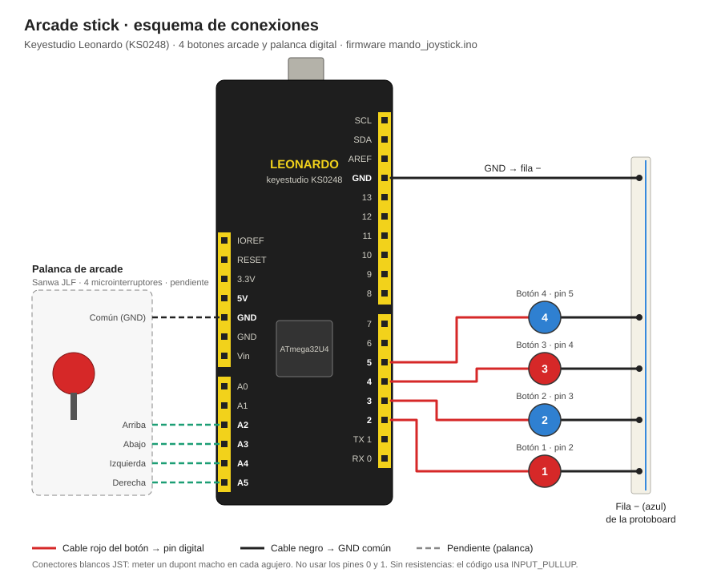

# Mando arcade (firmware HID)

Firmware del arcade stick de la recreativa para la placa **Keyestudio Leonardo (KS0248)**, compatible con Arduino Leonardo (ATmega32U4). El mando se conecta por USB como un joystick HID estándar, sin drivers. El mapeo de botones se puede cambiar por el puerto serie y se guarda en la EEPROM.

Tareas relacionadas en el [backlog](../../docs/gestion/backlog-kanban.csv): #19 (montaje), #20 (firmware), #50 (prueba en físico) y #21 (pruebas con emuladores).

## Estado

| Parte | Estado |
|---|---|
| Firmware HID (2 ejes y 4 botones) | Hecho, compila. 4 botones por indicación del profesor (26/10) |
| Palanca de arcade (4 microinterruptores) | Hecho. El 26/10 se quitan el modo analógico, la zona muerta y el modo `NINGUNA`: la palanca presupuestada es digital |
| Esquema de conexiones | [esquema-conexiones.svg](esquema-conexiones.svg), con 4 botones y la palanca (26/10) |
| Montaje (#19) | Hecho: caja con la palanca y los botones ([foto](evidencias/stick-montado-2026-10-27.webp), 27/10). La caja tiene 6 botones, pero el firmware lee 4 (pines 2 a 5): solo esos 4 llegan al PC |
| Mapeo configurable guardado en EEPROM | Hecho y probado en la placa (27/10): `MAP` + `GUARDAR` sobrevive a un reinicio |
| Comandos por puerto serie | Hecho y probado en la placa (27/10): `VER`, `MAP`, `GUARDAR` y `RESET` |
| **Prueba en la placa real** | **Hecha el 27/10** (tarea #50): botones, palanca, puerto serie y EEPROM. Ver [la prueba](#prueba-en-físico-tarea-50) |
| Pruebas con MAME y otro emulador | Hecho (tarea #21): en MAME, partida de *Gridlee* con el stick en la recreativa de 1 GB ([tarea 53](../../docs/arcade/53-recreativa-fisica/DOCUMENTACION.md), P4 y P10, 29/10); en Batocera (RetroArch), entradas comprobadas ([evtest](evidencias/batocera-evtest-2026-10-27.txt)) y partida jugada el 27/10, sin captura |

Compila con `pio run` (26/10, Flash 37,4 %, RAM 17,4 %) y funciona en la placa real desde el 27/10.

## Conexiones



Cada botón arcade trae dos cables: **rojo** y **negro**. Son las dos patas del microswitch, así que no tienen polaridad, pero se sigue este criterio para que quede ordenado:

| Elemento | Cable | Va a |
|---|---|---|
| Botón 1 (rojo) | rojo | pin 2 |
| Botón 2 (azul) | rojo | pin 3 |
| Botón 3 (rojo) | rojo | pin 4 |
| Botón 4 (azul) | rojo | pin 5 |
| Los 4 botones | negro | fila − (azul) de la protoboard |
| Fila − de la protoboard | — | GND del Leonardo |
| **Palanca de arcade** | izquierda / derecha / abajo / arriba / común (cable blanco) | A2 / A3 / A4 / A5 / GND |

- Sin resistencias: el código activa la resistencia interna de cada pin (`INPUT_PULLUP`).
- Los cables que acaban en **conector blanco JST** no entran en la placa ni en la protoboard: se mete un cable dupont macho en cada agujero del conector.
- Algunas protoboards largas tienen la fila − **cortada por la mitad**. En ese caso, todos los negros en la misma mitad o un puente entre las dos.
- No usar los pines 0 y 1 (RX/TX).
- Si un botón trae 4 patas, dos son del LED. Los cables van a las del microswitch.
- **Qué palanca:** una palanca de arcade normal (Sanwa, Zippy, Seimitsu…) **no es un potenciómetro**: son 4 microinterruptores, uno por dirección. Es la que se ha presupuestado y la única que lee el firmware. Cada microinterruptor tiene dos patas: una a su pin (A2-A5) y la otra a GND. **Ojo con el común:** en la palanca montada es el cable **blanco**; si se pincha en A2-A5 y una dirección en GND, solo funciona una dirección (pasó en la prueba del 27/10). El orden de las direcciones se ajusta en `PIN_ARRIBA`…`PIN_DERECHA` del `.ino`, sin recablear (en las Sanwa, el conector de 5 cables trae un común). Si es una palanca de 8 direcciones, las diagonales salen solas al cerrarse dos microinterruptores a la vez.
- Las palancas analógicas (de potenciómetros, como las de los mandos de consola) no están soportadas: no hacen falta para un arcade y complicaban el firmware.
- **Moneda y Start:** de los 4 botones, el 3 y el 4 se asignan en MAME a Moneda y Start, y el 1 y el 2 quedan para jugar (los juegos instalados usan como mucho 2 botones de disparo). Cómo asignarlos: [STICK-ARDUINO.md](../../docs/arcade/16-recreativa-mame/STICK-ARDUINO.md#moneda-y-start).

## Compilar y subir

### En un paso (Linux, recomendado)

Conecta la placa por USB y, desde esta carpeta:

```bash
./subir.sh
```

Compila, sube y avisa de lo que falte. La primera vez saca `arduino-cli` del AppImage del Arduino IDE que haya en
`~/Descargas` e instala el núcleo de la Leonardo y la librería Joystick. Si hace falta, aplica también el ajuste USB
`old_scheme_first` (sin él, en algunos PC no se reconoce el bootloader; pide la contraseña del usuario y se pierde al
reiniciar el PC). Con `./subir.sh monitor`, al acabar abre el monitor serie para los comandos de la sección siguiente.

Probado el 27/10/2026 en la placa real (Keyestudio Leonardo): 10 722 bytes grabados y verificados; después el PC la ve con 4 botones, la palanca en el centro y `VER` responde. Como `arduino-cli upload` a veces llega antes que el bootloader (`butterfly_recv failed`), el script reinicia la placa en modo de carga, espera a verla (USB `2341:0036`) y graba con `avrdude`. Si el usuario se acaba de añadir a `dialout`, se relanza solo con `sg dialout`.

### Arduino IDE

1. Descargar el ZIP de la librería desde <https://github.com/MHeironimus/ArduinoJoystickLibrary> (*Code → Download ZIP*). No está en el gestor de librerías.
2. *Programa → Incluir librería → Añadir biblioteca .ZIP* y elegir el ZIP.
3. Abrir [mando_joystick/mando_joystick.ino](mando_joystick/mando_joystick.ino).
4. *Herramientas → Placa → Arduino Leonardo* y el puerto `/dev/ttyACM0` (en Windows, `COMx`).
5. *Subir*. Si no encuentra la placa al subir, pulsar el botón **RESET** de la placa justo cuando aparezca "Subiendo…".

### PlatformIO

Desde esta carpeta (VS Code o CLI). Usa el mismo `.ino`:

```bash
pio run -t upload
```

La librería `mheironimus/Joystick` se descarga sola (está en [platformio.ini](platformio.ini)).

## Configuración por puerto serie

Abre el monitor serie a 9600 baudios. En el Arduino IDE, *Herramientas → Monitor serie* con el fin de línea en "Nueva línea". Con PlatformIO:

```bash
pio device monitor -b 9600
```

Los botones se numeran desde 1.

| Comando | Qué hace |
|---|---|
| `VER` | Muestra la configuración actual |
| `MAP <fisico> <hid>` | Asigna un botón físico a un botón HID (1–4). Ej.: `MAP 1 3` |
| `INV X` / `INV Y` | Invierte un eje (otra vez lo deja normal) |
| `GUARDAR` | Guarda la configuración en la EEPROM |
| `CARGAR` | Descarta los cambios y recarga la EEPROM |
| `RESET` | Vuelve a los valores por defecto (sin guardar) |

Los cambios se aplican al momento, pero se pierden al desenchufar si no se hace `GUARDAR`.

**Valores por defecto:** cada botón físico sale como el HID del mismo número (1 → 1 … 4 → 4), ejes sin invertir.

La versión de la configuración pasó a 4 al dejar 4 botones y quitar el tipo de palanca y la zona muerta (26/10): una placa con una configuración antigua guardada arranca con los valores por defecto y hay que volver a hacer los `MAP` y `GUARDAR`.

Al arrancar se lee la EEPROM. Si está vacía o los datos no son válidos (no coincide el número de control, la versión o el checksum), se usan los valores por defecto.

## Prueba guiada (Linux)

Con la placa conectada y el firmware subido:

```bash
python3 probar-stick.py
```

Sin instalar nada. Va pidiendo pulsar cada botón y mover la palanca, y comprueba lo que llega al PC
(`/dev/input/jsN`): reposo sin nada pulsado y ejes en el centro; cada botón sale con su número y se suelta;
arriba/abajo/izquierda/derecha y una diagonal llegan a tope y vuelven al centro. Después prueba por el puerto serie
`VER`, `MAP 1 3` (el botón 1 pasa a salir como el 3), `INV X` y `RESET`. No hace `GUARDAR`, para no tocar la EEPROM:
eso se prueba a mano. El resultado queda en `evidencias/prueba-stick-<fecha>.txt` (evidencia de la tarea #50).

Si la palanca aún no ha llegado, se responde "n" y esa parte se salta.

Comprobado el 26/10/2026 sin placa: se para avisando de que no ve el mando; la lectura de eventos se probó con eventos simulados.

### Ver en directo lo que llega (y dejar evidencia)

```bash
python3 ver-mando.py        # hasta Ctrl+C
python3 ver-mando.py 45     # durante 45 segundos
```

Sin instalar nada. Busca el mando por su nombre, muestra cada pulsación y dirección al momento
(`BOTÓN 1 (pin 2) pulsado`, `PALANCA ARRIBA`…) y, al acabar, guarda en `evidencias/entrada-stick-<fecha>.txt`
todo lo que llegó con un resumen: pulsaciones de cada botón, si llegan las 4 direcciones y cuántas pulsaciones
duraron menos de 30 ms. Esas son las que no hace un dedo: un cable que toca GND a ratos. Si todo está bien, termina
con `RESULTADO: todo llega bien`.

## Prueba en físico (tarea #50)

Hecha el 27/10/2026 con el stick montado (#19): primero Iker (subida, cableado de la palanca y Batocera) y después Adrian (registro de entrada y EEPROM).

| Comprobación | Resultado | Evidencia |
|---|---|---|
| Subir el firmware | ✅ `subir.sh` reinicia la placa, espera al bootloader y graba con avrdude: *10722 bytes of flash verified* | [prueba-placa](evidencias/prueba-placa-2026-10-27.txt), apartados 1 y 2 |
| El PC lo reconoce como mando | ✅ `2341:8036 Arduino Leonardo`, `/dev/input/js0`, joystick HID con 2 ejes y 4 botones | [prueba-placa](evidencias/prueba-placa-2026-10-27.txt), apartado 1 |
| Reposo | ✅ Ejes en el centro y nada pulsado | [prueba-placa](evidencias/prueba-placa-2026-10-27.txt), apartado 2 |
| Los 4 botones | ✅ Cada uno llega con su número y se suelta. Pulsaciones de 31 a 113 ms; ninguna de menos de 30 ms | [registro 1](evidencias/entrada-stick-2026-10-27-1124.txt), [registro 2](evidencias/entrada-stick-2026-10-27-1125.txt), [captura](evidencias/ver-mando-en-directo-2026-10-27.png) |
| Palanca | ✅ Arriba, abajo, izquierda y derecha, y vuelve al centro. Los pines se ajustaron en el `.ino` al cableado real | Los mismos registros; [prueba-placa](evidencias/prueba-placa-2026-10-27.txt), apartado 4 |
| Pulsaciones fantasma del botón 3 | ✅ Resuelta: Iker vio 21 en 20 s con el cable suelto. Con el montaje final, 45 s de registro (unos 35 sin tocar) sin ninguna | [registro 2](evidencias/entrada-stick-2026-10-27-1125.txt) |
| `VER` por el puerto serie | ✅ | [eeprom](evidencias/eeprom-2026-10-27.txt) |
| `MAP` + `GUARDAR` + reinicio + `VER` | ✅ `MAP 1 2` y `MAP 2 1` siguen después de reiniciar la placa (el kernel la ve pasar por el bootloader, `2341:0036`, y volver) | [eeprom](evidencias/eeprom-2026-10-27.txt) |
| `RESET` + `GUARDAR` | ✅ Vuelven los valores por defecto (la placa queda así) | [eeprom](evidencias/eeprom-2026-10-27.txt) |
| Batocera | ✅ La reconoce (`sdl2-jstest`) y `evtest` recibe los 4 botones y los ejes | [evtest](evidencias/batocera-evtest-2026-10-27.txt), [es_input.cfg](batocera/es_input.cfg) |

**Sin comprobar** (no cambian el resultado; se ven con `python3 probar-stick.py`, que los recorre):

- Que con `MAP 1 3` el botón físico 1 **llegue al PC** como botón 3. Se comprobó en `VER` y después de reiniciar, no pulsando.
- `INV X` / `INV Y` con la palanca: arriba pasa a dar abajo.

Nota: la lista original hablaba de ejes de 0 a 1023. El kernel los entrega de −32767 a 32767 (en `evtest`, de 0 a 65535), así que eso es lo que se mide.
