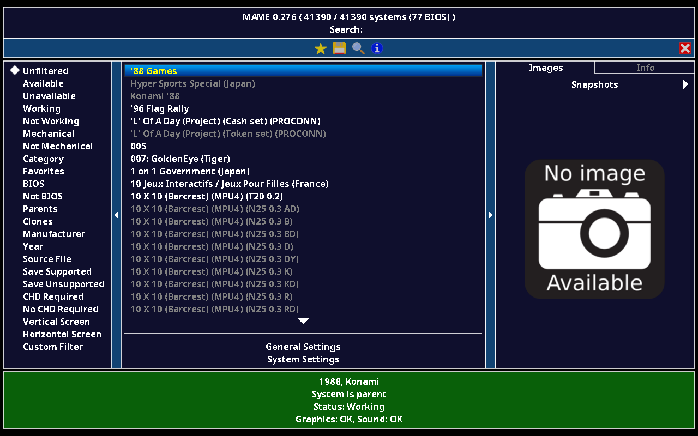
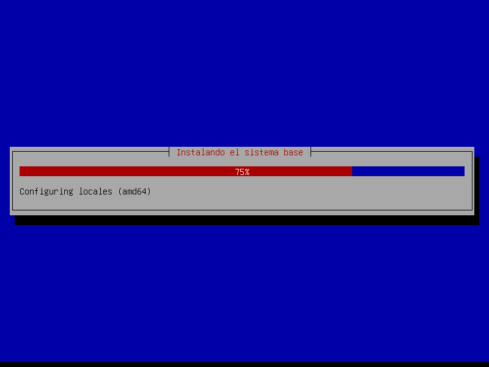
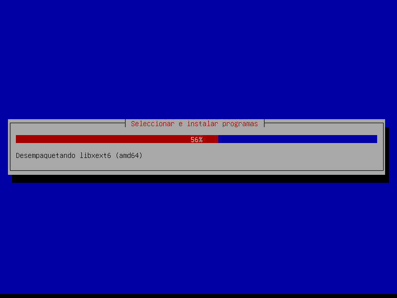
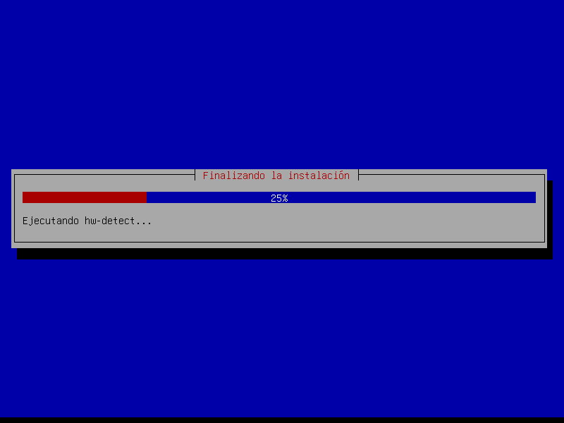
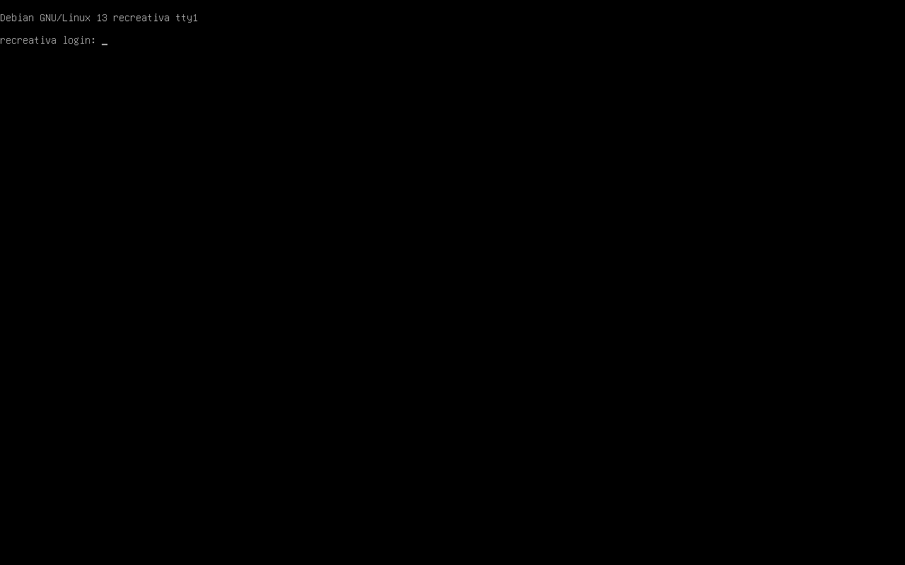
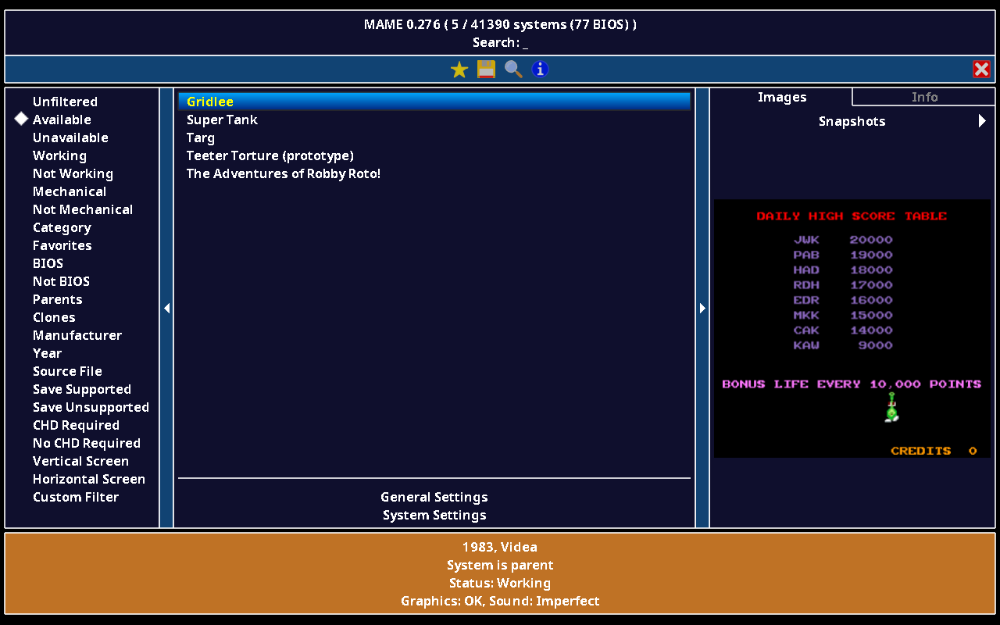
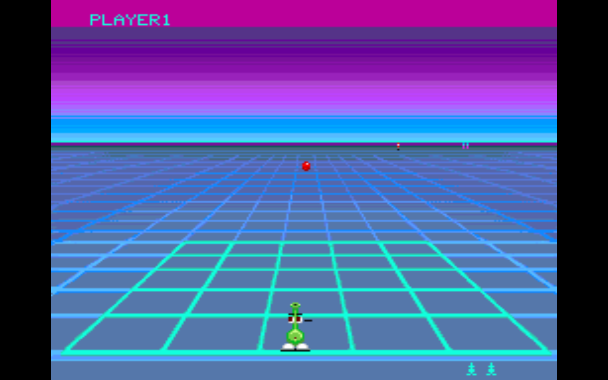
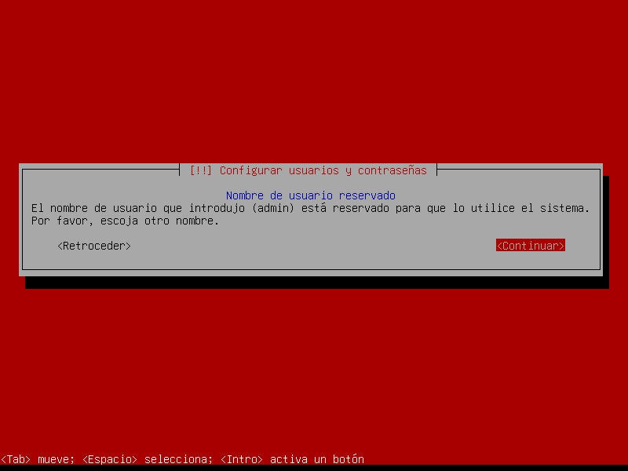

# Tarea 16 · Instalar SO ligero y MAME con arranque directo — Registro de ejecución

**Responsable:** Iker · **Revisa:** Markel · **Fecha de ejecución:** 22/10/2026
**Estado:** ✅ Hecha en máquina virtual (con 5 juegos legales funcionando) · ⏳ Pendiente: pasarla a la máquina física

## 1. Resultado

Al encender la recreativa se inicia Debian, entra solo el usuario `arcade` y se abre MAME a pantalla completa en **4,7 s**,
sin pedir contraseña y sin escritorio.



## 2. Entorno de pruebas

| Elemento | Valor |
|---|---|
| Virtualizador | VirtualBox 7.0.16 |
| Máquina virtual | `Recreativa`: 2 CPU, 1,5 GB RAM, disco de 20 GB, VMSVGA |
| Red | NAT con reenvío de puertos `127.0.0.1:2222 → 22` (SSH) |
| Sistema operativo | Debian 13.7 "Trixie", kernel 6.12.113 |
| Emulador | MAME 0.276 (repositorio oficial de Debian) |

## 3. Archivos de la tarea

| Archivo | Para qué sirve |
|---|---|
| [`preseed-recreativa.cfg`](preseed-recreativa.cfg) | Respuestas automáticas al instalador de Debian. Instala el sistema sin intervención y siempre igual. |
| [`instalar-arcade.sh`](instalar-arcade.sh) | Convierte el Debian recién instalado en recreativa. Es idempotente: se puede ejecutar varias veces. |
| [`README.md`](README.md) | Guía para hacerlo a mano, paso a paso. |
| [`evidencias/`](evidencias/) | Capturas, logs y medidas. |

## 4. Pasos realizados

### 4.1 Crear la máquina virtual
```bash
VBoxManage createvm --name Recreativa --ostype Debian_64 --register
VBoxManage modifyvm Recreativa --memory 1536 --cpus 2 --vram 128 --graphicscontroller vmsvga \
  --nic1 nat --natpf1 "ssh,tcp,127.0.0.1,2222,,22"
VBoxManage createmedium disk --filename Recreativa.vdi --size 20480
VBoxManage storagectl Recreativa --name SATA --add sata
VBoxManage storageattach Recreativa --storagectl SATA --port 0 --type hdd --medium Recreativa.vdi
VBoxManage storageattach Recreativa --storagectl SATA --port 1 --type dvddrive --medium emptydrive
```

### 4.2 Instalar Debian 13 sin intervención (≈6 min)
```bash
VBoxManage unattended install Recreativa --iso=debian-13.7.0-amd64-netinst.iso \
  --user=tecnico --password-file=.credenciales-vm \
  --script-template=preseed-recreativa.cfg --start-vm=headless
```
Decisiones del preseed, que son las mismas que se tomarían a mano:

| Decisión | Motivo |
|---|---|
| Sin contraseña de root | El usuario `tecnico` recibe `sudo`, y la cuenta root no se puede usar para entrar. |
| Programas: solo **utilidades estándar + servidor SSH** | Sin escritorio. Debian recién instalado ocupa 1,2 GB de disco y usa 206 MB de RAM. |
| Clave SSH en `/home/tecnico/.ssh/authorized_keys` | Administrar en remoto sin contraseña. |
| Particionado guiado, una sola partición | Es una máquina dedicada y no necesita más. |

| | |
|---|---|
|  |  |
|  |  |

### 4.3 Configurar la recreativa
```bash
scp -P 2222 instalar-arcade.sh tecnico@127.0.0.1:
ssh -p 2222 tecnico@127.0.0.1 'sudo ./instalar-arcade.sh'
```
El script hace lo siguiente (log completo en [`evidencias/salida-instalar-arcade.log`](evidencias/salida-instalar-arcade.log)):
1. Instala MAME, el servidor X mínimo (sin gestor de ventanas), los drivers Mesa y ALSA.
2. Crea el usuario `arcade`: sin sudo, con la contraseña bloqueada y solo en los grupos `audio`, `video` e `input`.
3. Configura el autologin de `arcade` en tty1 (override de `getty@tty1`) y cambia el arranque a `multi-user.target`.
4. Crea `.bash_profile`, que lanza `startx`, y `.xinitrc`, que ejecuta MAME en bucle (si se cierra, se vuelve a abrir).
5. Configura GRUB con `GRUB_TIMEOUT=0` y `quiet loglevel=3`.
6. Comprueba que todo ha quedado bien.

Salida de la comprobación:
```
Versión de MAME: 0.276 (unknown)
Usuario: uid=1001(arcade) gid=1001(arcade) grupos=1001(arcade),29(audio),44(video),996(input)
Destino de arranque: multi-user.target
```

### 4.4 Verificar el arranque directo
```bash
ssh -p 2222 tecnico@127.0.0.1 'sudo systemctl reboot'
```
A los 17 s SSH vuelve a responder, y en pantalla aparece el menú de MAME sin tocar nada. Procesos de `arcade`:
```
734 /usr/lib/xorg/Xorg :0 -nocursor vt1 -keeptty ...
745 /usr/games/mame -rompath /home/arcade/roms -skip_gameinfo
```

### 4.5 Instalar ROMs legales
Se usan solo las ROMs que los propietarios de los derechos han cedido para uso no comercial y que publica el equipo de MAME en
<https://www.mamedev.org/roms/>. Como el 22/10/2026 la web estaba caída, se descargaron los mismos ficheros desde la copia
de esa página guardada en el Internet Archive:
```bash
for j in gridlee robby supertnk targ teetert; do
  wget -O $j.zip "https://web.archive.org/web/2026id_/https://www.mamedev.org/roms/$j/$j.zip"
done
sudo cp *.zip /home/arcade/roms/ && sudo chown arcade:arcade /home/arcade/roms/*.zip
sudo -u arcade /usr/games/mame -rompath /home/arcade/roms -verifyroms gridlee robby supertnk targ teetert
```
```
romset gridlee is good
romset robby is good
romset supertnk is good
romset targ is good
romset teetert is good
5 romsets found, 5 were OK.
```
El menú de MAME se configura con el filtro **Available** (`~/.mame/ui.ini`) para mostrar solo los juegos instalados:



### 4.6 Preparar la recreativa para el arcade stick de Arduino
Detalles en [`STICK-ARDUINO.md`](STICK-ARDUINO.md) y firmware en [`../arcade-stick/`](../arcade-stick/).
- MAME tiene los mandos activados y el usuario `arcade` está en el grupo `input`.
- Un mando virtual con la identidad USB del Arduino Leonardo (VID 2341 / PID 8036) fue detectado por MAME (`Input: Adding joystick #1: LLC Arduino Leonardo`).
- En los menús, **Botón 1** y **Start** también sirven para elegir (`~/.mame/cfg/default.cfg`).
- La VM tiene el USB activado (OHCI) y filtros para pasarle automáticamente las placas con VID `2341` (Arduino) y `1B4F` (SparkFun).
- Partida completa jugada simulando el stick con el firmware: menú → juego → moneda → start → jugar.



## 5. Medidas (punto de partida para la tarea 17)

| Medida | Debian limpio | Con recreativa configurada |
|---|---|---|
| Arranque (`systemd-analyze`) | 6,398 s | **4,670 s** |
| Destino alcanzado | `graphical.target` en 3,612 s | `multi-user.target` en 2,248 s |
| RAM usada (`free -h`) | 206 MB | 406 MB (con Xorg + MAME abiertos) |
| Disco usado | 1,2 GB | — |

Arrancar a `multi-user.target` y quitar la espera de GRUB ya ahorra **1,7 s** (un 27 %).

Rendimiento de MAME (`mame -bench 60 <juego>`; 100 % = velocidad real de la máquina original):

| Juego | Velocidad media |
|---|---|
| Gridlee | 1535,43 % |
| The Adventures of Robby Roto! | 992,35 % |

La máquina virtual va sobrada: emula los juegos entre 10 y 15 veces más rápido de lo necesario.
Fichero: [`benchmark-mame-antes.txt`](evidencias/benchmark-mame-antes.txt).
Ficheros: [`arranque-debian-limpio.txt`](evidencias/arranque-debian-limpio.txt), [`arranque-con-mame.txt`](evidencias/arranque-con-mame.txt).

## 6. Seguridad aplicada (mínimos privilegios)
- `arcade` **no** pertenece a `sudo` y su contraseña está bloqueada (`passwd -l`). Solo puede entrar por el autologin de tty1.
- Las carpetas personales tienen permisos 700. `tecnico` no puede leer `/home/arcade` (comprobado: "Permiso denegado").
- La administración se hace desde `tecnico` en tty2 (`Ctrl+Alt+F2`) o por SSH con clave.
- No hay entorno de escritorio: el jugador solo tiene acceso a MAME.

## 7. Incidencias y soluciones

| # | Incidencia | Causa | Solución |
|---|---|---|---|
| 1 | El instalador se paró con "Nombre de usuario reservado" | Debian 13 reserva `admin` | Usar `tecnico` como administrador. Corregido en el preseed y en el README.  |
| 2 | La comprobación del script decía "MAME NO INSTALADO" aunque sí lo estaba | Debian instala MAME en `/usr/games`, que no está en el PATH de `sudo` | Usar la ruta completa `/usr/games/mame` en el script y en `.xinitrc` |
| 3 | No se podían descargar las ROMs | `www.mamedev.org` rechazaba las conexiones el 22/10/2026 (puertos 80 y 443) | Descargar los mismos ficheros oficiales desde la copia de la página en el Internet Archive. No se usan ROMs de fuentes no oficiales. |
| 4 | Al elegir un juego salía "Required ROM/disk images … are missing" | El menú enseña los 41.390 sistemas que MAME sabe emular, aunque no estén instalados | Instalar las ROMs y poner por defecto el filtro **Available** en `ui.ini`. Añadido al script. |
| 5 | "No funciona con el teclado" | Las teclas enviadas a la VM con pulsación instantánea (sin mantenerlas) no las detecta MAME, que lee el estado de las teclas una vez por fotograma. Además, la ventana de VirtualBox tiene que tener el foco (hacer clic dentro). | Con pulsaciones normales (≥ 1 fotograma) funciona: menú, moneda, start y movimiento comprobados. El firmware usa un antirrebote de 10 ms y mantiene la tecla pulsada mientras se pulsa el botón. |
| 6 | VirtualBox no puede pasar USB a la VM | El usuario del anfitrión no está en el grupo `vboxusers` | `sudo usermod -aG vboxusers $USER` y volver a iniciar sesión (lo tiene que hacer el propietario del PC). |

## 8. Pendiente
- [x] Jugar una partida (comprobado con teclado y con el stick simulado).
- [ ] Añadir el usuario del PC a `vboxusers` y probar con el stick real (tabla de pruebas de `STICK-ARDUINO.md`).
- [ ] Repetir la instalación en la máquina física (mismo preseed y mismo script).
- [ ] Revisión de Markel → mover a **Hecho** en el Kanban.
