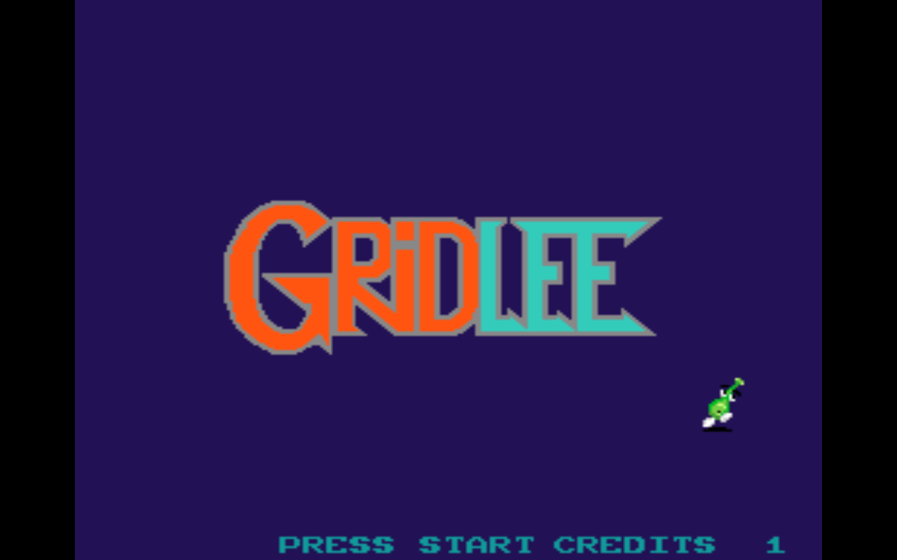
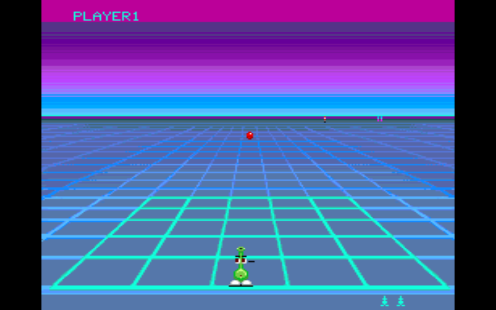

# Recreativa + arcade stick de Arduino

Qué tiene que cumplir el stick (tareas 19, 20 y 21) para funcionar con la recreativa (tarea 16).

## Lo que ya está comprobado
Se creó en la VM un mando virtual con la misma identidad USB que un **Arduino Leonardo / Pro Micro (ATmega32U4, VID 2341 / PID 8036)**,
y MAME lo detectó sin configurar nada ([`evidencias/prueba-stick-virtual.txt`](evidencias/prueba-stick-virtual.txt)):

```
Input: Adding joystick #1: LLC Arduino Leonardo (device id: 0300cb9d412300003680000001000000)
Game Controller: Got SDL joystick added event for reconnected game controller LLC Arduino Leonardo
```

- MAME tiene los mandos activados (`joystick 1`, zona muerta 0,15).
- El usuario `arcade` pertenece al grupo `input`, así que puede leer `/dev/input/event*`.
- MAME detecta el mando aunque se enchufe con MAME ya abierto.

## Cómo tiene que comportarse el firmware (tarea 20)

### ✅ Opción recomendada: el stick se presenta como **teclado USB** con las teclas por defecto de MAME
Funciona **sin configurar nada** en MAME y también en cualquier otro emulador (útil para la tarea 21).
En el Arduino se hace con la librería `Keyboard.h` (`Keyboard.press()` / `Keyboard.release()`).

| Control del stick | Tecla que envía | Acción en MAME |
|---|---|---|
| Palanca arriba / abajo / izquierda / derecha | `↑` `↓` `←` `→` | Mover (jugador 1) |
| Botón 1 | `Ctrl izquierdo` | Botón 1 |
| Botón 2 | `Alt izquierdo` | Botón 2 |
| Botón 3 | `Espacio` | Botón 3 |
| Botón 4 | `Shift izquierdo` | Botón 4 |
| Botón 5 | `Z` | Botón 5 |
| Botón 6 | `X` | Botón 6 |
| **Moneda** | `5` | Insertar crédito |
| **Start** | `1` | Empezar partida (1 jugador) |
| Salir (opcional) | `Esc` | Volver al menú de juegos |

En los menús de MAME, **Botón 1 (Ctrl)** y **Start (1)** también sirven para elegir, además de `Enter`.
Lo configura `instalar-arcade.sh` en `/home/arcade/.mame/cfg/default.cfg` (puerto `UI_SELECT`).

**Firmware ya hecho y compilado:** [`arduino/mando-joystick/mando_joystick/mando_joystick.ino`](../../../arduino/mando-joystick/mando_joystick/mando_joystick.ino) (cableado y uso en [`arduino/mando-joystick/README.md`](../../../arduino/mando-joystick/README.md)).

El "mapeo configurable en EEPROM" de la tarea 20 consiste en guardar en la EEPROM qué tecla manda cada botón,
para poder cambiarlas sin volver a programar el Arduino.

### Opción B: el stick se presenta como **mando (gamepad HID)**
Por ejemplo con la *ArduinoJoystickLibrary*. MAME lo detecta (ver la prueba), pero:
- La palanca y los botones 1–6 se asignan solos.
- **Moneda y Start no siempre**: hay que asignarlos una vez en MAME (`Tab` → *Input Settings* → *Input Assignments (general)* → *Player 1 Controls* / *Other Controls*).
  MAME lo guarda en `/home/arcade/.mame/cfg/default.cfg`. Ese fichero se copia al repo y el script de instalación lo puede restaurar.

## Conectarlo a la máquina virtual
1. **En el PC anfitrión** (solo una vez), da permiso a VirtualBox para usar USB y **cierra sesión y vuelve a entrar**:
   ```bash
   sudo usermod -aG vboxusers $USER
   ```
2. La VM `Recreativa` ya tiene el controlador USB activado y dos **filtros** que pasan el stick a la VM automáticamente:
   - `Arduino (VID 2341)`: Leonardo, Micro y placas oficiales.
   - `SparkFun Pro Micro (VID 1B4F)`: clones Pro Micro.
   Si vuestra placa tiene otro VID, mirad cuál es con `lsusb` en el anfitrión y añadid el filtro en *Configuración → USB*.
3. Enchufa el stick con la VM encendida. Dentro de la VM, compruébalo así:
   ```bash
   cat /proc/bus/input/devices | grep -A4 -i arduino
   ```

> ⚠️ Mientras el stick esté pasado a la VM, el anfitrión no lo ve. Para reprogramarlo desde el Arduino IDE,
> quítalo en la ventana de la VM (*Dispositivos → USB*) o apaga la VM.

En la **máquina física** no hace falta nada de esto: se enchufa por USB y listo.

## Prueba simulada (22/10/2026)
Dentro de la VM se creó un teclado virtual con la identidad USB del Arduino Leonardo, que manda las mismas teclas que el firmware
(`stick_teclado.py`, con `python3-evdev`). Secuencia: Salir → Botón 1 (elige Gridlee) → Botón 1 (quita el aviso) → Moneda → Start → Palanca → Botón 1.
Resultado: **la partida empieza y el personaje se mueve y dispara**.

| Moneda → `CREDITS 1` | Partida con el stick simulado |
|---|---|
|  |  |

## Prueba de aceptación (para la tabla de pruebas, tarea 47)
| # | Prueba | Resultado esperado |
|---|---|---|
| 1 | Encender la recreativa con el stick enchufado | MAME aparece sin tocar el teclado |
| 2 | Mover la palanca en el menú | La selección se mueve |
| 3 | Elegir Gridlee con el stick | El juego arranca |
| 4 | Pulsar Moneda y luego Start | Aparece `CREDITS 1` y empieza la partida |
| 5 | Jugar con la palanca y el botón 1 | El personaje se mueve y dispara |
| 6 | Desenchufar y volver a enchufar el stick en mitad de la partida | Sigue funcionando |
