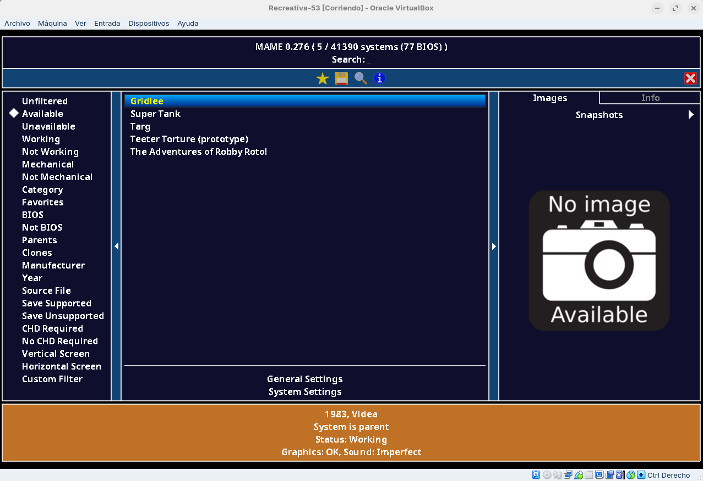

# Tarea 53 · Recreativa de 1 núcleo y 1 GB con el stick — Registro de ejecución

**Responsable:** Eneko.S · **Fecha de ejecución:** 29/10/2026 · **Depende de:** tareas 16 (recreativa en VM), 51 (decisión: Debian 13 + MAME) y 50 (stick probado en la placa)
**Estado:** ✅ Hecha en una VM de VirtualBox con **1 núcleo y 1 GB**, los recursos del enunciado, y probada **con el stick real**. Decisión del equipo (29/10): la recreativa se entrega en VM, no en un equipo físico.

## 1. Resultado

Al encender `Recreativa-53`, Debian entra solo con el usuario `arcade` y abre MAME a pantalla completa, sin pedir contraseña y sin escritorio. Aparecen los 5 juegos legales y se juega con el **stick de Arduino** (palanca y botones) pasado a la VM por USB. Si se sale de MAME, vuelve a abrirse solo.



## 2. Entorno

| Elemento | Valor |
|---|---|
| Anfitrión | PC de Eneko.S con Ubuntu y VirtualBox |
| Máquina virtual | `Recreativa-53`: **1 CPU, 1024 MB de RAM**, disco de 20 GB, VMSVGA, controlador USB OHCI |
| Red | NAT con reenvío `127.0.0.1:2223 → 22` (SSH). El 2223 para no chocar con la VM de la tarea 16 (2222) |
| USB | Filtro para el vendedor `2341` (Arduino): el stick pasa solo a la VM |
| Sistema | Debian 13.7, kernel 6.12.113+deb13-amd64 |
| Emulador | MAME 0.276 (repositorio de Debian) |
| Mando | Stick de las tareas 19, 20 y 50 (Arduino Leonardo, `2341:8036`) |

**Por qué una VM nueva y no `Recreativa-1GB`.** La VM de 1 núcleo y 1 GB de las tareas 17 y 51 existe, pero no se conoce la contraseña de `tecnico` (tarea 17). `Recreativa-53` se ha instalado desde cero con el mismo preseed y el mismo script, con una contraseña nueva que se guarda en el KeePassXC del proyecto, así que sirve también para terminar las medidas de las tareas 17, 18 y 54.

## 3. Pasos realizados

Todo desde la terminal del anfitrión. Los ficheros son los mismos de la [tarea 16](../16-recreativa-mame/DOCUMENTACION.md).

### 3.1 Preseed con la clave SSH y contraseña de `tecnico`

```bash
cd docs/arcade/16-recreativa-mame
sed "s|CLAVE_PUBLICA_SSH|$(cat ~/.ssh/id_ed25519.pub)|" preseed-recreativa.cfg > ~/preseed-vm.cfg
read -rsp "Contraseña de tecnico: " P; echo; printf '%s' "$P" > ~/.credenciales-vm; chmod 600 ~/.credenciales-vm; unset P
```

La contraseña se genera en KeePassXC y no se escribe en ningún fichero del repositorio. `~/.credenciales-vm` se borra al terminar (sección 7).

### 3.2 Crear la VM e instalar Debian sin intervención (≈15 min)

```bash
VM=Recreativa-53
VBoxManage createvm --name $VM --ostype Debian_64 --register
VBoxManage modifyvm $VM --cpus 1 --memory 1024 --vram 128 --graphicscontroller vmsvga \
  --nic1 nat --natpf1 "ssh,tcp,127.0.0.1,2223,,22" --usbohci on
VBoxManage createmedium disk --filename "$HOME/VirtualBox VMs/$VM/$VM.vdi" --size 20480
VBoxManage storagectl $VM --name SATA --add sata
VBoxManage storageattach $VM --storagectl SATA --port 0 --type hdd --medium "$HOME/VirtualBox VMs/$VM/$VM.vdi"
VBoxManage storageattach $VM --storagectl SATA --port 1 --type dvddrive --medium emptydrive
VBoxManage usbfilter add 0 --target $VM --name Arduino --vendorid 2341

# ISO netinst actual de Debian, comprobada con su SHA256
URL=https://cdimage.debian.org/debian-cd/current/amd64/iso-cd
ISO=$(wget -qO- $URL/SHA256SUMS | grep -o 'debian-[0-9.]*-amd64-netinst.iso' | head -1)
wget -c "$URL/$ISO" && wget -qO- $URL/SHA256SUMS | grep " $ISO\$" | sha256sum -c

VBoxManage unattended install $VM --iso="$PWD/$ISO" --user=tecnico --password-file="$HOME/.credenciales-vm" \
  --script-template="$HOME/preseed-vm.cfg" --start-vm=gui
```

La instalación termina sola en el `login:` de Debian. Los avisos `systemd-ssh-generator: Failed to query local AF_VSOCK CID` que salen en la consola son normales en VirtualBox y no afectan.

### 3.3 Convertirla en recreativa y copiar los juegos

```bash
scp -P 2223 docs/arcade/16-recreativa-mame/instalar-arcade.sh tecnico@127.0.0.1:
scp -P 2223 roms/*.zip tecnico@127.0.0.1:          # las 5 ROMs legales de la tarea 16, apartado 4.5
ssh -t -p 2223 tecnico@127.0.0.1 'chmod +x instalar-arcade.sh && sudo ./instalar-arcade.sh 2>&1 | tee salida-instalar-arcade.log'
ssh -t -p 2223 tecnico@127.0.0.1 'sudo sh -c "cp /home/tecnico/*.zip /home/arcade/roms/ && chown arcade:arcade /home/arcade/roms/*.zip" \
  && sudo -u arcade /usr/games/mame -rompath /home/arcade/roms -verifyroms gridlee robby supertnk targ teetert && sudo reboot'
```

Resultado: `5 romsets found, 5 were OK`. Al reiniciar, la VM abre MAME sola. Log del script: [`03-salida-instalar-arcade.log`](evidencias/03-salida-instalar-arcade.log).

### 3.4 Stick

Con el stick enchufado al anfitrión, el filtro USB lo pasa a la VM (el usuario del anfitrión tiene que estar en el grupo `vboxusers`). Moneda y Start se asignan una vez a los botones 3 y 4 en MAME (`Tab` → *Input Settings* → *Input Assignments (general)* → *Other Controls*), como explica [STICK-ARDUINO.md](../16-recreativa-mame/STICK-ARDUINO.md). Con el teclado, la moneda es `5` y Start es `1`.

## 4. Comprobaciones (29/10/2026)

Salidas completas: [`06-comprobaciones.txt`](evidencias/06-comprobaciones.txt) y [`06b-stick.txt`](evidencias/06b-stick.txt).

| # | Prueba | Cómo | Esperado | Resultado |
|---|---|---|---|---|
| P1 | Arranque directo | *Máquina → Reiniciar* y cronómetro hasta el menú de MAME | MAME sin tocar nada ni pedir contraseña | ✅ Entre 20 y 30 s cronometrados a mano, desde el reinicio de VirtualBox (incluye firmware y GRUB) |
| P2 | Tiempos de arranque del sistema | `systemd-analyze` | Apuntar | ✅ 14,4 s: 11,5 s de kernel y 2,9 s de espacio de usuario (primer arranque tras instalar) |
| P3 | Recursos | `nproc` y `free -m` | 1 núcleo y ≈1 GB | ✅ 1 núcleo y 967 MB. Con MAME abierto en el menú: 443 MB usados, 524 MB disponibles y 0 de swap |
| P4 | Juegos | Menú de MAME y una partida | Los 5 juegos; se juega | ✅ Los 5 juegos; partida de *Gridlee* jugada con el stick ([captura](evidencias/07-partida-stick.png)) |
| P5 | MAME se vuelve a abrir | Salir de MAME (`Esc` en el menú) | Se abre de nuevo solo | ✅ El jugador no puede quedarse en el sistema |
| P6 | `arcade` sin privilegios | `sudo -l -U arcade` y `passwd -S arcade` | Sin `sudo`; contraseña bloqueada | ✅ `User arcade is not allowed to run sudo`; estado `L` |
| P7 | Carpeta privada | `ls /home/arcade` como `tecnico` | Denegado | ✅ `Permiso denegado` |
| P8 | SSH solo con clave | `sshd -T` | Sin contraseña ni root | ✅ `passwordauthentication no`, `kbdinteractiveauthentication no`, `permitrootlogin no` |
| P9 | GRUB sin espera | `/etc/default/grub` | `GRUB_TIMEOUT=0` | ✅ |
| P10 | Stick en la VM | `lsusb` en el anfitrión y `/proc/bus/input/devices` en la VM | Se detecta | ✅ Anfitrión: `2341:8036 Arduino SA Leonardo`; VM: `Arduino LLC Arduino Leonardo` |
| P11 | Red de invitados | — | — | No aplica en VM: la VM usa NAT. La conexión a la Wi-Fi de invitados se documenta en la [tarea 16, sección 6](../16-recreativa-mame/DOCUMENTACION.md#6-conexión-a-la-wi-fi-de-invitados) para un equipo físico |
| P12 | Aislamiento de la LAN | — | — | No aplica en VM, por lo mismo. El aislamiento de la red de invitados se prueba en las tareas 24, 25 y 26 |

**Comparación con la VM de la tarea 16** (2 núcleos y 1,5 GB): allí MAME se abría a los 4,7 s del arranque y usaba 425 MB de RAM con el menú. Con 1 núcleo y 1 GB el sistema tarda más en arrancar, pero MAME funciona y deja más de la mitad de la memoria libre. Las medidas comparables, con reinicios repetidos y `mame -bench`, son las de la tarea 54.

## 5. Evidencias (en `evidencias/`)

| Fichero | Qué |
|---|---|
| [`03-salida-instalar-arcade.log`](evidencias/03-salida-instalar-arcade.log) | Salida de `instalar-arcade.sh` |
| [`05-arranque-directo.png`](evidencias/05-arranque-directo.png) | Menú de MAME con los 5 juegos tras arrancar |
| [`06-comprobaciones.txt`](evidencias/06-comprobaciones.txt) | P2, P3 y P6 a P9, y versiones |
| [`06b-stick.txt`](evidencias/06b-stick.txt) | P10: el stick dentro de la VM |
| [`07-partida-stick.png`](evidencias/07-partida-stick.png) | Partida de *Gridlee* con el stick |

## 6. Incidencias

| # | Incidencia | Causa | Solución |
|---|---|---|---|
| 1 | `VBoxManage unattended` no encontraba la ISO | El nombre de la ISO de Debian cambia con cada versión | Descargar la *netinst* actual leyendo su nombre de `SHA256SUMS` y comprobarla con `sha256sum -c` (sección 3.2) |
| 2 | `chown: no se puede acceder a '/home/arcade/roms/*.zip'` | `/home/arcade` tiene permisos 700 (tarea 16, sección 7): la shell de `tecnico` no puede expandir el `*` dentro de esa carpeta | Hacer la copia y el `chown` dentro de `sudo sh -c "…"`, para que el `*` lo expanda root |
| 3 | P10 vacía la primera vez | El stick no estaba enchufado | Enchufarlo; el filtro USB lo pasa solo a la VM |
| 4 | El primer `Esc` volvía al menú de MAME | Es el comportamiento de MAME: `Esc` sale del juego al menú | Un segundo `Esc` en el menú cierra MAME, que se vuelve a abrir solo (P5) |

## 7. Seguridad

- `arcade` sin `sudo`, con la contraseña bloqueada y la carpeta privada (P6, P7). El jugador solo tiene MAME (P5).
- SSH solo con clave, sin contraseña ni root (P8). La única clave instalada es la del equipo de administración.
- La contraseña de `tecnico` va al KeePassXC del proyecto, nunca a un fichero de texto. `~/.credenciales-vm` y `~/preseed-vm.cfg` no están en el repositorio y se borran del anfitrión al terminar.

## 8. Pendiente

- [ ] Comprobar que la contraseña de `tecnico` está en el KeePassXC del proyecto y borrar `~/preseed-vm.cfg` del anfitrión.
- [ ] Compartir la contraseña de `tecnico` de `Recreativa-53` (KeePassXC) con Eneko.P para las medidas de las tareas 17 y 18.
- [ ] Tarea 54: medidas antes y después en `Recreativa-53`.
- [x] Tarea 21: con MAME funciona (P4 y P10); en Batocera, entradas comprobadas por Iker y partida jugada el 27/10 (sin captura).

## Anexo: si hubiera que instalarla en un equipo físico

El procedimiento es el mismo con dos cambios: el preseed se genera con [`preparar-preseed-fisico.sh`](preparar-preseed-fisico.sh), que guarda la contraseña de `tecnico` como hash SHA-512 y permite elegir el disco (`bash preparar-preseed-fisico.sh /dev/nvme0n1`), y se sirve al instalador desde un portátil (`python3 -m http.server 8000`; en el menú del instalador, *Advanced options → Automated install* y la URL `http://IP_DEL_PORTATIL:8000/preseed-local.cfg`). Los scripts y las ROMs se copian con un USB. Si el equipo tuviera más de 1 núcleo o 1 GB, se puede limitar con `maxcpus=1 mem=1024M` en `GRUB_CMDLINE_LINUX`.
