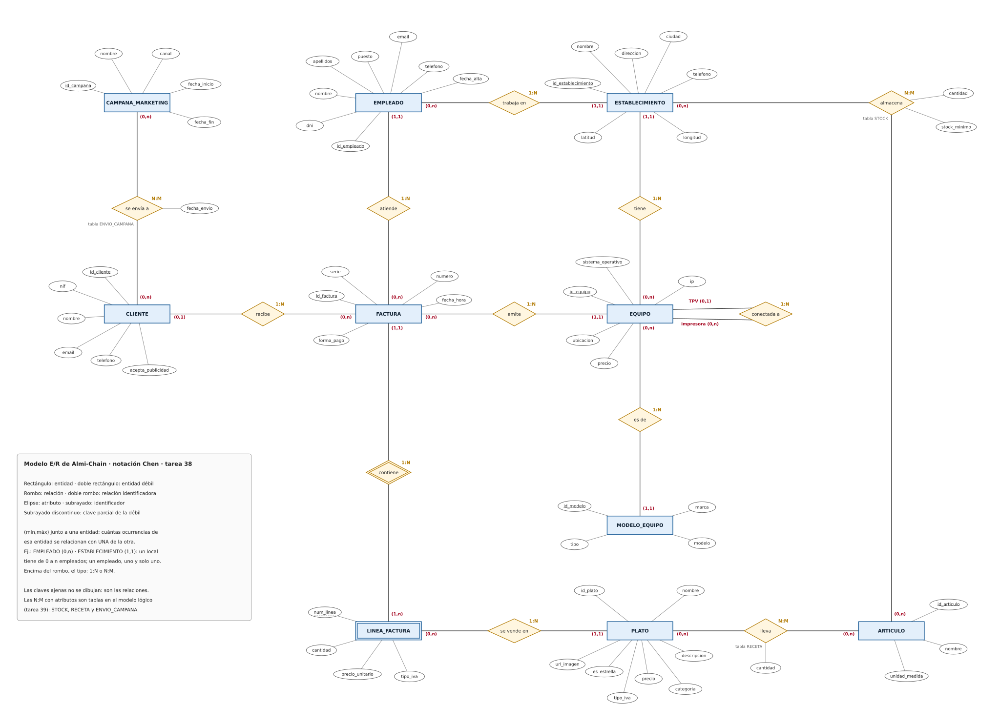

# Modelo E/R — Base de datos de establecimiento (Almi-Chain)

- **Bloque:** 8 BD
- **Responsable:** Adrian
- **Reto:** Almi-Chain (ASIR1 2026-27)
- **Estado:** hecha. 30/10: diagrama pasado a **notación Chen**, la que se da en clase (sección 2). 04/11: ampliado en la tarea 56 (Eneko.S) con una relación ternaria, un historial y atributos especiales (sección 6)
- **Fecha:** 23/10/2026
- **Fuente:** `Reto_1_ASIR1_2026-2027.docx`

> **Versión revisada.** Se han aplicado los cambios C-01 a C-04 acordados al normalizar el modelo en la tarea #39 (3FN). Están resumidos en la sección 5.

## 1. Qué dice el enunciado sobre la BD

El documento **no trae un enunciado de BD propio** (no hay lista de datos, atributos ni reglas de negocio).
Lo que hay sobre la base de datos es esto:

| Ubicación en el documento | Texto |
|---|---|
| «El reto», párrafo 5 | «Por último, quieren diseñar las bases de datos que habrá en cada establecimiento. Esta BD se almacenará en un dispositivo redundante…» |
| «Tareas a realizar», punto 14 | «Diseño del modelo E/R y tablas de la base de datos.» |
| «Tareas a realizar», punto 15 | «Implementación de la base de datos y consulta de sus datos.» |
| Resultados de aprendizaje, Gestión de BD, RA.2 | «Diseña modelos lógicos normalizados interpretando diagramas entidad/relación.» |

Por tanto, el **dominio** de la BD se deduce del resto del enunciado: qué es la empresa, qué gestiona y qué hay en cada local.
Abajo se indica para cada elemento si sale **literal** del texto (📄) o es una **decisión de diseño** del equipo (🛠).

Referencias usadas:

- **R1** = «El reto», párrafo 1 («Una cadena de restaurantes nos ha contratado…»)
- **R2** = «El reto», párrafo 2 («El gerente necesita, para su despacho…»)
- **R3** = «El reto», párrafo 3 («Quieren utilizar otro equipo como máquina recreativa…»)
- **R5** = «El reto», párrafo 5 («La empresa, que se quiere dar a conocer…»)
- **T*n*** = «Tareas a realizar», punto *n*

### 1.1 Una base central para toda la cadena

El enunciado habla de «las bases de datos que habrá en cada establecimiento». Hay dos formas de leerlo, y el modelo tiene que ser coherente con una de ellas:

| | Una base por local | **Una base central (elegida)** |
|---|---|---|
| ESTABLECIMIENTO | Tendría una sola fila (el propio local): sobra | Una fila por local |
| Clientes, platos, campañas | Se repiten en cada local y se desincronizan | Comunes a la cadena: se dan de alta una vez |
| STOCK, empleados, equipos, facturas | De ese local | De cada local, separados por `id_establecimiento` |
| Informes de la cadena (ventas por local, platos más vendidos) | Hay que juntar varias bases | Una consulta (consultas C-03 y C-04 de [`07-consultas.sql`](scripts/07-consultas.sql), tarea 41; no confundir con los cambios C-03 y C-04 de la sección 5) |

**Decisión:** el modelo es el de una **base central** de la cadena, que guarda los datos de **cada establecimiento** separados por la clave `id_establecimiento` (por eso existen ESTABLECIMIENTO y STOCK por local). Así se cumple la frase del enunciado («los datos de cada establecimiento») sin repetir la carta ni los clientes. Mientras la cadena sea el local piloto, la base está en el servidor de ese local, en el mismo PostgreSQL que Odoo y sobre el RAID (tareas 40 y 43). Si se abren más locales, se movería a un servidor central o a la nube, con acceso por VPN desde cada local.

Si el profesor entiende el enunciado como «una base distinta en cada local», el cambio es pequeño: quitar ESTABLECIMIENTO y las claves `id_establecimiento`, y cargar en cada local solo sus datos.

## 2. Diagrama

### 2.1 Notación Chen

Fuentes: [`38-modelo-er-chen.drawio`](38-modelo-er-chen.drawio) (para abrirlo y retocarlo en draw.io) y [`38-modelo-er-chen.svg`](38-modelo-er-chen.svg). Los dos se generan con `python3 scripts/bd/er-chen.py`, que tiene las entidades, atributos, relaciones y cardinalidades en un solo sitio: si cambia el modelo, se cambia el script y se vuelven a generar.

Cómo leerlo (también está en la leyenda del diagrama):

| Símbolo | Significado |
|---|---|
| Rectángulo | Entidad |
| Doble rectángulo y doble rombo | Entidad débil (`LINEA_FACTURA`) y su relación identificadora (`contiene`): una línea no existe sin su factura y se identifica por `id_factura` + `num_linea` |
| Rombo | Relación, con su tipo (1:N, N:M o N:M:P) al lado |
| Rombo con tres líneas | Relación ternaria (*suministra*: PROVEEDOR, ARTICULO y ESTABLECIMIENTO) |
| Elipse | Atributo; subrayado, identificador; subrayado discontinuo, clave parcial de la débil (`num_linea`, `fecha_desde`) |
| Doble elipse | Atributo multivaluado (`alergeno` de PLATO) |
| Elipse discontinua | Atributo derivado: no se guarda, se calcula (`total` de FACTURA) |
| (mín,máx) junto a una entidad | Cuántas ocurrencias de **esa** entidad se relacionan con **una** de la otra. Ej.: `EMPLEADO (0,n)` y `ESTABLECIMIENTO (1,1)` en *trabaja en*: un local tiene de 0 a n empleados y un empleado trabaja en un local y solo uno |

Diferencias con la vista de tablas de la sección 2.2, que son las propias de la notación Chen:

- **Las claves ajenas no se dibujan:** las representa la relación. Por ejemplo, `FACTURA.id_cliente` es la relación *recibe* entre CLIENTE y FACTURA, con `CLIENTE (0,1)` porque el ticket simplificado no lleva cliente.
- **Las N:M con atributos son rombos, no entidades:** *almacena* (tabla `STOCK`, con `cantidad` y `stock_minimo`), *lleva* (tabla `RECETA`, con `cantidad`) y *se envía a* (tabla `ENVIO_CAMPANA`, con `fecha_envio`). Al pasar al modelo lógico (tarea 39) cada una se convierte en una tabla con las dos claves.
- **La impresora conectada a un TPV** es una relación reflexiva de EQUIPO con dos papeles: un TPV tiene de 0 a n impresoras (`impresora (0,n)`) y una impresora está en 0 o 1 TPV (`TPV (0,1)`).

### 2.2 Vista de tablas (pata de gallo)

La misma información en el formato de Mermaid, que GitHub dibuja solo y enseña las claves ajenas tal como quedan en las tablas de la tarea 39:

```mermaid
erDiagram
    ESTABLECIMIENTO ||--o{ EMPLEADO : "trabaja en"
    ESTABLECIMIENTO ||--o{ EQUIPO : "tiene"
    MODELO_EQUIPO ||--o{ EQUIPO : "es de modelo"
    ESTABLECIMIENTO ||--o{ STOCK : "almacena"
    ARTICULO ||--o{ STOCK : "está en"
    EQUIPO |o--o{ EQUIPO : "impresora conectada a TPV"
    EQUIPO ||--o{ FACTURA : "emite (TPV)"
    EMPLEADO ||--o{ FACTURA : "atiende"
    CLIENTE |o--o{ FACTURA : "recibe"
    FACTURA ||--|{ LINEA_FACTURA : "contiene"
    PLATO ||--o{ LINEA_FACTURA : "se vende en"
    PLATO ||--o{ RECETA : "lleva"
    ARTICULO ||--o{ RECETA : "se usa en"
    CLIENTE ||--o{ ENVIO_CAMPANA : "recibe"
    CAMPANA_MARKETING ||--o{ ENVIO_CAMPANA : "se envía"
    PLATO ||--o{ PLATO_ALERGENO : "contiene alérgeno"
    PLATO ||--|{ HISTORIAL_PRECIO_PLATO : "tuvo precio"
    PROVEEDOR ||--o{ SUMINISTRO : "suministra"
    ARTICULO ||--o{ SUMINISTRO : "es suministrado"
    ESTABLECIMIENTO ||--o{ SUMINISTRO : "recibe"

    ESTABLECIMIENTO {
        int id_establecimiento PK
        string nombre
        string direccion
        string ciudad
        string telefono
        decimal latitud
        decimal longitud
    }
    EMPLEADO {
        int id_empleado PK
        string dni UK
        string nombre
        string apellidos
        string puesto "gerente, camarero, cocina..."
        string email
        string telefono
        date fecha_alta
        int id_establecimiento FK
    }
    CLIENTE {
        int id_cliente PK
        string nif UK "opcional"
        string nombre
        string email
        string telefono
        boolean acepta_publicidad
    }
    FACTURA {
        int id_factura PK
        string serie "UK con numero"
        int numero "UK con serie"
        datetime fecha_hora
        string forma_pago "efectivo, tarjeta, otro"
        int id_cliente FK "nulo = ticket simplificado"
        int id_empleado FK
        int id_equipo FK "TPV que la emite"
    }
    LINEA_FACTURA {
        int id_factura PK, FK
        int num_linea PK
        int id_plato FK
        int cantidad
        decimal precio_unitario "vigente en la venta"
        decimal tipo_iva "vigente en la venta"
    }
    PLATO {
        int id_plato PK
        string nombre
        string descripcion
        string categoria
        decimal precio
        decimal tipo_iva "4, 10 o 21"
        boolean es_estrella
        string url_imagen
    }
    ARTICULO {
        int id_articulo PK
        string nombre
        string unidad_medida
    }
    STOCK {
        int id_establecimiento PK, FK
        int id_articulo PK, FK
        decimal cantidad
        decimal stock_minimo
    }
    RECETA {
        int id_plato PK, FK
        int id_articulo PK, FK
        decimal cantidad
    }
    CAMPANA_MARKETING {
        int id_campana PK
        string nombre
        string canal
        date fecha_inicio
        date fecha_fin
    }
    ENVIO_CAMPANA {
        int id_campana PK, FK
        int id_cliente PK, FK
        datetime fecha_envio
    }
    PLATO_ALERGENO {
        int id_plato PK, FK
        string alergeno PK "uno de los 14 del Reglamento UE 1169/2011"
    }
    HISTORIAL_PRECIO_PLATO {
        int id_plato PK, FK
        datetime fecha_desde PK
        datetime fecha_hasta "nulo = precio actual"
        decimal precio
        decimal tipo_iva
    }
    PROVEEDOR {
        int id_proveedor PK
        string cif UK
        string nombre
        string telefono
        string email
    }
    SUMINISTRO {
        int id_proveedor PK, FK
        int id_articulo PK, FK
        int id_establecimiento PK, FK
        decimal precio_compra
    }
    MODELO_EQUIPO {
        int id_modelo PK
        string tipo "despacho, TPV, recreativa, impresora_tickets"
        string marca
        string modelo
    }
    EQUIPO {
        int id_equipo PK
        int id_modelo FK
        string sistema_operativo
        string ip
        string ubicacion
        decimal precio
        int id_establecimiento FK
        int id_equipo_tpv FK "solo impresoras"
    }
```

> `STOCK`, `RECETA`, `ENVIO_CAMPANA`, `SUMINISTRO`, `LINEA_FACTURA`, `HISTORIAL_PRECIO_PLATO` y `PLATO_ALERGENO` salen aquí como cajas porque son tablas, pero en el E/R son relaciones (N:M o ternaria), entidades débiles o un atributo multivaluado (secciones 2.1 y 6). Mermaid no dibuja relaciones ternarias: SUMINISTRO aparece unida a sus tres entidades.
> Los importes de la factura (base imponible, IVA y total) no se guardan en FACTURA: se calculan a partir de sus líneas. `(marca, modelo)` es única en MODELO_EQUIPO.

## 3. Trazabilidad: de dónde sale cada cosa

### Entidades

| Entidad | Origen | Texto exacto / justificación |
|---|---|---|
| ESTABLECIMIENTO | 📄 R1, R5 | «Una cadena de restaurantes…» (R1); «las bases de datos que habrá en cada establecimiento» (R5) |
| EMPLEADO | 📄 R5, R2 | ERP para gestionar «el personal» (R5); «El gerente» (R2) → el gerente es un valor de `puesto`, no una entidad aparte |
| CLIENTE | 📄 R5 | ERP para gestionar «la relación con los clientes» (R5) |
| FACTURA | 📄 R5, T12 | ERP para gestionar «las facturas» (R5); «automatizando al menos un caso de uso real (p. ej. emisión de una factura)» (T12). Los importes (base, IVA, total) se calculan desde las líneas, no se almacenan (3FN) |
| LINEA_FACTURA | 🛠 | Una factura tiene varios platos con cantidad y precio → entidad débil de FACTURA (necesaria para normalizar, RA.2 de BD) |
| PLATO | 📄 R5 | «un slideshow para mostrar sus platos estrella» (R5). Es un restaurante: lo que se factura son platos |
| ARTICULO | 📄 R5 | ERP para gestionar el «inventariado» (R5) → artículos/ingredientes del almacén |
| STOCK | 🛠 sobre R5 | El inventario es por local («cada establecimiento», R5) → N:M ESTABLECIMIENTO–ARTICULO con cantidad |
| RECETA | 🛠 | No aparece en el texto. Une inventario y ventas (qué artículos consume cada plato). Se puede quitar si se quiere un modelo mínimo |
| CAMPANA_MARKETING | 📄 R5 | ERP para gestionar «marketing» (R5) |
| ENVIO_CAMPANA | 🛠 | N:M CLIENTE–CAMPAÑA: a qué clientes se envía cada campaña |
| EQUIPO | 📄 R2, R3, T1, T13 | «un equipo con arranque dual» para el despacho, «dos equipos de barra (que funcionarán como TPV…) e impresoras de tickets» (R2); «otro equipo como máquina recreativa» (R3); T1 «configuración y presupuesto de equipos e impresoras» |
| PROVEEDOR | 🛠 sobre R5 (tarea 56) | El inventario (R5) se repone comprando a proveedores; hace falta para la relación ternaria *suministra* |
| HISTORIAL_PRECIO_PLATO | 🛠 sobre R5 (tarea 56) | Entidad débil de PLATO: los precios cambian y se quiere saber cuál estaba vigente cada día (informes de ventas y facturas) |
| MODELO_EQUIPO | 🛠 sobre R2, R3, T2 | T2 pide «identificar y documentar el hardware necesario»: marca, modelo y tipo se guardan una sola vez por modelo y no se repiten en cada equipo (3FN) |

### Relaciones y cardinalidades

| Relación | Card. | Origen | Justificación |
|---|---|---|---|
| EMPLEADO *trabaja en* ESTABLECIMIENTO | N:1 | 🛠 sobre R1/R5 | Cada empleado pertenece a un local de la cadena |
| EQUIPO *está en* ESTABLECIMIENTO | N:1 | 📄 R2 | Los equipos de R2 son del local (despacho, barra) |
| MODELO_EQUIPO *describe a* EQUIPO | 1:N | 🛠 sobre R2/R3 | Un modelo (marca, modelo, tipo) se repite en varios equipos y se guarda una sola vez |
| Impresora *conectada a* TPV | 0..N:0..1 (reflexiva) | 📄 R2 | «dos equipos de barra (TPV) e impresoras de tickets» |
| TPV *emite* FACTURA | 1:N | 📄 R2 + T12 | Los TPV de barra cobran; T12 pide «ERP + TPV» con emisión de factura |
| EMPLEADO *atiende* FACTURA | 1:N | 🛠 | Saber quién cobra (trazabilidad/seguridad, T18) |
| CLIENTE *recibe* FACTURA | 0..1:N | 🛠 | Un ticket de barra puede no tener cliente identificado → FK opcional |
| FACTURA *contiene* LINEA_FACTURA | 1:1..N | 🛠 | Toda factura tiene al menos una línea |
| PLATO *se vende en* LINEA_FACTURA | 1:N | 🛠 | Cada línea es un plato |
| PLATO–ARTICULO (RECETA) | N:M | 🛠 | Ver arriba |
| ESTABLECIMIENTO–ARTICULO (STOCK) | N:M | 🛠 sobre R5 | Ver arriba |
| CLIENTE–CAMPAÑA (ENVIO) | N:M | 🛠 sobre R5 | Ver arriba |
| PROVEEDOR–ARTICULO–ESTABLECIMIENTO (SUMINISTRO) | N:M:P (ternaria) | 🛠 sobre R5 (tarea 56) | Ver sección 6 |
| PLATO *tuvo precio* HISTORIAL_PRECIO_PLATO | 1:1..N (identificadora) | 🛠 (tarea 56) | Todo plato tiene al menos un tramo de precio: el actual |

### Atributos destacables

| Atributo | Origen |
|---|---|
| `ESTABLECIMIENTO.latitud/longitud` | 📄 R5: la web debe tener «geolocalización» → se guardan las coordenadas del local |
| `PLATO.es_estrella`, `PLATO.url_imagen` | 📄 R5: «slideshow para mostrar sus platos estrella» |
| `EMPLEADO.puesto` | 📄 R2: «El gerente» (más el personal genérico de R5) |
| `MODELO_EQUIPO.tipo` | 📄 R2/R3: despacho, TPV, impresora de tickets, recreativa |
| `PLATO.tipo_iva` | 🛠 sobre R5 (facturas): en restauración conviven tipos de IVA distintos (4, 10 o 21 %) |
| `LINEA_FACTURA.precio_unitario`, `LINEA_FACTURA.tipo_iva` | 🛠 sobre R5: copia del precio y del IVA vigentes en la venta; la factura no cambia si el plato sube de precio después |
| `EQUIPO.sistema_operativo`, `ip`, `precio` | 📄 R2: «detalles tanto del hardware como del software», «presupuesto»; T6 necesidades de comunicación |
| `PLATO.alergeno` (multivaluado) | 🛠 sobre R5 (tarea 56): un restaurante tiene que informar de los 14 alérgenos del Reglamento UE 1169/2011; un plato puede tener varios |
| `FACTURA.total` (derivado) | 📄 R5, T12: el importe de la factura. Se calcula desde las líneas (vista `v_factura_totales`), no se guarda (C-01) |
| `SUMINISTRO.precio_compra` | 🛠 (tarea 56): atributo de la relación ternaria; depende de proveedor, artículo y local a la vez |
| `CLIENTE.acepta_publicidad` | 🛠 sobre R5 (marketing) + RGPD: no se envían campañas sin consentimiento |
| Resto (nombre, dni, fechas, importes…) | 🛠 el documento no define ningún atributo; son los mínimos para identificar y operar cada entidad |

## 4. Qué se ha dejado fuera a propósito

No aparecen en el documento y no se modelan: **mesas, reservas, pedidos de cocina, nóminas/turnos**.
Si el equipo los quiere, encajan sin romper el modelo (p. ej. MESA 1:N FACTURA). Los **proveedores** se añadieron en la tarea 56 (sección 6).
La red (WAN, WDS, R4), la web en AWS y el arcade stick no son datos de negocio, así que no entran en la BD.

## 5. Cambios de esta versión (tarea #39)

| Id | Cambio | Motivo |
|---|---|---|
| C-01 | Se eliminan `base_imponible`, `iva` y `total` de FACTURA. | `total = base_imponible + iva` y los tres se calculan desde las líneas: dependencia que viola la 3FN y redundancia. |
| C-02 | Se añade `tipo_iva` a LINEA_FACTURA y a PLATO. | Hace falta para calcular el IVA con tipos distintos. |
| C-03 | Nueva entidad MODELO_EQUIPO (`tipo`, `marca`, `modelo`); EQUIPO pasa a tener `id_modelo`. | En EQUIPO, `modelo` determinaba `marca` y `tipo`: dependencia transitiva. |
| C-04 | `(serie, numero)` única en FACTURA y valores permitidos en `puesto`, `categoria`, `tipo` y `forma_pago`. | Integridad. |

El detalle de la normalización (1FN, 2FN, 3FN), el diccionario de datos y las restricciones están en el documento de la tarea #39.

## 6. Ampliación de la tarea 56: relación ternaria, historial y atributos especiales

La rúbrica de Gestión de BD (RA1 y RA2) pide, para el nivel 3, relaciones **binarias y ternarias con atributos**, y para el nivel 4, **historiales y atributos especiales**. El modelo tenía solo relaciones binarias, así que se añade lo siguiente (Eneko.S, 04/11/2026). Todo está en el diagrama de la sección 2.1, en el modelo lógico ([tarea 39, sección 9](39-modelo-logico-3fn.md#9-ampliación-de-la-tarea-56)) y en los scripts ([tarea 40, sección 9](40-scripts-ddl.md#9-tarea-56-ampliación-del-modelo)).

| Elemento | Qué es | Por qué hace falta en Almi-Chain |
|---|---|---|
| **Relación ternaria** *suministra* (PROVEEDOR, ARTICULO, ESTABLECIMIENTO), con el atributo `precio_compra` | Qué proveedor sirve qué artículo a qué local y a qué precio | El precio depende de los tres a la vez: el mismo proveedor cobra distinto la chuleta en Abando y en Deusto, y Abando compra el café a dos proveedores. Con tres relaciones binarias (proveedor–artículo, proveedor–local, artículo–local) se sabría que un proveedor vende café y que sirve a Abando, pero no si le vende **café a Abando** ni a qué precio: se pierde información |
| **Historial** HISTORIAL_PRECIO_PLATO, entidad débil de PLATO (relación identificadora *tuvo precio*) | Un tramo por cada precio que ha tenido el plato (`fecha_desde`, `fecha_hasta`, `precio`, `tipo_iva`); el tramo sin `fecha_hasta` es el precio actual | Saber qué precio estaba vigente cualquier día (informes, revisar una factura, ver subidas). Se identifica por el plato y `fecha_desde` (clave parcial). Lo rellena solo la base de datos (regla R-07), y la aplicación no puede cambiarlo |
| **Atributo multivaluado** `alergeno` de PLATO (doble elipse) | Un plato puede tener varios alérgenos (las croquetas: gluten, lácteos y huevo) | Obligación legal de informar de los 14 alérgenos del Reglamento UE 1169/2011 en hostelería |
| **Atributo derivado** `total` de FACTURA (elipse discontinua) | Se calcula desde las líneas: base + IVA | Ya existía como vista (`v_factura_totales`, cambio C-01); ahora se dibuja en el E/R con su símbolo |
| **Atributo opcional** `nif` de CLIENTE, `fecha_hasta` del historial | Pueden quedar vacíos | El ticket simplificado no lleva NIF; el tramo actual aún no tiene fin |

Cardinalidades de la ternaria: las tres son (0,n). Para una pareja proveedor–local puede haber de 0 a n artículos; para artículo–local, de 0 a n proveedores; y para proveedor–artículo, de 0 a n locales.
