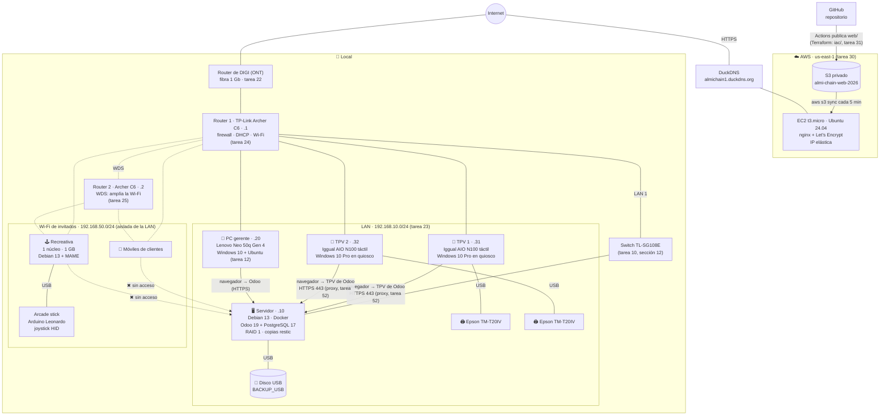

# Tarea 11 · Diagrama de arquitectura de equipos

**Responsable:** Iker · **Revisa:** Adrian · **Fecha:** 22/10/2026 · **Actualizado:** 23/10/2026 · **Depende de:** 8 (hardware), 9 (software), 23 (red)
**Estado:** actualizado con los modelos de las tareas 8 y 10, el direccionamiento de la tarea 23 y el hosting real de la tarea 30. El 24/10 el Mermaid y la tabla añaden el switch, el servidor presupuestado y la red de invitados `192.168.50.0/24`; el SVG se regeneró el mismo día. Pendiente de revisión.

## 1. Vista general

Imagen para la documentación y la presentación: [`arquitectura-equipos.svg`](arquitectura-equipos.svg) (vectorial).
El mismo diagrama en Mermaid (GitHub lo dibuja solo; para cambiarlo, se edita el texto):

## 2. Equipos

| Equipo | Función | Sistema / software | Conexión | IP | Tareas | Modelo |
|---|---|---|---|---|---|---|
| Servidor | ERP + TPV (Odoo), base de datos y copias | Debian 13, Docker, Odoo 19, PostgreSQL 17, mdadm, restic | Cable, switch (LAN 1) | 192.168.10.10 | 33–37, 40–45, 52 | HP ProDesk 600 G5 MT reacondicionado + 2 × WD Red Plus 2 TB en RAID 1 + SAI APC BX750MI (tarea 10, sección 12; en las pruebas, la VM `ServidorERP`) |
| Disco USB de copias | Copia 3 del 3-2-1; el gerente se lo lleva fuera del local cada semana | ext4, etiqueta `BACKUP_USB` | USB al servidor | — | 44 | WD Elements Portable 2 TB |
| Switch | Puertos libres en el armario (admite VLAN para la mejora del anexo de la tarea 23) | Firmware de fábrica | Cable, LAN 1 del router 1 | — | 23 | TP-Link TL-SG108E |
| PC del gerente | Gestión, ofimática y administración | Windows 10 + Ubuntu LTS (arranque dual) | Cable, LAN 2 | 192.168.10.20 | 12 | Lenovo ThinkCentre Neo 50q Gen 4 + monitor Xiaomi A24i |
| TPV 1 y TPV 2 | Caja de la barra | Windows 10 Pro: usuario estándar, modo quiosco con el navegador en el TPV de Odoo, USB bloqueado | Cable, LAN 3 y 4 | 192.168.10.31 y .32 | 13–15 | Iggual AIO B156.88.N100 (táctil de 15,6") |
| Impresoras de tickets (2) | Ticket de cada TPV | Driver ESC/POS de Windows | USB a su TPV (sin IP) | — | 14, 37 | Epson TM-T20IV |
| Recreativa | Máquina arcade para clientes | Debian 13 sin escritorio + MAME (o Batocera, tarea 51) | Wi-Fi de invitados (adaptador USB TP-Link TL-WN725N) | DHCP de invitados | 16–18, 51, 53, 54 | Equipo de 1 núcleo y 1 GB (lo pone el cliente) |
| Arcade stick | Mando de la recreativa | Firmware propio: joystick HID, palanca digital, mapeo en EEPROM | USB a la recreativa | — | 19–21, 50 | Keyestudio Leonardo (ATmega32U4) + 6 botones (hasta 8) + palanca Sanwa JLF-TP-8YT |
| Router de DIGI (ONT) | Llega la fibra de 1 Gb | Firmware de la operadora | Fibra; cable al WAN del router 1 | La de DIGI | 22 | Incluido con la línea |
| Router 1 | Salida a internet, firewall, DHCP, Wi-Fi del personal y de invitados | Firmware de fábrica | WAN al router del operador | 192.168.10.1 | 24 | TP-Link Archer C6 V3 |
| Router 2 | Amplía la Wi-Fi por WDS | Firmware de fábrica, DHCP apagado | WDS | 192.168.10.2 | 25 | TP-Link Archer C6 V3 |
| Web pública | Web del restaurante | S3 privado + EC2 con nginx y Let's Encrypt | Internet | IP elástica | 27–31 | AWS (Learner Lab) |

## 3. Decisiones de seguridad que se ven en el diagrama
- **Wi-Fi de invitados aislada:** los móviles de los clientes y la recreativa salen a internet, pero no ven el servidor, los TPV ni el PC del gerente. La recreativa va ahí para quedar separada de la caja sin VLAN, y se administra desde su consola local (tarea 23, apartado 5.2).
- **El ERP no está en internet:** Odoo solo es accesible desde la LAN. La web pública va aparte, en AWS, y no está conectada con Odoo: si atacan la web, las ventas y las facturas no están ahí.
- **PostgreSQL no se publica:** solo lo ve Odoo dentro de la red de Docker.
- **Las impresoras van por USB:** no tienen IP ni panel de administración en la red.
- **Las copias salen del local:** el USB de copias se lleva fuera (regla 3-2-1, tarea 44).
- **Los TPV no administran nada:** solo abren el TPV de Odoo en el navegador, con el usuario `cajero1` o `cajero2` (tarea 34).
- **El bucket S3 es privado:** solo lo lee la EC2 con su rol; al público solo llega nginx por HTTPS.

## 4. Red plana y anexo con VLAN
La red del local es **plana con la Wi-Fi de invitados aislada** (decisión de la [tarea 23, apartados 5.2 y 5.3](../../redes/23-plano-direccionamiento.md#52-decisión-red-plana-con-red-de-invitados-aislada-24102026)): lo que la red no separa entre TPV, gerente y servidor lo separa el cortafuegos de cada equipo. El diseño de mejora con una VLAN por grupo y ACL está simulado en el [anexo de Packet Tracer](../../redes/23-anexo-vlan.pkt) (tarea 23, apartado 5.5).

## 5. Cómo repetir la instalación de cada equipo

El enunciado pide para los TPV y las impresoras «un diagrama de la arquitectura que permita **repetir la instalación**». El diagrama dice qué hay; esta tabla dice dónde están los pasos para instalar cada equipo:

| Equipo | Guía de instalación | Estado |
|---|---|---|
| PC del gerente | [Tarea 12: arranque dual](../../so/12-dual-boot.md) | Hecha en VM |
| TPV 1 y 2 | [Tareas 13 y 15: bastionado, quiosco y scripts de Windows](../../so/13-tpv/DOCUMENTACION.md) | Scripts listos; falta ejecutarlos en la VM |
| Impresoras de tickets | [Tareas 14 y 37: driver en el TPV y ticket desde Odoo](../../so/14-impresora/DOCUMENTACION.md) | Guía lista; la impresora la da el centro |
| Servidor | [Tarea 33: Odoo con Docker](../../erp/33-odoo-docker/DOCUMENTACION.md) → [34: configuración](../../erp/34-configurar-odoo/DOCUMENTACION.md) → [43: RAID](../../backup/43-raid1/DOCUMENTACION.md) → [44: copias](../../backup/44-backup-3-2-1/DOCUMENTACION.md) → [40: BD `almi_chain`](../../bd/40-scripts-ddl.md) → [52: HTTPS](../../erp/52-https-odoo/DOCUMENTACION.md) | Hecho en VM; falta mover los datos al RAID (`mover-docker-al-raid.sh`) y activar el HTTPS |
| Recreativa | [Tarea 16: instalación](../../arcade/16-recreativa-mame/DOCUMENTACION.md) → [17: optimización](../../arcade/17-rendimiento-mame/DOCUMENTACION.md) | Hecha en VM |
| Arcade stick | [Firmware y conexiones](../../../arduino/mando-joystick/README.md) | Compila; sin montar |
| Routers | [Tarea 23: plano y direccionamiento](../../redes/23-plano-direccionamiento.md) → [24: red segura](../../redes/24-red-segura/DOCUMENTACION.md) → 25 (WDS) | En curso |
| Web | [Tarea 30: hosting en AWS](../../web/30-hosting-aws.md) o [Terraform (tarea 31)](../../../iac/README.md) | Hecha a mano; Terraform validado |

## 6. Pendiente
- [ ] Revisión de Adrian.
- [x] Regenerar `arquitectura-equipos.svg` desde el Mermaid de la sección 1 (24/10/2026).
- [x] Decisión de la tarea 23 (24/10): red plana con invitados aislada. El diagrama ya dibuja esa red y la WAN.
- [x] Enlazar en la sección 5 las guías de los TPV y de las impresoras (24/10/2026).
