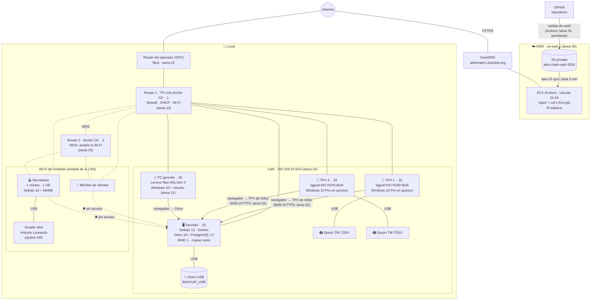

# Tarea 11 · Diagrama de arquitectura de equipos

**Responsable:** Iker · **Revisa:** Adrian · **Fecha:** 22/10/2026 · **Actualizado:** 23/10/2026 · **Depende de:** 8 (hardware), 9 (software), 23 (red)
**Estado:** actualizado con los modelos de las tareas 8 y 10, el direccionamiento de la tarea 23 y el hosting real de la tarea 30. Pendiente de revisión.

## 1. Vista general

Imagen para la documentación y la presentación: [`arquitectura-equipos.svg`](arquitectura-equipos.svg) (vectorial).
El mismo diagrama en Mermaid (GitHub lo dibuja solo; para cambiarlo, se edita el texto):

## 2. Equipos

| Equipo | Función | Sistema / software | Conexión | IP | Tareas | Modelo |
|---|---|---|---|---|---|---|
| Servidor | ERP + TPV (Odoo), base de datos y copias | Debian 13, Docker, Odoo 19, PostgreSQL 17, mdadm, restic | Cable, LAN 1 | 192.168.10.10 | 33–37, 43–45, 52 | No presupuestado: se usa un equipo del centro (en las pruebas, la VM `ServidorERP`) |
| Disco USB de copias | Copia 3 del 3-2-1; el gerente se lo lleva fuera del local | ext4, etiqueta `BACKUP_USB` | USB al servidor | — | 44 | Cualquier disco USB vacío |
| PC del gerente | Gestión, ofimática y administración | Windows 10 + Ubuntu LTS (arranque dual) | Cable, LAN 2 | 192.168.10.20 | 12 | Lenovo ThinkCentre Neo 50q Gen 4 + monitor Xiaomi A24i |
| TPV 1 y TPV 2 | Caja de la barra | Windows 10 Pro: usuario estándar, modo quiosco con el navegador en el TPV de Odoo, USB bloqueado | Cable, LAN 3 y 4 | 192.168.10.31 y .32 | 13–15 | Iggual AIO B156.88.N100 (táctil de 15,6") |
| Impresoras de tickets (2) | Ticket de cada TPV | Driver ESC/POS de Windows | USB a su TPV (sin IP) | — | 14, 37 | Epson TM-T20IV |
| Recreativa | Máquina arcade para clientes | Debian 13 sin escritorio + MAME (o Batocera, tarea 51) | Wi-Fi de invitados | DHCP de invitados | 16–18, 51, 53, 54 | Equipo de 1 núcleo y 1 GB (lo pone el cliente) |
| Arcade stick | Mando de la recreativa | Firmware propio: joystick HID, mapeo en EEPROM | USB a la recreativa | — | 19–21, 50 | Keyestudio Leonardo (ATmega32U4) + 6 botones |
| Router 1 | Salida a internet, firewall, DHCP, Wi-Fi del personal y de invitados | Firmware de fábrica | WAN al router del operador | 192.168.10.1 | 24 | TP-Link Archer C6 V3 |
| Router 2 | Amplía la Wi-Fi por WDS | Firmware de fábrica, DHCP apagado | WDS | 192.168.10.2 | 25 | TP-Link Archer C6 V3 |
| Web pública | Web del restaurante | S3 privado + EC2 con nginx y Let's Encrypt | Internet | IP elástica | 27–31 | AWS (Learner Lab) |

## 3. Decisiones de seguridad que se ven en el diagrama
- **Wi-Fi de invitados aislada:** los móviles de los clientes y la recreativa salen a internet, pero no ven el servidor, los TPV ni el PC del gerente. La recreativa va ahí porque los 4 puertos LAN del router están ocupados y así queda separada de la caja (tarea 23, apartado 5.2).
- **El ERP no está en internet:** Odoo solo es accesible desde la LAN. La web pública va aparte, en AWS, y no está conectada con Odoo: si atacan la web, las ventas y las facturas no están ahí.
- **PostgreSQL no se publica:** solo lo ve Odoo dentro de la red de Docker.
- **Las impresoras van por USB:** no tienen IP ni panel de administración en la red.
- **Las copias salen del local:** el USB de copias se lleva fuera (regla 3-2-1, tarea 44).
- **Los TPV no administran nada:** solo abren el TPV de Odoo en el navegador, con el usuario `cajero1` o `cajero2` (tarea 34).
- **El bucket S3 es privado:** solo lo lee la EC2 con su rol; al público solo llega nginx por HTTPS.

## 4. Diseño ideal con VLANs
Con un router o switch que admita VLANs, cada grupo iría en su propia red (servidores, TPV, gerencia, arcade, invitados y gestión), con ACLs que solo dejan pasar lo necesario. Está simulado y probado en Packet Tracer en la [tarea 23](../../redes/23-plano-direccionamiento.md#54-simulación-en-packet-tracer).

## 5. Pendiente
- [ ] WAN: la tarea 22 elige DIGI 1 Gb y el presupuesto (tarea 10) Telefónica 600 Mb. Cuando se decida, poner el operador en el nodo del router del operador.
- [ ] Revisión de Adrian.
