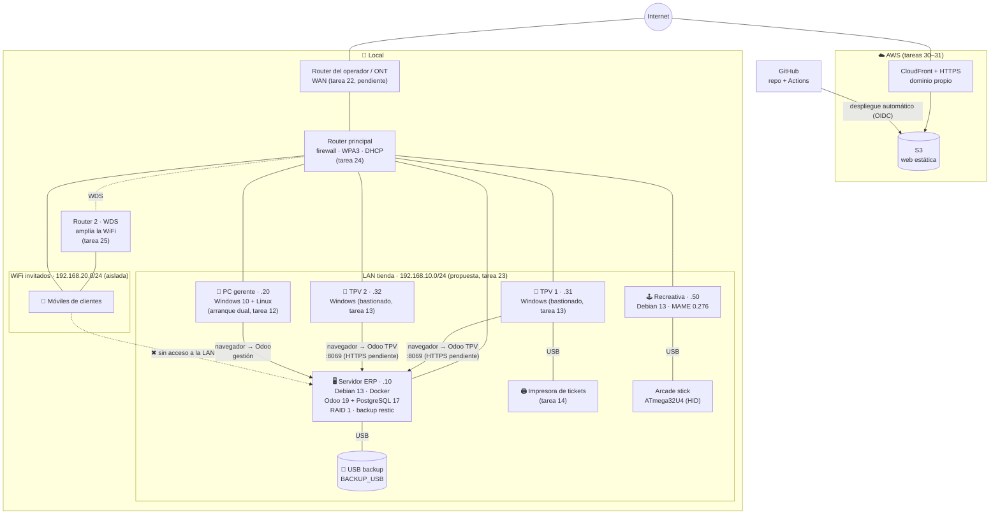

# Tarea 11 · Diagrama de arquitectura de equipos

**Responsable:** Iker · **Revisa:** Adrian · **Fecha:** 22/10/2026 · **Depende de:** 8 (hardware), 9 (software)
**Estado:** 🟡 **BORRADOR**. Faltan los modelos concretos de las tareas 8 y 9 y el direccionamiento definitivo de la tarea 23.
Lo marcado con *(pendiente)* se completa cuando esas tareas estén cerradas.

## 1. Vista general

Imagen para la documentación y la presentación: [`arquitectura-equipos.svg`](arquitectura-equipos.svg) (vectorial).
El mismo diagrama en Mermaid (GitHub lo dibuja solo; para cambiarlo, se edita el texto):

## 2. Equipos

| Equipo | Función | Sistema / software | Conexión | IP (propuesta) | Tarea | Modelo |
|---|---|---|---|---|---|---|
| Servidor ERP | ERP + TPV (Odoo), base de datos y copias | Debian 13, Docker 26, Odoo 19, PostgreSQL 17, mdadm, restic | Cable | 192.168.10.10 | 33–37, 43–45 | *(pendiente, tarea 8)* |
| Disco USB de backup | Copia 3 del 3-2-1, se lleva fuera del local | ext4, etiqueta `BACKUP_USB` | USB al servidor | — | 44 | *(pendiente)* |
| PC del gerente | Gestión, ofimática, administración | Windows 10 + Linux (arranque dual) | Cable | 192.168.10.20 | 12 | *(pendiente)* |
| TPV 1 | Caja | Windows bastionado (usuario estándar, modo quiosco, USB bloqueado) → navegador con Odoo TPV | Cable | 192.168.10.31 | 13 | *(pendiente)* |
| TPV 2 | Caja | Igual que el TPV 1 | Cable | 192.168.10.32 | 13 | *(pendiente)* |
| Impresora de tickets | Recibos del TPV 1 | Driver ESC/POS *(pendiente)* | USB al TPV 1 *(o red, pendiente de la tarea 14)* | — | 14, 37 | *(pendiente)* |
| Recreativa | Máquina arcade para clientes | Debian 13 sin escritorio, MAME 0.276 | Cable | 192.168.10.50 | 16–18 | *(pendiente)* |
| Arcade stick | Mando de la recreativa | Firmware propio (teclado HID, mapeo en EEPROM) | USB a la recreativa | — | 19–21 | ATmega32U4 (Leonardo / Pro Micro) |
| Router principal | Salida a internet, firewall, DHCP, WiFi WPA3, red de invitados | *(pendiente)* | — | 192.168.10.1 | 24 | *(pendiente, tarea 8)* |
| Router 2 (WDS) | Amplía la WiFi | *(pendiente)* | WDS | 192.168.10.2 | 25 | *(pendiente)* |
| Web pública | Web de la tienda | S3 + CloudFront, HTTPS, dominio propio | Internet | — | 27–31 | AWS |

## 3. Decisiones de seguridad que se ven en el diagrama
- **WiFi de invitados aislada:** los móviles de los clientes salen a internet, pero no ven el servidor, los TPV ni el PC del gerente.
- **El ERP no está en internet:** Odoo solo es accesible desde la LAN. La web pública va aparte, en AWS. Si atacan la web, las ventas y las facturas no están ahí.
- **Las copias salen del local:** el USB de backup se lleva fuera (regla 3-2-1, tarea 44).
- **Los TPV no administran nada:** solo abren el TPV de Odoo en el navegador, con el usuario `cajero1` o `cajero2` (tarea 34).

## 4. Pendiente para cerrar la tarea
- [ ] Modelos de cada equipo (tarea 8) y licencias (tarea 9).
- [ ] Direccionamiento definitivo y plano del local (tarea 23). Las IP de arriba son una **propuesta**.
- [ ] Cómo se conecta la impresora: USB o red (tarea 14).
- [ ] Proxy HTTPS delante de Odoo (seguridad transversal, tarea 46).
- [ ] Volver a exportar la imagen cuando el diagrama esté completo: abrir `diagrama.html` en un navegador y guardar el SVG (o usar `mmdc` de mermaid-cli).
