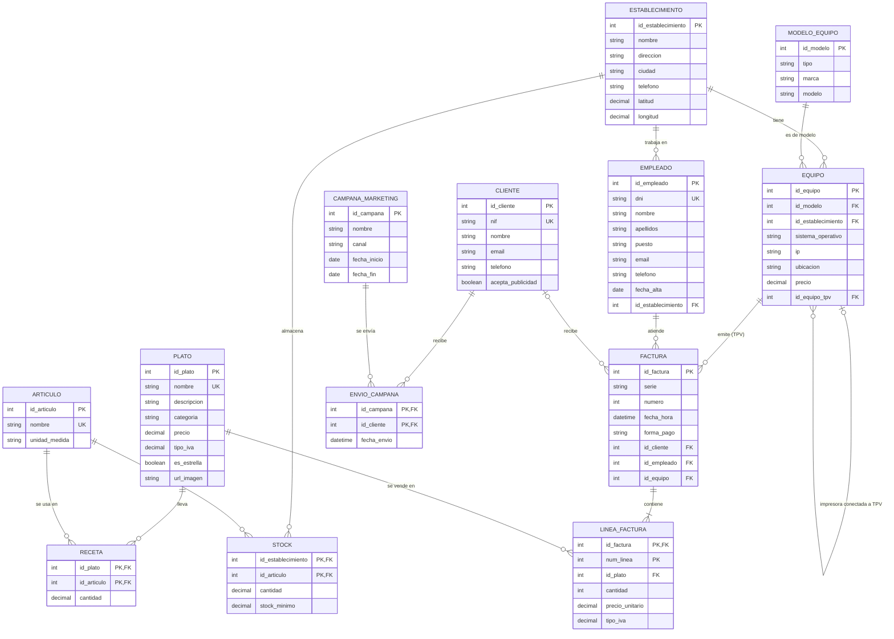

# Tarea 39: Modelo lógico normalizado (3FN)

- **Bloque:** 8 BD
- **Depende de:** tarea 38 (modelo E/R, Adrian)
- **Reto:** Almi-Chain (ASIR1 2026-27)
- **Resultado de aprendizaje:** Gestión de BD, RA.2: «Diseña modelos lógicos normalizados interpretando diagramas entidad/relación»
- **Estado:** pendiente de revisión

## 1. Resumen

Se parte del modelo E/R de la tarea 38 (12 entidades) y se pasa al modelo relacional, normalizado hasta la tercera forma normal (3FN). Al analizar las dependencias funcionales se han encontrado **cuatro problemas** en el E/R que impiden la 3FN. El equipo ha aceptado las correcciones y se corrigen aquí y en el E/R de la tarea 38.

Resultado: **13 tablas**, todas en 3FN (y en forma normal de Boyce-Codd, BCNF, según el análisis de la sección 4).

### Cambios respecto al E/R de la tarea 38

| Id | Cambio | Motivo |
|---|---|---|
| C-01 | Se eliminan `base_imponible`, `iva` y `total` de FACTURA. Se calculan con una vista a partir de las líneas. | `total = base_imponible + iva` es una dependencia entre atributos no clave (viola la 3FN), y los tres se pueden calcular desde LINEA_FACTURA (redundancia). |
| C-02 | Se añade `tipo_iva` a LINEA_FACTURA y a PLATO. | Sin el tipo de IVA por línea no se puede calcular el IVA si hay productos con tipos distintos (en restauración suelen coexistir). |
| C-03 | Nueva tabla MODELO_EQUIPO con `marca`, `modelo` y `tipo`. EQUIPO apunta a ella. | En EQUIPO, `modelo` determina `marca` y `tipo`: dependencia transitiva (`id_equipo` → `modelo` → `marca`, `tipo`) que viola la 3FN. |
| C-04 | `UNIQUE (serie, numero)` en FACTURA y valores permitidos (CHECK) en los campos de texto con lista cerrada (`puesto`, `categoria`, `tipo`, `forma_pago`). | Integridad. No es un problema de 3FN, pero evita duplicados y errores de escritura. |

Estos cambios se han aplicado también al modelo E/R de la tarea 38, que queda coherente con este documento.

## 2. Reglas de paso del E/R al modelo relacional

1. Cada entidad fuerte se convierte en una tabla con su clave primaria.
2. Las entidades débiles (LINEA_FACTURA) y las relaciones N:M (STOCK, RECETA, ENVIO_CAMPANA) se convierten en tablas con **clave primaria compuesta**, formada por las claves de las entidades que relacionan. STOCK, RECETA y ENVIO_CAMPANA llevan además atributos propios.
3. Cada relación 1:N se resuelve poniendo la clave del lado 1 como clave foránea en el lado N.
4. La relación reflexiva «impresora conectada a TPV» se resuelve con una clave foránea de EQUIPO hacia EQUIPO.
5. Las relaciones opcionales (0..1) dan claves foráneas que admiten NULL (`id_cliente` en FACTURA, `id_equipo_tpv` en EQUIPO).
6. Se aplican los cambios C-01 a C-04.

## 3. Esquema relacional

Notación: **negrita** = clave primaria; *cursiva* = clave foránea; `UK` = clave alternativa (única).

```
ESTABLECIMIENTO (id_establecimiento, nombre, direccion, ciudad, telefono, latitud, longitud)
    UK: (direccion, ciudad)

EMPLEADO (id_empleado, dni, nombre, apellidos, puesto, email, telefono, fecha_alta, id_establecimiento)
    UK: dni
    FK: id_establecimiento → ESTABLECIMIENTO

CLIENTE (id_cliente, nif, nombre, email, telefono, acepta_publicidad)
    UK: nif

MODELO_EQUIPO (id_modelo, tipo, marca, modelo)
    UK: (marca, modelo)

EQUIPO (id_equipo, id_modelo, id_establecimiento, sistema_operativo, ip, ubicacion, precio, id_equipo_tpv)
    FK: id_modelo → MODELO_EQUIPO
    FK: id_establecimiento → ESTABLECIMIENTO
    FK: id_equipo_tpv → EQUIPO (opcional, solo impresoras)
    UK: (id_establecimiento, ip)

PLATO (id_plato, nombre, descripcion, categoria, precio, tipo_iva, es_estrella, url_imagen)
    UK: nombre

ARTICULO (id_articulo, nombre, unidad_medida)
    UK: nombre

STOCK (id_establecimiento, id_articulo, cantidad, stock_minimo)
    PK compuesta: (id_establecimiento, id_articulo)
    FK: id_establecimiento → ESTABLECIMIENTO
    FK: id_articulo → ARTICULO

RECETA (id_plato, id_articulo, cantidad)
    PK compuesta: (id_plato, id_articulo)
    FK: id_plato → PLATO
    FK: id_articulo → ARTICULO

FACTURA (id_factura, serie, numero, fecha_hora, forma_pago, id_cliente, id_empleado, id_equipo)
    UK: (serie, numero)
    FK: id_cliente → CLIENTE (opcional)
    FK: id_empleado → EMPLEADO
    FK: id_equipo → EQUIPO (TPV que la emite)

LINEA_FACTURA (id_factura, num_linea, id_plato, cantidad, precio_unitario, tipo_iva)
    PK compuesta: (id_factura, num_linea)
    FK: id_factura → FACTURA
    FK: id_plato → PLATO

CAMPANA_MARKETING (id_campana, nombre, canal, fecha_inicio, fecha_fin)

ENVIO_CAMPANA (id_campana, id_cliente, fecha_envio)
    PK compuesta: (id_campana, id_cliente)
    FK: id_campana → CAMPANA_MARKETING
    FK: id_cliente → CLIENTE
```

### Diagrama



## 4. Normalización paso a paso

### 4.1 Primera forma normal (1FN)

Una tabla está en 1FN si todos sus atributos son atómicos (un solo valor por celda) y no hay grupos repetidos.

- No hay atributos multivaluados: un teléfono y un correo por fila, un solo valor en `ip`.
- Las facturas con varios platos no repiten columnas (`plato1`, `plato2`…): se separan en LINEA_FACTURA, una fila por plato.
- Los platos con varios ingredientes se resuelven en RECETA, y los clientes con varias campañas en ENVIO_CAMPANA.
- `direccion` se trata como un valor único (calle y número): no se necesita consultar sus partes por separado.

**Todas las tablas cumplen 1FN.**

### 4.2 Segunda forma normal (2FN)

Una tabla está en 2FN si está en 1FN y ningún atributo no clave depende solo de una parte de una clave compuesta. Solo importa en las tablas con clave compuesta:

| Tabla | Clave | Dependencia | ¿2FN? |
|---|---|---|---|
| STOCK | (`id_establecimiento`, `id_articulo`) | `cantidad` y `stock_minimo` dependen de la pareja: es el stock de un artículo **en un local** | Sí |
| RECETA | (`id_plato`, `id_articulo`) | `cantidad` depende de la pareja: cuánto lleva **ese plato de ese artículo** | Sí |
| LINEA_FACTURA | (`id_factura`, `num_linea`) | `id_plato`, `cantidad`, `precio_unitario` y `tipo_iva` dependen de la línea concreta, no solo de la factura | Sí |
| ENVIO_CAMPANA | (`id_campana`, `id_cliente`) | `fecha_envio` depende de la pareja: cuándo se envió **esa campaña a ese cliente** | Sí |

Las demás tablas tienen clave simple, así que cumplen 2FN directamente.

### 4.3 Tercera forma normal (3FN)

Una tabla está en 3FN si está en 2FN y ningún atributo no clave depende de otro atributo no clave (no hay dependencias transitivas).

**Problemas del E/R original y su corrección:**

| Tabla en el E/R | Dependencia que viola la 3FN | Corrección |
|---|---|---|
| FACTURA | `total` = `base_imponible` + `iva`. Además, los tres se calculan desde las líneas. | C-01: se eliminan y se calculan en una vista (ver 6.2). |
| EQUIPO | `id_equipo` → `modelo` → `marca`, `tipo`. | C-03: la tabla MODELO_EQUIPO guarda `marca` y `tipo` una sola vez por modelo. |

**Casos que parecen dependencias pero no lo son:**

- **`precio_unitario` y `tipo_iva` en LINEA_FACTURA** parecen depender de `id_plato` (que tiene `precio` y `tipo_iva`). No es una dependencia funcional: el precio y el IVA de un plato cambian con el tiempo, y la factura debe conservar el valor vigente **en el momento de la venta**. Es una copia deliberada de un dato histórico.
- **`latitud` y `longitud` en ESTABLECIMIENTO** se podrían deducir de la dirección, pero (`direccion`, `ciudad`) es una clave alternativa de la tabla. Un determinante que es clave no viola la 3FN.
- **`sistema_operativo`, `ip`, `ubicacion` y `precio` en EQUIPO** son propios de cada equipo concreto (el sistema instalado, la IP asignada, el precio pagado), no del modelo. No dependen de `id_modelo`.

### 4.4 Comprobación por tabla

| Tabla | Dependencias funcionales | 3FN | BCNF |
|---|---|---|---|
| ESTABLECIMIENTO | `id_establecimiento` → todo; (`direccion`, `ciudad`) → todo | Sí | Sí |
| EMPLEADO | `id_empleado` → todo; `dni` → todo | Sí | Sí |
| CLIENTE | `id_cliente` → todo; `nif` → todo | Sí | Sí |
| MODELO_EQUIPO | `id_modelo` → todo; (`marca`, `modelo`) → `tipo` | Sí | Sí |
| EQUIPO | `id_equipo` → todo; (`id_establecimiento`, `ip`) → todo | Sí | Sí |
| PLATO | `id_plato` → todo; `nombre` → todo | Sí | Sí |
| ARTICULO | `id_articulo` → todo; `nombre` → todo | Sí | Sí |
| STOCK | (`id_establecimiento`, `id_articulo`) → `cantidad`, `stock_minimo` | Sí | Sí |
| RECETA | (`id_plato`, `id_articulo`) → `cantidad` | Sí | Sí |
| FACTURA | `id_factura` → todo; (`serie`, `numero`) → todo | Sí | Sí |
| LINEA_FACTURA | (`id_factura`, `num_linea`) → todo | Sí | Sí |
| CAMPANA_MARKETING | `id_campana` → todo | Sí | Sí |
| ENVIO_CAMPANA | (`id_campana`, `id_cliente`) → `fecha_envio` | Sí | Sí |

En todas, cada determinante es una clave (primaria o alternativa).

## 5. Diccionario de datos

Los tipos están pensados para PostgreSQL; se adaptan fácilmente a otros gestores. Las claves primarias simples se generan automáticamente (`GENERATED ALWAYS AS IDENTITY`).

**ESTABLECIMIENTO**

| Columna | Tipo | Nulo | Restricciones |
|---|---|---|---|
| id_establecimiento | INTEGER | No | PK |
| nombre | VARCHAR(100) | No | |
| direccion | VARCHAR(200) | No | UK con `ciudad` |
| ciudad | VARCHAR(100) | No | |
| telefono | VARCHAR(20) | Sí | |
| latitud | NUMERIC(9,6) | Sí | CHECK entre -90 y 90 |
| longitud | NUMERIC(9,6) | Sí | CHECK entre -180 y 180 |

**EMPLEADO**

| Columna | Tipo | Nulo | Restricciones |
|---|---|---|---|
| id_empleado | INTEGER | No | PK |
| dni | VARCHAR(9) | No | UK |
| nombre | VARCHAR(100) | No | |
| apellidos | VARCHAR(150) | No | |
| puesto | VARCHAR(20) | No | CHECK en (`gerente`, `camarero`, `cocina`, `barra`, `otro`) |
| email | VARCHAR(254) | Sí | |
| telefono | VARCHAR(20) | Sí | |
| fecha_alta | DATE | No | por defecto, la fecha actual |
| id_establecimiento | INTEGER | No | FK → ESTABLECIMIENTO |

**CLIENTE**

| Columna | Tipo | Nulo | Restricciones |
|---|---|---|---|
| id_cliente | INTEGER | No | PK |
| nif | VARCHAR(9) | Sí | UK (varios NULL permitidos) |
| nombre | VARCHAR(150) | No | |
| email | VARCHAR(254) | Sí | |
| telefono | VARCHAR(20) | Sí | |
| acepta_publicidad | BOOLEAN | No | por defecto `false`; CHECK: si es `true`, `email` no puede ser NULL |

**MODELO_EQUIPO**

| Columna | Tipo | Nulo | Restricciones |
|---|---|---|---|
| id_modelo | INTEGER | No | PK |
| tipo | VARCHAR(20) | No | CHECK en (`despacho`, `tpv`, `recreativa`, `impresora_tickets`) |
| marca | VARCHAR(50) | No | UK con `modelo` |
| modelo | VARCHAR(100) | No | |

**EQUIPO**

| Columna | Tipo | Nulo | Restricciones |
|---|---|---|---|
| id_equipo | INTEGER | No | PK |
| id_modelo | INTEGER | No | FK → MODELO_EQUIPO |
| id_establecimiento | INTEGER | No | FK → ESTABLECIMIENTO |
| sistema_operativo | VARCHAR(50) | Sí | |
| ip | VARCHAR(45) | Sí | UK con `id_establecimiento` |
| ubicacion | VARCHAR(100) | Sí | |
| precio | NUMERIC(10,2) | Sí | CHECK ≥ 0 |
| id_equipo_tpv | INTEGER | Sí | FK → EQUIPO; solo para impresoras (ver regla R-03) |

**PLATO**

| Columna | Tipo | Nulo | Restricciones |
|---|---|---|---|
| id_plato | INTEGER | No | PK |
| nombre | VARCHAR(100) | No | UK |
| descripcion | VARCHAR(500) | Sí | |
| categoria | VARCHAR(20) | No | CHECK en (`entrante`, `principal`, `postre`, `bebida`) |
| precio | NUMERIC(8,2) | No | CHECK ≥ 0 |
| tipo_iva | NUMERIC(4,2) | No | CHECK en (4, 10, 21) |
| es_estrella | BOOLEAN | No | por defecto `false` |
| url_imagen | VARCHAR(255) | Sí | |

**ARTICULO**

| Columna | Tipo | Nulo | Restricciones |
|---|---|---|---|
| id_articulo | INTEGER | No | PK |
| nombre | VARCHAR(100) | No | UK |
| unidad_medida | VARCHAR(10) | No | CHECK en (`kg`, `g`, `l`, `ml`, `ud`) |

**STOCK**

| Columna | Tipo | Nulo | Restricciones |
|---|---|---|---|
| id_establecimiento | INTEGER | No | PK (1/2), FK → ESTABLECIMIENTO |
| id_articulo | INTEGER | No | PK (2/2), FK → ARTICULO |
| cantidad | NUMERIC(10,3) | No | CHECK ≥ 0 |
| stock_minimo | NUMERIC(10,3) | No | por defecto 0; CHECK ≥ 0 |

**RECETA**

| Columna | Tipo | Nulo | Restricciones |
|---|---|---|---|
| id_plato | INTEGER | No | PK (1/2), FK → PLATO |
| id_articulo | INTEGER | No | PK (2/2), FK → ARTICULO |
| cantidad | NUMERIC(10,3) | No | CHECK > 0 |

**FACTURA**

| Columna | Tipo | Nulo | Restricciones |
|---|---|---|---|
| id_factura | INTEGER | No | PK |
| serie | VARCHAR(10) | No | UK con `numero` |
| numero | INTEGER | No | CHECK > 0 |
| fecha_hora | TIMESTAMP | No | por defecto, el momento actual |
| forma_pago | VARCHAR(20) | No | CHECK en (`efectivo`, `tarjeta`, `otro`) |
| id_cliente | INTEGER | Sí | FK → CLIENTE (NULL = ticket simplificado) |
| id_empleado | INTEGER | No | FK → EMPLEADO |
| id_equipo | INTEGER | No | FK → EQUIPO (el TPV que la emite) |

**LINEA_FACTURA**

| Columna | Tipo | Nulo | Restricciones |
|---|---|---|---|
| id_factura | INTEGER | No | PK (1/2), FK → FACTURA |
| num_linea | INTEGER | No | PK (2/2), CHECK > 0 |
| id_plato | INTEGER | No | FK → PLATO |
| cantidad | INTEGER | No | CHECK > 0 |
| precio_unitario | NUMERIC(8,2) | No | CHECK ≥ 0 (precio en el momento de la venta) |
| tipo_iva | NUMERIC(4,2) | No | CHECK en (4, 10, 21) (tipo en el momento de la venta) |

**CAMPANA_MARKETING**

| Columna | Tipo | Nulo | Restricciones |
|---|---|---|---|
| id_campana | INTEGER | No | PK |
| nombre | VARCHAR(100) | No | |
| canal | VARCHAR(20) | No | CHECK en (`email`, `sms`, `redes`) |
| fecha_inicio | DATE | No | |
| fecha_fin | DATE | Sí | CHECK ≥ `fecha_inicio` |

**ENVIO_CAMPANA**

| Columna | Tipo | Nulo | Restricciones |
|---|---|---|---|
| id_campana | INTEGER | No | PK (1/2), FK → CAMPANA_MARKETING |
| id_cliente | INTEGER | No | PK (2/2), FK → CLIENTE |
| fecha_envio | TIMESTAMP | No | por defecto, el momento actual |

## 6. Integridad

### 6.1 Acciones de las claves foráneas

| Clave foránea | Al borrar el padre | Razón |
|---|---|---|
| EMPLEADO → ESTABLECIMIENTO | RESTRICT | No se borra un local con personal. |
| EQUIPO → ESTABLECIMIENTO, MODELO_EQUIPO | RESTRICT | No se borra un local o un modelo que tienen equipos. |
| EQUIPO → EQUIPO (`id_equipo_tpv`) | SET NULL | Si se retira un TPV, la impresora queda sin asignar. |
| FACTURA → CLIENTE, EMPLEADO, EQUIPO | RESTRICT | Las facturas se conservan por obligación legal. Para borrar a un cliente (derecho de supresión del RGPD), se anonimizan sus datos en lugar de borrar la fila. |
| LINEA_FACTURA → FACTURA | CASCADE | Entidad débil: sin factura, la línea no existe. |
| LINEA_FACTURA → PLATO | RESTRICT | No se borra un plato que se ha vendido (se puede dejar de ofrecer). |
| STOCK → ESTABLECIMIENTO, ARTICULO | RESTRICT | Se conserva el histórico de inventario. |
| RECETA → PLATO | CASCADE | Si se elimina el plato, su receta no tiene sentido. |
| RECETA → ARTICULO | RESTRICT | No se borra un artículo usado en recetas. |
| ENVIO_CAMPANA → CAMPANA_MARKETING, CLIENTE | CASCADE | Los envíos son registros dependientes. |

### 6.2 Vista de totales de factura (sustituye a los atributos eliminados)

La vista `v_factura_totales` calcula por factura:

- `base_imponible` = suma de `cantidad` × `precio_unitario` de sus líneas.
- `iva` = suma de `cantidad` × `precio_unitario` × `tipo_iva` / 100.
- `total` = `base_imponible` + `iva`.

Si el equipo prefiere guardar esos importes en la factura por rendimiento o por requisito fiscal, es una **desnormalización deliberada**, y debería documentarse como tal con una restricción que obligue a que coincidan con la vista.

### 6.3 Reglas que una clave foránea no puede expresar

Estas reglas se aplican con disparadores (triggers) o desde la aplicación, y se implementan en el diseño físico (tarea siguiente):

| Id | Regla |
|---|---|
| R-01 | El empleado que atiende una factura y el equipo (TPV) que la emite pertenecen al mismo establecimiento. |
| R-02 | El equipo de una factura es de tipo `tpv`. |
| R-03 | `id_equipo_tpv` solo se rellena si el modelo es `impresora_tickets`, y apunta a un `tpv` del mismo establecimiento. |
| R-04 | Las facturas emitidas no se modifican ni se borran: el rol de la aplicación no tiene permisos de UPDATE ni DELETE sobre FACTURA y LINEA_FACTURA (mínimos privilegios). |
| R-05 | La numeración de cada serie es correlativa y sin huecos. |
| R-06 | Una venta descuenta del STOCK los artículos de la RECETA del plato, en el establecimiento del TPV. |

## 7. Preguntas abiertas para Adrian y Peio

1. ¿Los tipos de IVA 4, 10 y 21 % son los que queréis admitir? (El equipo de Odoo debe usar los mismos.)
2. ¿Se necesita registrar la baja de empleados y la retirada de platos? Se resolvería con un campo `activo` o `fecha_baja`, que ahora no existe en el E/R.
3. Las listas de valores permitidos (`puesto`, `categoria`, `canal`, `forma_pago`) están como CHECK. Si cambian a menudo, se pueden pasar a tablas de catálogo.

## 8. Siguiente paso

Tarea de diseño físico: escribir el script SQL (`CREATE TABLE`, claves, restricciones, índices y roles) a partir de este esquema, e implementar las reglas R-01 a R-06.
