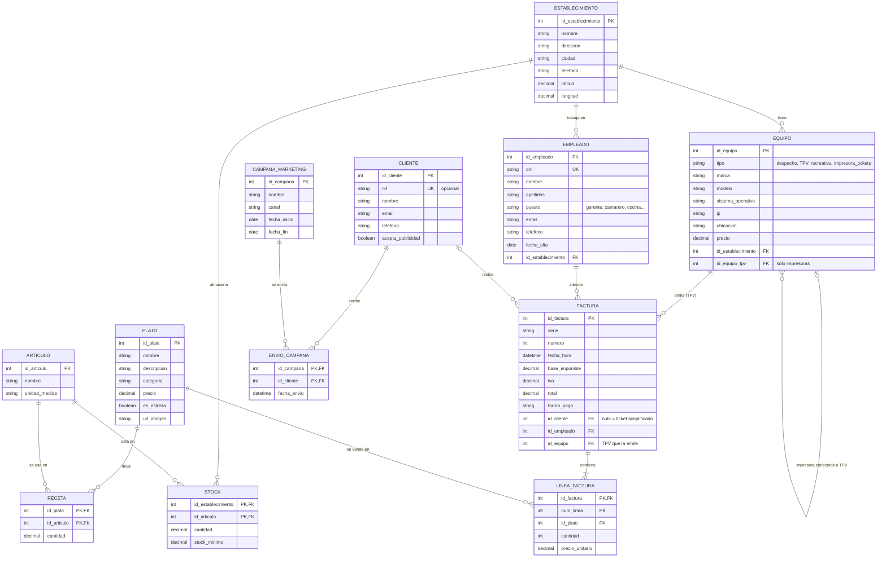

# Modelo E/R — Base de datos de establecimiento (Almi-Chain)

Tarea #38 del backlog (bloque 8 BD). Fuente: `Reto_1_ASIR1_2026-2027.docx`.

## 1. Qué dice el enunciado sobre la BD

El documento **no trae un enunciado de BD propio** (no hay lista de datos, atributos ni reglas de negocio).
Lo que hay sobre la base de datos es esto:

| Ubicación en el documento | Texto |
|---|---|
| «El reto», párrafo 5 | «Por último, quieren diseñar las bases de datos que habrá en cada establecimiento. Esta BD se almacenará en un dispositivo redundante…» |
| «Tareas a realizar», punto 14 | «Diseño del modelo E/R y tablas de la base de datos.» |
| «Tareas a realizar», punto 15 | «Implementación de la base de datos y consulta de sus datos.» |
| Resultados de aprendizaje, Gestión de BD, RA.2 | «Diseña modelos lógicos normalizados interpretando diagramas entidad/relación.» |

Por tanto, el **dominio** de la BD se deduce del resto del enunciado: qué es la empresa, qué gestiona y qué hay en cada local.
Abajo se indica para cada elemento si sale **literal** del texto (📄) o es una **decisión de diseño** del equipo (🛠).

Referencias usadas:

- **R1** = «El reto», párrafo 1 («Una cadena de restaurantes nos ha contratado…»)
- **R2** = «El reto», párrafo 2 («El gerente necesita, para su despacho…»)
- **R3** = «El reto», párrafo 3 («Quieren utilizar otro equipo como máquina recreativa…»)
- **R5** = «El reto», párrafo 5 («La empresa, que se quiere dar a conocer…»)
- **T*n*** = «Tareas a realizar», punto *n*

## 2. Diagrama

> El diagrama está en notación «pata de gallo» (Mermaid, se ve en GitHub). Si se pide en notación Chen, se pasa a draw.io
> con las mismas entidades y cardinalidades. `STOCK`, `RECETA`, `ENVIO_CAMPANA` y `LINEA_FACTURA` son relaciones N:M o entidades débiles,
> no entidades fuertes.

## 3. Trazabilidad: de dónde sale cada cosa

### Entidades

| Entidad | Origen | Texto exacto / justificación |
|---|---|---|
| ESTABLECIMIENTO | 📄 R1, R5 | «Una cadena de restaurantes…» (R1); «las bases de datos que habrá en cada establecimiento» (R5) |
| EMPLEADO | 📄 R5, R2 | ERP para gestionar «el personal» (R5); «El gerente» (R2) → el gerente es un valor de `puesto`, no una entidad aparte |
| CLIENTE | 📄 R5 | ERP para gestionar «la relación con los clientes» (R5) |
| FACTURA | 📄 R5, T12 | ERP para gestionar «las facturas» (R5); «automatizando al menos un caso de uso real (p. ej. emisión de una factura)» (T12) |
| LINEA_FACTURA | 🛠 | Una factura tiene varios platos con cantidad y precio → entidad débil de FACTURA (necesaria para normalizar, RA.2 de BD) |
| PLATO | 📄 R5 | «un slideshow para mostrar sus platos estrella» (R5). Es un restaurante: lo que se factura son platos |
| ARTICULO | 📄 R5 | ERP para gestionar el «inventariado» (R5) → artículos/ingredientes del almacén |
| STOCK | 🛠 sobre R5 | El inventario es por local («cada establecimiento», R5) → N:M ESTABLECIMIENTO–ARTICULO con cantidad |
| RECETA | 🛠 | No aparece en el texto. Une inventario y ventas (qué artículos consume cada plato). Se puede quitar si se quiere un modelo mínimo |
| CAMPANA_MARKETING | 📄 R5 | ERP para gestionar «marketing» (R5) |
| ENVIO_CAMPANA | 🛠 | N:M CLIENTE–CAMPAÑA: a qué clientes se envía cada campaña |
| EQUIPO | 📄 R2, R3, T1, T13 | «un equipo con arranque dual» para el despacho, «dos equipos de barra (que funcionarán como TPV…) e impresoras de tickets» (R2); «otro equipo como máquina recreativa» (R3); T1 «configuración y presupuesto de equipos e impresoras» |

### Relaciones y cardinalidades

| Relación | Card. | Origen | Justificación |
|---|---|---|---|
| EMPLEADO *trabaja en* ESTABLECIMIENTO | N:1 | 🛠 sobre R1/R5 | Cada empleado pertenece a un local de la cadena |
| EQUIPO *está en* ESTABLECIMIENTO | N:1 | 📄 R2 | Los equipos de R2 son del local (despacho, barra) |
| Impresora *conectada a* TPV | 0..N:0..1 (reflexiva) | 📄 R2 | «dos equipos de barra (TPV) e impresoras de tickets» |
| TPV *emite* FACTURA | 1:N | 📄 R2 + T12 | Los TPV de barra cobran; T12 pide «ERP + TPV» con emisión de factura |
| EMPLEADO *atiende* FACTURA | 1:N | 🛠 | Saber quién cobra (trazabilidad/seguridad, T18) |
| CLIENTE *recibe* FACTURA | 0..1:N | 🛠 | Un ticket de barra puede no tener cliente identificado → FK opcional |
| FACTURA *contiene* LINEA_FACTURA | 1:1..N | 🛠 | Toda factura tiene al menos una línea |
| PLATO *se vende en* LINEA_FACTURA | 1:N | 🛠 | Cada línea es un plato |
| PLATO–ARTICULO (RECETA) | N:M | 🛠 | Ver arriba |
| ESTABLECIMIENTO–ARTICULO (STOCK) | N:M | 🛠 sobre R5 | Ver arriba |
| CLIENTE–CAMPAÑA (ENVIO) | N:M | 🛠 sobre R5 | Ver arriba |

### Atributos destacables

| Atributo | Origen |
|---|---|
| `ESTABLECIMIENTO.latitud/longitud` | 📄 R5: la web debe tener «geolocalización» → se guardan las coordenadas del local |
| `PLATO.es_estrella`, `PLATO.url_imagen` | 📄 R5: «slideshow para mostrar sus platos estrella» |
| `EMPLEADO.puesto` | 📄 R2: «El gerente» (más el personal genérico de R5) |
| `EQUIPO.tipo` | 📄 R2/R3: despacho, TPV, impresora de tickets, recreativa |
| `EQUIPO.sistema_operativo`, `ip`, `precio` | 📄 R2: «detalles tanto del hardware como del software», «presupuesto»; T6 necesidades de comunicación |
| `CLIENTE.acepta_publicidad` | 🛠 sobre R5 (marketing) + RGPD: no se envían campañas sin consentimiento |
| Resto (nombre, dni, fechas, importes…) | 🛠 el documento no define ningún atributo; son los mínimos para identificar y operar cada entidad |

## 4. Qué se ha dejado fuera a propósito

No aparecen en el documento y no se modelan: **proveedores, mesas, reservas, pedidos de cocina, nóminas/turnos**.
Si el equipo los quiere, encajan sin romper el modelo (p. ej. PROVEEDOR 1:N ARTICULO, MESA 1:N FACTURA).
La red (WAN, WDS, R4), la web en AWS y el arcade stick no son datos de negocio, así que no entran en la BD.
