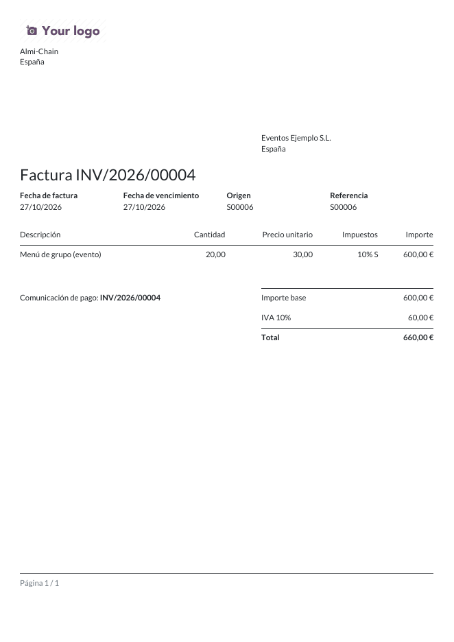

# Tarea 35 · Caso de uso de principio a fin automatizado: emitir una factura

**Responsable:** Iker (hecha por Iker; antes estaba a nombre de Adrian) · **Fecha:** 22/10/2026 · **Depende de:** 34
**Estado:** ✅ Hecha en máquina virtual · repetida el 27/10/2026 con el caso de uso real (menú de grupo, IVA 10 %): **660,00 €**

> El reto pide *"Elección e implementación del ERP + TPV, automatizando al menos un caso de uso real (p. ej. emisión de una factura)"*.

> **Caso de uso (revisado el 24/10/2026).** La primera versión facturaba «Partida recreativa» y «Alquiler recreativa (día)» a «Bar Pepe» con IVA del 21 %, que no es una operación de un restaurante. El caso de uso real es este: **una empresa reserva una comida de grupo y pide factura completa** a su nombre (el TPV solo da factura simplificada). Ahora el script lo hace por defecto, con el IVA de hostelería (10 %); `--iva 21` queda para otros servicios. Repetido el 27/10/2026 con estos valores: [`INV_2026_00004.pdf`](evidencias/INV_2026_00004.pdf), 660,00 €. Las facturas 00001 y 00002 son de la primera versión.

## 1. Resultado
El script [`factura_automatica.py`](factura_automatica.py) emite una factura completa sin tocar la pantalla, en menos de 10 segundos:

```
[1/6] Cliente: Eventos Ejemplo S.L. (id 11)
[2/6] Producto: Menú de grupo (evento) a 30.00 € + IVA 10% S (id 22)
[3/6] Pedido S00006 confirmado (sale), total 660.00 €
[4/6] Factura INV/2026/00004 validada el 2026-10-27: base 600.00 € + IVA 60.00 € = 660.00 €
[5/6] Cobro registrado: estado de pago 'paid'
[6/6] PDF guardado en evidencias/INV_2026_00004.pdf (24 KB)

OK · S00006 → INV/2026/00004 · 660.00 € · paid
```



PDF: [`evidencias/INV_2026_00004.pdf`](evidencias/INV_2026_00004.pdf). Salida completa: [`ejecucion-menu-grupo-2.txt`](evidencias/ejecucion-menu-grupo-2.txt).

## 2. Qué hace (el mismo recorrido que el gerente a mano)

| Paso | En pantalla sería… | Por la API |
|---|---|---|
| 1. Cliente | *Contactos → Nuevo* | `res.partner` · `search` / `create` |
| 2. Producto | *Ventas → Productos → Nuevo* | `product.template` · `create` (servicio, IVA 10 % S de hostelería o 21 % S con `--iva 21`, disponible en el TPV) |
| 3. Pedido | *Ventas → Nuevo → Confirmar* | `sale.order` · `create` + `action_confirm` |
| 4. Factura | *Crear factura → Confirmar* | asistente `sale.advance.payment.inv` · `create_invoices` + `account.move` · `action_post` |
| 5. Cobro | *Registrar pago* | asistente `account.payment.register` · `action_create_payments` |
| 6. PDF | *Imprimir → Factura* | `GET /report/pdf/account.report_invoice/<id>`, con una sesión web |

## 3. Cómo se usa
```bash
read -rs ODOO_PASSWORD && export ODOO_PASSWORD   # la de gerente, de KeePassXC; no se ve ni queda en el historial
ODOO_URL=http://localhost:8069 ODOO_DB=tienda ODOO_USER=gerente \
python3 factura_automatica.py --cliente "Eventos Ejemplo S.L." --producto "Menú de grupo (evento)" --precio 30 --cantidad 20
```
Opciones: `--cliente`, `--email`, `--producto`, `--precio` (sin IVA), `--cantidad`, `--iva` (10 o 21, por defecto 10) y `--pdf-dir`.

Resultado esperado con esos valores: 20 × 30,00 € = 600,00 € + IVA 10 % 60,00 € = **660,00 €**.

**Seguridad:**
- Se ejecuta con el usuario **`gerente`**, no con `admin` (mínimos privilegios).
- La contraseña va en una variable de entorno, nunca escrita en el script.
- Solo usa librerías estándar de Python, sin dependencias externas.

## 4. Pruebas

| # | Prueba | Resultado |
|---|---|---|
| 1 | Ejecución completa | ✅ Pedido confirmado, factura validada y cobrada, PDF descargado |
| 2 | Importes | ✅ Menú de grupo (27/10): 20 × 30,00 € = 600,00 € + IVA 10 % 60,00 € = **660,00 €**. Primera versión: 12,10 € con IVA 21 % |
| 3 | Numeración | ✅ Correlativa: `INV/2026/00001` a `INV/2026/00004` |
| 4 | Ejecución repetida | ✅ Reutiliza el cliente y el producto y crea un pedido y una factura nuevos |
| 5 | Permisos | ✅ Con `gerente` funciona. Sin el grupo *Productos / Crear*, Odoo lo impide (ver incidencia 1) |

## 5. Incidencias

| # | Incidencia | Causa | Solución |
|---|---|---|---|
| 1 | `No puede crear informes 'Product'` | En Odoo 19, crear productos necesita el grupo **Productos / Crear** (`product.group_product_manager`), y el gerente no lo tenía | Añadido al gerente en `configurar-odoo.py` (tarea 34). Los cajeros siguen sin él. |
| 2 | `cannot marshal None unless allow_none is enabled` al crear la factura | El botón *Crear factura* **sí se ejecuta**, pero devuelve una acción de pantalla con valores `None` que XML-RPC no puede enviar | Función `boton()`: ignora solo ese error concreto y el resultado se comprueba leyendo los datos. El intento fallido dejó una factura en borrador (eliminada) y el pedido S00002 (cancelado). |
| 3 | La primera factura (`INV/2026/00001`) salió con **IVA 21 % G (bienes)** | El script cogía el primer impuesto del 21 % que encontraba | Ahora elige el IVA según el tipo de producto (`tax_scope = service` → **21 % S**). La 00001 queda como factura de prueba: una factura validada no se borra; si hiciera falta, se anula con una **factura rectificativa**. |
| 4 | 27/10: al repetir con el menú de grupo, la factura `INV/2026/00003` salió por **654,55 €** en vez de **660,00 €** (base 545,45 € + IVA 109,10 €) | La línea llevaba **dos impuestos**: `10% S` (el del producto) y `10% S (IVA incluido)`, el que usa el TPV (tarea 52), que Odoo añadió al calcular la línea. Uno se quitaba del precio y el otro se sumaba ([diagnóstico](evidencias/diagnostico-iva-INV00003.txt)) | El script fija ahora el IVA **en la línea del pedido** y **comprueba el total**: si no es cantidad × precio + IVA, termina con error. Repetido: `INV/2026/00004` = **660,00 €** ([salida](evidencias/ejecucion-menu-grupo-2.txt)). `INV/2026/00003` está validada y cobrada: no se borra; se anuló el 27/10 con la rectificativa **`RINV/2026/00001`** (654,55 €, [evidencia](evidencias/rectificativa-INV00003.txt)) |

## 6. Ideas para ampliarlo
- **Automatizar dentro de Odoo:** que cada pedido del TPV genere la factura solo (*Punto de Venta → Configuración → Facturación*) o una acción automática.
- **Programarlo:** un `systemd timer` que facture cada mes a las empresas con comidas de grupo pendientes.
- **TicketBAI / Veri\*Factu:** ver la tarea 34, §6. Con el módulo instalado, `action_post` enviaría además la factura a Hacienda.
