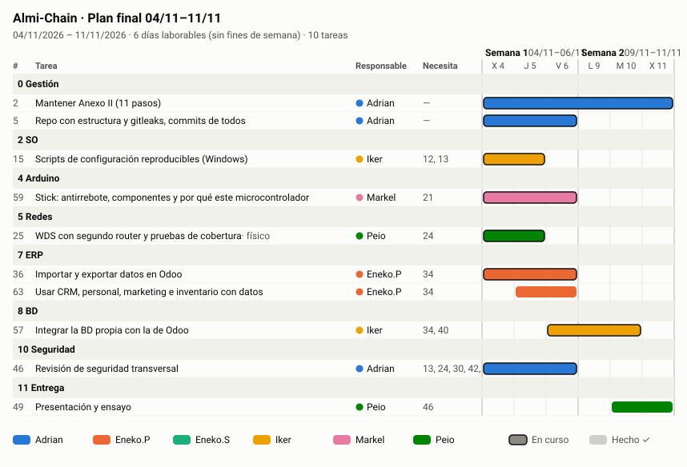

# Planificación · Diagrama de Gantt

Del 21/10/2026 al 11/11/2026 (16 días laborables).

> Fichero generado con `python3 scripts/gantt.py` a partir de [backlog-kanban.csv](backlog-kanban.csv). Para cambiar fechas o responsables, edita el CSV y vuelve a generarlo.

> **Fechas.** En las tareas *Hecho*, Inicio y Fin son las fechas **reales** en que se hicieron (sacadas de los documentos y del historial de Git); en el resto, las planificadas. El reto va del lunes 26/10 al jueves 12/11/2026. Corte técnico el miércoles 4/11 (ese día dan la rúbrica); documentación y presentación del 5 al 10/11 (decisión del 27/10/2026).

Cada barra tiene el color de su responsable. La columna *Necesita* indica qué tareas tienen que estar terminadas antes de empezar.

## Plan final (04/11 – 11/11)

Replanificado el 04/11/2026 con la rúbrica (Anexo VI, [rubrica-anexo-VI.pdf](rubrica-anexo-VI.pdf)) y la auditoría del repositorio: lo que queda, repartido para que cada persona tenga una carga parecida. Las tareas 56 a 62 salen de criterios de la rúbrica que el repositorio aún no cubre.

| Persona | Días de trabajo | Tareas |
|---|---|---|
| Adrian | 6 | #2 Mantener Anexo II (11 pasos) (04/11–11/11); #5 Repo con estructura y gitleaks; commits de todos (04/11–06/11); #46 Revisión de seguridad transversal (04/11–06/11) |
| Eneko.P | 5 | #36 Importar y exportar datos en Odoo (04/11–06/11); #63 Usar CRM, personal, marketing e inventario con datos (05/11–06/11); #58 Tecnologías habilitadoras: análisis y comparativa (09/11–10/11) |
| Eneko.S | 6 | #56 Ampliar el E/R: relación ternaria; historiales y atributos especiales (04/11–05/11); #62 Huecos de la rúbrica: VM; front-end de MAME; tablet; WCAG AA (06/11–09/11); #47 Tabla de pruebas por bloque (10/11–11/11) |
| Iker | 5 | #15 Scripts de configuración reproducibles (Windows) (04/11–05/11); #57 Integrar la BD propia con la de Odoo (06/11–10/11) |
| Markel | 6 | #59 Stick: antirrebote; componentes y por qué este microcontrolador (04/11–06/11); #48 Documentación final paso a paso (09/11–11/11) |
| Peio | 6 | #25 WDS con segundo router y pruebas de cobertura (04/11–05/11); #61 Poner al día los textos desfasados que señala la auditoría (06/11–09/11); #49 Presentación y ensayo (10/11–11/11) |

*Días de trabajo:* días laborables del tramo en que la persona tiene al menos una tarea. Las tareas 2 y 5 de Adrian son de seguimiento y ocupan poco cada día.

## Resumen

**47 de 63 tareas hechas (74 %).** *Hecho* significa que el entregable existe y tiene evidencias; las comprobaciones del 23/10/2026 están en [verificacion.md](verificacion.md).

| Tipo | Hechas | En curso | Pendientes | Total |
|---|---|---|---|---|
| Gestión | 4 | 2 | 0 | 6 |
| Documentación | 11 | 2 | 5 | 18 |
| Software | 26 | 3 | 3 | 32 |
| Físico | 6 | 1 | 0 | 7 |

*Software* se hace en un ordenador o en una máquina virtual; *Físico* necesita el equipo real (montar, cablear o configurar hardware).

## Tareas sin terminar

Ordenadas por estado y fecha de fin. *Qué falta* sale de revisar el documento de cada tarea.

| # | Tarea | Tipo | Responsable | Fin | Estado | Qué falta | Evidencia |
|---|---|---|---|---|---|---|---|
| 15 | Scripts de configuración reproducibles (Windows) | Software | Iker | 05/11 | En curso | configurar-tpv.ps1 y comprobar-tpv.ps1 hechos el 24/10 (tareas 13 y 15). Falta ejecutarlos en los dos TPV. | [configurar-tpv.ps1](../../docs/so/13-tpv/configurar-tpv.ps1) |
| 25 | WDS con segundo router y pruebas de cobertura | Físico | Peio | 05/11 | En curso | 04/11: Peio subió el router 2 en Range Extender (192.168.10.2, DHCP apagado, ping al router 1). Falta lo que pide la rúbrica: que amplíe la Wi-Fi de clientes y justificar la cobertura con medidas de antes y después. Aprovechar que se entra al router para desactivar UPnP (A-22). | [DOCUMENTACION.md](../../docs/redes/25-wds/DOCUMENTACION.md) |
| 5 | Repo con estructura y gitleaks; commits de todos | Gestión | Adrian | 06/11 | En curso | 04/11: quitados los .gitkeep de carpetas con contenido, permiso de ejecución de mover-docker-al-raid.sh corregido y correo de Git de Adrian corregido en el repo (los commits viejos con coma se quedan: no se reescribe el historial). Falta solo un commit de Eneko.P (lo hará con la 36 o la 63). | [gitleaks.yml](../../.github/workflows/gitleaks.yml) |
| 36 | Importar y exportar datos en Odoo | Software | Eneko.P | 06/11 | En curso | carta.csv (14 productos) e importar-exportar.py (importar carta; exportar carta; clientes; ventas y facturas a CSV) hechos el 24/10. Falta ejecutarlo contra Odoo y guardar las evidencias. El 26/10 pasa de Iker a Eneko.P (reparto de carga). | [DOCUMENTACION.md](../../docs/erp/36-importar-exportar/DOCUMENTACION.md) |
| 46 | Revisión de seguridad transversal | Software | Adrian | 06/11 | En curso | 04/11: S-08 y S-09 en preseed-servidor.cfg (SSH solo con clave y sin root; clave del PC del gerente en vez de recreativa-claude; unattended-upgrades), probado con una instalación desde cero: comprobaciones 6 y 7 OK. Falta lo que necesita el servidor del equipo (PC de Iker) y la red del aula: comprobaciones 2 y 3, y 6 y 7 en ese servidor tras aplicar la sección 4.2. | [DOCUMENTACION.md](../../docs/seguridad/46-revision-seguridad/DOCUMENTACION.md) |
| 2 | Mantener Anexo II (11 pasos) | Gestión | Adrian | 11/11 | En curso | Dura todo el reto. Borrador de las secciones 9 (entrega) y 10 (retrospectiva) el 26/10; la 10 se completa entre todos después de la presentación. 27/10: añadidas las incidencias del día (impresión por IPP; S-20 y S-21) y quitado el «pendiente de confirmar» de Eneko.P. 29/10: puesto al día (decisiones sustituidas marcadas, firmware de router, cifrado del gerente, semanas con el corte del 4/11, incidencias y pruebas del 27-29/10). 29/10 (tarde): pruebas de redes y arcade al día, incidencias del 29/10, retrospectiva (qué mejorar y desviaciones) y diagrama de AWS en la tarea 30. 30/10: decisiones de las VM (no van a Drive) y de la notación Chen del E/R; incidencia de las medidas de la recreativa cerrada con la tarea 54; revisión de seguridad con 24 hallazgos. 03/11: decisión de Windows de los TPV (LTSC 2021), incidencias del 30/10 y del 03/11 y prueba de seguridad al día. | [anexo-II-11-pasos.md](../../docs/gestion/anexo-II-11-pasos.md) |
| 47 | Tabla de pruebas por bloque | Documentación | Eneko.S | 11/11 | En curso | Punto de partida: las pruebas del 23/10 en verificacion.md. Pasa de Eneko.P a Eneko.S. 27/10: el equipo decide cerrar lo técnico el 4/11 (ese día dan la rúbrica) y dejar la documentación y la presentación para después, para ajustarlas a ella. 29/10: borrador con 59 pruebas de los 11 bloques (50 hechas; 9 pendientes, con la 53 y la 54) sacadas de cada tarea, del backlog y de verificacion.md. | [47-tabla-pruebas.md](../../docs/gestion/47-tabla-pruebas.md) |
| 48 | Documentación final paso a paso | Documentación | Markel | 11/11 | En curso | Punto de partida: LOGICA_RETO.md. 27/10: después de la rúbrica (4/11), para ajustarla a ella. 29/10: estaba en Hecho por error (el plan la pone del 5 al 9/11 y su documento dice En curso). Markel subió el capítulo de restauración (docs/backup/48-documentacion-final-restauracion.md), que amplía la 45 sin repetir sus pruebas. | [LOGICA_RETO.md](../../LOGICA_RETO.md) |
| 56 | Ampliar el E/R: relación ternaria; historiales y atributos especiales | Documentación | Eneko.S | 05/11 | Pendiente | Rúbrica, GBD RA1-RA2, niveles 3 y 4: el E/R actual solo tiene relaciones binarias. Añadir una ternaria, un historial (p. ej. de precios) y atributos especiales (derivado, multivaluado), y llevarlo a las tareas 39 y 40. | [38-modelo-er.md](../../docs/bd/38-modelo-er.md) |
| 59 | Stick: antirrebote; componentes y por qué este microcontrolador | Software | Markel | 06/11 | Pendiente | Rúbrica, Digitalización RA2 (stick), niveles 4 y 5. YA HECHO: HID sin drivers, remapeo sin reprogramar (MAP + GUARDAR en EEPROM, probado el 27/10), esquema SVG y código comentado. FALTA: antirrebote real en el firmware (hoy solo delay(10)), captura de una partida en un segundo emulador, tabla de pruebas por control, precio de la Leonardo y los botones (solo está la palanca) y por qué un ATmega32U4 (sistema embebido) y no un encoder USB comercial. | [README.md](../../arduino/mando-joystick/README.md) |
| 63 | Usar CRM, personal, marketing e inventario con datos | Software | Eneko.P | 06/11 | Pendiente | Rúbrica, LMSGI RA7, nivel 4 (y por ser acumulativo, el 5): los módulos están instalados pero solo se usan facturación y TPV. Una oportunidad de CRM que acaba en presupuesto, los empleados dados de alta, una campaña de correo y un movimiento de inventario, con capturas. Se hace a la vez que la 36 en la ServidorERP. | [DOCUMENTACION.md](../../docs/erp/34-configurar-odoo/DOCUMENTACION.md) |
| 61 | Poner al día los textos desfasados que señala la auditoría | Documentación | Peio | 09/11 | Pendiente | Hallazgos de la auditoría del 04/11: README; CORRECIONES; tareas 7-11; 17; 18; 30; listas de pendientes ya hechas. LOGICA_RETO va en la 48. | — |
| 62 | Huecos de la rúbrica: VM; front-end de MAME; tablet; WCAG AA | Documentación | Eneko.S | 09/11 | Pendiente | Rúbrica, cuatro huecos pequeños. ISO RA1 n4: en la tarea 12, la VM de VirtualBox con RAM, disco y Guest Additions (no aparecen en ningún sitio). ISO RA2 n4: un párrafo que justifique la interfaz de MAME como front-end (selección de juego, pantalla completa) y cite la tarea 51, donde ya se probó Batocera (EmulationStation) y se descartó con datos. LMSGI RA1 n3: wireframe y punto de corte de tableta (el CSS solo tiene 800 px). LMSGI RA1 n5: justificar WCAG AA (contraste, teclado, textos alternativos); la 27 solo habla de contraste. | — |
| 57 | Integrar la BD propia con la de Odoo | Software | Iker | 10/11 | Pendiente | Rúbrica, GBD RA3, nivel 4. YA HECHO: la 36 importa en Odoo la carta en CSV, con los mismos platos que almi_chain, pero a mano y sin enlace entre las bases. FALTA: un script que lea de almi_chain y escriba en Odoo (o al revés), por ejemplo carta y precios o clientes, que se pueda repetir y con evidencia. | — |
| 58 | Tecnologías habilitadoras: análisis y comparativa | Documentación | Eneko.P | 10/11 | Pendiente | Rúbrica, Digitalización RA2, niveles 4 y 5: caracterizar las THD del reto (cloud/AWS, IaC, ERP-TPV, Arduino/IoT, IA) y su aplicación, comparando alternativas y justificando la elección. Hoy no hay ningún documento que hable de THD. | — |
| 49 | Presentación y ensayo | Documentación | Peio | 11/11 | Pendiente |  27/10: después de la rúbrica (4/11), para ajustarla a ella. 04/11: ensayo con todos el 11/11. | — |

## Carga por persona

| Persona | Tareas | Sin terminar | Software sin terminar | Físicas sin terminar | Días-tarea | Bloques que toca |
|---|---|---|---|---|---|---|
| Adrian | 19 | 3 | 1 | 0 | 60 | 0, 2, 3, 4, 5, 6, 7, 8, 9, 10 |
| Eneko.P | 4 | 3 | 2 | 0 | 9 | 6, 7, 11 |
| Eneko.S | 11 | 3 | 0 | 0 | 19 | 1, 3, 5, 7, 8, 11 |
| Iker | 14 | 2 | 2 | 0 | 33 | 0, 1, 2, 3, 7, 8, 9 |
| Markel | 8 | 2 | 1 | 0 | 19 | 1, 2, 4, 5, 6, 11 |
| Peio | 7 | 3 | 0 | 1 | 16 | 0, 1, 5, 6, 11 |

## Tareas por persona

Solo las que están en curso o pendientes; las hechas están al final, en *Tareas hechas*.

### Adrian

| # | Tarea | Bloque | Tipo | Fechas | Depende de | Estado |
|---|---|---|---|---|---|---|
| 5 | Repo con estructura y gitleaks; commits de todos | 0 Gestión | Gestión | 21/10–06/11 | — | En curso |
| 46 | Revisión de seguridad transversal | 10 Seguridad | Software | 02/11–06/11 | #13 (Markel), #24 (Peio), #30 (Adrian), #42 (Adrian), #52 (Adrian) | En curso |
| 2 | Mantener Anexo II (11 pasos) | 0 Gestión | Gestión | 21/10–11/11 | — | En curso |

### Eneko.P

| # | Tarea | Bloque | Tipo | Fechas | Depende de | Estado |
|---|---|---|---|---|---|---|
| 36 | Importar y exportar datos en Odoo | 7 ERP | Software | 03/11–06/11 | #34 (Iker) | En curso |
| 63 | Usar CRM, personal, marketing e inventario con datos | 7 ERP | Software | 05/11–06/11 | #34 (Iker) | Pendiente |
| 58 | Tecnologías habilitadoras: análisis y comparativa | 11 Entrega | Documentación | 09/11–10/11 | #30 (Adrian), #32 (Eneko.S) | Pendiente |

### Eneko.S

| # | Tarea | Bloque | Tipo | Fechas | Depende de | Estado |
|---|---|---|---|---|---|---|
| 47 | Tabla de pruebas por bloque | 11 Entrega | Documentación | 10/11–11/11 | #21 (Markel), #25 (Peio), #26 (Eneko.S), #29 (Adrian) | En curso |
| 56 | Ampliar el E/R: relación ternaria; historiales y atributos especiales | 8 BD | Documentación | 04/11–05/11 | #38 (Adrian) | Pendiente |
| 62 | Huecos de la rúbrica: VM; front-end de MAME; tablet; WCAG AA | 11 Entrega | Documentación | 06/11–09/11 | — | Pendiente |

### Iker

| # | Tarea | Bloque | Tipo | Fechas | Depende de | Estado |
|---|---|---|---|---|---|---|
| 15 | Scripts de configuración reproducibles (Windows) | 2 SO | Software | 03/11–05/11 | #12 (Adrian), #13 (Markel) | En curso |
| 57 | Integrar la BD propia con la de Odoo | 8 BD | Software | 06/11–10/11 | #34 (Iker), #40 (Eneko.S) | Pendiente |

### Markel

| # | Tarea | Bloque | Tipo | Fechas | Depende de | Estado |
|---|---|---|---|---|---|---|
| 48 | Documentación final paso a paso | 11 Entrega | Documentación | 09/11–11/11 | #45 (Iker) | En curso |
| 59 | Stick: antirrebote; componentes y por qué este microcontrolador | 4 Arduino | Software | 04/11–06/11 | #21 (Markel) | Pendiente |

### Peio

| # | Tarea | Bloque | Tipo | Fechas | Depende de | Estado |
|---|---|---|---|---|---|---|
| 25 | WDS con segundo router y pruebas de cobertura | 5 Redes | Físico | 02/11–05/11 | #24 (Peio) | En curso |
| 61 | Poner al día los textos desfasados que señala la auditoría | 11 Entrega | Documentación | 06/11–09/11 | — | Pendiente |
| 49 | Presentación y ensayo | 11 Entrega | Documentación | 10/11–11/11 | #46 (Adrian) | Pendiente |

## Tareas hechas

| # | Tarea | Bloque | Tipo | Responsable | Comprobación | Evidencia |
|---|---|---|---|---|---|---|
| 1 | Firmar Anexo I (contrato de equipo) | 0 Gestión | Gestión | Adrian | Firmado el 21/10. | [anexo-I-contrato-equipo.md](../../docs/gestion/anexo-I-contrato-equipo.md) |
| 3 | Repartir tareas y responsables | 0 Gestión | Gestión | Adrian | Reparto revisado el 23/10 (software pendiente a Adrian e Iker; montaje físico a cualquiera salvo Eneko.P). 26/10: Eneko.P vuelve y recibe la 17, 18, 31 y 36; Markel e Iker se cambian la 13 y la 14. 27/10: la 37 pasa de Peio a Adrian. Cambios en roles.md. | [roles.md](../../docs/gestion/roles.md) |
| 4 | Herramienta de seguimiento (Gantt en el repo) | 0 Gestión | Gestión | Iker | El enunciado pide Gantt o Kanban: se usa el Gantt generado desde el CSV. El tablero de GitHub Projects se creó pero no se usa. | [gantt.md](../../docs/gestion/gantt.md) |
| 6 | Resolver dudas pendientes con el profesor | 0 Gestión | Gestión | Peio | Decidido el 24/10 y apuntado en el Anexo II (sección 5): grupo de 6; DuckDNS vale; reto del 26/10 al 12/11; base central; TicketBAI sin configurar; una VM; la impresora la da el centro. La notación del E/R se revisa con la rúbrica. | [anexo-II-11-pasos.md](../../docs/gestion/anexo-II-11-pasos.md) |
| 7 | Definir necesidades de equipos (gerente; 2 TPV; impresoras) | 1 Hardware | Documentación | Eneko.S | Requisitos RG, RT y RI con su prueba prevista. | [07-necesidades-equipos.md](../../docs/hardware/07-necesidades-equipos.md) |
| 8 | Tabla de hardware con justificación | 1 Hardware | Documentación | Eneko.S | Total de 2.361,36 € comprobado el 23/10. | [08-tabla-hardware.md](../../docs/hardware/08-tabla-hardware.md) |
| 9 | Tabla de software y licencias | 1 Hardware | Documentación | Markel | Revisada el 24/10: versión de cada programa y software del servidor, la recreativa y la web. Ubuntu 26.04.1 LTS apuntado el 27/10. El driver de Epson ya no se apunta: las pruebas se hacen con la Samsung ML-1660 (27/10). | [09-tabla-software-licencias.md](../../docs/hardware/09-tabla-software-licencias.md) |
| 10 | Presupuesto con enlaces (incl. WAN y router extra) | 1 Hardware | Documentación | Peio | Sumas comprobadas el 23/10. El 24/10 se añaden servidor, discos del RAID, disco USB, SAI, switch, cable, adaptador Wi-Fi y palanca (sección 12): 3.814,74 € de inversión completa y 4.174,74 € el primer año. | [10-presupuesto-hardware.md](../../docs/hardware/10-presupuesto-hardware.md) |
| 11 | Diagrama de arquitectura de equipos | 1 Hardware | Documentación | Iker | Actualizado el 24/10: switch; servidor presupuestado; red de invitados 192.168.50.0/24; Actions y HTTPS; SVG regenerado; tabla de guías de instalación por equipo. | [DIAGRAMA.md](../../docs/diagramas/11-arquitectura-equipos/DIAGRAMA.md) |
| 12 | Dual boot Win10 + Linux en el equipo del gerente (VM) | 2 SO | Software | Adrian | Hecho en VMware (23/10). Ubuntu 26.04.1 LTS (leído del disco el 27/10). 29/10: VM pasada a VirtualBox (disco SATA, teclado USB); Windows al día con KB5066791 (19045.6456); BitLocker en C: con contraseña de arranque (sin TPM) y /home/gerente cifrado con fscrypt; scripts en scripts/so/. No se vuelve a exportar: bastan las evidencias. 30/10: las VM no van a Drive; esta se queda en el PC de Adrian (docs/gestion/maquinas-virtuales.md). Windows 10 sin soporte: anotado como riesgo (Windows 11 Pro o ESU en el equipo real). | [12-dual-boot.md](../../docs/so/12-dual-boot.md) |
| 13 | Bastionado de los 2 TPV Windows en VM (usuario estándar; kiosko; USB) | 2 SO | Software | Markel | Hecha a mano por Markel el 26/10 en dos VM con Windows 11 Pro (TPV2 clonado de TPV1 con MAC nuevas): usuario estándar UsuarioTPV; quiosco QuioscoTPV con Edge; USB bloqueado por directiva; firewall y Defender activos; capturas en la guía. Queda (hallazgo S-20 de la tarea 46): el quiosco apunta a http://localhost:8069 provisional y hay que cambiarlo por la dirección del servidor (tarea 52); comprobar-tpv.ps1 no se ha ejecutado (tarea 15). El 26/10 pasa de Iker a Markel. | [13-bastionado-tpv-windows.md](../../docs/so/13-tpv/Tarea13_Markdown_GitHub/13-bastionado-tpv-windows.md) |
| 14 | Driver y cola de la impresora de tickets en el TPV (VM) y prueba | 2 SO | Software | Adrian | Hecha con la Samsung ML-1660 (decisión del 27/10: no hay térmicas para todos). 26/10: pasada por USB a la VM del TPV, Windows no crea USB001. 27/10: cola IPP a la CUPS del PC con el controlador Microsoft PS Class Driver; el ticket de Odoo sale en papel desde la VM y sin QR (tarea 52, sección 4.2; evidencias 16 y 17). Pasa a Adrian, que la hizo (antes Iker). La guía de docs/so/14-impresora queda para la térmica por USB del local. | [DOCUMENTACION.md](../../docs/erp/52-https-odoo/DOCUMENTACION.md) |
| 16 | Instalar SO ligero y MAME con arranque directo (VM) | 3 Arcade | Software | Iker | Debian 13 + MAME 0.276 en VM: arranque directo en 4,7 s y 5 ROMs legales verificadas. El 24/10: preseed sin clave SSH fija y SSH sin contraseña; conexión a la Wi-Fi de invitados documentada. 29/10: la recreativa se entrega en VM; la tarea 53 la repite en la VM de 1 núcleo y 1 GB con el stick real. | [DOCUMENTACION.md](../../docs/arcade/16-recreativa-mame/DOCUMENTACION.md) |
| 17 | Pruebas de rendimiento MAME antes/después (método; scripts; VM de 2 núcleos) | 3 Arcade | Software | Iker | Método, medir-rendimiento.sh, optimizar-arcade.sh (9 optimizaciones) y medidas de antes y después en una VM de 2 núcleos y 1,5 GB (22/10), más 3 medidas de antes en 1 GB (23/10). 29/10: se cierra con eso y vuelve a Iker, que la hizo (antes Eneko.P); la medida en 1 núcleo y 1 GB es la tarea 54, para no repetirla. 29/10: cerrada con las medidas en 1 GB de la tarea 54 (Recreativa-53). | [DOCUMENTACION.md](../../docs/arcade/17-rendimiento-mame/DOCUMENTACION.md) |
| 18 | Monitorización de recursos de la recreativa (scripts) | 3 Arcade | Software | Adrian | monitor-recreativa.sh y resumen-monitorizacion.sh hechos y probados en Linux; documento para Debian (24/10). 29/10: se cierra con los scripts y vuelve a Adrian, que los hizo (antes Eneko.P); la ejecución en la VM de 1 GB durante una partida es la tarea 54. 29/10: cerrada con las medidas en 1 GB de la tarea 54 (Recreativa-53). | [18-monitorizacion-recreativa.md](../../docs/arcade/18-monitorizacion-recreativa.md) |
| 19 | Montaje del arcade stick (ATmega32U4) | 4 Arduino | Físico | Markel | Esquema de conexiones con 4 botones (pines 2-5) y la palanca digital (A2-A5); actualizado el 26/10. 27/10 (Iker): cableado y probado en la placa real; el común de la palanca es el cable blanco a GND. Ver arduino/mando-joystick/evidencias/prueba-placa-2026-10-27.txt. 27/10 (Adrian): montado en la caja con la palanca y los botones (foto). La caja tiene 6 botones; el firmware lee 4 (pines 2-5). | [stick-montado-2026-10-27.webp](../../arduino/mando-joystick/evidencias/stick-montado-2026-10-27.webp) |
| 20 | Firmware HID y mapeo configurable (EEPROM) | 4 Arduino | Software | Adrian | Compila (pio run del 26/10: Flash 37,4 %; RAM 17,4 %). 26/10: 4 botones por indicación del profesor y solo palanca digital (fuera el modo analógico; la zona muerta y el modo NINGUNA). Probarlo en la placa es la tarea 50. | [README.md](../../arduino/mando-joystick/README.md) |
| 21 | Pruebas del stick con MAME y otro emulador | 4 Arduino | Físico | Markel | Pasa de Eneko.P a Markel. MAME: partida de Gridlee con el stick en Recreativa-53 (tarea 53, P4 y P10, 29/10). Otro emulador: Batocera (RetroArch), con evtest de los 4 botones y los ejes y es_input.cfg (Iker, 27/10) y una partida jugada ese día, sin captura. | [README.md](../../arduino/mando-joystick/README.md) |
| 22 | Comparativa de operadores WAN | 5 Redes | Documentación | Markel | Elige DIGI 1 Gb (30 €/mes). El 24/10 se añaden el análisis de necesidades y el esquema de conectividad. Es la WAN de todo el proyecto. | [22-comparativa-wan.md](../../docs/redes/22-comparativa-wan.md) |
| 23 | Plano del local y plan de direccionamiento IP | 5 Redes | Documentación | Adrian | Plano; plan de IP; red plana con invitados aislada (5.2 y 5.3). 23-red-local.pkt hecho el 25/10 (MCP de Packet Tracer y dos pasos a mano): las 16 pruebas correctas. | [23-plano-direccionamiento.md](../../docs/redes/23-plano-direccionamiento.md) |
| 24 | Configurar red segura (WPA3; invitados; firewall) | 5 Redes | Físico | Peio | Hecho en un TL-WR841N: administración remota cerrada; WPA2-AES; SPI y anti-DoS; contraseñas Wi-Fi y de administración cambiadas y en KeePassXC (26/10). 29/10 (Peio, configurar-red-segura.md): LAN 192.168.10.0/24, reserva del gerente, WPS desactivado, red de invitados aislada, administración solo desde la MAC del gerente y renovación de la clave de grupo. 29/10: contraseñas del personal y de invitados cambiadas (distintas) tras verse en las capturas 14 y 16 (S-24). PIN de WPS nuevo. 30/10: capturas de ping P3b y P4 desde la red de invitados (sin respuesta al gerente ni entre móviles; Internet sí). WPA3: limitación del TL-WR841N. | [DOCUMENTACION.md](../../docs/redes/24-red-segura/DOCUMENTACION.md) |
| 26 | Análisis de conectividad (Wireshark; nmap) | 5 Redes | Físico | Eneko.S | Con el equipo real o en VM: Packet Tracer no tiene Wireshark ni nmap (su modo simulación solo enseña los paquetes). Probar que desde la Wi-Fi de invitados nmap no ve la LAN. 27/10: se acorta a un día (4/11) por el corte técnico de esa fecha; depende de que la 25 acabe el 3/11. 27/10: plan W1-W7 de Wireshark y analizar-red.sh (nmap con veredicto; probado con servicios locales). 30/10: hecho con el router real; invitados aislados; hallazgos H-01 a H-05 (UPnP y SSH en el router). | [DOCUMENTACION.md](../../docs/redes/26-analisis-conectividad/DOCUMENTACION.md) |
| 27 | Wireframes y diseño conceptual web | 6 Web | Documentación | Peio | — | [27-wireframes.md](../../docs/web/27-wireframes.md) |
| 28 | Implementar web (mapa; formulario; slideshow) | 6 Web | Software | Markel | Mapa de OpenStreetMap; geolocalización; formulario de ejemplo y slideshow. | [index.html](../../web/index.html) |
| 29 | Validación W3C; Lighthouse y accesibilidad | 6 Web | Software | Adrian | Lighthouse 98-100 en local (23/10). Contra la URL pública (26/10; medianas de 5): móvil 94/100/100/100 y escritorio 99/100/100/100. Móvil daba 70 hasta que el mapa pasó a cargarse al pulsar un botón. W3C contra la URL pública: 0 errores en HTML y en CSS. Pasa de Eneko.P a Adrian, que la hizo. 29/10: repetido con la web actual (fotos en web/img/) tras el apply de la tarea 31: móvil 97/100/100/100, escritorio 100/100/100/100, sin errores en la consola; W3C sin errores en HTML y CSS. | [lighthouse-w3c.txt](../../docs/evidencias/web/lighthouse-w3c.txt) |
| 30 | Hosting AWS con dominio y HTTPS | 6 Web | Software | Adrian | Probado con el laboratorio encendido (evidencias del 23/10). Fuera de sesión no responde porque el Learner Lab apaga la EC2. Configuración de nginx comprobada con nginx -t. 29/10: el montaje se importó en Terraform (tarea 31) y se aplicó: misma IP, instancia nueva; pruebas con curl repetidas con la web actual (iac/evidencias/03-pruebas-curl.txt). | [30-hosting-aws.md](../../docs/web/30-hosting-aws.md) |
| 31 | IaC y despliegue automatizado (Terraform + Actions) | 6 Web | Software | Eneko.P | Código hecho el 24/10 (Iker); pasó a Eneko.P el 26/10. Aplicado en el Learner Lab de Adrian. 29/10: aplicado en el Learner Lab importando el montaje a mano de la tarea 30 (misma IP elástica, sin tocar DuckDNS): instancia nueva con disco cifrado e IMDSv2, web actual con las fotos, pruebas correctas y terraform plan sin cambios. Arreglado: el Learner Lab prohíbe leer el object lock del bucket, así que el bucket se lee con un data y se crea una vez con la CLI. Publicación por GitHub Actions comprobada el 27/10 (ejecución 40503296317); los secretos caducan con cada sesión del laboratorio. | [README.md](../../iac/README.md) |
| 32 | Comparativa y elección de ERP | 7 ERP | Documentación | Eneko.S | Elige Odoo Community. | [32-comparativa-erp.md](../../docs/erp/32-comparativa-erp.md) |
| 33 | Instalar Odoo + PostgreSQL con Docker | 7 ERP | Software | Iker | Repetido el 23/10 en Docker limpio con el mismo docker-compose.yml: login 200; gestor de BD desactivado; 5432 sin publicar; admin/admin rechazado. | [DOCUMENTACION.md](../../docs/erp/33-odoo-docker/DOCUMENTACION.md) |
| 34 | Configurar módulos de Odoo | 7 ERP | Software | Iker | Hecha por Iker (estaba a nombre de Markel). La prueba en limpio del 23/10 encontró 2 fallos que impedían repetirla desde cero; corregidos (evidencias/prueba-instalacion-limpia.txt). TPV de barra probado con una venta real. | [DOCUMENTACION.md](../../docs/erp/34-configurar-odoo/DOCUMENTACION.md) |
| 35 | Caso de uso end-to-end automatizado | 7 ERP | Software | Iker | Pedido; factura; cobro y PDF. Repetida el 27/10 con el caso de uso real (menú de grupo, IVA 10 %): INV/2026/00004 = 660,00 €. La primera repetición (INV/2026/00003, 654,55 €) llevaba también el IVA incluido del TPV: el script fija ahora el IVA en la línea y comprueba el total. La 00003 se anuló con la rectificativa RINV/2026/00001. | [DOCUMENTACION.md](../../docs/erp/35-factura-automatica/DOCUMENTACION.md) |
| 37 | Imprimir ticket desde el TPV de Odoo en la impresora real | 7 ERP | Físico | Adrian | El ticket ya sale en pantalla (tarea 34; sección 8). Pasos en docs/so/14-impresora/DOCUMENTACION.md (paso 6). Espera a la impresora del centro. 26/10: el recibo de una venta por HTTPS se genera e imprime desde Edge (tarea 52, evidencia 09), pero salió por el CUPS del PC, no desde el TPV. 27/10: ya sale desde la VM win-11 por IPP a la Samsung del PC (tarea 52, evidencia 16). Decisión del 27/10: la impresora de tickets de las pruebas es la Samsung ML-1660 (las térmicas del centro no llegan para todos los grupos), así que la tarea se da por hecha con ese ticket (evidencias 16 y 17 de la 52). Pasa de Peio a Adrian, que la hizo. | [DOCUMENTACION.md](../../docs/erp/52-https-odoo/DOCUMENTACION.md) |
| 38 | Modelo E/R | 8 BD | Documentación | Adrian | 30/10: diagrama pasado a notación Chen (docs/bd/38-modelo-er-chen.svg y .drawio, generados con scripts/bd/er-chen.py); la vista de tablas en Mermaid se queda como complemento. | [38-modelo-er.md](../../docs/bd/38-modelo-er.md) |
| 39 | Modelo lógico normalizado (3FN) | 8 BD | Documentación | Eneko.S | — | [39-modelo-logico-3fn.md](../../docs/bd/39-modelo-logico-3fn.md) |
| 40 | Scripts DDL | 8 BD | Software | Eneko.S | Repetido el 23/10 en PostgreSQL 16: 01 a 03 sin errores; 03 repetible; 05-pruebas 33/33 dos veces; 04 borra y se puede recrear. | [40-scripts-ddl.md](../../docs/bd/40-scripts-ddl.md) |
| 41 | Datos de prueba y consultas | 8 BD | Software | Iker | 06-datos.sql (2 locales; 8 ventas) y 07-consultas.sql (12 consultas) ejecutados el 24/10 en PostgreSQL 18.3 sin errores; evidencia guardada. almi_chain creada en el servidor el 27/10 con 01-03 y 06 (tarea 44) y ya entra en las copias. | [41-datos-y-consultas.txt](../../docs/bd/evidencias/41-datos-y-consultas.txt) |
| 42 | Usuarios de BD con mínimos privilegios | 8 BD | Software | Adrian | 08-usuarios.sql (tpv_app e informes con LOGIN; contraseñas por variable) y 09-pruebas-usuarios.sql: 9/9 con cada cuenta el 24/10. Pasa de Markel a Adrian. 29/10: S-22 corregido (las contraseñas se leen con read -rs, no en la orden) y todos los scripts de BD probados en PostgreSQL 17, el de Odoo. | [42-usuarios-y-permisos.txt](../../docs/bd/evidencias/42-usuarios-y-permisos.txt) |
| 43 | RAID 1 y simulación de fallo | 9 Backup | Software | Iker | RAID y simulación de fallo (22-23/10). 27/10: la BD y los adjuntos de Odoo pasan al RAID (solo los volúmenes de Docker: todo /var/lib/docker no cabía, 6097 MB frente a 4454 MB libres) con mover-docker-al-raid.sh; avería repetida con Odoo funcionando (venta S00007 guardada con [U_]; reconstruido en 30 s) y reinicio comprobado. La restauración (45) se repitió con la BD en el RAID el 27/10: todo OK en 63 s. | [DOCUMENTACION.md](../../docs/backup/43-raid1/DOCUMENTACION.md) |
| 44 | Plan de backup 3-2-1 cifrado y automatizado | 9 Backup | Software | Iker | Copia diaria cifrada en RAID y USB. 27/10: almi_chain creada en el servidor y la copia lleva las dos bases; aviso si la copia falla (OnFailure=) instalado y probado con un fallo provocado. Mejora preparada sin probar: tercer repositorio en S3 (falta crear el bucket y el usuario IAM). 29/10: la copia a S3 no puede funcionar con el Learner Lab (no deja crear usuarios IAM; hallazgo S-23 de la tarea 46): queda como diseño. | [DOCUMENTACION.md](../../docs/backup/44-backup-3-2-1/DOCUMENTACION.md) |
| 45 | Prueba de restauración con evidencias | 9 Backup | Software | Iker | Restaurada la copia del USB en un entorno aislado (46 s). Repetida el 27/10 con la BD en el RAID: todas las comprobaciones OK en 63 s. Falta repetirla en una VM nueva para medir el RTO real. | [DOCUMENTACION.md](../../docs/backup/45-restauracion/DOCUMENTACION.md) |
| 50 | Probar el firmware del stick en la placa (HID; comandos; EEPROM) | 4 Arduino | Físico | Adrian | Lista de comprobaciones en arduino/mando-joystick/README.md. 27/10 (Iker): firmware subido y verificado; los 4 botones y las 4 direcciones llegan al PC y a Batocera. 27/10 (Adrian): ver-mando.py registra la entrada y deja evidencia: 2 registros con los 4 botones y las 4 direcciones, sin pulsaciones fantasma (el botón 3 ya no se pulsa solo); MAP + GUARDAR sobrevive al reinicio de la placa y RESET + GUARDAR deja los valores por defecto. 30/10 (Adrian): probar-stick.py (corregido) confirma MAP 1 3 pulsando; los botones se pulsaron sin saber su número, de ahí los FALLO. Sin comprobar: INV moviendo la palanca. | [README.md](../../arduino/mando-joystick/README.md) |
| 51 | Comparar Batocera con Debian en VM de 1 núcleo y 1 GB y decidir el SO | 3 Arcade | Software | Iker | 26/10: medidas en VM de 1 núcleo y 1 GB (3 antes y 3 después en Batocera; Debian del 23/10). Decidido Debian 13 + MAME: llega antes a jugar (7,1 s frente a 12,9 s), usa menos RAM (400 MB con el juego frente a 554 MB solo con el menú) y MAME va igual o más rápido. Batocera endurecido (security.enabled) y optimizado; incidencias y decisión en NOTAS.md y Anexo II. | [NOTAS.md](../../docs/arcade/16-batocera/NOTAS.md) |
| 52 | Proxy HTTPS delante de Odoo | 7 ERP | Software | Adrian | Hecha en VM el 26/10: proxy nginx con certificado propio (con nameConstraints; tarea 46) y las 15 pruebas correctas, con venta por HTTPS (5) y venta sin red (6) en un TPV provisional (win-11) de la red 192.168.10.0/24; fijar-url-y-qr.sh quita el QR del ticket (S-19). El 27/10 se da por hecha y ese mismo día el ticket se imprime desde la VM win-11, por IPP a la cola CUPS del PC (la Samsung ML-1660 no crea el puerto USB001 si se pasa por USB), ya sin QR. RUNBOOK.md queda para pasarla al servidor del equipo. | [DOCUMENTACION.md](../../docs/erp/52-https-odoo/DOCUMENTACION.md) |
| 53 | Instalar la recreativa en VM de 1 núcleo y 1 GB y probarla con el stick | 3 Arcade | Software | Eneko.S | Mismo preseed y script que la VM (tarea 16): la 51 decidió Debian el 26/10. 27/10: guía y preparar-preseed-fisico.sh (contraseña como hash; disco elegido; clave SSH) listos y probados; falta hacerlo en el equipo real. 29/10: el equipo decide hacerla en VM. Hecha en Recreativa-53 (VirtualBox; 1 CPU; 1024 MB; Debian 13.7; MAME 0.276) con el mismo preseed y script de la 16 y contraseña nueva de tecnico en KeePassXC: arranque directo a MAME; 5 ROMs OK; partida de Gridlee con el stick por USB; MAME se reabre al salir; arcade sin sudo y bloqueada; SSH solo con clave; 524 MB libres con MAME. | [DOCUMENTACION.md](../../docs/arcade/53-recreativa-fisica/DOCUMENTACION.md) |
| 54 | Medir rendimiento y monitorizar en la VM de 1 núcleo y 1 GB (antes/después y jugando) | 3 Arcade | Software | Eneko.S | Con medir-rendimiento.sh y monitor-recreativa.sh. 27/10: protocolo y resumir-rendimiento.sh (reproduce la tabla de la tarea 17); falta medir en el equipo real. 29/10: se mide en Recreativa-53 (tarea 53); sirve también para lo que le falta a la 17 en 1 GB. 29/10: es la única tarea que mide en 1 GB: absorbe lo que faltaba de la 17 y la 18. 29/10: medido en Recreativa-53 (3+3 arranques; reposo; 10 min de juego antes y después): timers 8→5 y disco −12 %; arranque 14,4 s, RAM y velocidad sin cambios significativos (Robby Roto 773 % → 777 %); jugando, CPU media 52-58 %, más de 460 MB libres y sin swap. Las 3 primeras de después se repitieron: el anfitrión estaba ocupado (−45 % en -bench; control con el anfitrión libre: 777 %). | [DOCUMENTACION.md](../../docs/arcade/54-medidas-equipo-real/DOCUMENTACION.md) |
| 55 | Contraseñas robustas en la VM del gerente y guardarlas en KeePassXC | 2 SO | Software | Adrian | 4 contraseñas cambiadas el 23/10 con frases generadas en KeePassXC; la cuenta de instalación de Windows ya no existe; VM exportada de nuevo. Drive revisado el 24/10: .vmdk y .kdbx nuevos y ningún .txt con contraseñas. 29/10: contraseñas de administrador y gerente de Ubuntu repuestas desde el modo de recuperación y guardadas en KeePassXC, con la contraseña de BitLocker y su clave de recuperación. | [ubu-07-cuentas-y-contrasenas.txt](../../docs/evidencias/12-dual-boot/ubu-07-cuentas-y-contrasenas.txt) |
| 60 | Copia remota en S3 y restauración de almi_chain probadas | 9 Backup | Software | Adrian | Hecha el 04/11 en la ServidorERP de laboratorio, montada desde cero con los scripts 43 y 44: copia diaria a RAID, USB y S3 (bucket privado almi-chain-backup-2026, cifrado AES-256) y restauración desde S3 con 23 comprobaciones OK en 166 s, también almi_chain (roles, tablas, filas, importes y permisos). El Learner Lab no deja crear usuarios IAM: se usan sus credenciales temporales (tarea 44, sección 8.2). | [DOCUMENTACION.md](../../docs/backup/44-backup-3-2-1/DOCUMENTACION.md) |
