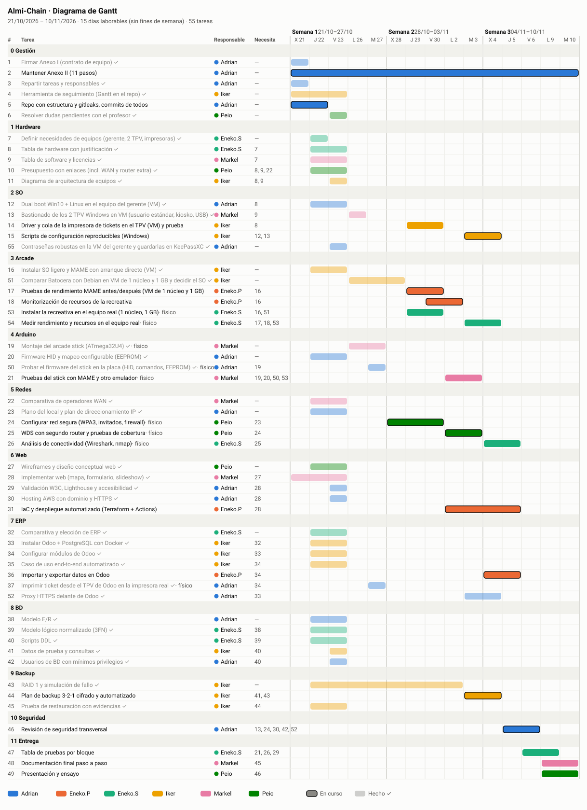

# Planificación · Diagrama de Gantt

Del 21/10/2026 al 10/11/2026 (15 días laborables).

> Fichero generado con `python3 scripts/gantt.py` a partir de [backlog-kanban.csv](backlog-kanban.csv). Para cambiar fechas o responsables, edita el CSV y vuelve a generarlo.

Cada barra tiene el color de su responsable. La columna *Necesita* indica qué tareas tienen que estar terminadas antes de empezar.

## Carga por persona

| Persona | Tareas | Días-tarea | Revisiones | Bloques que toca |
|---|---|---|---|---|
| Adrian | 9 | 34 | 7 | 0, 4, 6, 7, 8 |
| Eneko.P | 8 | 21 | 8 | 2, 4, 5, 6, 7, 9, 11 |
| Eneko.S | 9 | 17 | 8 | 1, 2, 3, 5, 7, 8, 10 |
| Iker | 8 | 20 | 8 | 0, 1, 3, 6, 7, 8, 9 |
| Markel | 8 | 22 | 8 | 1, 2, 5, 6, 7, 8, 9, 11 |
| Peio | 8 | 16 | 8 | 0, 1, 2, 5, 6, 7, 11 |

## Tareas por persona

### Adrian

| # | Tarea | Bloque | Fechas | Depende de | Revisa | Estado |
|---|---|---|---|---|---|---|
| 1 | Firmar Anexo I (contrato de equipo) | 0 Gestión | 21/10–21/10 | — | Equipo | Hecho |
| 2 | Mantener Anexo II (11 pasos) | 0 Gestión | 21/10–10/11 | — | Iker | En curso |
| 3 | Repartir tareas y responsables | 0 Gestión | 21/10–21/10 | — | Equipo | Hecho |
| 5 | Repo con estructura y gitleaks; commits de todos | 0 Gestión | 21/10–22/10 | — | Eneko.P | En curso |
| 20 | Firmware HID y mapeo configurable (EEPROM) | 4 Arduino | 27/10–30/10 | — | Eneko.P | Hecho |
| 50 | Probar el firmware del stick en físico (HID; comandos; EEPROM) | 4 Arduino | 28/10–30/10 | #19 (Eneko.P) | Eneko.P | Pendiente |
| 30 | Hosting AWS con dominio y HTTPS | 6 Web | 02/11–04/11 | #28 (Markel) | Eneko.P | Pendiente |
| 35 | Caso de uso end-to-end automatizado | 7 ERP | 03/11–05/11 | #34 (Markel) | Iker | Pendiente |
| 38 | Modelo E/R | 8 BD | 22/10–23/10 | — | Peio | Hecho |

### Eneko.P

| # | Tarea | Bloque | Fechas | Depende de | Revisa | Estado |
|---|---|---|---|---|---|---|
| 12 | Dual boot Win10 + Linux en el equipo del gerente | 2 SO | 28/10–30/10 | #8 (Eneko.S) | Eneko.S | Pendiente |
| 19 | Montaje del arcade stick (ATmega32U4) | 4 Arduino | 22/10–27/10 | — | Peio | Pendiente |
| 21 | Pruebas del stick con MAME y otro emulador | 4 Arduino | 02/11–03/11 | #16 (Iker), #19 (Eneko.P), #20 (Adrian), #50 (Adrian) | Markel | Pendiente |
| 23 | Plano del local y plan de direccionamiento IP | 5 Redes | 22/10–26/10 | — | Iker | Pendiente |
| 29 | Validación W3C; Lighthouse y accesibilidad | 6 Web | 02/11–03/11 | #28 (Markel) | Peio | Pendiente |
| 37 | Imprimir ticket desde el TPV de Odoo | 7 ERP | 04/11–05/11 | #14 (Peio), #34 (Markel) | Peio | Pendiente |
| 43 | RAID 1 y simulación de fallo | 9 Backup | 29/10–02/11 | — | Iker | Pendiente |
| 47 | Tabla de pruebas por bloque | 11 Entrega | 06/11–09/11 | #21 (Eneko.P), #26 (Eneko.S), #29 (Eneko.P) | Markel | Pendiente |

### Eneko.S

| # | Tarea | Bloque | Fechas | Depende de | Revisa | Estado |
|---|---|---|---|---|---|---|
| 7 | Definir necesidades de equipos (gerente; 2 TPV; impresoras) | 1 Hardware | 22/10–22/10 | — | Iker | Hecho |
| 8 | Tabla de hardware con justificación | 1 Hardware | 23/10–26/10 | #7 (Eneko.S) | Peio | Hecho |
| 15 | Scripts de configuración reproducibles | 2 SO | 03/11–04/11 | #12 (Eneko.P), #13 (Markel) | Markel | Pendiente |
| 18 | Monitorización de recursos de la recreativa | 3 Arcade | 30/10–02/11 | #16 (Iker) | Markel | Pendiente |
| 26 | Análisis de conectividad (Wireshark; nmap) | 5 Redes | 04/11–05/11 | #25 (Peio) | Markel | Pendiente |
| 32 | Comparativa y elección de ERP | 7 ERP | 22/10–23/10 | — | Markel | Hecho |
| 39 | Modelo lógico normalizado (3FN) | 8 BD | 26/10–27/10 | #38 (Adrian) | Peio | Hecho |
| 40 | Scripts DDL | 8 BD | 28/10–29/10 | #39 (Eneko.S) | Adrian | Hecho |
| 46 | Revisión de seguridad transversal | 10 Seguridad | 05/11–06/11 | #13 (Markel), #24 (Peio), #30 (Adrian), #42 (Markel) | Eneko.P | Pendiente |

### Iker

| # | Tarea | Bloque | Fechas | Depende de | Revisa | Estado |
|---|---|---|---|---|---|---|
| 4 | Crear tablero Kanban en GitHub Projects | 0 Gestión | 21/10–22/10 | — | Adrian | Pendiente |
| 11 | Diagrama de arquitectura de equipos | 1 Hardware | 27/10–28/10 | #8 (Eneko.S), #9 (Markel) | Adrian | Pendiente |
| 16 | Instalar SO ligero y MAME con arranque directo | 3 Arcade | 26/10–28/10 | — | Markel | Pendiente |
| 17 | Pruebas de rendimiento MAME antes/después | 3 Arcade | 29/10–30/10 | #16 (Iker) | Eneko.P | Pendiente |
| 31 | IaC y despliegue automatizado (Terraform + Actions) | 6 Web | 02/11–05/11 | #28 (Markel) | Adrian | Pendiente |
| 33 | Instalar Odoo + PostgreSQL con Docker | 7 ERP | 26/10–28/10 | #32 (Eneko.S) | Peio | Pendiente |
| 41 | Datos de prueba y consultas | 8 BD | 30/10–02/11 | #40 (Eneko.S) | Eneko.S | Pendiente |
| 45 | Prueba de restauración con evidencias | 9 Backup | 05/11–06/11 | #44 (Markel) | Markel | Pendiente |

### Markel

| # | Tarea | Bloque | Fechas | Depende de | Revisa | Estado |
|---|---|---|---|---|---|---|
| 9 | Tabla de software y licencias | 1 Hardware | 23/10–26/10 | #7 (Eneko.S) | Eneko.P | Hecho |
| 13 | Bastionado de los 2 TPV Windows (usuario estándar; kiosko; USB) | 2 SO | 28/10–02/11 | #9 (Markel) | Iker | Pendiente |
| 22 | Comparativa de operadores WAN | 5 Redes | 22/10–23/10 | — | Eneko.S | Hecho |
| 28 | Implementar web (mapa; formulario; slideshow) | 6 Web | 26/10–30/10 | #27 (Peio) | Eneko.S | Hecho |
| 34 | Configurar módulos de Odoo | 7 ERP | 29/10–02/11 | #33 (Iker) | Adrian | Pendiente |
| 42 | Usuarios de BD con mínimos privilegios | 8 BD | 02/11–03/11 | #40 (Eneko.S) | Iker | Pendiente |
| 44 | Plan de backup 3-2-1 cifrado y automatizado | 9 Backup | 03/11–04/11 | #41 (Iker), #43 (Eneko.P) | Eneko.S | Pendiente |
| 48 | Documentación final paso a paso | 11 Entrega | 09/11–10/11 | #45 (Iker) | Peio | Pendiente |

### Peio

| # | Tarea | Bloque | Fechas | Depende de | Revisa | Estado |
|---|---|---|---|---|---|---|
| 6 | Resolver dudas pendientes con el profesor | 0 Gestión | 21/10–22/10 | — | Adrian | Pendiente |
| 10 | Presupuesto con enlaces (incl. WAN y router extra) | 1 Hardware | 27/10–27/10 | #8 (Eneko.S), #9 (Markel), #22 (Markel) | Eneko.S | Pendiente |
| 14 | Instalar impresora de tickets y prueba | 2 SO | 29/10–30/10 | #8 (Eneko.S) | Eneko.S | Pendiente |
| 24 | Configurar red segura (WPA3; invitados; firewall) | 5 Redes | 28/10–30/10 | #23 (Eneko.P) | Adrian | Pendiente |
| 25 | WDS con segundo router y pruebas de cobertura | 5 Redes | 02/11–03/11 | #24 (Peio) | Iker | Pendiente |
| 27 | Wireframes y diseño conceptual web | 6 Web | 22/10–23/10 | — | Eneko.S | Hecho |
| 36 | Importar y exportar datos en Odoo | 7 ERP | 04/11–05/11 | #34 (Markel) | Eneko.P | Pendiente |
| 49 | Presentación y ensayo | 11 Entrega | 09/11–10/11 | #46 (Eneko.S) | Equipo | Pendiente |
