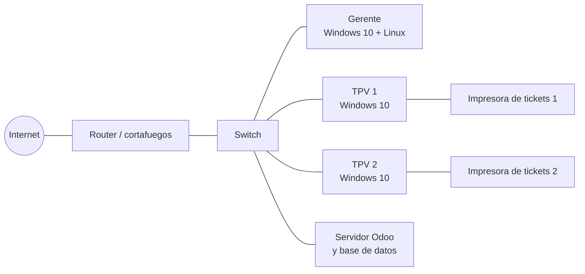

# Tarea 7: Necesidades de equipos (gerente, 2 TPV e impresoras)

- **Bloque:** 1 Hardware
- **Reto:** Almi-Chain (ASIR1 2026-27)
- **Estado:** pendiente de revisión
- **Fecha:** 22/10/2026

## 1. Alcance

El enunciado pide para el restaurante:

- Un equipo para el despacho del gerente, con arranque dual Windows 10 y GNU/Linux.
- Dos equipos de barra que funcionarán como TPV en Windows.
- Impresoras de tickets.

Este documento define las **necesidades** de cada puesto: qué debe hacer, qué no debe poder hacer, qué rendimiento necesita y con qué se conecta. La elección de modelos, el presupuesto y la configuración se tratan en las tareas siguientes (hardware, software, presupuesto y bastionado), que parten de aquí.

El enunciado no fija cifras de hardware, número exacto de impresoras ni periféricos opcionales. Esas decisiones las hemos tomado nosotros y están marcadas como **supuesto** en la sección 6.

## 2. Esquema de puestos

Las impresoras pueden ir por USB al TPV o por red (IP fija). Lo decidirá el plano de red (bloque de redes).

## 3. Requisitos por puesto

La seguridad es un requisito explícito del enunciado: los equipos deben estar «lo más restringidos posible en cuanto a permisos y funcionalidades», con mínimos privilegios y configuración segura por defecto. Cada requisito lleva un identificador para poder comprobarlo en las pruebas.

### 3.1 Equipo del gerente

| Id | Tipo | Requisito |
|---|---|---|
| RG-01 | Funcional | Arranque dual: el usuario elige Windows 10 o GNU/Linux al encender. |
| RG-02 | Funcional | Ofimática, navegación y acceso web al ERP (Odoo) como administrador funcional. |
| RG-03 | Seguridad | El usuario de uso diario no tiene permisos de administrador en ninguno de los dos sistemas. |
| RG-04 | Seguridad | Una cuenta de administración distinta, usada solo para mantenimiento. |
| RG-05 | Seguridad | Cortafuegos activo y actualizaciones de seguridad automáticas en ambos sistemas. |
| RG-06 | Rendimiento | Trabajar con varios programas y pestañas abiertos sin esperas apreciables. |
| RG-07 | Conexión | Cable Ethernet a la red de oficina; acceso al servidor Odoo por HTTPS. |

### 3.2 TPV de barra (2 unidades)

| Id | Tipo | Requisito |
|---|---|---|
| RT-01 | Funcional | Abrir solo el punto de venta de Odoo, en pantalla completa (modo quiosco). |
| RT-02 | Funcional | Cobrar, imprimir el ticket y cerrar caja. |
| RT-03 | Funcional | Manejo con pantalla táctil, pensado para uso rápido tras la barra. |
| RT-04 | Seguridad | Usuario estándar sin permisos de administrador. Sin consola, sin panel de control, sin instalar software. |
| RT-05 | Seguridad | Puertos USB de almacenamiento bloqueados. |
| RT-06 | Seguridad | Cortafuegos con salida limitada al servidor Odoo, DNS y actualizaciones. |
| RT-07 | Rendimiento | Arrancar y quedar listo para vender en poco tiempo, con respuesta táctil sin retrasos. |
| RT-08 | Conexión | Cable Ethernet a la red de TPV, con IP fija. |
| RT-09 | Entorno | Equipo apto para hostelería: preferible sin ventilador y con frontal resistente a salpicaduras. |

### 3.3 Impresoras de tickets

| Id | Tipo | Requisito |
|---|---|---|
| RI-01 | Funcional | Impresión térmica de tickets en rollo de 80 mm. |
| RI-02 | Funcional | Compatible con ESC/POS y con controlador para Windows. |
| RI-03 | Funcional | Cortador automático. |
| RI-04 | Funcional | Salida para cajón portamonedas (si se usa; ver supuestos). |
| RI-05 | Conexión | USB y Ethernet, para poder usar la que mejor encaje con el plano de red. |
| RI-06 | Seguridad | Si va por red: IP fija, sin acceso desde las redes de clientes y panel de administración con contraseña propia. |
| RI-07 | Rendimiento | Ticket impreso en pocos segundos para no frenar el cobro. |

## 4. Dimensionado propuesto

Estos son los **mínimos recomendados** para cada puesto. Son valores nuestros, razonados en la sección 5, no requisitos del cliente.

| | Gerente | TPV (cada uno) | Impresora (cada una) |
|---|---|---|---|
| Procesador | 4 núcleos | 4 núcleos, bajo consumo | n/a |
| Memoria RAM | 16 GB (mínimo 8 GB) | 8 GB (mínimo 4 GB) | n/a |
| Disco | SSD de 512 GB (mínimo 256 GB) | SSD de 128 GB o más | n/a |
| Pantalla | Monitor de 22-24" Full HD | Táctil de 15" | n/a |
| Red | Ethernet gigabit | Ethernet gigabit | Ethernet y USB |
| Otros puertos | USB suficientes para teclado, ratón y periféricos | 4 o más USB | Salida RJ11/RJ12 para cajón |
| Firmware | UEFI y arranque seguro compatible con Linux | UEFI | n/a |
| Sistema | Windows 10 Pro y Linux (LTS) | Windows 10 Pro | Controlador Windows |

## 5. Justificación de las cifras

- **Mínimos oficiales de Windows 10 (Microsoft):** procesador de 1 GHz, 2 GB de RAM en 64 bits, disco de 32 GB, gráficos DirectX 9 y pantalla de 800 x 600. Son el suelo para que arranque, no un dimensionado para trabajar. Fuente: [Windows 10 system requirements, Microsoft Support](https://support.microsoft.com/en-us/windows/windows-10-system-requirements-6d4e9a79-66bf-7950-467c-795cf0386715).
- **Gerente, disco:** el arranque dual necesita dos sistemas completos más datos. Reservamos unos 100 GB para Windows, unos 100 GB para Linux y el resto para datos y actualizaciones. Por eso 512 GB, con 256 GB como mínimo.
- **Gerente, RAM:** el uso será ofimática, navegador y ERP web con varias pestañas. 8 GB bastan; 16 GB dan margen para años de uso y para probar máquinas virtuales.
- **TPV, RAM y procesador:** el punto de venta de Odoo se ejecuta en el navegador, de modo que no hace falta potencia de cálculo. 4 GB serían suficientes para Windows 10 y el navegador; con 8 GB evitamos que se ralentice con el tiempo. El procesador de bajo consumo y sin ventilador reduce averías y calor en la barra.
- **Windows 10 Pro (no Home):** es el que permite el modo quiosco («Acceso asignado»), las directivas de seguridad local y el cifrado BitLocker, que necesitamos para aplicar mínimos privilegios. Home no incluye el editor de directivas locales.
- **Impresora ESC/POS de 80 mm:** es el estándar de los tickets de TPV y el que funciona con el punto de venta de Odoo mediante la impresión del navegador o con un controlador de Windows. El cortador y la salida para cajón evitan accesorios adicionales en la barra.
- **Ethernet con IP fija en TPV e impresoras:** simplifica las reglas de cortafuegos y evita que un cambio de dirección deje el TPV sin impresora.
- **Software:** el detalle de programas, versiones y licencias se documenta en la tarea de software. Aquí solo se fija que ambos sistemas son los que exige el enunciado.

**Aviso sobre Windows 10:** Microsoft terminó las actualizaciones gratuitas de Windows 10 el 14 de octubre de 2025 y recomienda pasar a Windows 11. El enunciado exige Windows 10, así que hay que documentar el riesgo y su mitigación en la tarea de software y de bastionado: aislamiento de red, TPV en modo quiosco con solo el navegador, cortafuegos restrictivo y, si procede, revisar las ediciones con soporte ampliado.

## 6. Supuestos y dudas pendientes

| Id | Supuesto o duda | Quién lo resuelve |
|---|---|---|
| S-01 | Hay **2 impresoras** de tickets, una por TPV. El enunciado dice «impresoras» sin cantidad. | Confirmar con el profesor o el cliente |
| S-02 | **Cajón portamonedas**: se prevé la salida en la impresora, pero no se compra salvo que se pida. | Equipo |
| S-03 | **Lector de códigos de barras**: no se incluye. | Equipo |
| S-04 | Impresora por **USB o por red**. Se deja abierto hasta tener el plano de red. | Bloque de redes |
| S-05 | **Direcciones IP** de cada puesto: dependen del plan de direccionamiento. | Bloque de redes |
| S-06 | Las cifras de la sección 4 son recomendaciones propias, no requisitos del cliente. | Revisión del equipo |
| S-07 | En las pruebas del reto, los equipos se simulan en VirtualBox. Las máquinas virtuales tendrán menos recursos que los equipos reales (por ejemplo, 2-4 vCPU, 4 GB y 40-80 GB de disco). | Bloque de puestos |

## 7. Trazabilidad con las pruebas

Cada requisito de seguridad se comprobará más adelante con una prueba concreta:

| Requisito | Prueba prevista |
|---|---|
| RG-01 | Reiniciar y entrar en cada sistema desde el menú de arranque. |
| RG-03, RT-04 | Intentar instalar un programa o abrir una consola con el usuario estándar: debe fallar. |
| RT-01 | Reiniciar el TPV: debe abrirse solo el punto de venta de Odoo. |
| RT-05 | Conectar un USB de almacenamiento: no debe montarse. |
| RT-06 | Intentar abrir otra web distinta de Odoo: no debe cargar. |
| RI-02, RI-03 | Imprimir un ticket de prueba desde el TPV. |

## 8. Siguiente paso

Elegir modelos y precios que cumplan los mínimos de la sección 4 (tarea de hardware) y consolidar el presupuesto.
