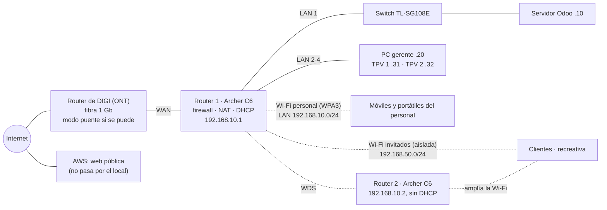

# Tarea 22: Comparativa de operadores WAN

- **Bloque:** 5 Redes
- **Responsable:** Markel · **Revisa:** Eneko.S
- **Reto:** Almi-Chain (ASIR1 2026-27)
- **Fecha de consulta de precios:** 22/10/2026 · **Revisión:** 24/10/2026 (análisis de necesidades, esquema de conectividad y tabla en Markdown)
- **La necesitan:** tarea 23 (plano), tarea 10 (presupuesto) y tarea 11 (diagrama)

## 1. Introducción

El enunciado pide *«identificar necesidades de comunicación en función de los requerimientos»* y, en cuanto a la conectividad, que *«necesitan contratar una línea WAN. De esta, se quiere crear un esquema de conectividad […]»*. Este documento:

1. Calcula qué necesita el local de la línea (sección 2).
2. Compara cuatro operadores (sección 3).
3. Dibuja el esquema de conectividad, de la WAN a cada red del local (sección 4).
4. Elige el operador (secciones 5 y 6).

## 2. Necesidades de comunicación

### 2.1 Qué usa internet en el local

| Equipo o servicio | Cuántos | Qué hace por la WAN | Ancho de banda estimado |
|---|---:|---|---|
| TPV | 2 | Nada pesado: Odoo está en el servidor del local, así que las ventas no salen a internet. Solo actualizaciones de Windows | Picos de descarga al actualizar |
| PC del gerente | 1 | Navegación, correo, ofimática en la nube, actualizaciones | ~10 Mbit/s, picos al actualizar |
| Servidor | 1 | Actualizaciones de Debian e imágenes de Docker; la **copia externa** propuesta en S3 (tarea 44) | **Subida**: unos cientos de MB al día |
| Recreativa | 1 | Solo actualizaciones de seguridad (a las 5:00, tarea 17) | Despreciable |
| Wi-Fi de clientes | 20-40 móviles a la vez (supuesto) | Navegación, redes sociales, vídeo | 2-5 Mbit/s por móvil: **hasta ~150-200 Mbit/s** en hora punta |
| Web pública | — | Está en AWS, no en el local: **no usa la línea del local** | 0 |

**Conclusión del cálculo:** con unos 200 Mbit/s de bajada y 50 Mbit/s de subida bastaría. Se elige 1 Gb porque en los cuatro operadores cuesta lo mismo o casi lo mismo que una velocidad menor, y da margen para más clientes o un segundo uso.

### 2.2 Otros requisitos de la línea

| Requisito | Por qué | Qué pedir al operador |
|---|---|---|
| **Subida suficiente** (mejor simétrica) | Las copias externas y, en el futuro, una VPN salen del local | Velocidad de subida por escrito |
| **IPv4 pública, sin CG-NAT** | Con CG-NAT no se puede entrar al local desde fuera (VPN de mantenimiento). La web no lo necesita, porque está en AWS | Preguntar si la IP es pública; IP fija no hace falta |
| **Router del operador en modo puente** o, si no, poder usar el nuestro detrás sin doble NAT problemático | El router 1 (Archer C6) es el que hace el firewall, la Wi-Fi de invitados y el WDS (tarea 23) | Modo puente o DMZ hacia el router 1 |
| **Servicio técnico para empresa** | Si se cae la línea no se puede cobrar con tarjeta ni atender reservas | Tiempo de reparación comprometido y teléfono de empresa |
| **Factura a nombre de la empresa** | Es un gasto del negocio | Tarifa de autónomos o empresa, no de particular |
| **Permanencia corta** | Poder cambiar si el servicio falla | Meses de permanencia y penalización |

## 3. Tabla comparativa

| Operador | Velocidad | Precio mensual | IVA | Permanencia | Router | Instalación |
|---|---|---|---|---|---|---|
| Movistar Autónomos | 1 Gb simétrica | 29,90 €/mes (12 meses) | Incluido | Sin permanencia | Smart WiFi | Gratuita |
| Vodafone Autónomos | 1 Gb | 25 €/mes (12 meses; luego 35 €) | Incluido | 12 meses* | Wi-Fi 6 | Gratuita* |
| Orange Empresas | 1 Gb | 54,50 €/mes (pack completo) | Consultar | 12 meses | Wi-Fi 7 | Incluida |
| DIGI | 1 Gb | 30 €/mes (precio final) | Incluido | 3 meses | Wi-Fi 6 | Gratuita |

\* Según las condiciones de la oferta consultada.

Los datos de las páginas no dicen nada de CG-NAT, modo puente ni tiempo de reparación: hay que preguntarlos antes de contratar (sección 2.2).

## 4. Esquema de conectividad

- **Entrada:** la fibra llega al router de DIGI. Lo ideal es ponerlo en modo puente para que la IP pública la tenga el router 1; si no se puede, el router 1 queda detrás con doble NAT (válido para navegar, no para una VPN entrante).
- **Una sola salida a internet:** todo el tráfico del local sale por el router 1, que hace de firewall y NAT.
- **Redes del local:** LAN del personal y Wi-Fi de invitados aislada. El detalle de IPs, el plano y la decisión de red (plana con invitados aislada) están en la [tarea 23](23-plano-direccionamiento.md).
- **La web no está aquí:** se sirve desde AWS ([tarea 30](../web/30-hosting-aws.md)), así que no se abre ningún puerto del local hacia internet.

## 5. Criterios de elección

Velocidad suficiente para el cálculo de la sección 2, precio **final** (no de promoción), permanencia, router incluido, instalación y cobertura en el local. Lo que las ofertas no publican (CG-NAT, modo puente, servicio técnico) se confirma con el operador antes de firmar.

## 6. Conclusión

Se recomienda **DIGI 1 Gb**: cubre de sobra la necesidad calculada (sección 2), su precio de 30 €/mes es el final y no sube a los 12 meses como en Vodafone o Movistar, la instalación es gratuita y la permanencia es de solo 3 meses. Antes de contratar hay que comprobar:

- Cobertura de fibra en la dirección del local.
- Velocidad de subida real (DIGI anuncia 1 Gb sin indicar la subida; Movistar sí la da simétrica).
- Que no haya CG-NAT y que su router admita modo puente.
- Si hay tarifa con factura para empresa y qué servicio técnico tiene. Si DIGI no ofrece tiempo de reparación para empresas y el cliente lo considera crítico, la alternativa es **Movistar Autónomos** (simétrica y sin permanencia), con el coste de los meses posteriores a la promoción.

## 7. Fuentes consultadas (22/10/2026)

- [Movistar, página oficial](https://www.movistar.es/) (sección de autónomos)
- [Vodafone, página oficial](https://www.vodafone.es/) (sección de autónomos)
- [Orange, página oficial](https://www.orange.es/) (sección de empresas)
- [DIGI, página oficial](https://www.digimobil.es/)

Las páginas de oferta cambian a menudo, así que solo se enlaza la página principal de cada operador. Las capturas de las ofertas no se guardaron: para la entrega final conviene repetir la consulta y guardar la página o una captura de cada oferta.
