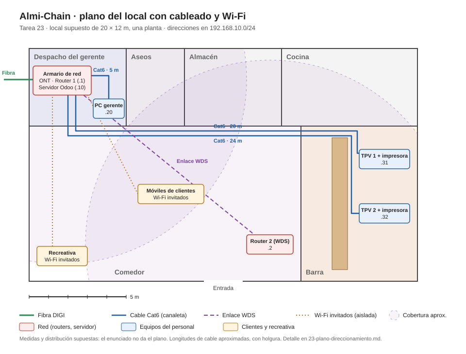
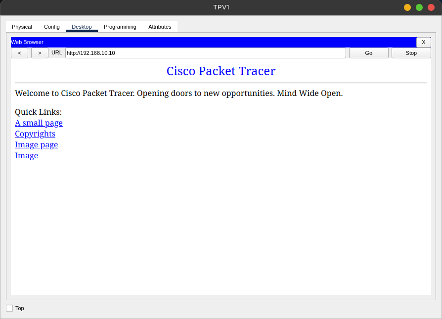

# Tarea 23: Plano del local y plan de direccionamiento IP

- **Bloque:** 5 Redes
- **Responsable:** Adrian · **Revisa:** Iker
- **Reto:** Almi-Chain (ASIR1 2026-27)
- **Estado:** borrador, pendiente de revisión
- **Fecha:** 23/10/2026
- **La necesitan:** tarea 24 (red segura), tarea 25 (WDS) y tarea 11 (diagrama de arquitectura)

## 1. Alcance

El enunciado dice: *«necesitan contratar una línea WAN. De esta, se quiere crear un esquema de conectividad y un diagrama de la arquitectura de red (plano), cableado y Wi-Fi, con la red configurada de forma segura»*. La separación de la red por grupos (TPV, gerente, clientes y arcade) **no la pide el enunciado**: es una decisión del equipo (venía en el plan de trabajo) para cumplir lo de «configurada de forma segura» y los mínimos privilegios. El esquema de conectividad (WAN → router → LAN e invitados) está en la [tarea 22](22-comparativa-wan.md#4-esquema-de-conectividad). Este documento recoge:

- **Plano:** dónde va cada equipo, por dónde pasa el cable y dónde se colocan los dos routers Wi-Fi.
- **Direccionamiento:** qué red y qué IP tiene cada equipo, y cómo se separan los grupos.

La configuración del router se hace en las tareas 24 (red segura) y 25 (WDS). Aquí solo se decide qué hay que configurar.

## 2. Supuestos

El enunciado no da el plano ni las medidas del local. Se trabaja con estos supuestos:

| # | Supuesto | Motivo |
|---|---|---|
| S-01 | Local de una planta de 20 × 12 m: despacho, aseos, almacén, cocina, comedor y barra | Tamaño habitual de un restaurante pequeño. Basta para justificar el segundo router (WDS) |
| S-02 | La fibra de DIGI entra por el despacho del gerente y ahí va el armario de red | El despacho es la única estancia que se cierra con llave, así que el router y el servidor quedan fuera del alcance de los clientes |
| S-03 | Internet: DIGI 1 Gb con su router, que hace de ONT ([tarea 22](22-comparativa-wan.md)) | Operador elegido en la tarea 22 |
| S-04 | Router principal y router WDS: 2 × TP-Link Archer C6 V3 ([tarea 10](../hardware/10-presupuesto-hardware.md), apartado 4.4) | Equipos elegidos en el presupuesto |
| S-05 | Switch TP-Link TL-SG108E de 8 puertos en el armario, en el puerto LAN 1 del router 1; el servidor se conecta al switch ([tarea 10](../hardware/10-presupuesto-hardware.md#12-elementos-que-faltaban-en-el-presupuesto), sección 12) | Sin switch, los 4 puertos LAN del router quedaban todos ocupados. Además admite VLAN (apartado 5.5) |
| S-06 | Las impresoras de tickets van por USB a su TPV, así que no llevan IP ([tarea 8](../hardware/08-tabla-hardware.md), apartado 3.3) | Decisión de la tarea 8 |
| S-07 | El cable va por canaleta a ras de techo o por falso techo y se usa Cat6 | Soporta 1 Gb/s con margen y es barato |

## 3. Plano del local



Ficheros: [23-plano-local.svg](23-plano-local.svg) (imagen) y [23-plano-local.drawio](23-plano-local.drawio) (se abre y se edita en [app.diagrams.net](https://app.diagrams.net)).

### 3.1 Armario de red (despacho)

En el despacho hay un armario pequeño o una balda con:

- El router de DIGI (ONT), donde llega la fibra.
- El **router 1** (Archer C6, principal), conectado por su puerto WAN al router de DIGI.
- El **servidor de Odoo**, con cable al router 1.

### 3.2 Cableado

| Tirada | Desde → hasta | Puerto del router 1 | Longitud aprox. |
|---|---|---|---|
| 1 | Router 1 → switch → servidor Odoo | LAN 1 (switch) | 1 m + 1 m (dentro del armario) |
| 2 | Router 1 → PC del gerente | LAN 2 | 5 m |
| 3 | Router 1 → TPV 1 (barra) | LAN 3 | 20 m |
| 4 | Router 1 → TPV 2 (barra) | LAN 4 | 24 m |
| — | Router de DIGI → router 1 (WAN) | WAN | 1 m |

Las longitudes salen del plano y llevan holgura para las bajadas por la pared. Todas están muy por debajo del límite de 100 m del Ethernet. En total son unos 50 m (en el presupuesto, una bobina de 100 m). Con estas tiradas se ocupan los 4 puertos LAN del router 1, y el switch del armario (S-05) deja 6 puertos libres para ampliar. La recreativa va igualmente por la Wi-Fi de invitados, para que quede aislada (apartado 5.2).

### 3.3 Wi-Fi

- **Router 1** en el armario del despacho: cubre el despacho, los aseos, el almacén y la mitad izquierda del comedor.
- **Router 2** en la pared del comedor, cerca de la entrada y de la barra: cubre la barra, la entrada y la mitad derecha del comedor. Se une al router 1 por **WDS** (tarea 25), sin cable.
- Entre los dos debe quedar zona solapada para que los móviles pasen de uno a otro. Los círculos del plano son aproximados: la cobertura real se mide en la tarea 25 con una app tipo Wi-Fi Analyzer.

## 4. Plan de direccionamiento

### 4.1 Redes

| Red | Subred | Puerta de enlace | DHCP | Para qué |
|---|---|---|---|---|
| LAN del local | `192.168.10.0/24` | `192.168.10.1` (router 1) | Router 1 | Servidor, gerente, TPV y routers |
| Wi-Fi de invitados | `192.168.50.0/24` *(a comprobar, ver 4.4)* | Router 1 | Router 1 | Móviles de clientes y recreativa |
| WAN | La que dé el router de DIGI | Router de DIGI | Router de DIGI | Enlace entre el router 1 y DIGI |

**Por qué `192.168.10.0/24` y no `192.168.1.0/24`:** los routers de operador suelen venir con `192.168.1.0/24`. Si nuestra LAN usara la misma red que hay detrás del router de DIGI, el router 1 tendría la misma red a los dos lados y no sabría por dónde enviar el tráfico. Además, `192.168.10.x` es lo que ya proponía el diagrama de la [tarea 11](../diagramas/11-arquitectura-equipos/DIAGRAMA.md).

### 4.2 Rangos dentro de la LAN

Las IPs de los equipos fijos se dan por **reserva DHCP** (el router siempre da la misma IP a la misma MAC). Así no hay que configurar nada en cada equipo y todo queda apuntado en un solo sitio, el router.

| Rango | Uso |
|---|---|
| .1 | Router 1 (puerta de enlace, DHCP y DNS) |
| .2 | Router 2 (WDS) |
| .3–.9 | Reservado para red (por ejemplo, un switch en el futuro) |
| .10–.19 | Servidores |
| .20–.29 | Gerencia |
| .30–.39 | TPV |
| .40–.49 | Impresoras (solo si algún día van por red) |
| .50–.59 | Arcade (si la recreativa vuelve a ir por cable) |
| .100–.199 | DHCP dinámico: portátiles y móviles del personal |
| .200–.254 | Libre |

### 4.3 Equipos

| Equipo | IP | Cómo la obtiene | Conexión | MAC |
|---|---|---|---|---|
| Router 1 (Archer C6) | 192.168.10.1 | Fija en el router | — | *(apuntar al montarlo)* |
| Router 2 (Archer C6, WDS) | 192.168.10.2 | Fija en el router, con su DHCP apagado | WDS | *(apuntar)* |
| Servidor Odoo | 192.168.10.10 | Reserva DHCP | Cable, switch (LAN 1) | *(apuntar)* |
| PC del gerente | 192.168.10.20 | Reserva DHCP | Cable, LAN 2 | *(apuntar)* |
| TPV 1 | 192.168.10.31 | Reserva DHCP | Cable, LAN 3 | *(apuntar)* |
| TPV 2 | 192.168.10.32 | Reserva DHCP | Cable, LAN 4 | *(apuntar)* |
| Impresora TPV 1 | — (USB) | — | USB al TPV 1 | — |
| Impresora TPV 2 | — (USB) | — | USB al TPV 2 | — |
| Recreativa | Rango de invitados | DHCP de invitados | Wi-Fi de invitados | *(apuntar)* |
| Móviles de clientes | Rango de invitados | DHCP de invitados | Wi-Fi de invitados | — |

- **DNS:** los equipos usan el router 1 (`192.168.10.1`) como DNS y el router reenvía a DNS públicos (por ejemplo `9.9.9.9` y `1.1.1.1`).
- **Duración de la concesión DHCP:** 24 h en la LAN y 2 h en invitados, porque los clientes entran y salen.

### 4.4 Redes Wi-Fi

| SSID | Seguridad | Red | Quién se conecta |
|---|---|---|---|
| `Restaurante-Almichain` | WPA3-Personal (o WPA2/WPA3 mixto si algún equipo no soporta WPA3) | LAN | Personal |
| `Restaurante-Almichain-Invitados` | WPA2/WPA3, contraseña distinta y que se cambia cada cierto tiempo | Invitados | Clientes y recreativa |

Se mantienen los nombres de la [tarea 24](24-red-segura/DOCUMENTACION.md).

**A comprobar en la tarea 24:** no está confirmado que la red de invitados del Archer C6 use una subred propia (`192.168.50.0/24`, la misma que la VLAN 50 de invitados del apartado 5.3, para que una red no signifique cosas distintas en los dos diseños). Algunos routers domésticos dan a los invitados IPs del mismo rango que la LAN y los aíslan solo con reglas internas. Lo importante es el aislamiento, que se prueba igual en los dos casos (apartado 6). La subred que asigne el router de verdad se apunta en esta tabla.

## 5. Segmentación

El enunciado pide separar **TPV, gerente, clientes y arcade**.

### 5.1 Quién puede hablar con quién

| Desde ↓ / Hacia → | Servidor Odoo | TPV | PC gerente | Internet |
|---|---|---|---|---|
| **TPV** | Sí (TPV de Odoo, puerto 8069) | — | No hace falta | Sí |
| **PC gerente** | Sí (Odoo y administración) | No hace falta | — | Sí |
| **Clientes** | **No** | **No** | **No** | Sí |
| **Recreativa** | **No** | **No** | **No** | Sí (actualizaciones) |

### 5.2 Decisión: red plana con red de invitados aislada (24/10/2026)

**Se monta la opción (b): una sola red para el personal (`192.168.10.0/24`) y la Wi-Fi de invitados aislada (`192.168.50.0/24`) para clientes y recreativa.** Lo que la red no separa (TPV, gerente y servidor comparten red) lo separa **cada equipo**, con su cortafuegos y sus cuentas. El diseño con una VLAN por grupo queda como **anexo de mejora** (apartado 5.5).

Cómo se cumple cada casilla de la tabla 5.1 (defensa en profundidad: ninguna medida depende de una sola pieza):

| Desde → hacia | Lo impide o lo permite | Dónde está |
|---|---|---|
| Clientes y recreativa → cualquier equipo del personal | **El router:** la red de invitados no ve la LAN y aísla a los clientes entre sí | Tarea 24 (red de invitados) |
| TPV → PC del gerente | **El TPV:** salida bloqueada por defecto salvo Odoo, DNS, DHCP y actualizaciones; Edge solo abre Odoo; el cajero no es administrador | `configurar-tpv.ps1` (tareas 13 y 15) |
| PC del gerente → TPV | **El TPV:** entrada bloqueada por defecto y sin Escritorio remoto | `configurar-tpv.ps1` |
| Cualquiera → PC del gerente | **El gerente:** Firewall de Windows y `ufw` en Ubuntu, con la entrada bloqueada | Tarea 12 |
| TPV y gerente → servidor | **El servidor:** solo HTTPS (443) desde la LAN; SSH solo desde el PC del gerente; PostgreSQL sin publicar | [`cortafuegos-servidor.sh`](../erp/33-odoo-docker/cortafuegos-servidor.sh) y tarea 52 |
| Cualquiera → contraseñas y ventas por la red | **Cifrado:** Odoo por HTTPS; Wi-Fi con WPA3/WPA2-AES | Tareas 52 y 24 |
| Cualquiera → administración del router | **El router:** solo desde la MAC del PC del gerente, nunca desde la Wi-Fi | Tarea 24 |
| Todos → Internet | Sí, por NAT en el router 1 | Tarea 24 |

**Recreativa.** Va a la Wi-Fi de invitados, no por cable, con un adaptador USB (TP-Link TL-WN725N, tarea 10, sección 12; configuración en la [tarea 16, sección 6](../arcade/16-recreativa-mame/DOCUMENTACION.md#6-conexión-a-la-wi-fi-de-invitados)). Como la red de invitados aísla a los clientes, no se llega a ella por SSH: se administra **desde su consola local** (`Ctrl+Alt+F2`, usuario `tecnico`) y la monitorización de la [tarea 18](../arcade/18-monitorizacion-recreativa.md) se ejecuta en ella.

**Router 2 (WDS).** Amplía la **Wi-Fi de invitados** (el enunciado dice «para ampliar la cobertura Wi-Fi para los clientes»). Se gestiona en `192.168.10.2`, con su DHCP apagado. Si en la tarea 25 se comprueba que el firmware del Archer C6 no pasa la red de invitados por WDS, se documenta y la alternativa es que el router 2 emita solo la red de invitados con su propio aislamiento.

### 5.3 Por qué la red plana y no las VLAN

Montar las VLAN de verdad (opción a) separaría mejor la red, pero **empeora el proyecto en conjunto**:

| Criterio | VLAN reales (a) | Red plana con invitados aislada (b) |
|---|---|---|
| **Hardware** | Exige cambiar el firmware de los Archer C6 por OpenWrt (riesgo de dejarlos inservibles, sin soporte del fabricante) o comprar un router profesional | Los dos Archer C6 de fábrica que ya están en el presupuesto |
| **WDS** (requisito del enunciado) | Con OpenWrt hay que llevar las VLAN por el enlace WDS: configuración avanzada y difícil de comprobar | Es la opción del menú del fabricante (`Enable WDS Bridging`), la que documenta TP-Link |
| **Pruebas con el equipo que hay** | El TL-WR841N de prácticas no sirve para probarlo (las versiones actuales de OpenWrt no lo admiten: tiene poca memoria) | Se prueba igual en el TL-WR841N y en los Archer C6 (tarea 24) |
| **Coherencia con lo hecho** | Habría que rehacer el plan de IP, las IP de los TPV, los scripts de los TPV (puerta de enlace y DNS), el certificado HTTPS, el presupuesto, los diagramas y la tarea 24 | Todo lo hecho (plan de IP, scripts de TPV, HTTPS, copias, diagramas, presupuesto) ya está pensado para esta red |
| **Mantenimiento por el cliente** | Un restaurante no tiene a nadie que sepa mantener OpenWrt y VLAN | El gerente puede gestionar el router con la interfaz web de siempre |
| **Plazo** (del 26/10 al 12/11) | Ocupa a una persona varios días y bloquea las tareas 24-26 | Las tareas 24-26 pueden empezar el lunes |
| **Seguridad** | Separación en la red | Separación en cada equipo (apartado 5.2) más la red de invitados. Para un local con 4 equipos fijos, todos bastionados, el riesgo que queda es bajo |

**Lo que se pierde, y cómo se compensa:** en la red plana, un equipo del personal comprometido podría intentar llegar a otro. Eso lo frenan los cortafuegos de cada equipo (TPV con entrada y salida bloqueadas; gerente y servidor con la entrada bloqueada) y el cifrado de Odoo. Ningún equipo del personal es de uso público: los clientes, que son el riesgo real, están en otra red.

**Camino de mejora:** el switch del presupuesto (TL-SG108E) ya admite VLAN 802.1Q. Si la cadena crece o se cambia de router, el diseño del anexo (apartado 5.5) se puede montar sin cambiar el plan de direcciones de la LAN.

### 5.4 Simulación en Packet Tracer de la red real

La simulación tiene que representar **la red que se monta**, no otra. Se construye a partir del `.pkt` del anexo (se reutilizan R1, SW1 y los equipos) siguiendo [23-packet-tracer-red-local.md](23-packet-tracer-red-local.md), que tiene los comandos listos para pegar y las pruebas.

```
INTERNET (servidor de prueba 198.51.100.10: web y DNS)
   │
ISP · router de DIGI ── red pública 203.0.113.0/30
   │  NAT
R1 · router 1 (Archer C6): firewall, DHCP, NAT ── VLAN 10 = LAN del personal · VLAN 50 = invitados
   │  (en el Archer C6 la separación LAN / invitados es interna; en Packet Tracer se ve con dos VLAN)
SW1 · switch del armario
   ├─ cable, LAN 192.168.10.0/24: SRV-ODOO .10 · GERENTE .20 · TPV1 .31 · TPV2 .32 · AP-PERSONAL
   └─ invitados 192.168.50.0/24: AP-INVITADOS · ROUTER2-WDS (puente) ─ ─ Wi-Fi: CLIENTE, RECREATIVA
```

| Fichero | Qué es | Estado |
|---|---|---|
| [23-red-local.pkt](23-red-local.pkt) | La red real | **Construida el 25/10/2026** con el MCP de Packet Tracer; faltan la conexión Wi-Fi de dos equipos y los cortafuegos de los PC (a mano, [guía, sección 10](23-packet-tracer-red-local.md#10-estado-25102026-construida-con-el-mcp-faltan-dos-pasos-a-mano)). [Configuración y pruebas](evidencias/23-red-local-configuracion-y-pruebas.txt) |
| [23-anexo-vlan.pkt](23-anexo-vlan.pkt) | El diseño de mejora con una VLAN por grupo (apartado 5.5) | Hecho el 23/10 |

**Dos decisiones de la simulación:**

- **Las dos VLAN de la simulación no son «el diseño con VLAN».** Representan lo que el Archer C6 hace por dentro: su red de invitados es una red aparte de la LAN. El resto de la separación (TPV, gerente, servidor) se ve en la simulación igual que en el local: con el cortafuegos de cada equipo (Packet Tracer tiene cortafuegos en los PC).
- **El router 2 se dibuja como un punto de acceso (AccessPoint-PT) rotulado «ROUTER2-WDS».** Un router en modo WDS funciona como un **puente**: no enruta ni reparte IP; une su Wi-Fi a la del router principal. Packet Tracer no simula WDS, y el aparato que se comporta igual es el punto de acceso. Un router doméstico de Packet Tracer (WRT300N) haría NAT y DHCP propios (otra red, que no es lo que hay en el local) o, puesto como puente en la red de invitados, dejaría su panel de administración al alcance de los clientes. El cable entre SW1 y ROUTER2-WDS representa el enlace por radio; la prueba real del WDS es la tarea 25.

### 5.5 Anexo: diseño de mejora con una VLAN por grupo

Con un router que admita VLAN y el switch TL-SG108E, cada grupo tendría su propia red y el router solo dejaría pasar lo que marca la tabla 5.1:

| VLAN | Nombre | Subred | Equipos |
|---|---|---|---|
| 10 | Servidores | 192.168.10.0/24 | Servidor Odoo |
| 20 | TPV | 192.168.20.0/24 | TPV 1 y 2 (e impresoras si van por red) |
| 30 | Gerencia | 192.168.30.0/24 | PC del gerente |
| 40 | Arcade | 192.168.40.0/24 | Recreativa |
| 50 | Invitados | 192.168.50.0/24 | Móviles de clientes |
| 99 | Gestión | 192.168.99.0/24 | Panel de administración de routers y switch |

Está simulado y probado en [23-anexo-vlan.pkt](23-anexo-vlan.pkt) (Packet Tracer 9.0.1). Es una simulación **solo de la red interna** (sin Internet ni Wi-Fi): sirve para enseñar la segmentación con *router-on-a-stick* y ACL, no para representar el local.


**Montaje:**
- Router **R1** (Cisco 2911) y switch **SW1** (2960-24TT) unidos por un *trunk* (`R1 Gi0/0` ↔ `SW1 Gi0/1`).
- R1 tiene una subinterfaz por VLAN (`Gi0/0.10` … `Gi0/0.99`), que hace de puerta de enlace `.1` de cada red. Este montaje se llama *router-on-a-stick*.
- R1 reparte las IPs por DHCP, con un pool por VLAN que empieza en `.10`. El servidor tiene IP fija: `192.168.10.10`.
- SW1 se administra desde la VLAN 99 (`192.168.99.2`).

| Puerto de SW1 | VLAN | Equipo | IP obtenida |
|---|---|---|---|
| Fa0/1 | 10 Servidores | SRV-ODOO | 192.168.10.10 (fija) |
| Fa0/2 | 20 TPV | TPV1 | 192.168.20.10 |
| Fa0/3 | 20 TPV | TPV2 | 192.168.20.11 |
| Fa0/4 | 30 Gerencia | GERENTE | 192.168.30.10 |
| Fa0/5 | 40 Arcade | RECREATIVA | 192.168.40.10 |
| Fa0/6 | 50 Invitados | CLIENTE | 192.168.50.10 |

**ACLs en R1** (de entrada en cada subinterfaz; aplican la tabla 5.1):

| ACL | Subinterfaz | Qué deja pasar |
|---|---|---|
| `TPV-IN` | Gi0/0.20 | DHCP; HTTP (80) y ping al servidor; nada más hacia redes internas; resto (internet) sí |
| `GERENCIA-IN` | Gi0/0.30 | DHCP; todo hacia el servidor y hacia la VLAN de gestión; nada más hacia redes internas; resto sí |
| `AISLADA-IN` | Gi0/0.40 y Gi0/0.50 | DHCP; ninguna red interna (`192.168.0.0/16`); resto sí |

En Packet Tracer no existe Odoo. El servidor responde por HTTP en el puerto 80 en lugar del 8069 del local real.

**Pruebas** (ping desde cada equipo, 23/10/2026):

| # | Desde → hasta | Esperado | Resultado |
|---|---|---|---|
| 1 | TPV1 → servidor (192.168.10.10) | Llega | 4/4 ✔ |
| 2 | GERENTE → servidor | Llega | 4/4 ✔ |
| 3 | GERENTE → SW1, gestión (192.168.99.2) | Llega | 4/4 ✔ |
| 4 | TPV1 → GERENTE (192.168.30.10) | Bloqueado | 0/4 ✔ |
| 5 | GERENTE → TPV1 (192.168.20.10) | Bloqueado | 0/4 ✔ |
| 6 | CLIENTE → servidor | Bloqueado | 0/4 ✔ |
| 7 | CLIENTE → RECREATIVA (192.168.40.10) | Bloqueado | 0/4 ✔ |
| 8 | RECREATIVA → TPV1 | Bloqueado | 0/4 ✔ |

El primer ping de cada pareja pierde 1 o 2 paquetes mientras se resuelve la dirección MAC (ARP). En las tablas se pone el resultado de la repetición.

`show access-lists` en R1 confirma que los bloqueos los hacen las ACLs y no un fallo de red: suben los contadores de las líneas `deny ip any 192.168.0.0 0.0.255.255` de `TPV-IN`, `GERENCIA-IN` y `AISLADA-IN`.

**Acceso web del TPV al servidor:** desde TPV1, *Desktop → Web Browser* con `http://192.168.10.10`, se abre la página del servidor. En `show access-lists TPV-IN`, la línea `permit tcp … host 192.168.10.10 eq www` registra 5 coincidencias, así que el tráfico pasa por la regla prevista.



## 6. Cómo se comprueba

En el local se hacen en las tareas 24 y 25, con el router montado; en Packet Tracer, con la guía del apartado 5.4 (que tiene las mismas pruebas y algunas más):

| # | Prueba | Resultado esperado |
|---|---|---|
| 1 | `ipconfig` en el TPV 1 / `ip addr` en el servidor | 192.168.10.31 / 192.168.10.10, puerta de enlace .1 |
| 2 | Desde el TPV 1, abrir `https://192.168.10.10` (o `http://192.168.10.10:8069` antes de la tarea 52) | Abre Odoo |
| 3 | Móvil en la Wi-Fi de invitados: abrir una web | Funciona |
| 4 | Móvil en la Wi-Fi de invitados: `ping 192.168.10.10` y abrir `http://192.168.10.10:8069` | No responde |
| 5 | Recreativa: `ping 192.168.10.31` | No responde |
| 6 | Ver la lista de clientes DHCP en el router | Cada equipo fijo tiene su IP reservada |
| 7 | Móvil en el comedor junto al router 2 | Conectado al router 2 con buena señal y en la red de invitados |
| 8 | Desde el TPV 1, `ping 192.168.10.20` (PC del gerente) | No responde (cortafuegos del TPV y del gerente) |
| 9 | Desde el TPV 1, `ssh` al servidor | Rechazado (solo desde el PC del gerente) |

## 7. Cambios que provoca en otras tareas

| Tarea | Qué hay que cambiar |
|---|---|
| 24 · Red segura (Peio) | Las capturas son de un TL-WR841N con la LAN en `192.168.1.0/24`. Al montar los Archer C6 hay que poner la LAN en `192.168.10.0/24`, configurar las reservas de la tabla 4.3 y documentar la red de invitados |
| 25 · WDS | Router 2 en 192.168.10.2, DHCP apagado y colocado donde marca el plano; comprobar que amplía la red de invitados (apartado 5.2) |
| 13 · TPV | Ninguno: `configurar-tpv.ps1` ya usa esta red (router y DNS en `192.168.10.1`) |
| 33 · Servidor | Ejecutar [`cortafuegos-servidor.sh`](../erp/33-odoo-docker/cortafuegos-servidor.sh) (SSH solo desde el gerente; HTTPS desde la LAN) |
| 11 · Diagrama de arquitectura (Iker) | Pasar el direccionamiento de "propuesta" a definitivo. La recreativa va por la Wi-Fi de invitados, no por cable |
| 10 · Presupuesto | Hecho el 24/10: impresoras en `.41` y `.42` (rango .40–.49, solo si algún día van por red); adaptador USB Wi-Fi de la recreativa, switch y cable añadidos (sección 12) |
| 18 · Monitorización de la recreativa | Los scripts se ejecutan en la propia recreativa, desde su consola (apartado 5.2), no por SSH |

## 8. Pendiente

- [ ] Revisión de Iker.
- [ ] Apuntar las MAC de los equipos cuando estén montados.
- [ ] Confirmar en la tarea 24 qué subred da el Archer C6 a la red de invitados.
- [ ] Confirmar si el PC de la recreativa tiene Wi-Fi (el adaptador USB ya está presupuestado).
- [x] Decidir red plana o VLAN: red plana con invitados aislada (apartados 5.2 y 5.3, 24/10/2026).
- [x] Construir `23-red-local.pkt` con [la guía](23-packet-tracer-red-local.md) (25/10/2026, con el MCP de Packet Tracer).
- [ ] Conectar CLIENTE y RECREATIVA a la Wi-Fi y poner los cortafuegos de los PC (a mano, guía sección 10); terminar las 16 pruebas y la captura `23-red-local.png`.
- [x] Simular el diseño con VLAN en Packet Tracer (anexo, apartado 5.5).
- [x] Probar en Packet Tracer el acceso HTTP del TPV al servidor desde el navegador (anexo).
