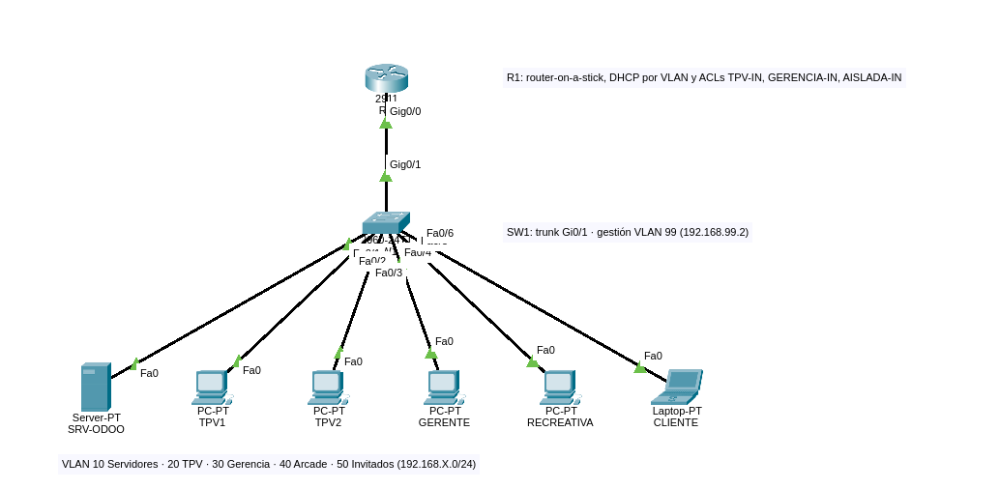

# Tarea 23: Plano del local y plan de direccionamiento IP

- **Bloque:** 5 Redes
- **Responsable:** Adrian · **Revisa:** Iker
- **Reto:** Almi-Chain (ASIR1 2026-27)
- **Estado:** borrador, pendiente de revisión
- **Fecha:** 23/10/2026
- **La necesitan:** tarea 24 (red segura), tarea 25 (WDS) y tarea 11 (diagrama de arquitectura)

## 1. Alcance

El enunciado dice: *«necesitan contratar una línea WAN. De esta, se quiere crear un esquema de conectividad y un diagrama de la arquitectura de red (plano), cableado y Wi-Fi, con la red configurada de forma segura»*. La separación de la red por grupos (TPV, gerente, clientes y arcade) **no la pide el enunciado**: es una decisión del equipo (venía en el plan de trabajo) para cumplir lo de «configurada de forma segura» y los mínimos privilegios. El esquema de conectividad (WAN → router → LAN e invitados) está en la [tarea 22](22-comparativa-wan.md#4-esquema-de-conectividad). Este documento recoge:

- **Plano:** dónde va cada equipo, por dónde pasa el cable y dónde se colocan los dos routers Wi-Fi.
- **Direccionamiento:** qué red y qué IP tiene cada equipo, y cómo se separan los grupos.

La configuración del router se hace en las tareas 24 (red segura) y 25 (WDS). Aquí solo se decide qué hay que configurar.

## 2. Supuestos

El enunciado no da el plano ni las medidas del local. Se trabaja con estos supuestos:

| # | Supuesto | Motivo |
|---|---|---|
| S-01 | Local de una planta de 20 × 12 m: despacho, aseos, almacén, cocina, comedor y barra | Tamaño habitual de un restaurante pequeño. Basta para justificar el segundo router (WDS) |
| S-02 | La fibra de DIGI entra por el despacho del gerente y ahí va el armario de red | El despacho es la única estancia que se cierra con llave, así que el router y el servidor quedan fuera del alcance de los clientes |
| S-03 | Internet: DIGI 1 Gb con su router, que hace de ONT ([tarea 22](22-comparativa-wan.md)) | Operador elegido en la tarea 22 |
| S-04 | Router principal y router WDS: 2 × TP-Link Archer C6 V3 ([tarea 10](../hardware/10-presupuesto-hardware.md), apartado 4.4) | Equipos elegidos en el presupuesto |
| S-05 | Switch TP-Link TL-SG108E de 8 puertos en el armario, en el puerto LAN 1 del router 1; el servidor se conecta al switch ([tarea 10](../hardware/10-presupuesto-hardware.md#12-elementos-que-faltaban-en-el-presupuesto), sección 12) | Sin switch, los 4 puertos LAN del router quedaban todos ocupados. Además admite VLAN (apartado 5.5) |
| S-06 | Las impresoras de tickets van por USB a su TPV, así que no llevan IP ([tarea 8](../hardware/08-tabla-hardware.md), apartado 3.3) | Decisión de la tarea 8 |
| S-07 | El cable va por canaleta a ras de techo o por falso techo y se usa Cat6 | Soporta 1 Gb/s con margen y es barato |

## 3. Plano del local


Ficheros: [23-plano-local.svg](23-plano-local.svg) (imagen) y [23-plano-local.drawio](23-plano-local.drawio) (se abre y se edita en [app.diagrams.net](https://app.diagrams.net)).

### 3.1 Armario de red (despacho)

En el despacho hay un armario pequeño o una balda con:

- El router de DIGI (ONT), donde llega la fibra.
- El **router 1** (Archer C6, principal), conectado por su puerto WAN al router de DIGI.
- El **servidor de Odoo**, con cable al router 1.

### 3.2 Cableado

| Tirada | Desde → hasta | Puerto del router 1 | Longitud aprox. |
|---|---|---|---|
| 1 | Router 1 → switch → servidor Odoo | LAN 1 (switch) | 1 m + 1 m (dentro del armario) |
| 2 | Router 1 → PC del gerente | LAN 2 | 5 m |
| 3 | Router 1 → TPV 1 (barra) | LAN 3 | 20 m |
| 4 | Router 1 → TPV 2 (barra) | LAN 4 | 24 m |
| — | Router de DIGI → router 1 (WAN) | WAN | 1 m |

Las longitudes salen del plano y llevan holgura para las bajadas por la pared. Todas están muy por debajo del límite de 100 m del Ethernet. En total son unos 50 m (en el presupuesto, una bobina de 100 m). Con estas tiradas se ocupan los 4 puertos LAN del router 1, y el switch del armario (S-05) deja 6 puertos libres para ampliar. La recreativa va igualmente por la Wi-Fi de invitados, para que quede aislada (apartado 5.2).

### 3.3 Wi-Fi

- **Router 1** en el armario del despacho: cubre el despacho, los aseos, el almacén y la mitad izquierda del comedor.
- **Router 2** en la pared del comedor, cerca de la entrada y de la barra: cubre la barra, la entrada y la mitad derecha del comedor. Se une al router 1 por **WDS** (tarea 25), sin cable.
- Entre los dos debe quedar zona solapada para que los móviles pasen de uno a otro. Los círculos del plano son aproximados: la cobertura real se mide en la tarea 25 con una app tipo Wi-Fi Analyzer.

## 4. Plan de direccionamiento

### 4.1 Redes

| Red | Subred | Puerta de enlace | DHCP | Para qué |
|---|---|---|---|---|
| LAN del local | `192.168.10.0/24` | `192.168.10.1` (router 1) | Router 1 | Servidor, gerente, TPV y routers |
| Wi-Fi de invitados | `192.168.50.0/24` *(a comprobar, ver 4.4)* | Router 1 | Router 1 | Móviles de clientes y recreativa |
| WAN | La que dé el router de DIGI | Router de DIGI | Router de DIGI | Enlace entre el router 1 y DIGI |

**Por qué `192.168.10.0/24` y no `192.168.1.0/24`:** los routers de operador suelen venir con `192.168.1.0/24`. Si nuestra LAN usara la misma red que hay detrás del router de DIGI, el router 1 tendría la misma red a los dos lados y no sabría por dónde enviar el tráfico. Además, `192.168.10.x` es lo que ya proponía el diagrama de la [tarea 11](../diagramas/11-arquitectura-equipos/DIAGRAMA.md).

### 4.2 Rangos dentro de la LAN

Las IPs de los equipos fijos se dan por **reserva DHCP** (el router siempre da la misma IP a la misma MAC). Así no hay que configurar nada en cada equipo y todo queda apuntado en un solo sitio, el router.

| Rango | Uso |
|---|---|
| .1 | Router 1 (puerta de enlace, DHCP y DNS) |
| .2 | Router 2 (WDS) |
| .3–.9 | Reservado para red (por ejemplo, un switch en el futuro) |
| .10–.19 | Servidores |
| .20–.29 | Gerencia |
| .30–.39 | TPV |
| .40–.49 | Impresoras (solo si algún día van por red) |
| .50–.59 | Arcade (si la recreativa vuelve a ir por cable) |
| .100–.199 | DHCP dinámico: portátiles y móviles del personal |
| .200–.254 | Libre |

### 4.3 Equipos

| Equipo | IP | Cómo la obtiene | Conexión | MAC |
|---|---|---|---|---|
| Router 1 (Archer C6) | 192.168.10.1 | Fija en el router | — | *(apuntar al montarlo)* |
| Router 2 (Archer C6, WDS) | 192.168.10.2 | Fija en el router, con su DHCP apagado | WDS | *(apuntar)* |
| Servidor Odoo | 192.168.10.10 | Reserva DHCP | Cable, switch (LAN 1) | *(apuntar)* |
| PC del gerente | 192.168.10.20 | Reserva DHCP | Cable, LAN 2 | *(apuntar)* |
| TPV 1 | 192.168.10.31 | Reserva DHCP | Cable, LAN 3 | *(apuntar)* |
| TPV 2 | 192.168.10.32 | Reserva DHCP | Cable, LAN 4 | *(apuntar)* |
| Impresora TPV 1 | — (USB) | — | USB al TPV 1 | — |
| Impresora TPV 2 | — (USB) | — | USB al TPV 2 | — |
| Recreativa | Rango de invitados | DHCP de invitados | Wi-Fi de invitados | *(apuntar)* |
| Móviles de clientes | Rango de invitados | DHCP de invitados | Wi-Fi de invitados | — |

- **DNS:** los equipos usan el router 1 (`192.168.10.1`) como DNS y el router reenvía a DNS públicos (por ejemplo `9.9.9.9` y `1.1.1.1`).
- **Duración de la concesión DHCP:** 24 h en la LAN y 2 h en invitados, porque los clientes entran y salen.

### 4.4 Redes Wi-Fi

| SSID | Seguridad | Red | Quién se conecta |
|---|---|---|---|
| `Restaurante-Almichain` | WPA3-Personal (o WPA2/WPA3 mixto si algún equipo no soporta WPA3) | LAN | Personal |
| `Restaurante-Almichain-Invitados` | WPA2/WPA3, contraseña distinta y que se cambia cada cierto tiempo | Invitados | Clientes y recreativa |

Se mantienen los nombres de la [tarea 24](24-red-segura/DOCUMENTACION.md).

**A comprobar en la tarea 24:** no está confirmado que la red de invitados del Archer C6 use una subred propia (`192.168.50.0/24`, la misma que la VLAN 50 de invitados del apartado 5.3, para que una red no signifique cosas distintas en los dos diseños). Algunos routers domésticos dan a los invitados IPs del mismo rango que la LAN y los aíslan solo con reglas internas. Lo importante es el aislamiento, que se prueba igual en los dos casos (apartado 6). La subred que asigne el router de verdad se apunta en esta tabla.

## 5. Segmentación

El enunciado pide separar **TPV, gerente, clientes y arcade**.

### 5.1 Quién puede hablar con quién

| Desde ↓ / Hacia → | Servidor Odoo | TPV | PC gerente | Internet |
|---|---|---|---|---|
| **TPV** | Sí (TPV de Odoo, puerto 8069) | — | No hace falta | Sí |
| **PC gerente** | Sí (Odoo y administración) | No hace falta | — | Sí |
| **Clientes** | **No** | **No** | **No** | Sí |
| **Recreativa** | **No** | **No** | **No** | Sí (actualizaciones) |

### 5.2 Lo que se monta con el hardware actual

El Archer C6 con su firmware de fábrica **no tiene VLANs**: todos sus puertos LAN están en la misma red. Con lo que hay se consigue esto:

1. **Clientes aislados:** van a la Wi-Fi de invitados, que solo tiene salida a internet y no ve la LAN.
2. **Recreativa aislada:** también va a la **Wi-Fi de invitados**, no por cable. Así queda separada de los TPV y del servidor sin necesidad de VLAN. Lleva un adaptador USB Wi-Fi (TP-Link TL-WN725N, ya en el presupuesto de la tarea 10, sección 12) y su configuración está en la [tarea 16, sección 6](../arcade/16-recreativa-mame/DOCUMENTACION.md#6-conexión-a-la-wi-fi-de-invitados).
3. **TPV y gerente separados por rangos:** están en la misma red, pero en rangos distintos (.30 y .20). Eso ordena la red y facilita el firewall y los registros, aunque **no impide** que un TPV vea el PC del gerente. Para compensarlo:
   - Los TPV usan un usuario estándar en modo quiosco (tarea 13).
   - El PC del gerente tiene activado el firewall de Windows, que bloquea las conexiones entrantes.

**Contrapartida:** desde la LAN no se llega a la recreativa por SSH. Tampoco desde otro equipo de la Wi-Fi de invitados, porque la tarea 24 aísla a los clientes entre sí. **Decisión:** la recreativa se administra **desde su consola local** (teclado en la recreativa, `Ctrl+Alt+F2`, usuario `tecnico`), y los scripts de monitorización de la [tarea 18](../arcade/18-monitorizacion-recreativa.md) se ejecutan en ella y guardan el CSV en local. Si se monta la opción (a) del apartado 5.5, la recreativa pasa a la VLAN 40 y se administra por SSH desde la VLAN de gestión, como en Packet Tracer.

### 5.3 Diseño ideal (mejora)

Con un router que admita VLANs (por ejemplo, uno compatible con OpenWrt) o un switch gestionable, cada grupo tendría su propia red, y el firewall del router solo dejaría pasar lo que marca la tabla 5.1:

| VLAN | Nombre | Subred | Equipos |
|---|---|---|---|
| 10 | Servidores | 192.168.10.0/24 | Servidor Odoo |
| 20 | TPV | 192.168.20.0/24 | TPV 1 y 2 (e impresoras si van por red) |
| 30 | Gerencia | 192.168.30.0/24 | PC del gerente |
| 40 | Arcade | 192.168.40.0/24 | Recreativa |
| 50 | Invitados | 192.168.50.0/24 | Móviles de clientes |
| 99 | Gestión | 192.168.99.0/24 | Panel de administración de routers y switch |

Haría falta un switch gestionable de 8 puertos o cambiar de router. Con el Archer C6 de fábrica no se puede montar, así que se ha comprobado en Packet Tracer (apartado 5.4).

### 5.4 Simulación en Packet Tracer

Fichero: [23-segmentacion-vlan.pkt](23-segmentacion-vlan.pkt) (Packet Tracer 9.0.1).



**Montaje:**
- Router **R1** (Cisco 2911) y switch **SW1** (2960-24TT) unidos por un *trunk* (`R1 Gi0/0` ↔ `SW1 Gi0/1`).
- R1 tiene una subinterfaz por VLAN (`Gi0/0.10` … `Gi0/0.99`), que hace de puerta de enlace `.1` de cada red. Este montaje se llama *router-on-a-stick*.
- R1 reparte las IPs por DHCP, con un pool por VLAN que empieza en `.10`. El servidor tiene IP fija: `192.168.10.10`.
- SW1 se administra desde la VLAN 99 (`192.168.99.2`).

| Puerto de SW1 | VLAN | Equipo | IP obtenida |
|---|---|---|---|
| Fa0/1 | 10 Servidores | SRV-ODOO | 192.168.10.10 (fija) |
| Fa0/2 | 20 TPV | TPV1 | 192.168.20.10 |
| Fa0/3 | 20 TPV | TPV2 | 192.168.20.11 |
| Fa0/4 | 30 Gerencia | GERENTE | 192.168.30.10 |
| Fa0/5 | 40 Arcade | RECREATIVA | 192.168.40.10 |
| Fa0/6 | 50 Invitados | CLIENTE | 192.168.50.10 |

**ACLs en R1** (de entrada en cada subinterfaz; aplican la tabla 5.1):

| ACL | Subinterfaz | Qué deja pasar |
|---|---|---|
| `TPV-IN` | Gi0/0.20 | DHCP; HTTP (80) y ping al servidor; nada más hacia redes internas; resto (internet) sí |
| `GERENCIA-IN` | Gi0/0.30 | DHCP; todo hacia el servidor y hacia la VLAN de gestión; nada más hacia redes internas; resto sí |
| `AISLADA-IN` | Gi0/0.40 y Gi0/0.50 | DHCP; ninguna red interna (`192.168.0.0/16`); resto sí |

En Packet Tracer no existe Odoo. El servidor responde por HTTP en el puerto 80 en lugar del 8069 del local real.

**Pruebas** (ping desde cada equipo, 23/10/2026):

| # | Desde → hasta | Esperado | Resultado |
|---|---|---|---|
| 1 | TPV1 → servidor (192.168.10.10) | Llega | 4/4 ✔ |
| 2 | GERENTE → servidor | Llega | 4/4 ✔ |
| 3 | GERENTE → SW1, gestión (192.168.99.2) | Llega | 4/4 ✔ |
| 4 | TPV1 → GERENTE (192.168.30.10) | Bloqueado | 0/4 ✔ |
| 5 | GERENTE → TPV1 (192.168.20.10) | Bloqueado | 0/4 ✔ |
| 6 | CLIENTE → servidor | Bloqueado | 0/4 ✔ |
| 7 | CLIENTE → RECREATIVA (192.168.40.10) | Bloqueado | 0/4 ✔ |
| 8 | RECREATIVA → TPV1 | Bloqueado | 0/4 ✔ |

El primer ping de cada pareja pierde 1 o 2 paquetes mientras se resuelve la dirección MAC (ARP). En las tablas se pone el resultado de la repetición.

`show access-lists` en R1 confirma que los bloqueos los hacen las ACLs y no un fallo de red: suben los contadores de las líneas `deny ip any 192.168.0.0 0.0.255.255` de `TPV-IN`, `GERENCIA-IN` y `AISLADA-IN`.

**Acceso web del TPV al servidor:** desde TPV1, *Desktop → Web Browser* con `http://192.168.10.10`, se abre la página del servidor. En `show access-lists TPV-IN`, la línea `permit tcp … host 192.168.10.10 eq www` registra 5 coincidencias, así que el tráfico pasa por la regla prevista.


### Lo que falta en la simulación

La configuración se ha leído del propio `.pkt`, no solo de la captura. La simulación tiene **una red interna con 6 VLAN, pero ninguna red pública**: `Gi0/1` y `Gi0/2` de R1 están apagadas y sin IP, no hay ruta por defecto ni NAT, no hay ningún punto de acceso (el CLIENTE es un portátil con cable) y R1 y SW1 no tienen contraseñas ni SSH; los puertos Fa0/7-24 de SW1 están encendidos en la VLAN 1 y los pools DHCP no reparten DNS. Así no demuestra la línea WAN, la Wi-Fi, el WDS ni la red segura que pide el enunciado, ni el RA.7 de PAR («conecta redes privadas a redes públicas»). Las ACL acaban en `permit ip any any` («internet sí»), pero no hay internet que probar.

Hay que añadir al `.pkt` (pendiente: el fichero solo se puede editar con Packet Tracer). **Los comandos listos para pegar, equipo por equipo, y las pruebas nuevas están en [23-packet-tracer-completar.md](23-packet-tracer-completar.md).** Resumen:

1. **ISP e Internet:** un router `ISP` (el de DIGI) y detrás un servidor `INTERNET` con HTTP y DNS en `198.51.100.10`.
2. **WAN y NAT con sobrecarga en R1:**
   ```
   interface GigabitEthernet0/1
    ip address 203.0.113.2 255.255.255.252
    ip nat outside
    no shutdown
   ! en cada subinterfaz Gi0/0.10 ... Gi0/0.99:
    ip nat inside
   ip route 0.0.0.0 0.0.0.0 203.0.113.1
   access-list 1 permit 192.168.0.0 0.0.255.255
   ip nat inside source list 1 interface GigabitEthernet0/1 overload
   ```
   En cada pool DHCP: `dns-server 198.51.100.10`. En el ISP, `203.0.113.1/30` hacia R1 y la red del servidor INTERNET, **sin ruta** hacia `192.168.0.0/16`.
3. **Wi-Fi:** un punto de acceso en un puerto de la VLAN 50 (SSID de invitados, WPA2-PSK/AES) y otro para el personal; el portátil CLIENTE con tarjeta inalámbrica. El segundo router (WDS) se representa con otro punto de acceso con el mismo SSID. Packet Tracer no simula WDS tal cual, así que la prueba real del WDS es la tarea 25 con los Archer C6.
4. **Seguridad de R1 y SW1:** `enable secret`, usuario local, `ip domain-name`, `crypto key generate rsa`, `ip ssh version 2`, `login local` y `transport input ssh` en las `vty`; `service password-encryption`; en SW1, `shutdown` en Fa0/7-24 y pasarlos a una VLAN sin uso (por ejemplo, la 999). Así la VLAN 99 sirve de verdad para administrar.
5. **Pruebas nuevas:** desde cada VLAN, `ping 198.51.100.10` y abrir la web del servidor INTERNET; `show ip nat translations` en R1; desde INTERNET, `ping` a una IP interna (debe fallar); SSH a R1 y SW1 desde GERENTE (debe funcionar) y desde CLIENTE (debe fallar).
6. Rehacer la captura `23-segmentacion-vlan.png` y la tabla de pruebas de arriba.

### 5.5 Decisión pendiente: red real plana o con VLAN

Con los dos Archer C6 de fábrica, el personal está en **una sola red** (apartado 5.2): separar TPV y gerente por rangos (.20 / .30) **no aísla nada**, porque cualquiera puede ponerse una IP fija. El diseño con VLAN solo existe en Packet Tracer. El equipo tiene que elegir una de dos:

| | (a) Montar las VLAN de verdad | (b) Mantener la red plana |
|---|---|---|
| Qué hace falta | El switch TL-SG108E (ya presupuestado, admite 802.1Q) y un router que enrute las VLAN. El Archer C6 v3 parece estar soportado por OpenWrt: **comprobarlo en su tabla de hardware antes de decidir** | Nada más |
| Aislamiento | TPV, gerente, servidor, recreativa e invitados en redes separadas, con las ACL del apartado 5.4 | Solo quedan aislados los invitados y la recreativa |
| Packet Tracer | El `.pkt` actual, con lo que falta del apartado 5.4, representa la red real | Hay que simular **la red plana** (router con NAT, LAN del personal, red de invitados y WDS), y el `.pkt` con VLAN queda como anexo de mejora |

Hasta que se decida, el plan de direccionamiento del apartado 4 es el de la opción (b).

## 6. Cómo se comprueba

Estas pruebas se hacen en las tareas 24 y 25, con el router montado. Se dejan apuntadas aquí para que cuadren con el plan:

| # | Prueba | Resultado esperado |
|---|---|---|
| 1 | `ipconfig` en el TPV 1 / `ip addr` en el servidor | 192.168.10.31 / 192.168.10.10, puerta de enlace .1 |
| 2 | Desde el TPV 1, abrir `http://192.168.10.10:8069` | Abre Odoo |
| 3 | Móvil en la Wi-Fi de invitados: abrir una web | Funciona |
| 4 | Móvil en la Wi-Fi de invitados: `ping 192.168.10.10` y abrir `http://192.168.10.10:8069` | No responde |
| 5 | Recreativa: `ping 192.168.10.31` | No responde |
| 6 | Ver la lista de clientes DHCP en el router | Cada equipo fijo tiene su IP reservada |
| 7 | Móvil en el comedor junto al router 2 | Conectado al router 2 con buena señal |

## 7. Cambios que provoca en otras tareas

| Tarea | Qué hay que cambiar |
|---|---|
| 24 · Red segura (Peio) | Las capturas son de un TL-WR841N con la LAN en `192.168.1.0/24`. Al montar los Archer C6 hay que poner la LAN en `192.168.10.0/24`, configurar las reservas de la tabla 4.3 y documentar la red de invitados |
| 25 · WDS | Router 2 en 192.168.10.2, DHCP apagado y colocado donde marca el plano |
| 11 · Diagrama de arquitectura (Iker) | Pasar el direccionamiento de "propuesta" a definitivo. La recreativa va por la Wi-Fi de invitados, no por cable |
| 10 · Presupuesto | Hecho el 24/10: impresoras en `.41` y `.42` (rango .40–.49, solo si algún día van por red); adaptador USB Wi-Fi de la recreativa, switch y cable añadidos (sección 12) |
| 18 · Monitorización de la recreativa | Los scripts se ejecutan en la propia recreativa, desde su consola (apartado 5.2), no por SSH |

## 8. Pendiente

- [ ] Revisión de Iker.
- [ ] Apuntar las MAC de los equipos cuando estén montados.
- [ ] Confirmar en la tarea 24 qué subred da el Archer C6 a la red de invitados.
- [ ] Confirmar si el PC de la recreativa tiene Wi-Fi (el adaptador USB ya está presupuestado).
- [ ] Decidir entre las opciones (a) y (b) del apartado 5.5.
- [ ] Completar el `.pkt` con WAN, NAT, Wi-Fi y seguridad («Lo que falta en la simulación», apartado 5.4) y rehacer la captura y las pruebas.
- [x] Simular el diseño con VLANs en Packet Tracer (apartado 5.4).
- [x] Probar en Packet Tracer el acceso HTTP del TPV al servidor desde el navegador.
