# Tarea 24: Configurar red segura (WPA3; invitados; firewall)

- **Bloque:** 5 Redes
- **Responsable:** Peio
- **Reto:** Almi-Chain (ASIR1 2026-27)
- **Estado (29/10/2026):** 🟡 Configuración hecha por Peio el 29/10 ([segunda parte](configurar-red-segura.md)): LAN `192.168.10.0/24`, reserva del PC del gerente, WPS desactivado, red de invitados aislada, administración solo desde el PC del gerente y renovación de la clave de grupo. Contraseñas Wi-Fi del personal y de invitados cambiadas el 29/10 tras verse en dos capturas (sección 6). **Falta:** confirmar el PIN de WPS nuevo y las capturas de ping de las pruebas P3b y P4. WPA3 no existe en este router: queda como limitación
- **Fecha:** 23/10/2026 · **Revisión:** 24/10/2026 · **Segunda parte:** 29/10/2026
- **Depende de:** tarea 23 (plano y direccionamiento)

## 1. Objetivo

Configurar y comprobar la seguridad de la red inalámbrica del restaurante, proteger el acceso de administración y revisar las funciones de firewall del router.

> [!IMPORTANT]
> El equipo utilizado es un **TP-Link TL-WR841N v14**. En las capturas solamente aparecen WPA/WPA2 y WPA2-PSK. Por tanto, este equipo no permite demostrar WPA3. La opción más segura mostrada es **WPA2-PSK con AES**. Para cumplir el requisito WPA3 hace falta un router o punto de acceso compatible con WPA3-SAE.

> [!NOTE]
> **Por qué un TL-WR841N y no el Archer C6.** Los Archer C6 del presupuesto (tarea 10) no se han comprado; el TL-WR841N es el router que había disponible para practicar. Sirve para demostrar el procedimiento (administración, cifrado, firewall), pero **no es el router del diseño**: su LAN está en `192.168.1.0/24` y no en `192.168.10.0/24` (tarea 23), y no tiene WPA3. La configuración definitiva se repite en el Archer C6 (sección 12).

> [!NOTE]
> **Este documento es la primera parte (23-26/10), con la red de prácticas `192.168.1.0/24`.** La configuración definitiva del 29/10, con la red del proyecto (tarea 23), está en [configurar-red-segura.md](configurar-red-segura.md). Las secciones 9, 10 y 12 recogen ya el resultado de las dos.

## 2. Comprobación de conectividad

Se comprobó la comunicación con la puerta de enlace `192.168.1.1` mediante cuatro paquetes ICMP. Se recibieron los cuatro paquetes, con un 0 % de pérdida.

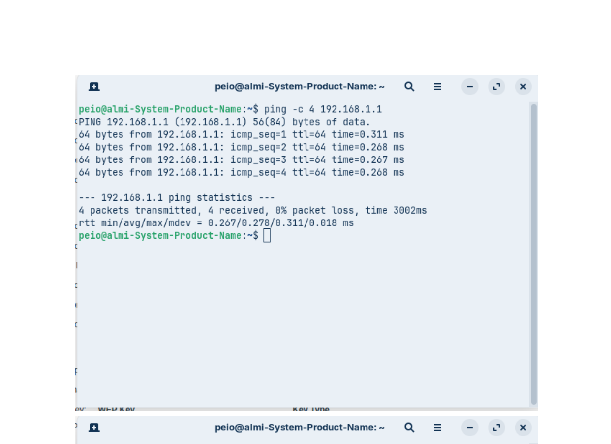

*Figura 1. Prueba de conectividad con el router.*

También se consultó la dirección del equipo con `ip addr`. La interfaz de red recibió la dirección `192.168.1.110/24`.

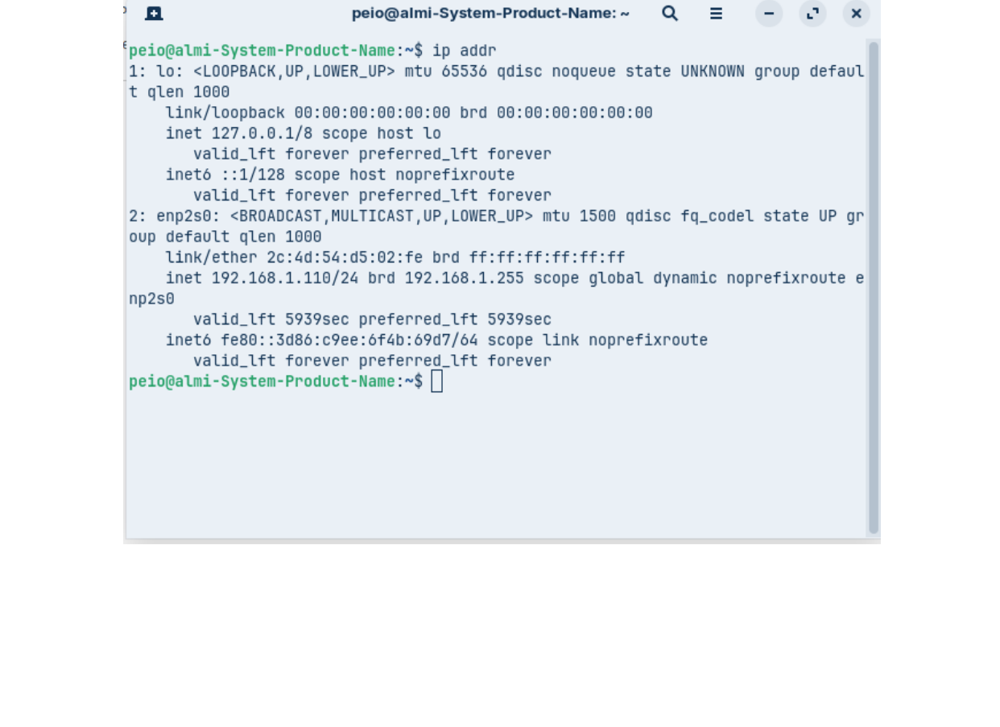

*Figura 2. Dirección IPv4 asignada al equipo de administración.*

## 3. Administración remota y local

La administración remota aparece desactivada mediante el valor `0.0.0.0`. Esta configuración impide administrar el router directamente desde Internet.

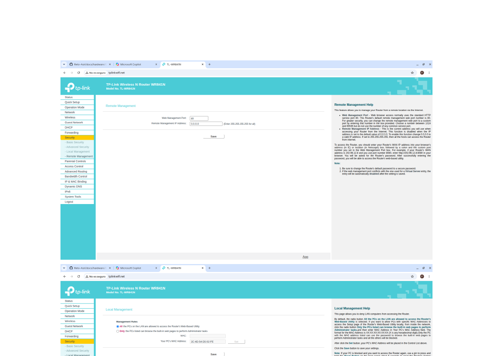

*Figura 3. Administración remota desactivada.*

El panel también permite restringir la administración local a equipos concretos mediante su dirección MAC. Esta medida reduce el número de dispositivos que pueden acceder a la configuración.

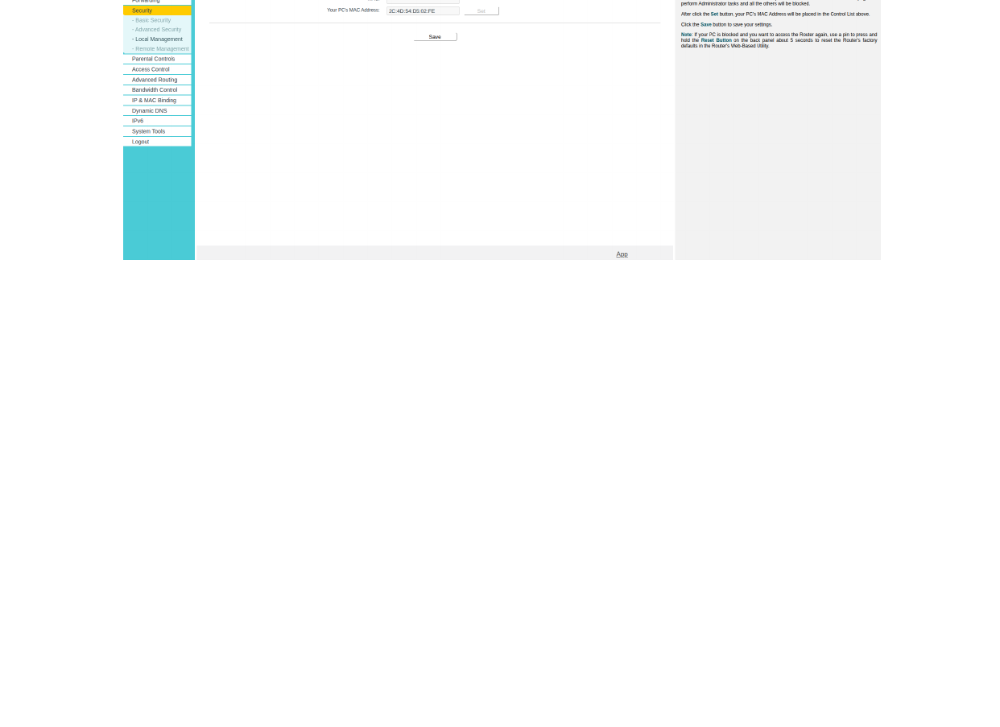

*Figura 4. Opciones de control para la administración local.*

## 4. Seguridad avanzada

El router ofrece protección frente a ataques DoS y filtros para tráfico ICMP-FLOOD, UDP-FLOOD y TCP-SYN-FLOOD. También permite impedir respuestas a ping desde el puerto WAN.

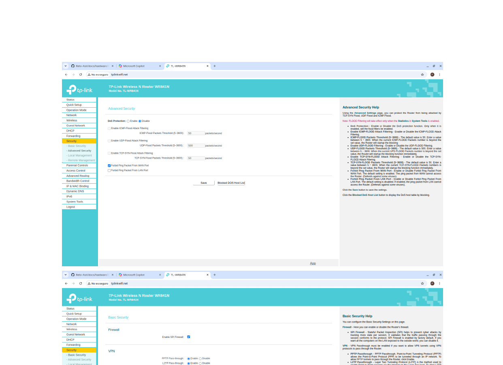

*Figura 5. Opciones de protección avanzada y filtrado de inundaciones.*

## 5. Firewall

En **Security > Basic Security** se revisó el firewall SPI. La inspección con estado ayuda a bloquear tráfico entrante que no corresponda a conexiones iniciadas desde la red interna.

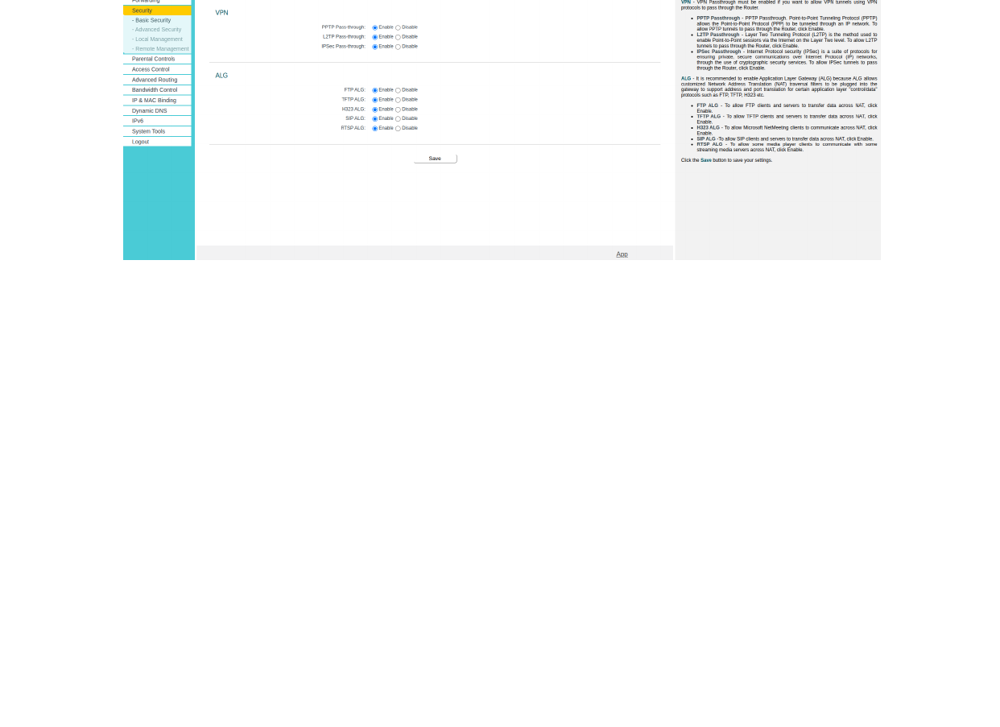

*Figura 6. Configuración del firewall SPI y servicios relacionados.*

## 6. Seguridad Wi-Fi

El panel recomienda WPA2-PSK con cifrado AES.

> [!CAUTION]
> **Contraseñas expuestas (corregido el 24/10/2026).** En la primera versión de las figuras 7 y 8 el recuadro negro tapaba otra zona y **se leían la contraseña Wi-Fi y la contraseña RADIUS**. Ahora están tapadas encima del campo correcto, pero las imágenes antiguas **siguen en el historial de Git**, así que:
> 1. Hay que **cambiar la contraseña Wi-Fi** de ese router si sigue en uso. Además era débil (8 cifras), contra la norma del proyecto. La nueva, una frase de 20 caracteres o más generada con KeePassXC.
> 2. gitleaks no analiza imágenes: cada captura se revisa a ojo, ampliada, antes de subirla.
>
> **Volvió a pasar el 29/10.** En las capturas 14 y 16 de la segunda parte el recuadro tapaba el campo de al lado: se leía la contraseña Wi-Fi nueva (**la misma en la red del personal y en la de invitados**). En la 15 se leía el PIN de WPS. Las imágenes se taparon bien el mismo día, pero las anteriores siguen en el historial de Git, así que hay que: cambiar la contraseña Wi-Fi del personal y poner **otra distinta** a la de invitados (las dos en KeePassXC), y generar un PIN nuevo en *Wireless → WPS* (WPS sigue desactivado). Hallazgo S-24 de la [tarea 46](../../seguridad/46-revision-seguridad/DOCUMENTACION.md).

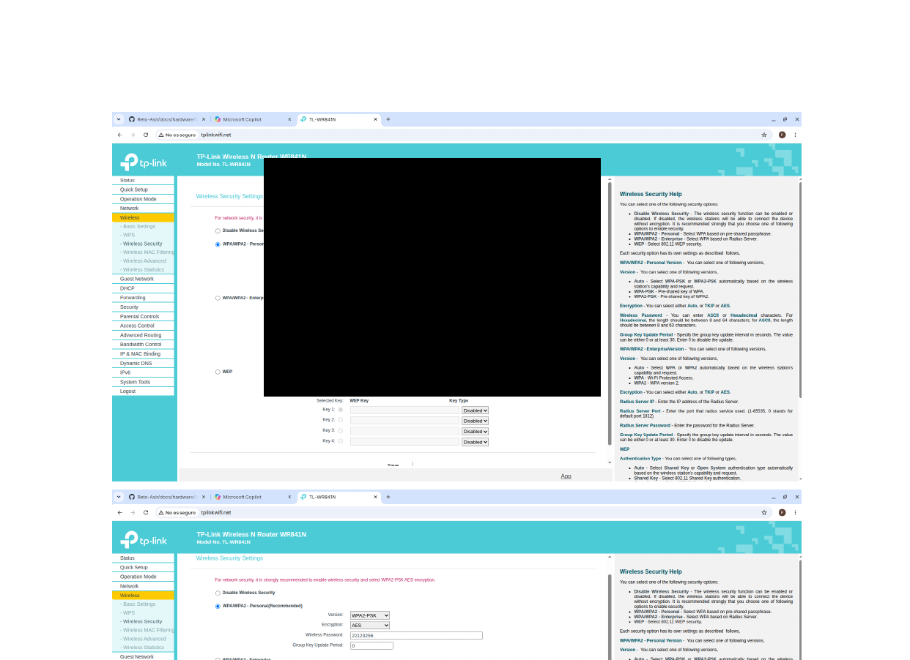

*Figura 7. Primera comprobación de la seguridad inalámbrica.*

En la configuración final se mantiene WPA2-PSK con AES. No se utiliza WEP ni TKIP porque son alternativas antiguas y menos seguras.

Dos ajustes que quedan mal en las capturas y hay que corregir en el router definitivo:

- **Periodo de renovación de la clave de grupo a `0`**: no se renueva nunca. Poner un valor, por ejemplo 3600 s.
- **Modo `11bgn mixed`** (figura 9): admite clientes 802.11b, antiguos y lentos. Usar `11gn` o `11n` si no hay equipos antiguos.

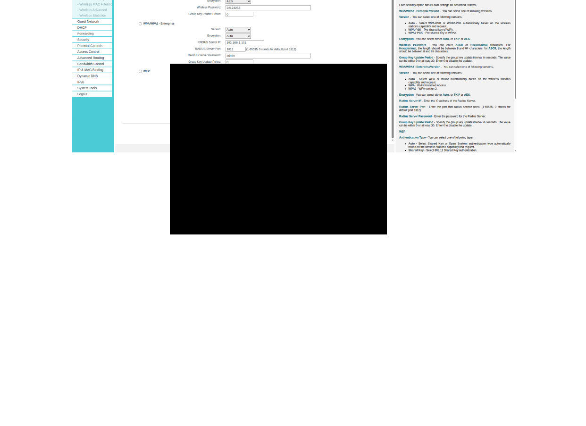

*Figura 8. Configuración final de WPA2-PSK y AES con las credenciales ocultas.*

### Limitación de WPA3

El TP-Link TL-WR841N v14 no muestra WPA3-SAE en el panel. Por ello, esta documentación no afirma que WPA3 esté habilitado. Para completar ese requisito debe incorporarse un punto de acceso o router compatible con WPA3.

## 7. Nombre y estado de la red

En la configuración básica aparece el SSID `Restaurante-Almichain`, con modo `11bgn mixed`, canal automático y difusión del SSID.

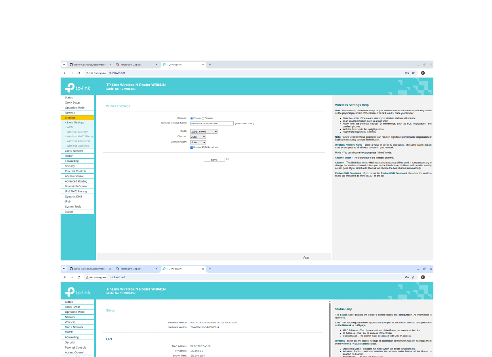

*Figura 9. Nombre y parámetros básicos de la red inalámbrica.*

La página de estado identifica el equipo como **TP-Link TL-WR841N v14**, muestra la dirección LAN `192.168.1.1` y la máscara `255.255.255.0`.

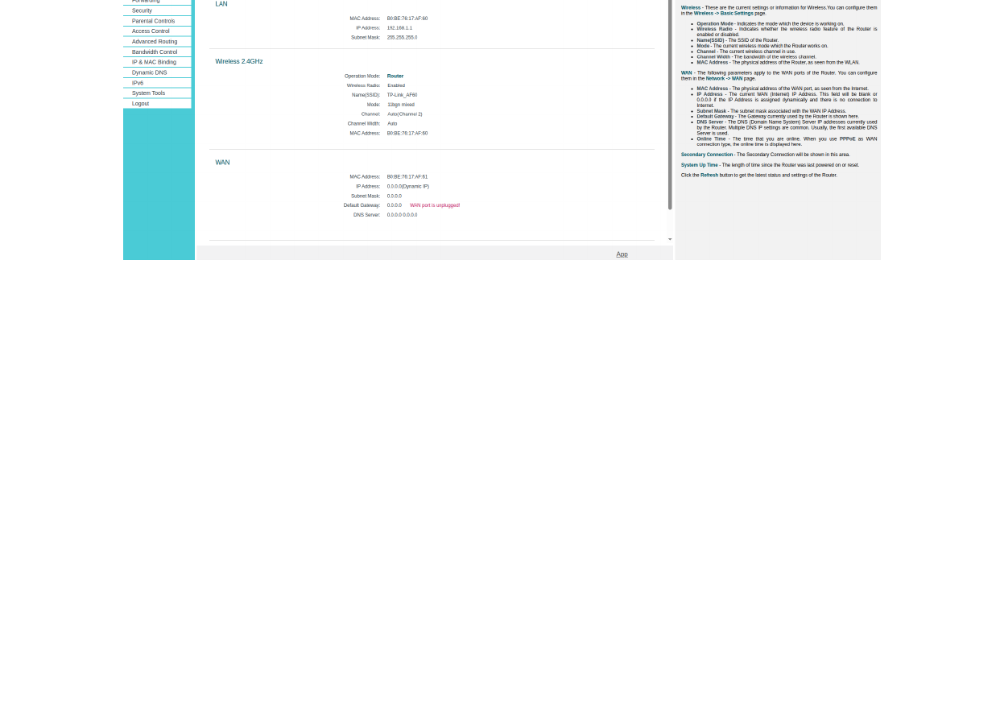

*Figura 10. Estado general, versión de hardware y parámetros LAN.*

## 8. Acceso al panel

El panel solicita credenciales de administración. La contraseña administrativa debe ser robusta, diferente de la contraseña Wi-Fi y no debe conservar el valor predeterminado.

**Problemas que se ven en las capturas:**

- Se entra como `Admin` con una contraseña de 5 caracteres, que parece la de fábrica (`admin`). No hay evidencia de que se haya cambiado.
- El panel va por **HTTP** (el navegador marca «No es seguro»): la contraseña viaja sin cifrar.
- La administración local está abierta a **todos** los equipos de la LAN (figura 4).

**Qué hay que hacer y documentar:** cambiar la contraseña de administración por una de KeePassXC (distinta de la Wi-Fi), limitar la administración local a la MAC del PC del gerente (figura 4) y administrar solo por cable, nunca desde la Wi-Fi.

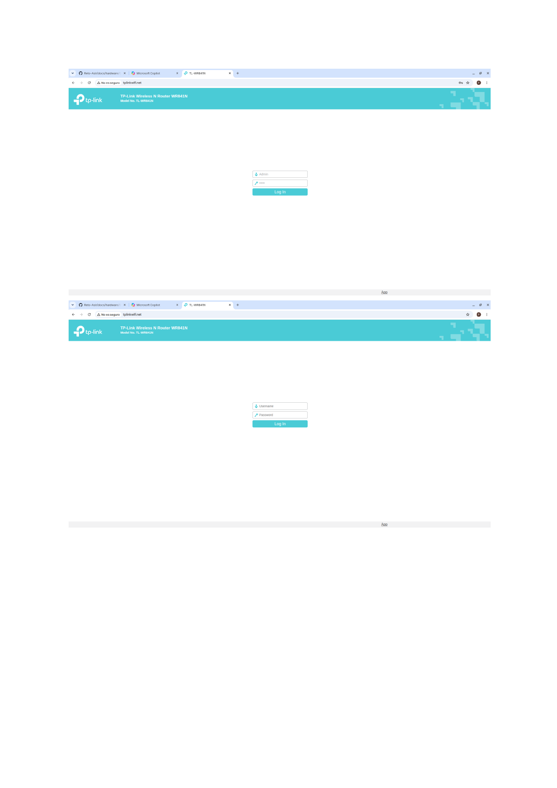

*Figura 11. Pantalla de acceso al panel de administración.*

## 9. Red de invitados

**Hecha el 29/10** ([segunda parte, sección 6](configurar-red-segura.md#6-red-de-invitados)): `Restaurante-Almichain-Invitados`, WPA2-PSK con AES, sin acceso a la red local, aislamiento entre invitados y renovación de la clave cada 3600 s. Un móvil de la red de invitados no abre el panel del router. Lo que se pedía:

1. Un SSID independiente, por ejemplo `Restaurante-Almichain-Invitados`.
2. Una contraseña diferente de la red principal.
3. El acceso a la red local desactivado.
4. El aislamiento entre clientes activado, si el firmware lo permite.
5. Una prueba de acceso a Internet y otra que demuestre que no se puede acceder a `192.168.1.0/24`.

## 10. Resultado de las comprobaciones

| Comprobación | Resultado |
|---|---|
| Dirección del equipo | `192.168.1.110/24` |
| Comunicación con el router | Correcta, 0 % de pérdida |
| Dirección LAN del router | `192.168.1.1/24` |
| Administración remota | Desactivada |
| Seguridad principal | WPA2-PSK con AES |
| WPA3 | No disponible en las capturas ni en el panel mostrado |
| Firewall SPI | Revisado en el panel |
| Protección DoS | Disponible y revisada |
| Red de invitados aislada | Configurada el 29/10 (acceso a la LAN desactivado y aislamiento activado); el móvil no abre el panel. Faltan las capturas de ping (P3b y P4) |
| WPS | Desactivado (29/10). Hay que generar un PIN nuevo: el actual se leía en una captura |
| Contraseña de administración | Cambiada por Peio el 26/10/2026 y guardada en KeePassXC. Administración solo desde la MAC del PC del gerente (29/10) |
| Contraseña Wi-Fi | Cambiada el 26/10, otra vez el 29/10 y de nuevo ese día tras verse en las capturas 14 y 16; personal e invitados con contraseñas distintas, en KeePassXC |
| LAN del proyecto | `192.168.10.1/24`, DHCP `.100-.199` y reserva `192.168.10.20` para el PC del gerente (29/10) |

## 11. Conclusión

Se ha verificado la conectividad, se ha revisado la administración local y remota, se ha configurado la opción Wi-Fi más segura disponible en el equipo y se han comprobado las funciones de firewall. Para terminar completamente la tarea faltan dos acciones: utilizar un equipo compatible con WPA3-SAE y documentar la configuración y el aislamiento de la red de invitados.

> [!WARNING]
> No deben subirse al repositorio las capturas originales sin censurar, ya que contienen contraseñas Wi-Fi y credenciales RADIUS visibles.

## 12. Pendiente

- [x] Cambiar la contraseña Wi-Fi expuesta del TL-WR841N (26/10/2026, guardada en KeePassXC).
- [x] Cambiar la contraseña de administración (26/10/2026, guardada en KeePassXC).
- [x] Limitar la administración a la MAC del PC del gerente; captura (29/10).
- [x] Desactivar WPS; captura (29/10).
- [x] Cambiar la contraseña Wi-Fi del personal (se leía en las capturas 14 y 16) y poner otra distinta en la de invitados (29/10).
- [ ] Confirmar el PIN de WPS nuevo.
- [ ] Capturas de ping desde la red de invitados: al PC del gerente (P3b) y entre dos móviles (P4).
- [x] LAN en `192.168.10.0/24`, reserva del gerente y renovación de la clave de grupo, en el TL-WR841N (29/10).
- [ ] En el local, con el Archer C6: WPA3 (o WPA2/WPA3) y modo sin 802.11b, que el TL-WR841N no tiene (limitación).
- [x] Configurar la red de invitados con aislamiento entre clientes (29/10). El TL-WR841N no le da una subred propia en el panel: el aislamiento es interno (tarea 23, apartado 4.4).
- [ ] Comprobar en la tarea 25 si la red de invitados pasa por el enlace WDS al router 2. Si no pasa, documentarlo y corregir los diagramas (tarea 11 y LOGICA_RETO).
