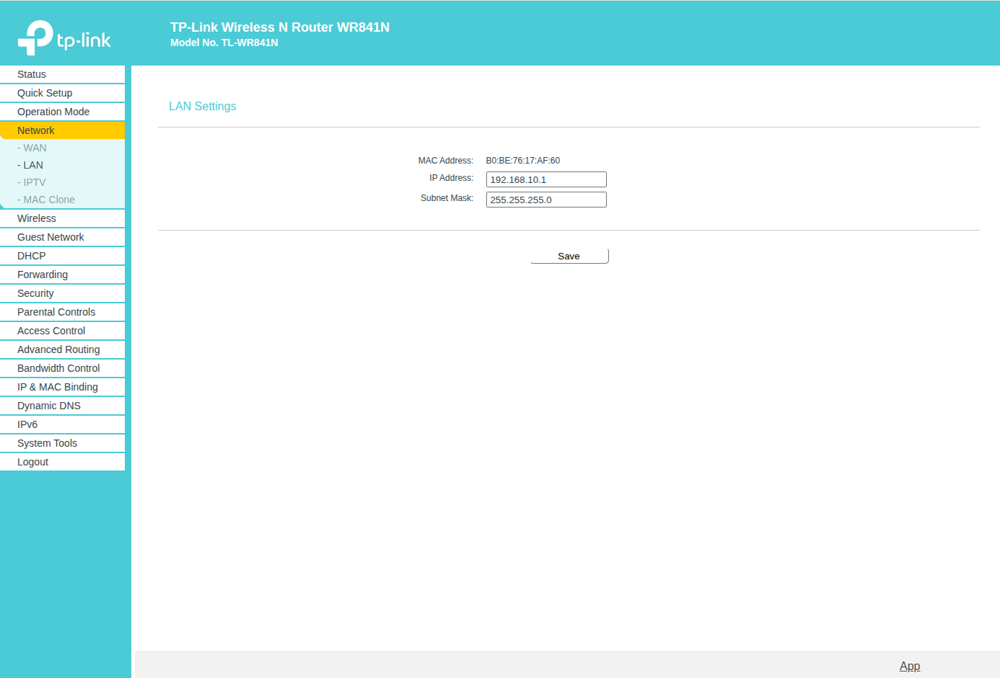
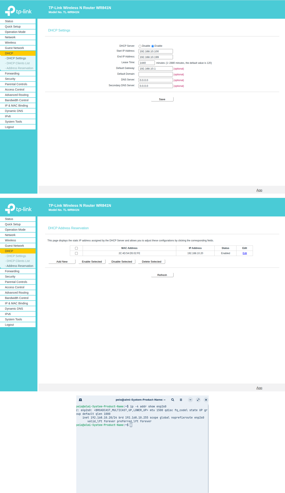
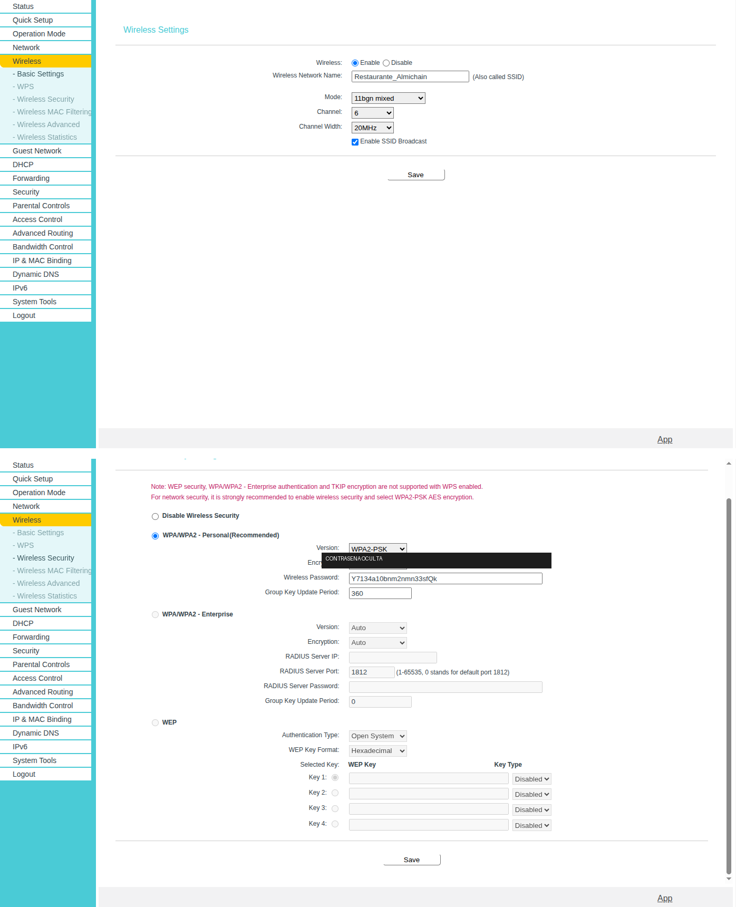
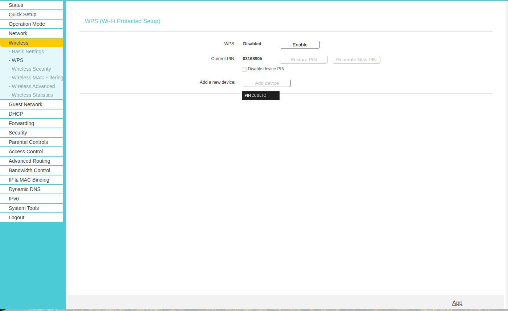
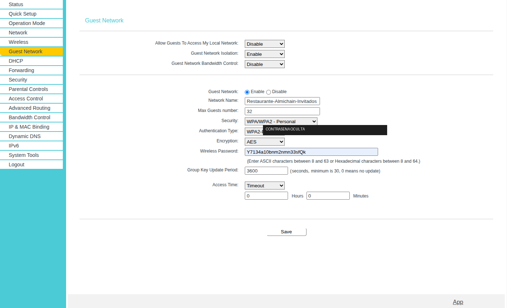
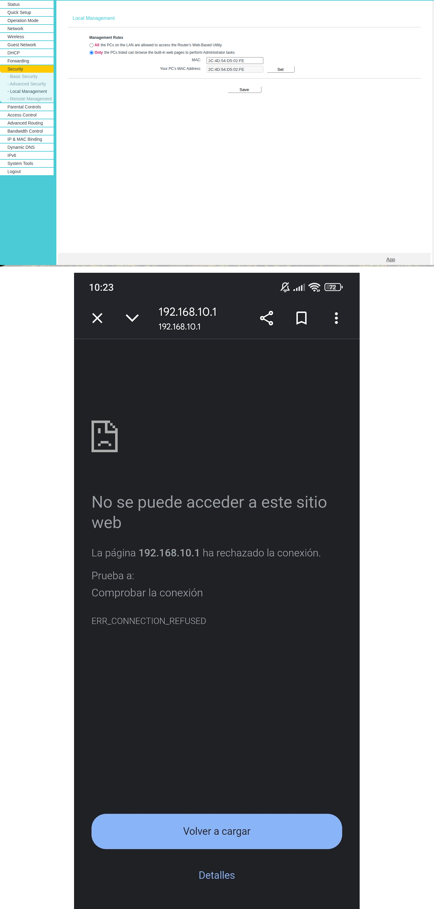
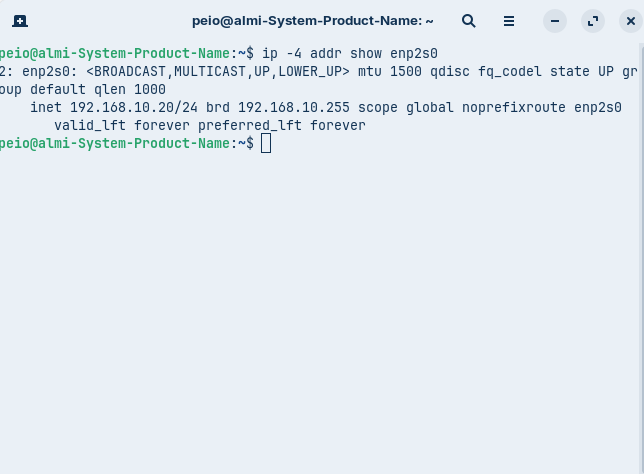
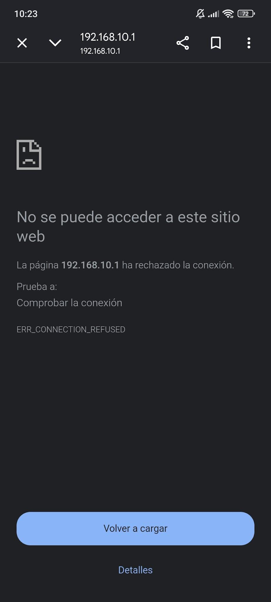
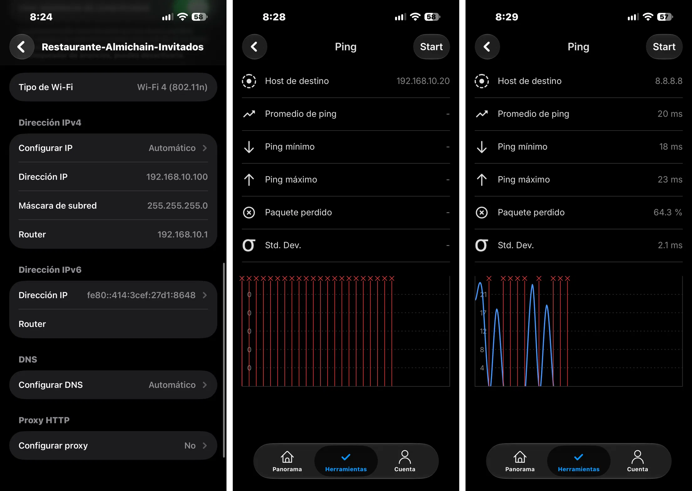
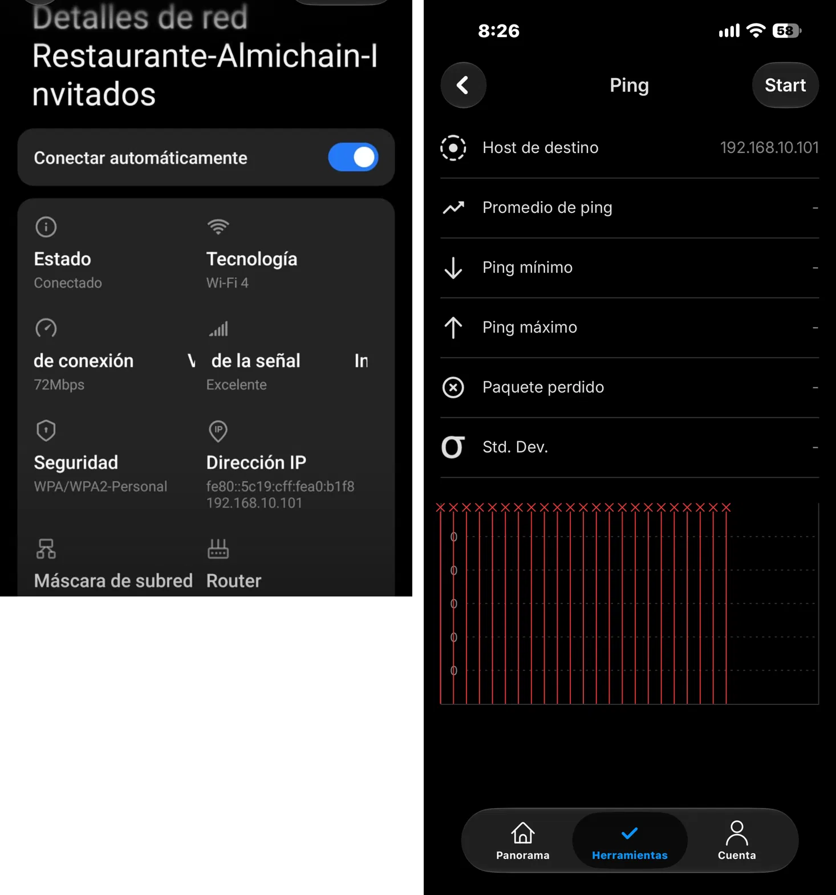

# Configurar una red segura con TP-Link TL-WR841N

## 1. Objetivo

Configurar y comprobar la seguridad de la red del restaurante mediante:

- Una red LAN separada en `192.168.10.0/24`.
- DHCP con una reserva para el PC de administración.
- Wi-Fi del personal protegido con WPA2-PSK y AES.
- WPS desactivado.
- Una red de invitados aislada de la LAN.
- Acceso al panel limitado al PC de administración.

El equipo utilizado es un **TP-Link TL-WR841N**. Este modelo y su firmware no muestran compatibilidad con WPA3-SAE, por lo que se utiliza la opción más segura disponible: **WPA2-PSK con AES**.

> **Limitación:** para utilizar WPA3 sería necesario sustituir el router o añadir un punto de acceso compatible con WPA3-SAE.

## 2. Configuración de la red LAN

En `Network > LAN` se configuraron los siguientes valores:

| Parámetro | Valor |
|---|---|
| Dirección del router | `192.168.10.1` |
| Máscara de subred | `255.255.255.0` |



*Figura 1. Dirección LAN del router y máscara de subred.*

## 3. DHCP y reserva del PC de administración

En `DHCP > DHCP Settings` se habilitó el servidor DHCP con esta configuración:

| Parámetro | Valor |
|---|---|
| Rango DHCP | `192.168.10.100` - `192.168.10.199` |
| Tiempo de concesión | `1440` minutos |
| Puerta de enlace | `192.168.10.1` |

En `DHCP > Address Reservation` se reservó `192.168.10.20` para la interfaz Ethernet del PC de administración. Después de renovar la conexión, Linux confirmó que `enp2s0` estaba activa con `192.168.10.20/24`.



*Figura 2. Servidor DHCP, reserva de dirección y comprobación en Linux.*

## 4. Wi-Fi del personal

En `Wireless > Basic Settings` se configuró:

| Parámetro | Valor |
|---|---|
| SSID | `Restaurante_Almichain` (con guion bajo; en la primera parte era `Restaurante-Almichain`) |
| Modo | `11bgn mixed` |
| Canal | `6` fijo |
| Ancho de canal | `20 MHz` |
| Difusión del SSID | Activada |

El firmware no ofrece `11gn mixed`, por lo que se mantuvo `11bgn mixed`, que es la opción disponible con compatibilidad 802.11n. El canal se dejó fijo para evitar cambios automáticos que puedan afectar al WDS.

En `Wireless > Wireless Security` se seleccionó:

- `WPA/WPA2 - Personal`.
- Versión `WPA2-PSK`.
- Cifrado `AES`.
- Renovación periódica de la clave de grupo.



*Figura 3. Parámetros básicos y seguridad de la red del personal. La contraseña está censurada.*

## 5. WPS desactivado

En `Wireless > WPS` se desactivó WPS. El panel muestra el estado `Disabled`.



*Figura 4. WPS desactivado. El PIN se ha censurado.*

## 6. Red de invitados

En `Guest Network` se configuró una red independiente:

| Parámetro | Valor |
|---|---|
| Estado | Activada |
| SSID | `Restaurante-Almichain-Invitados` |
| Seguridad | `WPA2-PSK` con `AES` |
| Acceso a la red local | Desactivado |
| Aislamiento entre invitados | Activado |
| Renovación de clave de grupo | `3600` segundos |

La contraseña de invitados no se publica en el repositorio. **Corrección (29/10):** en las capturas 14 y 16 se veía que era la misma que la del personal; hay que poner dos distintas ([DOCUMENTACION.md, sección 6](DOCUMENTACION.md#6-seguridad-wi-fi)).



*Figura 5. Red de invitados habilitada y aislada. La contraseña está censurada.*

## 7. Administración limitada al PC autorizado

En `Security > Local Management` se seleccionó la opción que permite administrar el router únicamente desde los equipos incluidos en la lista. Se añadió la interfaz Ethernet del PC de administración.

La comprobación dio el resultado esperado:

- El PC autorizado por Ethernet puede entrar en `http://192.168.10.1`.
- Un móvil conectado por Wi-Fi recibe `ERR_CONNECTION_REFUSED` al intentar abrir el panel.



*Figura 6. Restricción por MAC y prueba de acceso denegado desde un móvil.*

## 8. Comprobación de la dirección reservada

El comando utilizado en Linux fue:

```bash
ip -4 addr show enp2s0
```

El resultado confirmó `192.168.10.20/24` en la interfaz Ethernet.



*Figura 7. Dirección reservada aplicada al PC de administración.*

## 9. Pruebas de la red de invitados

| Prueba | Resultado esperado | Evidencia disponible |
|---|---|---|
| P1. Salir a Internet desde invitados | Responde | ✅ Ping a `8.8.8.8` con respuesta, 18-23 ms (figura 9) |
| P2. Consultar IP y puerta de enlace del invitado | Registrar ambos valores | ✅ Móvil en `Restaurante-Almichain-Invitados`: `192.168.10.100/24`, router `192.168.10.1` (figura 9) |
| P3a. Abrir `192.168.10.1` desde invitados | El panel no abre | Sí |
| P3b. Ping a `192.168.10.20` desde invitados | Sin respuesta | ✅ Ningún paquete responde (figura 9) |
| P4. Ping entre dos móviles invitados | Sin respuesta | ✅ Del `.100` al `.101`, los dos en invitados: ningún paquete responde (figura 10) |
| P5. Conectar con la contraseña antigua | No conecta | Sin captura requerida |



*Figura 8. El dispositivo Wi-Fi no puede abrir el panel del router.*

> La captura anterior demuestra el bloqueo del panel, pero no sustituye las capturas de ping exigidas para P3b y P4.
>
> Además, en la captura no se ve a qué Wi-Fi está conectado el móvil, y `ERR_CONNECTION_REFUSED` significa que el router contesta y rechaza la conexión: es lo que pasa con **cualquier** equipo que no sea el del gerente, por la regla de administración local (figura 6). Así que demuestra esa regla, no el aislamiento de invitados. Por eso P3b y P4 se hicieron el 30/10 con ping (app de iPhone) y con la pantalla de detalles del Wi-Fi, que enseña la red y la IP.



*Figura 9. P2, P3b y P1 (30/10/2026): el móvil está en la red de invitados con `192.168.10.100`; el ping al PC del gerente (`192.168.10.20`) no responde y el de `8.8.8.8` sí. La pérdida del 64 % hacia `8.8.8.8` es de la red del aula y no cambia el resultado: hay salida a Internet.*



*Figura 10. P4 (30/10/2026): el segundo móvil está en la red de invitados con `192.168.10.101` y el ping desde el primero (`.100`) no responde.*

## 10. Resultado de las comprobaciones

| Comprobación | Resultado |
|---|---|
| Dirección LAN | `192.168.10.1/24` |
| DHCP | Activado, rango `192.168.10.100-199` |
| Reserva del PC | `192.168.10.20/24` aplicada |
| Seguridad Wi-Fi | WPA2-PSK con AES |
| Canal | `6`, fijo |
| WPS | Desactivado |
| Red de invitados | Activada y con aislamiento configurado |
| Acceso al panel desde móvil | Bloqueado |
| Acceso al panel desde PC autorizado | Permitido |
| WPA3 | No disponible en el TL-WR841N |

## 11. Conclusión

La red se ha migrado a `192.168.10.0/24`, se ha configurado DHCP con una reserva para el PC de administración, se ha protegido el Wi-Fi con WPA2-PSK y AES, se ha desactivado WPS, se ha creado una red de invitados aislada y se ha limitado el panel a un único equipo autorizado.

La principal limitación es la ausencia de WPA3-SAE en el TP-Link TL-WR841N. Las pruebas de la red de invitados (P1 a P4) tienen captura desde el 30/10.

## 12. Lista de comprobación

- [x] Dirección LAN `192.168.10.1/24`.
- [x] DHCP `192.168.10.100-199` y concesión de 1440 minutos.
- [x] Reserva `192.168.10.20` para el PC de administración.
- [x] Canal Wi-Fi fijo.
- [x] WPA2-PSK con AES.
- [x] WPS desactivado.
- [x] Red de invitados habilitada.
- [x] Acceso de invitados a la LAN desactivado.
- [x] Aislamiento entre invitados habilitado en la configuración.
- [x] Administración limitada al PC autorizado.
- [x] Prueba de bloqueo del panel desde un móvil.
- [x] Salida a Internet desde la red de invitados (ping a `8.8.8.8`, 30/10).
- [x] Captura de IP y puerta de enlace de un invitado (30/10).
- [x] Captura del ping fallido desde invitados a `192.168.10.20` (30/10).
- [x] Captura del ping fallido entre dos invitados (30/10).

## 13. Seguridad de las evidencias

Las imágenes preparadas para GitHub ocultan contraseñas y el PIN WPS. **El 29/10 no los ocultaban:** en la 14 y la 16 el recuadro tapaba el campo de al lado y en la 15 se leía el PIN; se taparon bien el mismo día y, como las versiones anteriores siguen en el historial de Git, **el 29/10 se cambiaron las contraseñas Wi-Fi (personal e invitados, distintas) y se generó un PIN de WPS nuevo**, guardados en KeePassXC (hallazgo S-24 de la tarea 46, cerrado). El PDF original no debe subirse al repositorio porque contiene credenciales visibles.
