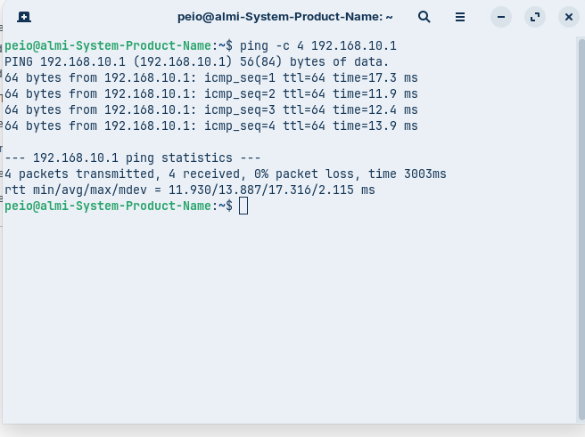
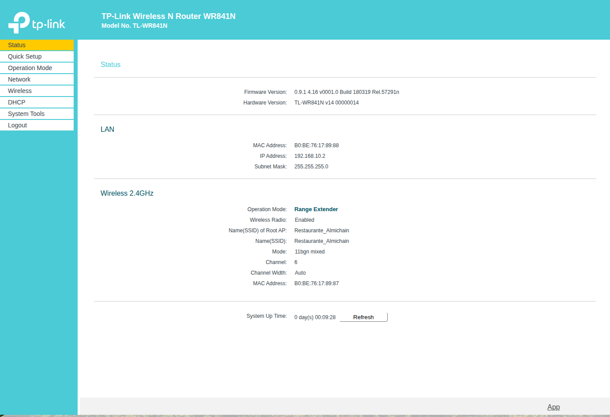
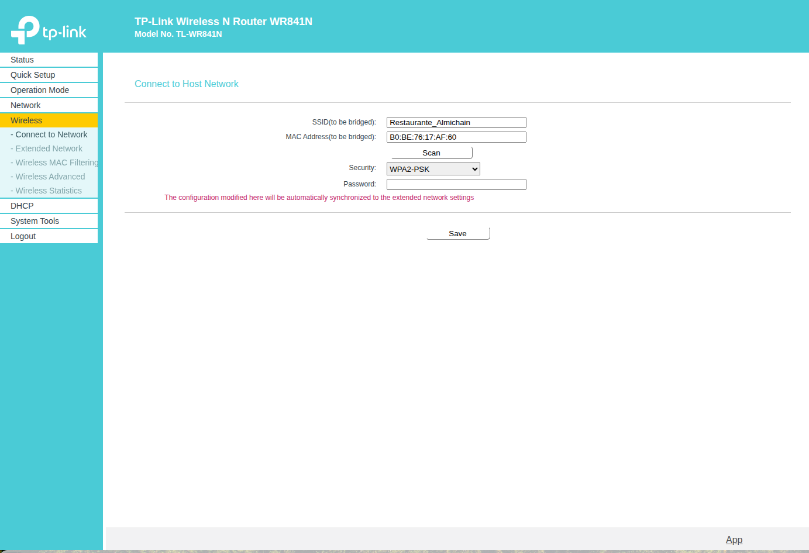
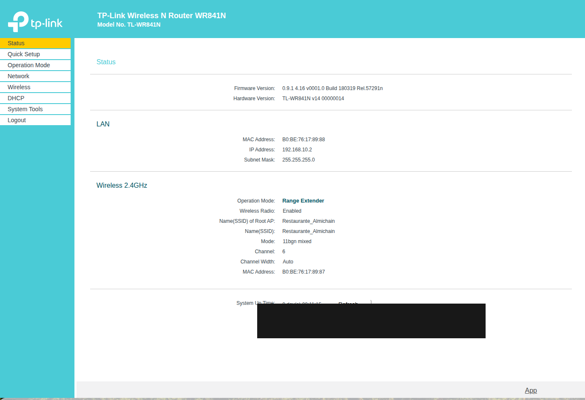
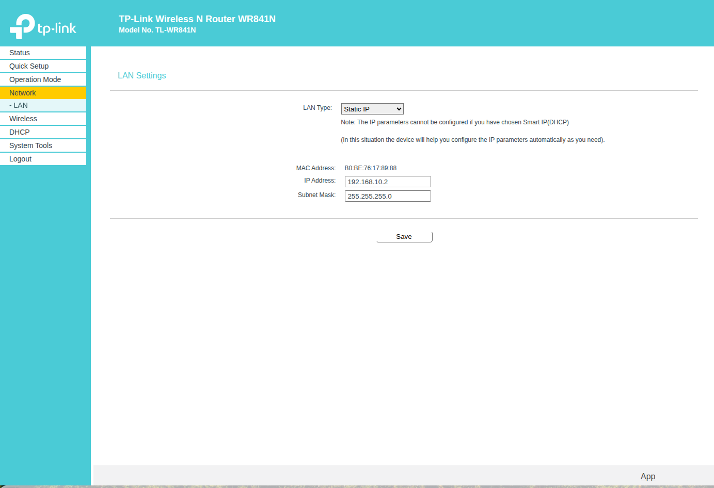
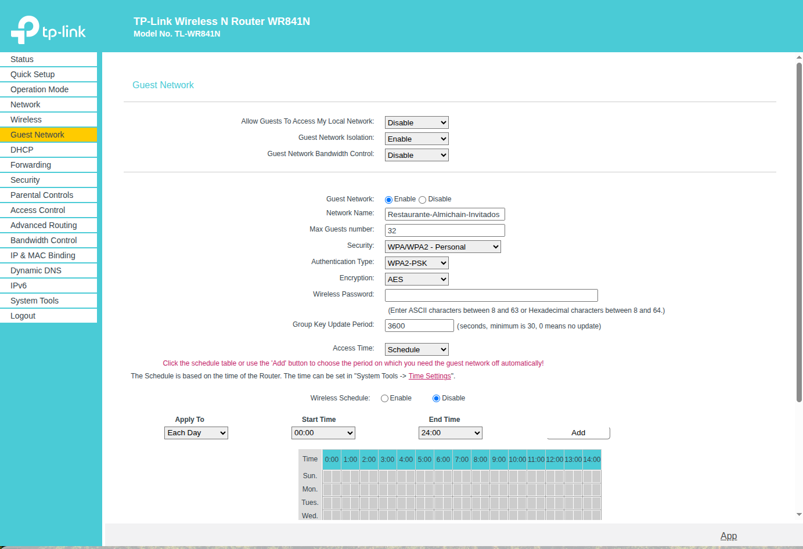
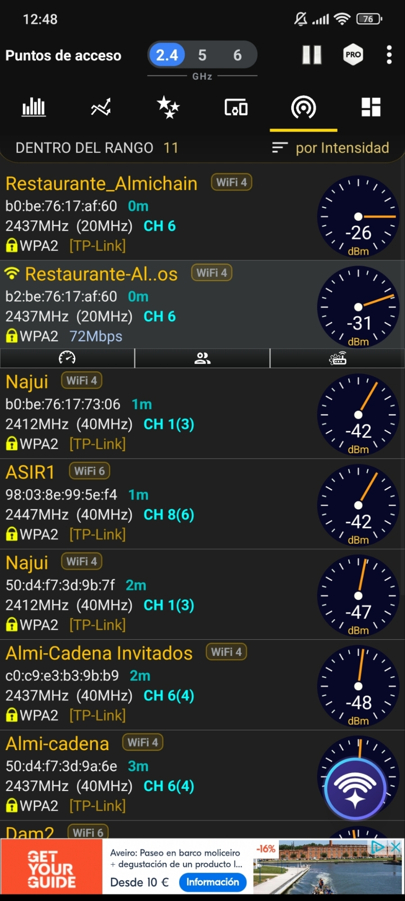
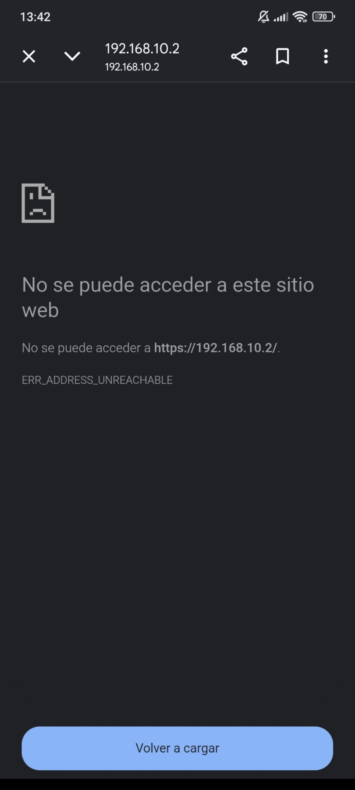

# Tarea 25: WDS con segundo router y pruebas de cobertura

- **Bloque:** 5 Redes
- **Responsable:** Peio
- **Reto:** Almi-Chain (ASIR1 2026-27)
- **Estado:** ✅ Completado
- **Fechas:** 02/11 – 03/11/2026

## 1. Objetivo

El objetivo de esta tarea es ampliar la cobertura Wi-Fi del local utilizando un segundo router conectado inalámbricamente al router principal.

Se ha utilizado un segundo **TP-Link TL-WR841N** configurado en modo **Range Extender**, que realiza la función de extensión inalámbrica de la red principal.

La configuración permite:

1. Conectar inalámbricamente el router 2 con el router principal.
2. Mantener ambos equipos dentro de la red `192.168.10.0/24`.
3. Mantener un único servidor DHCP, situado en el router principal.
4. Dar acceso a Internet a los clientes de la red ampliada.
5. Mantener aislada la red de invitados respecto a la LAN interna.
6. Comprobar la cobertura y el punto de acceso mediante WiFi Analyzer.

## 2. Topología y direccionamiento

```text
                    Enlace inalámbrico
                    Range Extender

Router 1  <================================>  Router 2
192.168.10.1                                192.168.10.2
DHCP activo                                 DHCP desactivado
Canal 6                                     Canal 6
Router principal                            Range Extender
```

| Parámetro | Router 1 | Router 2 |
|---|---|---|
| IP LAN | `192.168.10.1` | `192.168.10.2` |
| Máscara | `255.255.255.0` | `255.255.255.0` |
| DHCP | Activado | **Desactivado** |
| Banda | 2,4 GHz | 2,4 GHz |
| Canal | **6 fijo** | 6 |
| SSID principal | `Restaurante_Almichain` | `Restaurante_Almichain` |
| Modo | Router principal | Range Extender |

## 3. Router principal

El router principal se mantiene en `192.168.10.1`. Para evitar que el enlace inalámbrico cambie de canal durante el funcionamiento, la banda de 2,4 GHz se ha configurado en el **canal 6 fijo**.



La red de invitados utilizada es `Restaurante-Almichain-Invitados`, configurada para proporcionar acceso a Internet sin permitir acceso a la red local.

## 4. Configuración LAN del router 2

El segundo router estaba inicialmente en otra subred. Se modificó su configuración LAN para integrarlo en la red del proyecto con la dirección:

```text
IP:      192.168.10.2
Máscara: 255.255.255.0
```



De esta manera, los dos routers tienen direcciones diferentes pero pertenecen a la misma red `192.168.10.0/24`.

## 5. DHCP del router 2

El servidor DHCP del segundo router se ha desactivado.



Solo el router principal reparte direcciones IP. Esto evita conflictos entre dos servidores DHCP dentro de la misma red.

```text
Router 1 → DHCP activado
Router 2 → DHCP desactivado
```

## 6. Enlace inalámbrico / Range Extender

En el firmware del TP-Link TL-WR841N utilizado, la extensión inalámbrica se configura mediante **Range Extender / Connect to Host Network**.

Como red principal se seleccionó:

```text
Restaurante_Almichain
```

La contraseña necesaria para establecer el enlace está ocultada en la evidencia publicada.



Una vez configurado, el estado del router 2 muestra:

- **Operation Mode:** Range Extender.
- **Wireless Radio:** Enabled.
- **Root AP:** `Restaurante_Almichain`.
- **SSID:** `Restaurante_Almichain`.
- **Channel:** 6.
- **IP LAN:** `192.168.10.2`.



El router 2 queda así enlazado inalámbricamente con el router principal y utiliza el mismo canal de 2,4 GHz.

## 7. Prueba de conectividad

Para comprobar la comunicación a través del montaje se hizo ping al router principal:

```bash
ping -c 4 192.168.10.1
```

El resultado fue:

```text
4 packets transmitted
4 received
0% packet loss
```



El **0 % de pérdida de paquetes** confirma que existe conectividad con el router principal.

También se comprobó desde un dispositivo móvil, con los datos móviles desactivados, que la conexión Wi-Fi permitía navegar correctamente por Internet.

## 8. Prueba de cobertura con WiFi Analyzer

Para comprobar las características de la red inalámbrica se utilizó **WiFi Analyzer** desde un móvil Android.

La aplicación permitió comprobar el SSID, BSSID, canal y nivel de señal recibido.



En la medición realizada se observó:

```text
Canal:      6
Frecuencia: 2437 MHz
Ancho:      20 MHz
Señal:      aproximadamente -31 dBm
```

Como referencia:

| Señal | Calidad |
|---|---|
| -30 a -67 dBm | Buena |
| -67 a -75 dBm | Aceptable |
| Peor que -75 dBm | Mala |

El valor obtenido, aproximadamente **-31 dBm**, corresponde a una señal de calidad muy buena en el punto comprobado.

## 9. Aislamiento de la red de invitados

Una parte importante de la prueba consiste en garantizar que ampliar la Wi-Fi no permite a los clientes invitados acceder a la LAN interna.

El móvil se conectó a:

```text
Restaurante-Almichain-Invitados
```

Primero se comprobó que el móvil podía navegar por Internet. Después se intentó acceder a diferentes direcciones de la red interna.

### 9.1 Acceso al router 2

Se intentó acceder a:

```text
192.168.10.2
```

El navegador mostró `ERR_ADDRESS_UNREACHABLE`.



**Resultado:** el panel del router 2 no es accesible desde la red de invitados.

### 9.2 Acceso a un equipo de la LAN

También se probó:

```text
192.168.10.10
```

El navegador volvió a indicar que la dirección no era alcanzable.


Durante las pruebas también se comprobó que desde la red de invitados no se podía acceder a `192.168.10.1`.

| Destino | Resultado desde invitados |
|---|---|
| Internet | ✅ Accesible |
| `192.168.10.1` | ✅ Bloqueado |
| `192.168.10.2` | ✅ Bloqueado |
| `192.168.10.10` | ✅ Bloqueado |

Por tanto, la ampliación inalámbrica mantiene el aislamiento entre los clientes invitados y la red interna.

## 10. Incidencias y soluciones durante la configuración

### 10.1 Cambio de subred

El router 2 estaba inicialmente en `192.168.0.0/24`. Se cambió su dirección a `192.168.10.2/24` para integrarlo en la red del proyecto.

### 10.2 Desactivación de DHCP

Al desactivar DHCP en el router 2, el ordenador dejó de recibir temporalmente una dirección mientras permanecía conectado únicamente a ese equipo.

Para continuar la administración se utilizó temporalmente una dirección manual de la red, por ejemplo:

```text
192.168.10.50/24
```

Después se pudo acceder de nuevo al router 2 mediante `192.168.10.2`.

### 10.3 Navegador y conectividad IP

Durante algunas comprobaciones el navegador podía mostrar errores HTTP aunque existiera conectividad IP. Por ello se utilizó también `ping` para separar los problemas del servicio web de los problemas de red.

## 11. Resultados

| Comprobación | Resultado |
|---|---|
| Router principal en `192.168.10.1` | ✅ |
| Canal 2,4 GHz fijo | ✅ Canal 6 |
| Router 2 en `192.168.10.2` | ✅ |
| DHCP del router 2 desactivado | ✅ |
| Router 2 en modo Range Extender | ✅ |
| Enlace con `Restaurante_Almichain` | ✅ |
| Mismo canal en el enlace | ✅ Canal 6 |
| Comunicación con `192.168.10.1` | ✅ |
| Pérdida de paquetes | ✅ 0 % |
| Acceso a Internet por Wi-Fi | ✅ |
| Comprobación con WiFi Analyzer | ✅ |
| Señal registrada | ✅ ~ -31 dBm |
| Invitados con Internet | ✅ |
| Invitados sin acceso a `192.168.10.1` | ✅ |
| Invitados sin acceso a `192.168.10.2` | ✅ |
| Invitados sin acceso a `192.168.10.10` | ✅ |
| Aislamiento de la LAN | ✅ |

## 12. Evidencias

Todas las evidencias están guardadas en la carpeta `evidencias/`.

| Fichero | Qué demuestra |
|---|---|
| `10-router1-canal-fijo.png` | Router 1 funcionando con el canal 6 fijo |
| `11-router2-lan.png` | Router 2 configurado como `192.168.10.2` |
| `12-router2-dhcp-desactivado.png` | DHCP desactivado en el router 2 |
| `13-router2-range-extender.png` | Estado del router 2 en modo Range Extender |
| `14-ping-router-principal.png` | Comunicación con el router principal y 0 % de pérdida |
| `15-wifi-analyzer-p1-antes.jpg` | Señal, BSSID y canal vistos desde WiFi Analyzer |
| `16-invitados-sin-acceso-router2.jpg` | La red de invitados no alcanza `192.168.10.2` |
| `17-invitados-sin-acceso-lan.jpg` | La red de invitados no alcanza `192.168.10.10` |
| `18-router2-host-network-REDACTADA.png` | Selección de la red principal para el enlace, con la contraseña oculta |

Las contraseñas y credenciales sensibles se han ocultado antes de publicar las evidencias.

## 13. Conclusión

La prueba realizada confirma el funcionamiento del segundo router como **extensor inalámbrico** de la red del restaurante.

El router principal permanece en `192.168.10.1` y el segundo router se integra en la misma red mediante `192.168.10.2`, manteniendo el servidor DHCP desactivado y utilizando el mismo canal inalámbrico.

El TP-Link TL-WR841N queda funcionando en modo **Range Extender**, enlazado a `Restaurante_Almichain`. La prueba de conectividad con el router principal obtiene **0 % de pérdida de paquetes** y se comprueba navegación por Internet desde la red inalámbrica.

Mediante **WiFi Analyzer** se verifica el canal y la intensidad de señal, con aproximadamente **-31 dBm** en la medición realizada, valor correspondiente a una señal de muy buena calidad.

Finalmente, la red `Restaurante-Almichain-Invitados` mantiene su aislamiento: permite acceder a Internet, pero no permite acceder a `192.168.10.1`, `192.168.10.2` ni `192.168.10.10`.

Por tanto, la solución permite **ampliar la cobertura Wi-Fi manteniendo el direccionamiento previsto y el aislamiento entre la red de invitados y la LAN interna**.
