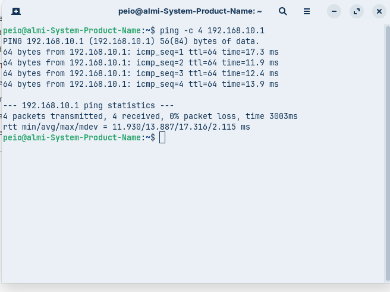
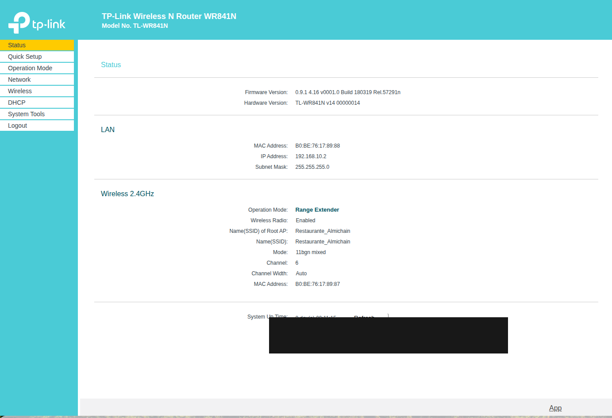
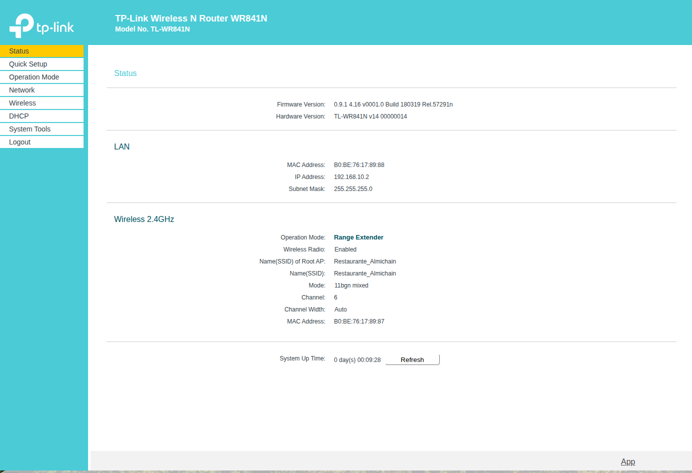
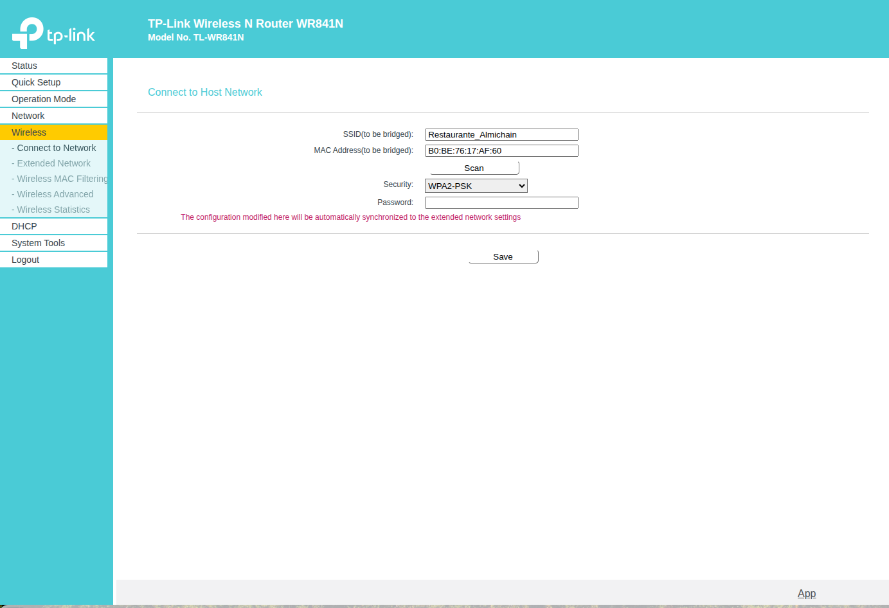
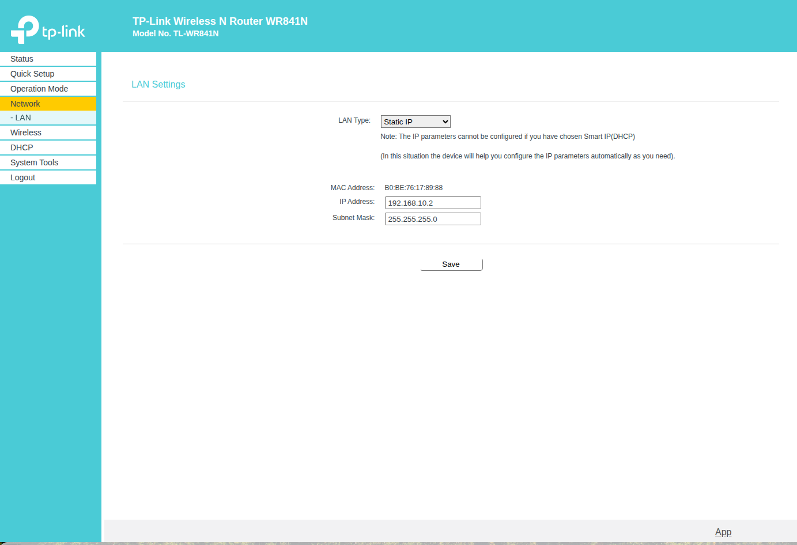
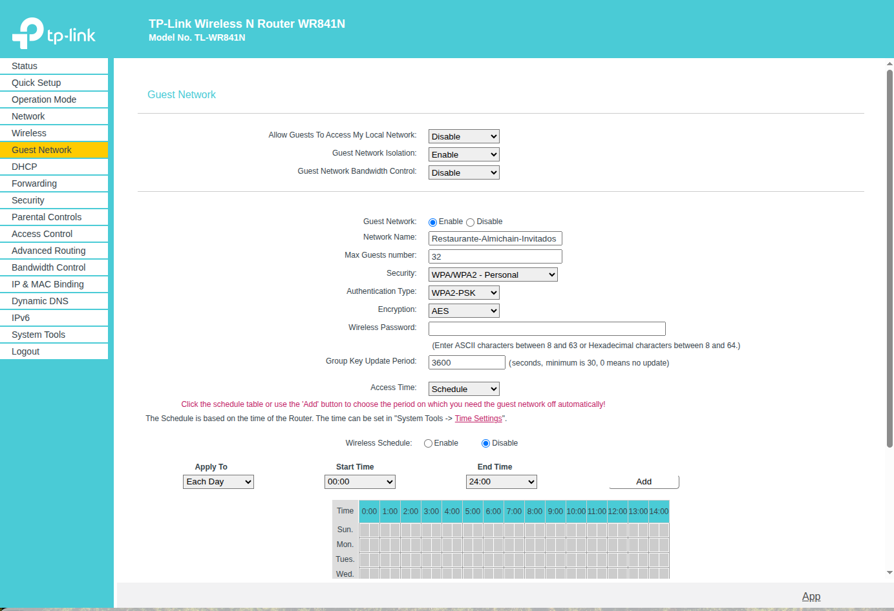
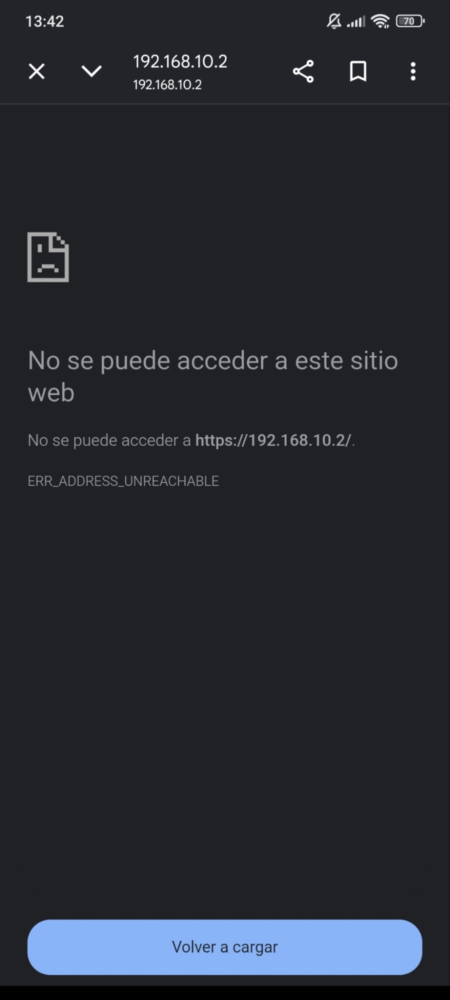
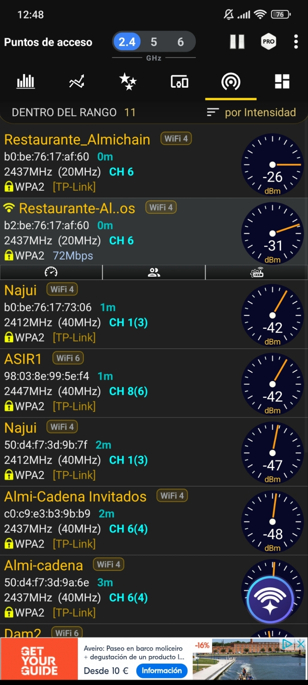

# 25: WDS con segundo router y pruebas de cobertura

## 1. Objetivo

En esta tarea se ha configurado un segundo router **TP-Link TL-WR841N** como extensor inalámbrico de la red del proyecto. El objetivo es ampliar la cobertura Wi-Fi usando un enlace inalámbrico entre los dos routers, mantener un único servidor DHCP y comprobar que la red de invitados continúa aislada de la LAN.

> **Estado:** configuración principal y pruebas básicas realizadas. Las mediciones completas de cobertura antes/después, `iperf3` y algunas pruebas de roaming quedan pendientes para cerrar la tarea al 100 %.

## 2. Topología final

```text
                         enlace inalámbrico
Router 1  <============================================>  Router 2
192.168.10.1                                               192.168.10.2
Router                                                      Range Extender
DHCP activo                                                 DHCP desactivado
Canal 6                                                     Canal 6
SSID: Restaurante_Almichain                                Root AP: Restaurante_Almichain
```

El segundo router no utiliza el puerto WAN para enlazarse con el principal. La administración del router 2 queda en la misma red LAN, con la dirección `192.168.10.2/24`.

## 3. Configuración del router principal

El router principal está configurado con:

| Parámetro | Valor |
|---|---|
| IP LAN | `192.168.10.1` |
| Máscara | `255.255.255.0` |
| SSID personal | `Restaurante_Almichain` |
| Banda | 2,4 GHz |
| Canal | **6 fijo** |
| Modo | Router |



La red de invitados se configuró con aislamiento de la red local. La comprobación práctica del aislamiento se documenta más adelante mediante intentos de acceso a direcciones internas.

Durante la configuración del enlace se seleccionó la red principal como **Host Network**. La contraseña se ha ocultado expresamente en la evidencia publicada.



## 4. Configuración del router secundario

El router secundario se configuró con IP estática dentro de la red del proyecto:

| Parámetro | Valor |
|---|---|
| Modelo | TP-Link TL-WR841N |
| IP LAN | `192.168.10.2` |
| Máscara | `255.255.255.0` |
| Modo | Range Extender |
| Root AP | `Restaurante_Almichain` |
| Canal | 6 |
| DHCP | **Desactivado** |



El DHCP se desactivó para evitar dos servidores DHCP en la misma red. El direccionamiento debe seguir dependiendo del router principal.



## 5. Enlace inalámbrico / WDS

En este firmware del TL-WR841N la función se presenta como **Range Extender / Connect to Host Network**. El estado del router muestra:

- Operation Mode: `Range Extender`.
- Root AP: `Restaurante_Almichain`.
- SSID extendido: `Restaurante_Almichain`.
- Canal: `6`.
- IP LAN: `192.168.10.2`.



No se publica la captura de `Connect to Host Network` tomada durante la configuración porque contiene la contraseña Wi-Fi visible.

## 6. Pruebas realizadas

### 6.1 Conectividad entre el router 2 y el router principal

Con el equipo conectado al lado del router 2 se ejecutó:

```bash
ping -c 4 192.168.10.1
```

Resultado obtenido:

```text
4 packets transmitted, 4 received, 0% packet loss
rtt min/avg/max/mdev = 11.930/13.887/17.316/2.115 ms
```

La prueba confirma conectividad con el router principal sin pérdida de paquetes.



### 6.2 Acceso a Internet

Se comprobó desde el móvil que, conectado por Wi-Fi en la zona cubierta por el montaje, era posible navegar por Internet. Esta prueba mejora el ensayo anterior, en el que la salida a Internet no había quedado verificada.

### 6.3 Aislamiento de invitados

Con el móvil conectado a `Restaurante-Almichain-Invitados` se verificó que había navegación a Internet pero que no se podía acceder a direcciones internas probadas.

| Destino | Resultado |
|---|---|
| Internet | ✅ Accesible |
| `192.168.10.1` | ✅ Sin acceso desde invitados |
| `192.168.10.2` | ✅ Sin acceso desde invitados |
| `192.168.10.10` | ✅ Sin acceso desde invitados |




Los errores `ERR_ADDRESS_UNREACHABLE` obtenidos desde la red de invitados son coherentes con el aislamiento buscado: el cliente puede navegar, pero no alcanzar esos destinos de la LAN.

## 7. Comprobación de señal con WiFi Analyzer

Se utilizó **WiFi Analyzer** para observar la red de 2,4 GHz. En la medición inicial junto al router principal se observó la red de invitados en el canal 6 con una señal aproximada de **-31 dBm**, que corresponde a una señal excelente.



Esta captura sirve como referencia inicial, pero todavía no sustituye la tabla completa de medidas P1 a P5 antes y después de activar el segundo router.

## 8. Resultados actuales

| Comprobación | Estado |
|---|---|
| Router 1 en `192.168.10.1` | ✅ |
| Canal 2,4 GHz fijo en 6 | ✅ |
| Router 2 en `192.168.10.2` | ✅ |
| DHCP del router 2 desactivado | ✅ |
| Router 2 enlazado como Range Extender | ✅ |
| Mismo canal que el router principal | ✅ |
| Ping a `192.168.10.1` | ✅ 0 % de pérdida |
| Internet en el montaje | ✅ |
| Invitados sin acceso a `192.168.10.1` | ✅ |
| Invitados sin acceso a `192.168.10.2` | ✅ |
| Invitados sin acceso a `192.168.10.10` | ✅ |
| Medición completa P1-P5 antes/después | ⏳ Pendiente |
| `iperf3` antes/después | ⏳ Pendiente |
| Aislamiento entre dos clientes invitados | ⏳ Pendiente |
| Roaming y apagado del router 2 | ⏳ Pendiente |

## 9. Problemas encontrados y solución

### Cambio de subred del router 2

Durante la configuración el router secundario estuvo inicialmente en la red `192.168.0.0/24`. Se corrigió su dirección y quedó definitivamente como `192.168.10.2/24`, de acuerdo con la red del proyecto.

### Pérdida de acceso tras desactivar DHCP

Al desactivar DHCP en el router 2, el PC dejó de recibir automáticamente una dirección mientras estaba conectado únicamente a él. Para continuar la configuración se utilizó temporalmente una IP manual de la red correspondiente y posteriormente se trabajó en `192.168.10.0/24`.

### HTTP no sirve como única prueba de conectividad

Al probar algunos equipos desde el navegador se obtuvieron errores HTTP. Para comprobar conectividad IP se utilizó `ping`, separando así un posible problema del servicio web de un problema de red.

## 10. Pendiente para cerrar completamente la tarea

Quedan por realizar y documentar:

1. Medidas de señal en **P1, P2, P3, P4 y P5**, antes y después del router 2.
2. Tres medidas de velocidad de Internet por punto y uso de la mediana.
3. Pruebas `iperf3` en la red de personal, especialmente en P3 antes y después.
4. Confirmar mediante BSSID que el móvil, junto al router 2, está asociado al segundo punto de acceso.
5. Probar aislamiento entre dos móviles conectados como invitados.
6. Probar el cambio de BSSID al desplazarse del despacho a la barra.
7. Apagar el router 2 y comprobar la transición al router 1 cuando exista cobertura.
8. Repetir la comprobación de `192.168.10.10` desde un cliente de la Wi-Fi de personal cuando ese servicio/equipo esté disponible.

## 11. Conclusión provisional

La configuración actual demuestra que el **TP-Link TL-WR841N** puede integrarse en la red `192.168.10.0/24` como **Range Extender**, usando `192.168.10.2` para administración y con el servidor DHCP desactivado. El enlace permite alcanzar el router principal con **0 % de pérdida de paquetes** y se ha comprobado navegación por Internet.

Las pruebas realizadas también muestran que la red de invitados mantiene el aislamiento frente a los destinos internos probados (`192.168.10.1`, `192.168.10.2` y `192.168.10.10`). Para dar la tarea por cerrada queda cuantificar la mejora real de cobertura y rendimiento mediante las mediciones antes/después y completar las pruebas de roaming e `iperf3`.

## 12. Seguridad de las evidencias

Antes de publicar en GitHub:

- No subir ninguna captura que muestre contraseñas Wi-Fi o credenciales de administración.
- La captura de `Connect to Host Network` incluida en `evidencias/` es una **copia redactada**: la contraseña se ha tapado antes de publicarla.
- Usar únicamente la versión redactada incluida en esta carpeta cuando corresponda.
- Revisar las imágenes ampliadas antes del commit.
