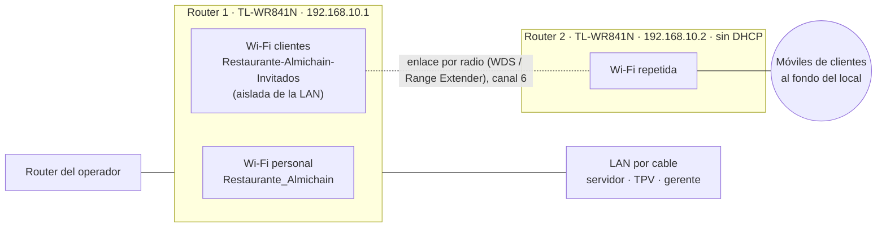
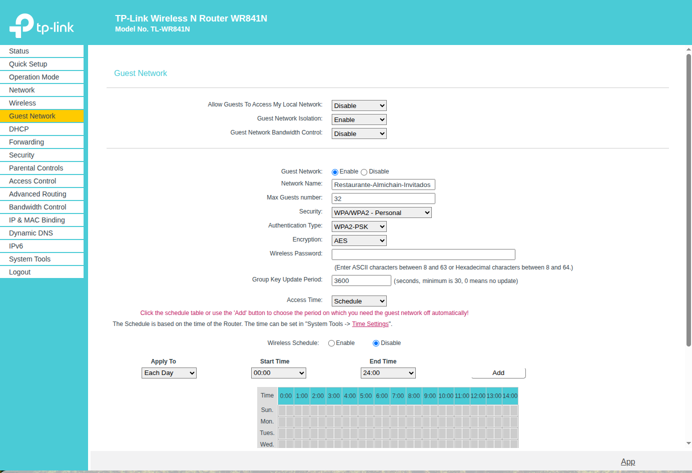
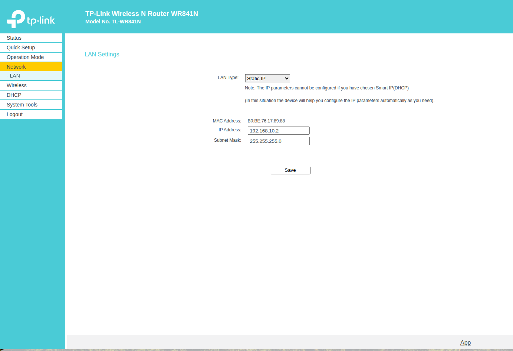
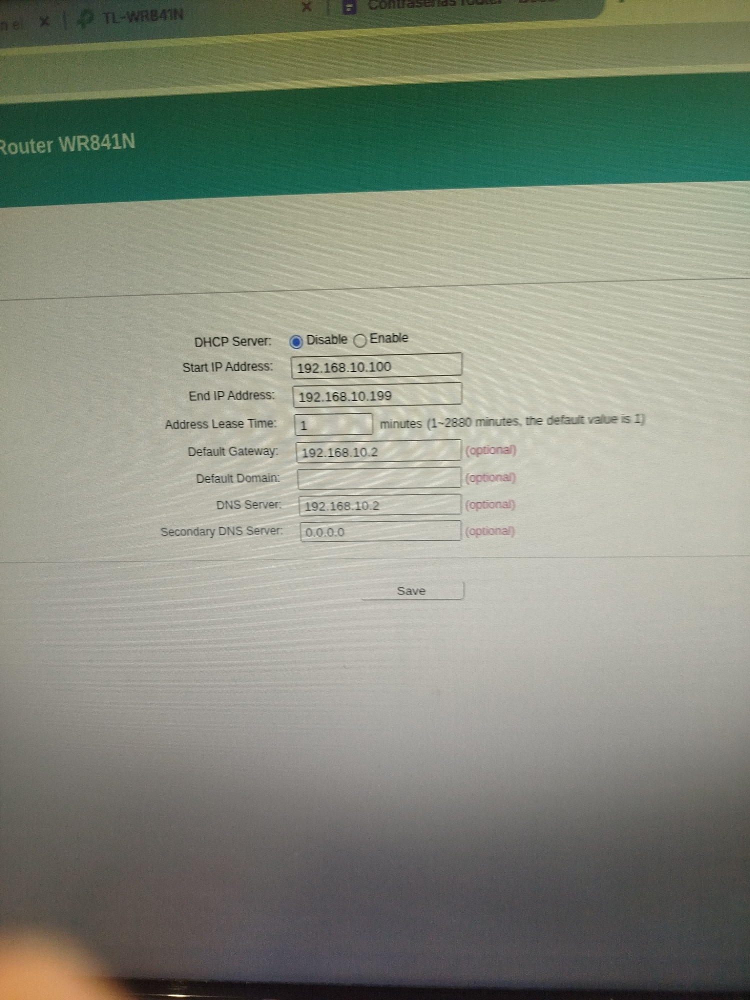
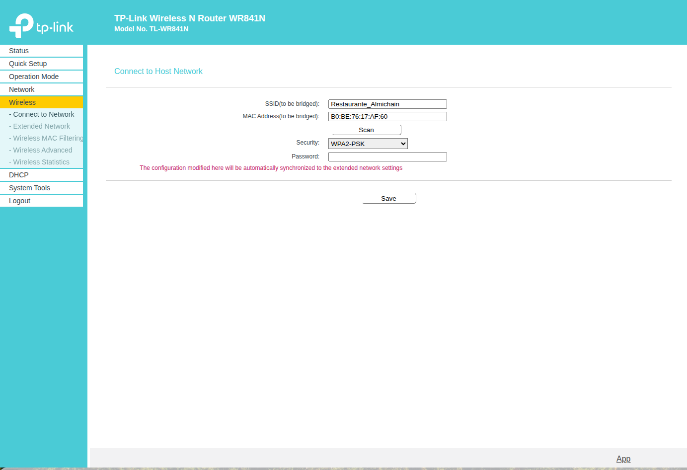
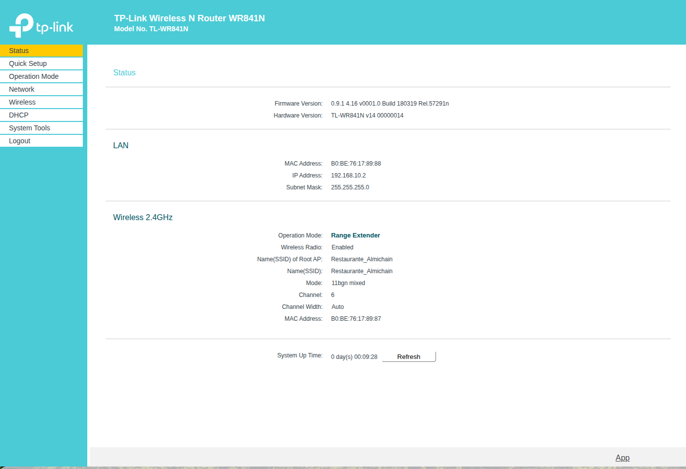

# Tarea 25: WDS con segundo router y pruebas de cobertura

- **Bloque:** 5 Redes
- **Responsable:** Peio
- **Reto:** Almi-Chain (ASIR1 2026-27)
- **Fechas reales:** práctica el 27/10/2026 (red de prácticas `192.168.1.0/24`); montaje con la red del proyecto el 04/11/2026. Documento reordenado el 10/11/2026 con lo que demuestra cada captura.
- **Estado (12/11/2026):** ✅ **Terminada: el enlace entre los dos routers está hecho y probado** (enlace, DHCP único, ping e Internet). Por falta de tiempo antes de la entrega, el 12/11 se cierra sin dos mejoras que quedan descritas en la [sección 7](#7-lo-que-falta-hoja-de-trabajo) (unos 30 min con los routers delante): enlazar el router 2 a la Wi-Fi **de clientes** en vez de a la del personal, y medir la cobertura con el router 2 apagado y encendido.

## 0. Resumen para la defensa

- **Qué pide el enunciado:** *«Para ampliar la cobertura Wi-Fi para los clientes del local se dispondrá de otro router Wi-Fi conectado mediante WDS al router principal, comprobando que la solución funciona correctamente»*.
- **Qué hemos montado:** dos TP-Link TL-WR841N v14 (los Archer C6 del presupuesto no se han comprado). El router 2 se une al 1 **por radio, sin cable**, y vuelve a emitir la Wi-Fi. Está en la LAN `192.168.10.0/24` con la IP `192.168.10.2` y **sin DHCP**: todas las IP las sigue dando el router 1.
- **Por qué cuenta como WDS:** WDS (*Wireless Distribution System*) es unir puntos de acceso por radio en lugar de por cable, para que la red llegue más lejos. En el firmware del TL-WR841N v14 eso se configura en el modo **Range Extender** (*Operation Mode*), con *Connect to Host Network*. Es la misma función que el puente WDS del Archer C6 del diseño.
- **Lo que falta y por qué:** el router 2 repite hoy `Restaurante_Almichain`, la Wi-Fi del **personal**. En modo Range Extender el TL-WR841N solo se puede enlazar a **una** red, y su menú no tiene *Guest Network* (sección 6). La solución es enlazarlo a `Restaurante-Almichain-Invitados`, que es lo que ya dibuja el diseño de la [tarea 23](../23-packet-tracer-red-local.md#6-wi-fi) (`ROUTER2-WDS` repite la red de invitados). El personal no lo necesita: TPV, servidor y gerente van por cable.

## 1. Objetivo y criterio de la rúbrica

| Lo pide | Dónde | Cómo se cumple |
|---|---|---|
| Ampliar la cobertura para **los clientes** con un segundo router por WDS | Enunciado | Router 2 enlazado por radio. ⏳ Enlazarlo a la Wi-Fi de clientes (sección 7, paso 1) |
| «Comprobando que la solución funciona correctamente» | Enunciado | Enlace, DHCP único, ping e Internet ✅. ⏳ Cobertura antes y después (sección 7, paso 3) |
| Nivel 2 de redes: «configura los routers Wi-Fi para ampliar la cobertura (WDS)» | [Rúbrica, criterio 4](../../gestion/rubrica-anexo-VI.md) | ✅ Secciones 3 y 4 |
| Nivel 5: «se justifica la cobertura (WDS) con pruebas de conectividad» | Rúbrica, criterio 4 | 🟡 Conectividad probada (sección 5); falta la cobertura medida |

## 2. Topología

> El dibujo es el objetivo (router 2 enlazado a la Wi-Fi de clientes). **Hoy** el enlace va a `Restaurante_Almichain` (personal): ver sección 6.

| Parámetro | Router 1 | Router 2 |
|---|---|---|
| Modelo | TL-WR841N v14, firmware 0.9.1 4.16 (Build 180319) | El mismo |
| Modo | Wireless Router | **Range Extender** |
| IP LAN | `192.168.10.1/24` | `192.168.10.2/24` (fija) |
| DHCP | Activado (`.100`–`.199`) | **Desactivado** |
| Canal | **6 fijo**, 20 MHz | 6 (lo toma del router 1) |
| MAC de la radio (BSSID) | `B0:BE:76:17:AF:60` (personal) y `B2:BE:76:17:AF:60` (invitados) | `B0:BE:76:17:89:87` |
| Red a la que se enlaza | — | Hoy `Restaurante_Almichain`; objetivo `Restaurante-Almichain-Invitados` |

## 3. Router principal

El router 1 es el de la [tarea 24](../24-red-segura/configurar-red-segura.md): LAN `192.168.10.0/24`, Wi-Fi del personal con WPA2-AES y Wi-Fi de invitados aislada. Para el WDS solo hace falta una cosa más: **el canal fijo**. Si el router 1 cambia de canal por su cuenta, el router 2 pierde el enlace. Está en el canal 6 y 20 MHz desde el 29/10 ([tarea 24, figura 14](../24-red-segura/imagenes/14-wifi-personal.png)).

Red de invitados del router 1 (acceso a la LAN desactivado y aislamiento activado):

## 4. Router 2, paso a paso

Con el PC conectado **por cable** al router 2 (si se hace por Wi-Fi, el enlace se corta a mitad):

1. **IP de la LAN** (*Network → LAN*): `192.168.10.2`, máscara `255.255.255.0`. Venía en otra subred; si no, chocaría con el router 1.

   

2. **DHCP desactivado** (*DHCP → DHCP Settings → Disable*). Así solo hay un servidor DHCP en la red (el router 1) y nadie recibe una puerta de enlace equivocada. Al apagarlo, el PC se queda sin IP: se le pone a mano una de la red (por ejemplo `192.168.10.50/24`) para seguir en el panel.

   

3. **Modo** (*Operation Mode → Range Extender*). El router reinicia y el menú cambia: desaparecen *Guest Network*, *Forwarding* y *Security* (sección 6).
4. **Enlace** (*Wireless → Connect to Network*): *Scan*, elegir la red del router 1, poner su contraseña y *Save*. El panel avisa de que la configuración se copia a la red extendida.

   

5. **Comprobar** en *Status*: *Operation Mode: Range Extender*, *Root AP* y *SSID* con el nombre de la red del router 1, canal 6 e IP `192.168.10.2`.

   

## 5. Pruebas

| # | Prueba | Esperado | Resultado | Evidencia |
|---|---|---|---|---|
| W1 | Estado del router 2 | Range Extender, enlazado, canal 6, `192.168.10.2` | ✅ 04/11. *Root AP* `Restaurante_Almichain`, radio activa, canal 6 | [11](evidencias/11-router2-estado-range-extender.png) |
| W2 | Un solo DHCP en la red | DHCP del router 2 apagado | ✅ 04/11 | [19](evidencias/19-router2-dhcp-desactivado.jpg) |
| W3 | `ping -c 4 192.168.10.1` desde el PC | 0 % de pérdidas | ✅ 04/11: 4/4, 0 % de pérdidas, 11,9-17,3 ms. **No consta** si el PC estaba en el router 1 o en el 2 | [10](evidencias/10-ping-router-principal.png) |
| W4 | Navegar con el móvil sin datos móviles | Abre webs | ✅ 04/11, sin captura | — |
| W5 | Desde la Wi-Fi de invitados: Internet sí; `192.168.10.1`, `.2` y `.10` no | Aislados | ✅ 04/11, **conectado al router 1** | [16](evidencias/16-invitados-sin-acceso-router2.jpg), [17](evidencias/17-invitados-sin-acceso-lan.jpg) |
| W6 | Lo mismo, conectado al **router 2** | Aislados | ⏳ Sección 7, paso 2 | — |
| W7 | WiFi Analyzer con el BSSID del router 2 (`b0:be:76:17:89:87`) | Se ve y el móvil se conecta a él | ⏳ La captura del 04/11 enseña el router 1 (`…:af:60`, -26 dBm personal y -31 dBm invitados, a 0 m); el router 2 no aparece entre las siete redes más fuertes | [15](evidencias/15-wifi-analyzer-p1-antes.jpg) |
| W8 | Cobertura: señal en la barra y en la entrada, con el router 2 apagado y encendido | Mejor con el router 2 | ⏳ Sección 7, paso 3 | — |

Las pruebas de aislamiento con nmap desde la Wi-Fi de invitados del router 1 están en la [tarea 26, sección 5.2](../26-analisis-conectividad/DOCUMENTACION.md#52-desde-la-wi-fi-de-invitados-móvil-con-termux): no se ve ningún equipo de la LAN.

## 6. Por qué el router 2 no repite la Wi-Fi de clientes, y cómo se arregla

**Lo que se ve en las capturas.** Con el router en modo *Wireless Router* (router 1, [captura 14](evidencias/14-router1-red-invitados.png)), el menú tiene *Guest Network*, *Forwarding*, *Security*, *Access Control*… En modo *Range Extender* (router 2, [capturas 11 y 12](evidencias/11-router2-estado-range-extender.png)) solo quedan *Status*, *Quick Setup*, *Operation Mode*, *Network*, *Wireless*, *DHCP* y *System Tools*. Y *Connect to Host Network* tiene **un solo** campo de SSID y otro de BSSID.

**Qué significa:**

- El router 2 no puede crear su propia red de invitados: repite **una** red del router 1, la que se le diga.
- No filtra nada: el aislamiento de los invitados lo pone el router 1 en su red de invitados.

**La solución (5 minutos):** en *Wireless → Connect to Network*, hacer *Scan* y elegir `Restaurante-Almichain-Invitados` (BSSID `B2:BE:76:17:AF:60`) con la contraseña de invitados de KeePassXC, en vez de `Restaurante_Almichain`. Así el router 2 repite la Wi-Fi de **clientes**, como pide el enunciado y como está en el diseño de la tarea 23 (Packet Tracer, `ROUTER2-WDS`). La Wi-Fi del personal no hace falta repetirla: TPV, servidor y PC del gerente van por cable ([tarea 23, sección 5](../23-packet-tracer-red-local.md#5-equipos-con-cable)).

**Lo que hay que vigilar después:**

| Riesgo | Por qué | Qué se hace |
|---|---|---|
| Un cliente conectado al router 2 podría abrir el panel del router 2 (`192.168.10.2`) | El router 2 no tiene las reglas de invitados: el aislamiento está en el router 1, y el panel del 2 lo sirve el propio 2 | Contraseña de administración del router 2 cambiada y en KeePassXC, y la prueba W6 incluye abrir `192.168.10.2` desde un móvil conectado al router 2. Si se abre el panel (pide contraseña), se anota como riesgo aceptado; con el Archer C6 del diseño, el router 2 repite las dos redes con su propio aislamiento |
| El router 2 deja de verse desde la LAN | Como cliente de la red de invitados, el router 1 lo aísla de la LAN | Se administra por cable, conectando el portátil a su puerto LAN |
| Dos clientes del router 2 se ven entre sí | El aislamiento entre clientes lo aplica el router 1 a sus propios clientes | Riesgo bajo (son móviles de clientes); comprobarlo con dos móviles en W6 |

## 7. Lo que falta: hoja de trabajo

**Material:** los dos routers, el portátil con cable de red, un móvil Android con WiFi Analyzer y las contraseñas de KeePassXC. Tiempo: 30-45 min.

**Paso 1 · Enlazar el router 2 a la Wi-Fi de clientes** (sección 6). Captura de *Status* con *Root AP* `Restaurante-Almichain-Invitados` → `evidencias/20-router2-enlazado-a-invitados.png`.

**Paso 2 · Pruebas conectado al router 2.** El móvil a 1-2 m del router 2 y lejos del 1. En WiFi Analyzer, conectado al BSSID `b0:be:76:17:89:87`:

| Prueba | Resultado | Captura |
|---|---|---|
| WiFi Analyzer: conectado al BSSID del router 2 | | `21-analyzer-conectado-router2.jpg` |
| Navegar a una web | | `22-router2-internet.jpg` |
| Abrir `192.168.10.1` y `192.168.10.10` | Esperado: no se abren | `23-router2-sin-acceso-lan.jpg` |
| Abrir `192.168.10.2` (panel del router 2) | Apuntar qué pasa (sección 6) | `24-router2-panel.jpg` |

**Paso 3 · Cobertura antes y después.** Dos puntos fijos: **barra** (cerca del router 1) y **entrada o terraza** (lejos). En cada punto, la señal en dBm de `Restaurante-Almichain-Invitados` con el router 2 **apagado** y luego **encendido**:

| Punto | Router 2 apagado (dBm) | Router 2 encendido (dBm) | Captura |
|---|---|---|---|
| Barra | | | `25-cobertura-barra.jpg` |
| Entrada | | | `26-cobertura-entrada.jpg` |

Para interpretarlo: de -30 a -67 dBm, buena; de -67 a -75, aceptable; por debajo de -75, mala. La prueba sale bien si en la entrada la señal mejora con el router 2 encendido.

**Paso 4 · Router 1 (de paso, tarea 24 y hallazgo S-25):** *Forwarding → UPnP → Disable*, con captura `27-router1-upnp-desactivado.png`. Y cerrar sesión e intentar entrar con `admin`/`admin`: captura del rechazo → `../24-red-segura/imagenes/23-admin-por-defecto-rechazado.png` (nivel 5 de la rúbrica: «credenciales por defecto cambiadas»).

**Al terminar:** rellenar las tablas de este paso, cambiar W6-W8 de la sección 5 a ✅ y subirlo **por Pull Request** desde una rama (no a `main` desde la web: [CONTRIBUTING.md](../../../CONTRIBUTING.md)). **Antes de subir las capturas, ampliarlas y comprobar que no se ve ninguna contraseña.**

## 8. Incidencias y soluciones

| Incidencia | Causa | Solución |
|---|---|---|
| El router 2 venía en `192.168.0.0/24` | Configuración de fábrica | IP fija `192.168.10.2` antes de enlazar |
| Al apagar el DHCP del router 2, el PC se quedó sin IP | El PC estaba conectado solo al router 2 | IP manual `192.168.10.50/24` mientras se configura |
| El navegador daba errores HTTP con la red funcionando | Caché y redirecciones del panel | Probar primero con `ping` para separar fallos de red de fallos web |
| 04/11: las capturas se subieron a `main` desde la web de GitHub, con nombres que no correspondían a su contenido y 11 enlaces rotos | Subida sin rama ni PR | Renombradas por lo que muestran y enlaces arreglados (PR #108). El 09/11 se repitió con un renombrado (PR #112). Desde entonces, siempre por PR |

## 9. Evidencias

| Fichero | Qué demuestra |
|---|---|
| [`01-pdf-seleccion-y-configuracion-wds.png`](evidencias/01-pdf-seleccion-y-configuracion-wds.png) | Práctica del 27/10 en la red de prácticas: búsqueda de redes y enlace a `TP-Link_AF60` (el router 1) |
| [`10-ping-router-principal.png`](evidencias/10-ping-router-principal.png) | Ping al router 1: 4/4, 0 % de pérdidas |
| [`11-router2-estado-range-extender.png`](evidencias/11-router2-estado-range-extender.png) | Router 2: Range Extender, `192.168.10.2`, *Root AP* `Restaurante_Almichain`, canal 6, BSSID `B0:BE:76:17:89:87`; menú sin *Guest Network* |
| [`12-router2-conectar-red-principal.png`](evidencias/12-router2-conectar-red-principal.png) | *Connect to Host Network*: un solo SSID y BSSID a los que enlazarse (contraseña vacía en la captura) |
| [`13-router2-lan.png`](evidencias/13-router2-lan.png) | Router 2 con IP fija `192.168.10.2` |
| [`14-router1-red-invitados.png`](evidencias/14-router1-red-invitados.png) | Router 1: red de invitados sin acceso a la LAN y con aislamiento; menú completo del modo router |
| [`15-wifi-analyzer-p1-antes.jpg`](evidencias/15-wifi-analyzer-p1-antes.jpg) | Señal del **router 1** a 0 m: -26 dBm (personal) y -31 dBm (invitados), canal 6. El router 2 no sale |
| [`16-invitados-sin-acceso-router2.jpg`](evidencias/16-invitados-sin-acceso-router2.jpg) | Desde la Wi-Fi de invitados del router 1 no se abre `192.168.10.2` |
| [`17-invitados-sin-acceso-lan.jpg`](evidencias/17-invitados-sin-acceso-lan.jpg) | Desde la Wi-Fi de invitados del router 1 no se abre `192.168.10.10` |
| [`19-router2-dhcp-desactivado.jpg`](evidencias/19-router2-dhcp-desactivado.jpg) | DHCP del router 2 desactivado (foto de la pantalla) |

## 10. Conclusión

El segundo router está unido al principal por radio, dentro de la red del proyecto y sin un segundo DHCP, y la red funciona a través del montaje (ping sin pérdidas e Internet). Eso cubre el nivel 2 de la rúbrica de redes y es el mismo diseño que se simuló en Packet Tracer.

Para que cumpla lo que dice el enunciado quedan dos cosas, las dos en la sección 7:

1. Enlazar el router 2 a la Wi-Fi de **clientes**. Hoy repite la del personal porque en modo Range Extender el TL-WR841N solo repite una red, y se eligió esa.
2. Demostrar con números que la señal llega más lejos con el router 2 encendido.
