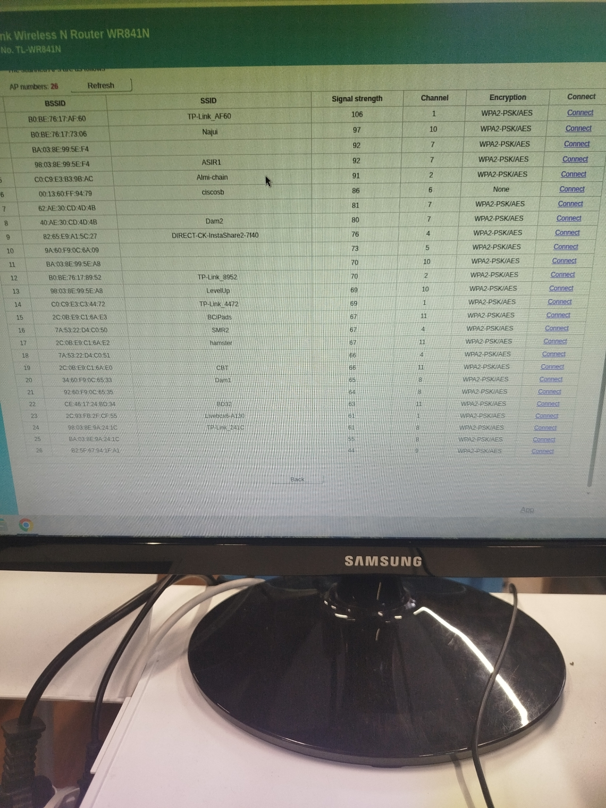
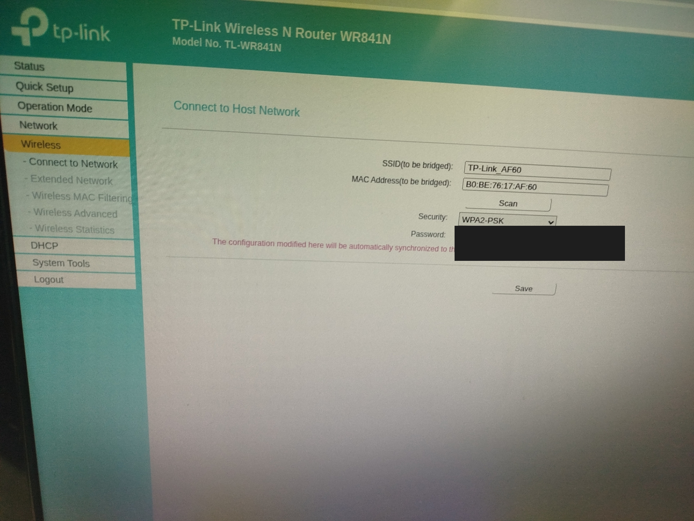
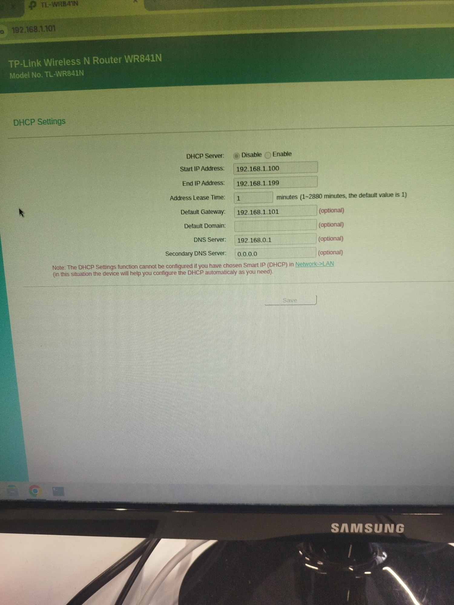
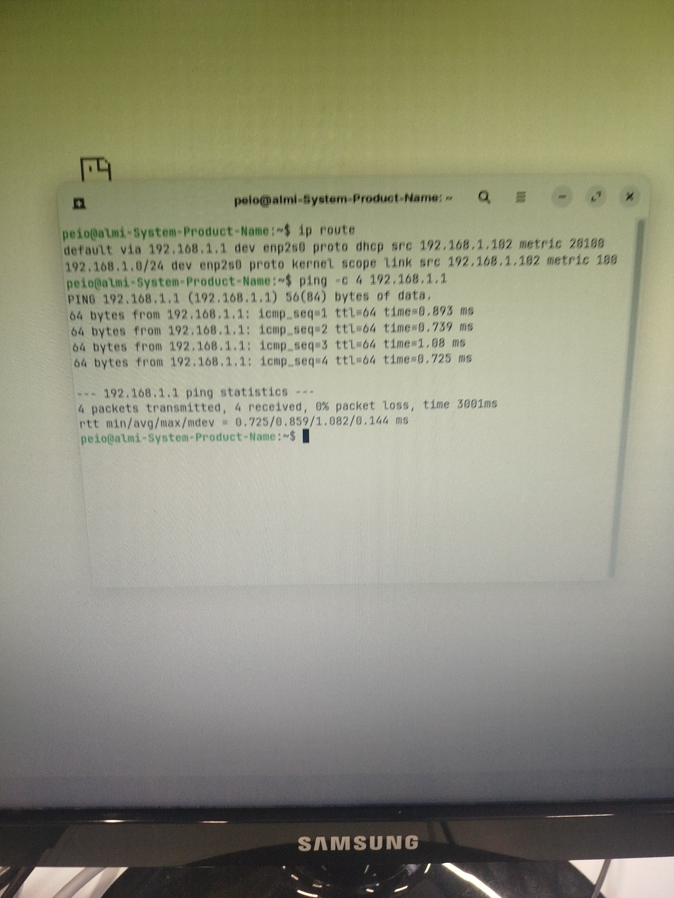
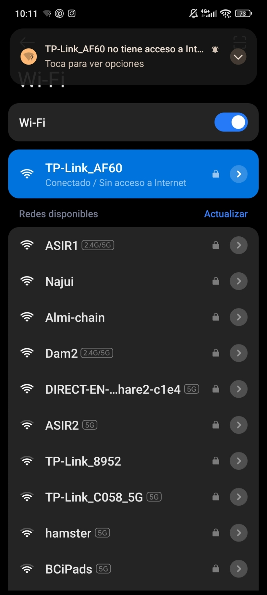
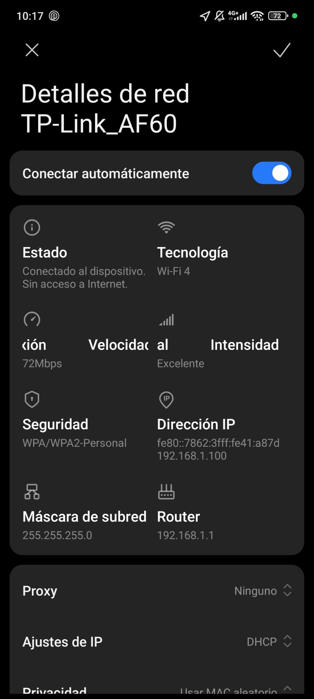
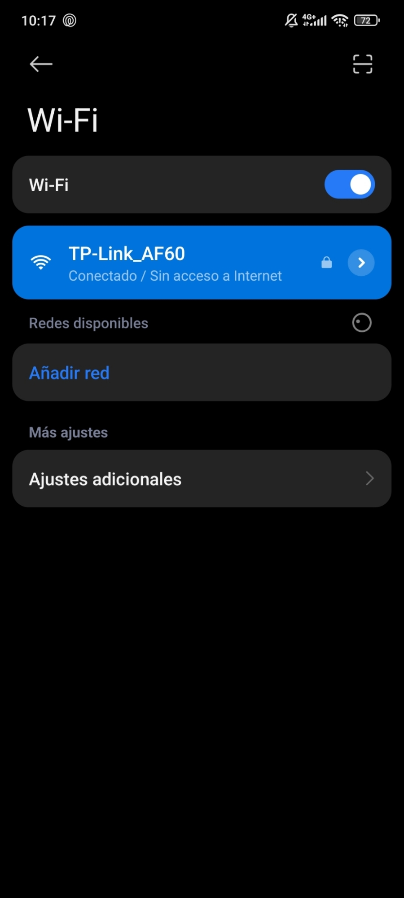

# WDS con segundo router y pruebas de cobertura

## 1. Introducción

En esta práctica se configura un segundo router **TP-Link TL-WR841N** para ampliar la cobertura de una red inalámbrica mediante **WDS (Wireless Distribution System)**.

WDS permite enlazar dos routers de forma inalámbrica, sin instalar un cable Ethernet entre el router principal y el secundario. También se realizan pruebas de conectividad y cobertura para comprobar el funcionamiento de la solución.

## 2. Objetivos

- Configurar un segundo router como extensión inalámbrica.
- Enlazar el router secundario con el principal mediante WDS.
- Integrar ambos routers en la red `192.168.1.0/24`.
- Asignar una dirección de administración al router secundario.
- Desactivar el servidor DHCP del router secundario.
- Verificar la comunicación con el router principal.
- Comprobar la cobertura Wi-Fi con un teléfono móvil.
- Documentar la configuración, las pruebas y los problemas encontrados.

## 3. Material utilizado

- Router principal TP-Link.
- Router secundario **TP-Link TL-WR841N**.
- Ordenador con GNU/Linux.
- Cable Ethernet.
- Teléfono móvil con conexión Wi-Fi.
- Navegador web.
- Terminal de Linux.

## 4. Topología de red

```text
                         Enlace WDS
                    mediante red Wi-Fi

   Router principal  <---------------->  Router secundario
    192.168.1.1                            192.168.1.101
    TP-Link_AF60                           DHCP desactivado
                                                  |
                                                  |
                                            Cable Ethernet
                                                  |
                                               PC Linux
```

Los routers se comunican inalámbricamente mediante WDS. El cable Ethernet se utilizó entre el PC y un puerto LAN del router secundario para realizar la configuración y las pruebas.

### Direccionamiento

| Dispositivo | Dirección |
|---|---|
| Router principal | `192.168.1.1` |
| Router secundario | `192.168.1.101` |
| Teléfono durante la prueba | `192.168.1.100` |
| Máscara de subred | `255.255.255.0` |
| Red local | `192.168.1.0/24` |

## 5. Conexión inicial

Para configurar el router secundario se realizó la siguiente conexión:

1. Se encendió el router secundario.
2. Se conectó el PC a un puerto **LAN** del router secundario mediante Ethernet.
3. El puerto **WAN** del secundario se dejó vacío.
4. Se accedió al panel de administración desde el navegador.

Inicialmente, el router secundario era accesible mediante:

```text
http://192.168.0.1
```

Después de integrarlo en la red principal, su dirección de administración pasó a ser:

```text
http://192.168.1.101
```

## 6. Configuración del enlace WDS

Desde el panel del router secundario se accedió a:

```text
Wireless > Connect to Network
```

Se realizó un escaneo de las redes inalámbricas disponibles y se seleccionó la red del router principal.

| Parámetro | Valor |
|---|---|
| SSID principal | `TP-Link_AF60` |
| BSSID/MAC | `B0:BE:76:17:AF:60` |
| Canal observado | `1` |
| Seguridad | `WPA2-PSK` |
| Cifrado | `AES` |



Después se introdujo la contraseña Wi-Fi de la red principal y se guardó la configuración.



> **Seguridad:** la contraseña debe estar completamente tapada en la captura antes de publicar el repositorio.

## 7. Configuración del router secundario

El router secundario quedó integrado en la misma red que el principal y recibió la dirección de administración:

```text
192.168.1.101
```

La configuración final fue:

| Parámetro | Configuración |
|---|---|
| Router principal | `192.168.1.1` |
| Router secundario | `192.168.1.101` |
| Red | `192.168.1.0/24` |
| Máscara | `255.255.255.0` |
| Red principal enlazada | `TP-Link_AF60` |
| Seguridad | `WPA2-PSK` |
| DHCP del secundario | Desactivado |

## 8. Desactivación de DHCP

Desde el router secundario se accedió a:

```text
DHCP > DHCP Settings
```

El servidor DHCP se dejó desactivado:

```text
DHCP Server: Disable
```



Solo debe existir un servidor DHCP en esta red. Al desactivar DHCP en el secundario, el router principal mantiene la asignación centralizada de direcciones y se evitan conflictos de IP, puerta de enlace y DNS.

## 9. Localización del router secundario

Después de configurar WDS, `192.168.0.1` dejó de ser accesible porque el PC pasó a trabajar en la red `192.168.1.0/24`.

Se comprobó la ruta mediante:

```bash
ip route
```

La puerta de enlace observada fue:

```text
default via 192.168.1.1
```

También se consultó la tabla de vecinos:

```bash
ip neigh
```

Se identificaron los siguientes dispositivos:

```text
192.168.1.1
192.168.1.101
```

`192.168.1.1` correspondía al router principal y `192.168.1.101` al secundario. El panel del secundario volvió a ser accesible mediante:

```text
http://192.168.1.101
```

## 10. Prueba de conectividad

Con el PC conectado por Ethernet a un puerto LAN del router secundario, se ejecutó:

```bash
ping -c 4 192.168.1.1
```

El resultado fue:

```text
4 packets transmitted
4 received
0% packet loss
```



Los cuatro paquetes enviados recibieron respuesta y no hubo pérdidas. Esto confirma que el equipo conectado al router secundario podía comunicarse correctamente con `192.168.1.1`.

## 11. Comprobación de interfaces en Linux

Se ejecutó:

```bash
nmcli device status
```

El equipo mostraba la interfaz Ethernet `enp2s0` conectada. Se intentó listar las redes inalámbricas mediante:

```bash
nmcli dev wifi list
```

Sin embargo, el PC no tenía una interfaz Wi-Fi disponible o detectada. Por este motivo, las pruebas de cobertura se realizaron con un teléfono móvil.

## 12. Pruebas de cobertura Wi-Fi

### 12.1. Procedimiento

1. Se mantuvieron encendidos los dos routers.
2. El teléfono se conectó a `TP-Link_AF60`.
3. Se observó la conexión cerca de los routers.
4. Se consultaron los detalles de la red.
5. Se aumentó progresivamente la distancia.
6. Se comprobó el comportamiento hasta superar el alcance Wi-Fi.

### 12.2. Prueba cerca de los routers

Cerca de los routers, el móvil se conectó correctamente a `TP-Link_AF60`.



Los detalles mostrados fueron:

| Parámetro | Resultado |
|---|---|
| SSID | `TP-Link_AF60` |
| Tecnología | Wi-Fi 4 |
| Velocidad del enlace | `72 Mbps` |
| Intensidad | Excelente |
| Seguridad | WPA/WPA2-Personal |
| Dirección IPv4 | `192.168.1.100` |
| Máscara | `255.255.255.0` |
| Router | `192.168.1.1` |
| Configuración IP | DHCP |



La dirección `192.168.1.100` confirma que el teléfono estaba integrado en la red `192.168.1.0/24`. La puerta de enlace era `192.168.1.1`.

### 12.3. Prueba al aumentar la distancia

Se aumentó progresivamente la distancia respecto a los routers. El teléfono mantuvo inicialmente la conexión, pero al continuar alejándose terminó desconectándose completamente de la red Wi-Fi.



No se obtuvo una captura intermedia con señal débil, ya que el teléfono pasó de mantener la conexión a desconectarse. La observación permite establecer el comportamiento práctico de la cobertura:

- Cerca de los routers, la intensidad era excelente.
- La velocidad del enlace era de `72 Mbps`.
- La conexión se mantuvo al aumentar inicialmente la distancia.
- Al superar el alcance efectivo, el teléfono perdió la conexión.

## 13. Acceso a Internet

Durante las pruebas, el teléfono mostraba:

```text
Sin acceso a Internet
```

Por tanto, las evidencias confirman:

- La configuración WDS.
- La integración del router secundario.
- La asignación de una dirección de la red principal.
- La comunicación local con `192.168.1.1`.
- El funcionamiento de la conexión Wi-Fi dentro de su alcance.
- El límite práctico de cobertura.

Las pruebas no permiten afirmar que existiera acceso a Internet. La conectividad WAN del router principal no quedó verificada.

## 14. Problemas encontrados y soluciones

### Confusión entre el router principal y el secundario

Los dos dispositivos eran TP-Link y fue necesario identificar correctamente qué router emitía `TP-Link_AF60`.

**Solución:** se comparó la dirección MAC de la configuración con la etiqueta física. La MAC del principal terminaba en `AF:60`.

### Pérdida de acceso a `192.168.0.1`

El PC pasó a la red `192.168.1.0/24` después de configurar WDS.

**Solución:** se usaron `ip route` e `ip neigh` para localizar el secundario en `192.168.1.101`.

### Credenciales incorrectas

Las credenciales del secundario no funcionaban al intentar acceder a `192.168.1.1`.

**Causa:** esa dirección correspondía al router principal.

**Solución:** se accedió al secundario mediante `192.168.1.101`.

### El PC no mostraba redes Wi-Fi

`nmcli dev wifi list` no devolvía redes.

**Causa:** no había una interfaz Wi-Fi disponible o detectada.

**Solución:** se utilizó un teléfono móvil para las pruebas de cobertura.

### Sin acceso a Internet

La comunicación local con `192.168.1.1` funcionaba, pero no se verificó conectividad exterior.

**Conclusión:** se comprobó la red local y el enlace configurado, pero no la salida WAN.

## 15. Resultados

- Router secundario integrado en `192.168.1.0/24`.
- Administración del secundario desde `192.168.1.101`.
- Servidor DHCP del secundario desactivado.
- Enlace configurado con `TP-Link_AF60`.
- Comunicación con `192.168.1.1`.
- Ping con `0 %` de pérdida.
- Teléfono con dirección `192.168.1.100`.
- Puerta de enlace del teléfono `192.168.1.1`.
- Intensidad excelente cerca de los routers.
- Velocidad de enlace de `72 Mbps`.
- Pérdida de conexión al superar el alcance Wi-Fi.
- Acceso a Internet no verificado.

## 16. Conclusión

Se configuró un segundo router **TP-Link TL-WR841N** para integrarlo en la red inalámbrica mediante WDS.

El router secundario quedó configurado con la dirección `192.168.1.101` y con DHCP desactivado. De este modo se mantuvo un único servidor DHCP y se evitaron conflictos de direccionamiento.

La prueba desde GNU/Linux confirmó que el equipo conectado al secundario podía comunicarse con `192.168.1.1`, obteniendo cuatro respuestas y un `0 %` de pérdida.

En la prueba de cobertura, el teléfono se conectó a `TP-Link_AF60`, obtuvo una dirección de la red principal y mostró una intensidad excelente con una velocidad de `72 Mbps`. Al aumentar suficientemente la distancia, el teléfono perdió la conexión, lo que permitió comprobar de forma práctica el límite de cobertura.

Por tanto, se verificaron la configuración del enlace inalámbrico, la conectividad local y el comportamiento de la cobertura. La salida a Internet quedó pendiente de verificación.

## 17. Seguridad antes de publicar

Antes de publicar el repositorio se debe comprobar que:

- La contraseña Wi-Fi esté tapada en todas las capturas.
- No aparezcan credenciales de administración.
- No se publiquen datos personales.
- Los nombres de las imágenes coincidan con las rutas del README.
- Si una contraseña quedó expuesta, se cambie antes de publicar.
