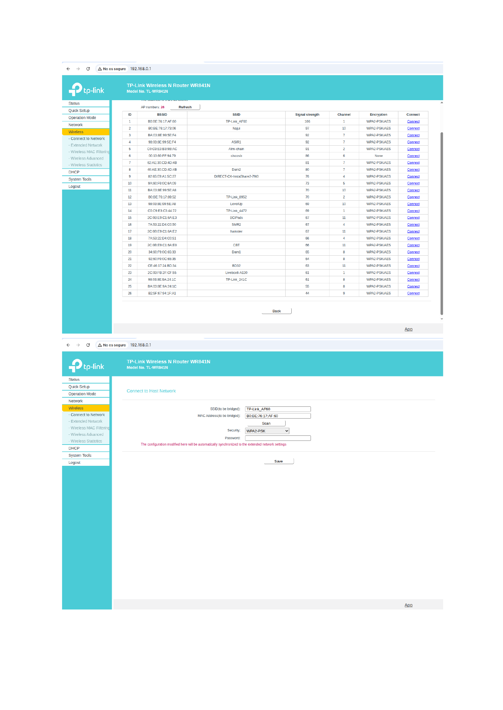
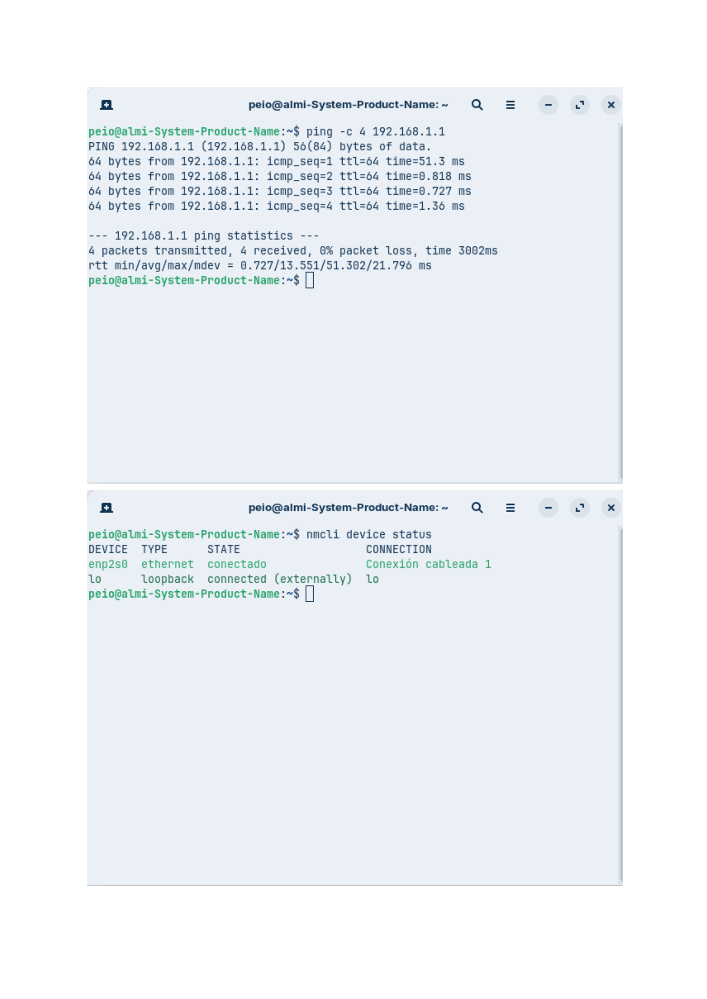
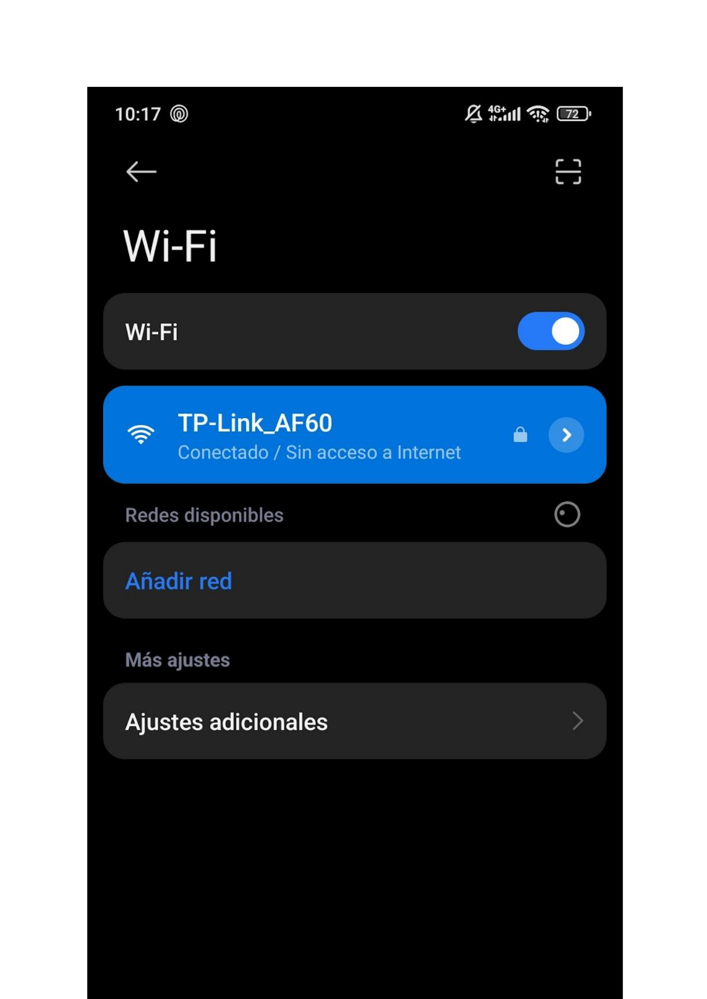
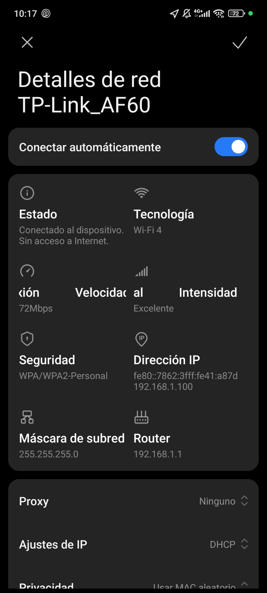

# WDS con segundo router y pruebas de cobertura

> **Área 25 · Bloque 5 Redes**  
> **Responsable:** Peio  
> **Reto:** Almi-Chain (ASIR1 2026-27)  
> **Estado a 27/10/2026:** prueba de laboratorio completada. El enlace WDS y la conectividad local funcionan. Queda pendiente repetir la implantación con el direccionamiento, los SSID y la red de invitados definitivos del proyecto.

## 1. Introducción

En esta práctica se configura un segundo router **TP-Link TL-WR841N** para ampliar la cobertura de una red inalámbrica mediante **WDS (Wireless Distribution System)**.

WDS permite enlazar dos routers de forma inalámbrica, sin instalar un cable Ethernet entre el router principal y el secundario. El router secundario funciona como puente: recibe la conexión del principal y la extiende, mientras que el direccionamiento se mantiene centralizado en el router principal.

La práctica realizada el 27/10/2026 es una **prueba de laboratorio válida**. Demuestra que el enlace WDS funciona en red local, pero todavía no sustituye la implantación definitiva del proyecto Almi-Chain.

## 2. Objetivos

- Configurar un segundo router como extensión inalámbrica.
- Enlazar el router secundario con el principal mediante WDS.
- Integrar ambos routers en la misma red IPv4.
- Asignar una dirección de administración al router secundario.
- Desactivar el servidor DHCP del router secundario.
- Verificar la comunicación con el router principal.
- Comprobar el comportamiento básico de la cobertura Wi-Fi con un teléfono móvil.
- Documentar la configuración, las pruebas y los problemas encontrados.
- Preparar el procedimiento para repetir la práctica con la red definitiva de Almi-Chain.

## 3. Material utilizado

- Router principal TP-Link.
- Router secundario **TP-Link TL-WR841N**.
- Ordenador con GNU/Linux.
- Cable Ethernet.
- Teléfono móvil con conexión Wi-Fi.
- Navegador web.
- Terminal de Linux.

## 4. Topología de red

```text
                         Enlace WDS
                    mediante red Wi-Fi

   Router principal  <---------------->  Router secundario
    192.168.1.1                            192.168.1.101
    TP-Link_AF60                           DHCP desactivado
                                                  |
                                                  |
                                            Cable Ethernet
                                                  |
                                               PC Linux
```

Los routers se comunican inalámbricamente mediante WDS. El cable Ethernet se utilizó entre el PC y un puerto LAN del router secundario para realizar la configuración y las pruebas.

### Direccionamiento de la prueba de laboratorio

| Dispositivo | Dirección |
|---|---|
| Router principal | `192.168.1.1` |
| Router secundario | `192.168.1.101` |
| PC durante la prueba | `192.168.1.102` |
| Teléfono durante la prueba | `192.168.1.100` |
| Máscara de subred | `255.255.255.0` |
| Red local | `192.168.1.0/24` |

> **Nota:** la implantación definitiva del proyecto utilizará `192.168.10.1` para el router principal y `192.168.10.2` para el secundario.

## 5. Conexión inicial

Para configurar el router secundario se realizó la siguiente conexión:

1. Se encendió el router secundario.
2. Se conectó el PC a un puerto **LAN** del router secundario mediante Ethernet.
3. El puerto **WAN** del router secundario se dejó vacío.
4. No se instaló ningún cable Ethernet entre los dos routers.
5. Se accedió al panel de administración desde el navegador.

Inicialmente, el router secundario era accesible mediante:

```text
http://192.168.0.1
```

Después de integrarlo en la red principal, su dirección de administración pasó a ser:

```text
http://192.168.1.101
```

## 6. Configuración del enlace WDS

Desde el panel del router secundario se accedió a:

```text
Wireless > Connect to Network
```

Se realizó un escaneo de las redes inalámbricas disponibles y se seleccionó la red del router principal.

| Parámetro | Valor |
|---|---|
| SSID principal | `TP-Link_AF60` |
| BSSID/MAC | `B0:BE:76:17:AF:60` |
| Canal observado | `1` |
| Seguridad | `WPA2-PSK` |
| Cifrado | `AES` |

La siguiente evidencia reúne la selección de la red principal y la configuración del enlace WDS:



Después se introdujo la contraseña Wi-Fi de la red principal y se guardó la configuración.

> **Seguridad:** la contraseña está tapada en la evidencia y no debe publicarse en el repositorio.

## 7. Configuración del router secundario

El router secundario quedó integrado en la misma red que el principal y recibió la siguiente dirección de administración:

```text
192.168.1.101
```

La configuración final de laboratorio fue:

| Parámetro | Configuración |
|---|---|
| Router principal | `192.168.1.1` |
| Router secundario | `192.168.1.101` |
| Red | `192.168.1.0/24` |
| Máscara | `255.255.255.0` |
| Red principal enlazada | `TP-Link_AF60` |
| Seguridad | `WPA2-PSK/AES` |
| DHCP del secundario | Desactivado |

## 8. Desactivación de DHCP

Desde el router secundario se accedió a:

```text
DHCP > DHCP Settings
```

El servidor DHCP se dejó desactivado:

```text
DHCP Server: Disable
```

La siguiente evidencia reúne la configuración WDS y el servidor DHCP desactivado:


Solo debe existir un servidor DHCP en esta red. Al desactivar DHCP en el secundario, el router principal mantiene la asignación centralizada de direcciones y se evitan conflictos de IP, puerta de enlace y DNS.

## 9. Localización del router secundario

Después de configurar WDS, `192.168.0.1` dejó de ser accesible porque el PC pasó a trabajar en la red `192.168.1.0/24`.

Se comprobó la ruta mediante:

```bash
ip route
```

La puerta de enlace observada fue:

```text
default via 192.168.1.1
```

También se consultó la tabla de vecinos:

```bash
ip neigh
```

Se identificaron los siguientes equipos activos:

```text
192.168.1.1
192.168.1.101
```

`192.168.1.1` correspondía al router principal y `192.168.1.101` al secundario. El panel del secundario volvió a ser accesible mediante:

```text
http://192.168.1.101
```

## 10. Prueba de conectividad

Con el PC conectado por Ethernet a un puerto LAN del router secundario, se ejecutó:

```bash
ping -c 4 192.168.1.1
```

El resultado fue:

```text
4 packets transmitted
4 received
0% packet loss
```

La evidencia incluye el ping al router principal y el estado de la interfaz Ethernet:



Los cuatro paquetes enviados recibieron respuesta y no hubo pérdidas. Esto confirma que el equipo conectado al router secundario podía comunicarse correctamente con el router principal a través del enlace configurado.

## 11. Comprobación de interfaces en Linux

Se ejecutó:

```bash
nmcli device status
```

El equipo mostraba la interfaz Ethernet `enp2s0` conectada. También se intentó listar las redes inalámbricas con:

```bash
nmcli dev wifi list
```

El PC no tenía una interfaz Wi-Fi disponible o detectada. Por este motivo, las pruebas de cobertura inalámbrica se realizaron con un teléfono móvil.

## 12. Pruebas de cobertura Wi-Fi

### 12.1. Procedimiento

1. Se mantuvieron encendidos los dos routers.
2. El teléfono se conectó a `TP-Link_AF60`.
3. Se observó la conexión cerca de los routers.
4. Se consultaron los detalles de la red.
5. Se aumentó progresivamente la distancia.
6. Se comprobó el comportamiento hasta superar el alcance Wi-Fi.

### 12.2. Conexión cerca de los routers

Cerca de los routers, el móvil se conectó correctamente a `TP-Link_AF60`.


La captura demuestra que el teléfono estaba conectado al SSID de laboratorio. También muestra el aviso **Sin acceso a Internet**, por lo que esta evidencia confirma asociación Wi-Fi, pero no salida WAN.

### 12.3. Prueba al aumentar la distancia

Se aumentó progresivamente la distancia respecto a los routers. El teléfono mantuvo inicialmente la conexión a `TP-Link_AF60`. Al continuar alejándose, la conexión terminó perdiéndose completamente.



La observación permite establecer el comportamiento práctico básico:

- Cerca de los routers, la intensidad era excelente.
- La conexión se mantuvo al aumentar inicialmente la distancia.
- Al superar el alcance efectivo, el teléfono perdió la conexión.

Esta prueba no demuestra por sí sola cuánto mejora la cobertura gracias al router 2, porque no se registró el BSSID ni se realizaron medidas antes y después en los mismos puntos.

### 12.4. Detalles de la conexión Wi-Fi

Los detalles mostrados por el teléfono fueron:

| Parámetro | Resultado |
|---|---|
| SSID | `TP-Link_AF60` |
| Estado | Conectado al dispositivo, sin acceso a Internet |
| Tecnología | Wi-Fi 4 |
| Velocidad del enlace | `72 Mbps` |
| Intensidad | Excelente |
| Seguridad | WPA/WPA2-Personal |
| Dirección IPv4 | `192.168.1.100` |
| Máscara | `255.255.255.0` |
| Router | `192.168.1.1` |
| Configuración IP | DHCP |



La dirección `192.168.1.100` confirma que el teléfono estaba integrado en la red `192.168.1.0/24`. La puerta de enlace era `192.168.1.1`, por lo que la dirección fue entregada por la red principal.

## 13. Acceso a Internet

Durante las pruebas, el teléfono mostraba:

```text
Sin acceso a Internet
```

Por tanto, las evidencias permiten confirmar:

- La selección y configuración del enlace WDS.
- La integración del router secundario en la red principal.
- La asignación de direcciones mediante el router principal.
- La comunicación local con `192.168.1.1`.
- La asociación del teléfono a la red Wi-Fi.
- El comportamiento básico de la cobertura dentro del laboratorio.

Las pruebas no permiten afirmar que existiera acceso a Internet. La conectividad WAN del router principal no quedó verificada.

## 14. Problemas encontrados y soluciones

### 14.1. Confusión entre el router principal y el secundario

Los dos dispositivos eran TP-Link y fue necesario identificar correctamente qué router emitía `TP-Link_AF60`.

**Solución:** se comparó la dirección MAC detectada con la etiqueta física. La MAC del router principal terminaba en `AF:60`.

### 14.2. Pérdida de acceso a `192.168.0.1`

El PC pasó a la red `192.168.1.0/24` después de configurar WDS.

**Solución:** se utilizaron `ip route` e `ip neigh` para localizar el secundario en `192.168.1.101`.

### 14.3. Credenciales incorrectas

Las credenciales del secundario no funcionaban al intentar acceder a `192.168.1.1`.

**Causa:** `192.168.1.1` correspondía al router principal.

**Solución:** se accedió al secundario mediante `192.168.1.101`.

### 14.4. El PC no mostraba redes Wi-Fi

El comando `nmcli dev wifi list` no devolvía redes.

**Causa:** no había una interfaz Wi-Fi disponible o detectada.

**Solución:** se utilizó un teléfono móvil para las pruebas de cobertura.

### 14.5. Sin acceso a Internet

La comunicación local con `192.168.1.1` funcionaba, pero no se verificó conectividad exterior.

**Conclusión:** se comprobó la red local y el enlace configurado, pero no la salida WAN.

### 14.6. Limitación de la prueba de cobertura

No se registraron valores en dBm ni el BSSID del punto de acceso.

**Consecuencia:** la prueba demuestra el comportamiento del SSID, pero no permite cuantificar la mejora aportada por el router secundario.

## 15. Resultados

### Resultados comprobados

- Router secundario integrado en `192.168.1.0/24`.
- Administración del secundario desde `192.168.1.101`.
- Servidor DHCP del secundario desactivado.
- Enlace configurado con `TP-Link_AF60`.
- Comunicación local con `192.168.1.1`.
- Ping con `0 %` de pérdida.
- PC con dirección `192.168.1.102`.
- Teléfono con dirección `192.168.1.100`.
- Puerta de enlace del teléfono `192.168.1.1`.
- Intensidad excelente cerca de los routers.
- Velocidad de enlace de `72 Mbps`.
- Pérdida de conexión al superar el alcance Wi-Fi.

### Resultados pendientes para cerrar el área 25

- Repetir la práctica con `192.168.10.1` y `192.168.10.2`.
- Utilizar `Restaurante-Almichain` y `Restaurante-Almichain-Invitados`.
- Obtener `WDS Status: Run` o estado equivalente.
- Verificar navegación desde el router 2.
- Verificar aislamiento de invitados frente a Odoo, TPV y paneles.
- Verificar aislamiento entre clientes invitados.
- Registrar el BSSID de cada router.
- Medir P1-P5 antes y después en dBm.
- Ejecutar Speedtest o Fast.com tres veces por punto y calcular la mediana.
- Ejecutar `iperf3` antes y después.

## 16. Conclusión

Se configuró un segundo router **TP-Link TL-WR841N** para integrarlo en una red inalámbrica mediante WDS.

El router secundario quedó configurado con la dirección `192.168.1.101` y con DHCP desactivado. De este modo se mantuvo un único servidor DHCP y se evitaron conflictos de direccionamiento.

La prueba desde GNU/Linux confirmó que el equipo conectado al secundario podía comunicarse con `192.168.1.1`, obteniendo cuatro respuestas y un `0 %` de pérdida. El teléfono obtuvo `192.168.1.100`, mostró una intensidad excelente y una velocidad de enlace de `72 Mbps`.

La práctica demuestra el funcionamiento del enlace WDS y de la conectividad local en el laboratorio. Sin embargo, todavía no demuestra la implantación definitiva de Almi-Chain, el aislamiento de la red de invitados ni la mejora cuantificada de cobertura. Estas comprobaciones quedarán cerradas cuando se repita la configuración con el direccionamiento definitivo y se realicen las pruebas comparativas en P1-P5.

## 17. Seguridad antes de publicar

Antes de publicar el repositorio se debe comprobar que:

- La contraseña Wi-Fi esté tapada en todas las capturas.
- No aparezcan credenciales de administración.
- No se publiquen datos personales.
- Los nombres de las imágenes coincidan exactamente con las rutas del README.
- Las imágenes se revisen ampliadas, porque Gitleaks no detecta secretos dentro de imágenes.
- Si una contraseña quedó expuesta durante la práctica, se cambie antes de publicar.

## 18. Evidencias utilizadas

| Archivo | Contenido |
|---|---|
| `01-seleccion-y-configuracion-wds.png` | Selección de `TP-Link_AF60` y configuración del enlace |
| `02-wds-y-dhcp-desactivado-final.png` | Configuración WDS y DHCP desactivado |
| `03-ping-y-estado-interfaz.png` | Ping con 0 % de pérdida y estado de Ethernet |
| `04-movil-conectado-wifi.png` | Teléfono conectado al SSID de laboratorio |
| `05-prueba-cobertura.png` | Comprobación básica al aumentar la distancia |
| `06-detalles-conexion-wifi.png` | IP, puerta de enlace, señal y velocidad de enlace |

La estructura del repositorio debe ser:

```text
docs/
└── redes/
    └── 25-wds/
        ├── README.md
        └── evidencias/
            ├── 01-seleccion-y-configuracion-wds.png
            ├── 02-wds-y-dhcp-desactivado-final.png
            ├── 03-ping-y-estado-interfaz.png
            ├── 04-movil-conectado-wifi.png
            ├── 05-prueba-cobertura.png
            └── 06-detalles-conexion-wifi.png
```
