# Área 25: WDS con segundo router y pruebas de cobertura

- **Bloque:** 5 · Redes
- **Responsable:** Peio
- **Reto:** Almi-Chain (ASIR1 2026-27)
- **Estado (27/10/2026):** 🟡 Prueba de laboratorio realizada. El enlace WDS y la conectividad local funcionan. Queda pendiente repetir la implantación con el direccionamiento, los SSID y la red de invitados definitivos, además de completar las pruebas W3-W10 y las mediciones P1-P5.
- **Fechas previstas:** 02/11 – 03/11/2026
- **Depende de:** tarea 24, router 1 configurado, y [tarea 23](../23-plano-direccionamiento.md#3-plano-del-local), plano y direccionamiento
- **La necesita:** tarea 26, Wireshark y Nmap

> [!IMPORTANT]
> La experiencia recogida en esta página es una **prueba de laboratorio** con dos TP-Link TL-WR841N. No debe confundirse con la implantación definitiva de Almi-Chain.

## Pendiente para cerrar la tarea

- [ ] Configurar la red de invitados en el router 1.
- [ ] Repetir WDS con router 1 en `192.168.10.1` y router 2 en `192.168.10.2`.
- [ ] Utilizar `Restaurante-Almichain` y `Restaurante-Almichain-Invitados`.
- [ ] Obtener una captura de `WDS Status: Run` o estado equivalente.
- [ ] Ejecutar `ping -c 4 192.168.10.2` desde el PC del gerente.
- [ ] Completar W3-W7 para demostrar el aislamiento de invitados.
- [ ] Completar W8-W10 para probar personal, roaming y conmutación.
- [ ] Medir señal, Internet e `iperf3` en P1-P5 antes y después.
- [ ] Subir la implantación definitiva mediante rama y pull request.

---

## 1. Qué pide el enunciado

> «Para ampliar la cobertura Wi-Fi para los clientes del local se dispondrá de otro router Wi-Fi conectado mediante WDS al router principal, comprobando que la solución funciona correctamente.»

WDS (*Wireless Distribution System*) enlaza dos routers por radio. El router 2 debe comportarse como puente hacia el router 1, sin realizar NAT ni entregar direcciones mediante un segundo servidor DHCP.

| Nº | Requisito | Evidencia definitiva |
|---:|---|---|
| 1 | Enlace WDS activo | Estado `Run` o equivalente |
| 2 | Cliente conectado al router 2 y con navegación | BSSID, IP y prueba web |
| 3 | Invitados aislados de la LAN | W5, W6 y W7 |
| 4 | Mejora de cobertura y rendimiento | Comparativa P1-P5 antes/después |

## 2. Prueba de laboratorio del 27/10/2026

### 2.1. Topología utilizada

```text
Router 1                               Router 2
192.168.1.1       enlace WDS       192.168.1.101
TP-Link_AF60     <----------->      DHCP desactivado
                                           |
                                           | Ethernet
                                           |
                                      PC GNU/Linux
```

### 2.2. Selección de la red principal

El router secundario detectó 26 puntos de acceso. Se seleccionó `TP-Link_AF60`, con BSSID `B0:BE:76:17:AF:60`, canal 1 y seguridad WPA2-PSK/AES.

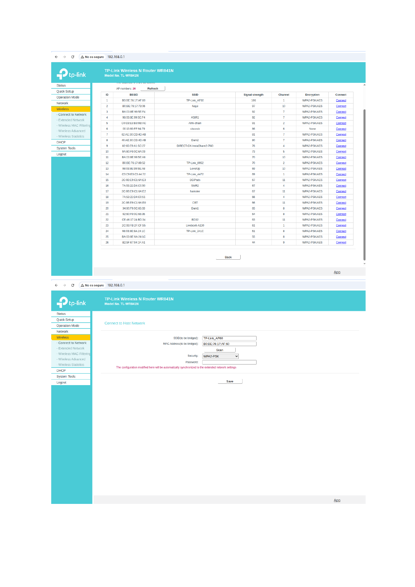

La captura individual permite leer con más claridad la lista del escaneo y la potencia indicada por el panel.

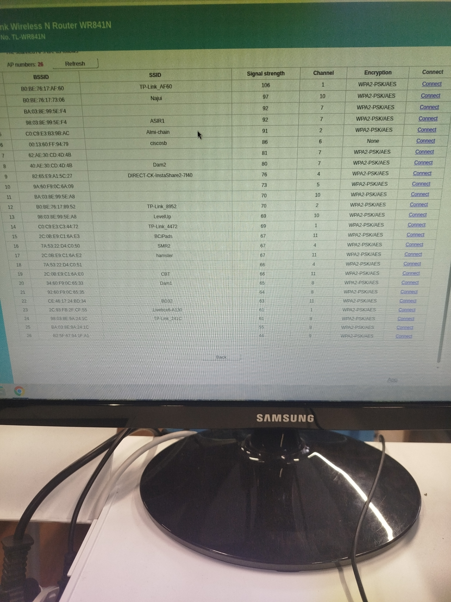

### 2.3. Configuración del puente WDS

Desde `Wireless > Connect to Network` se configuró el SSID y la MAC del router principal. La contraseña se ha censurado antes de publicar la evidencia.

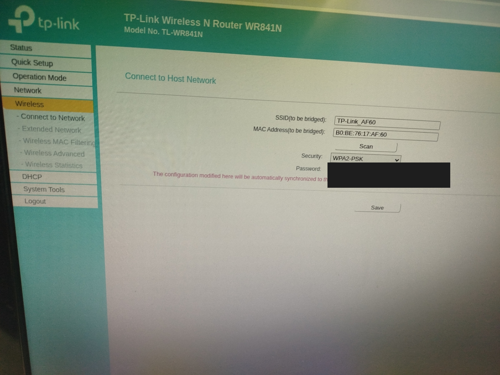

### 2.4. IP y DHCP del router secundario

Tras integrar el secundario en la red, el panel quedó disponible en `192.168.1.101`. El servidor DHCP del router 2 quedó desactivado para que las direcciones fueran entregadas únicamente por el router 1.

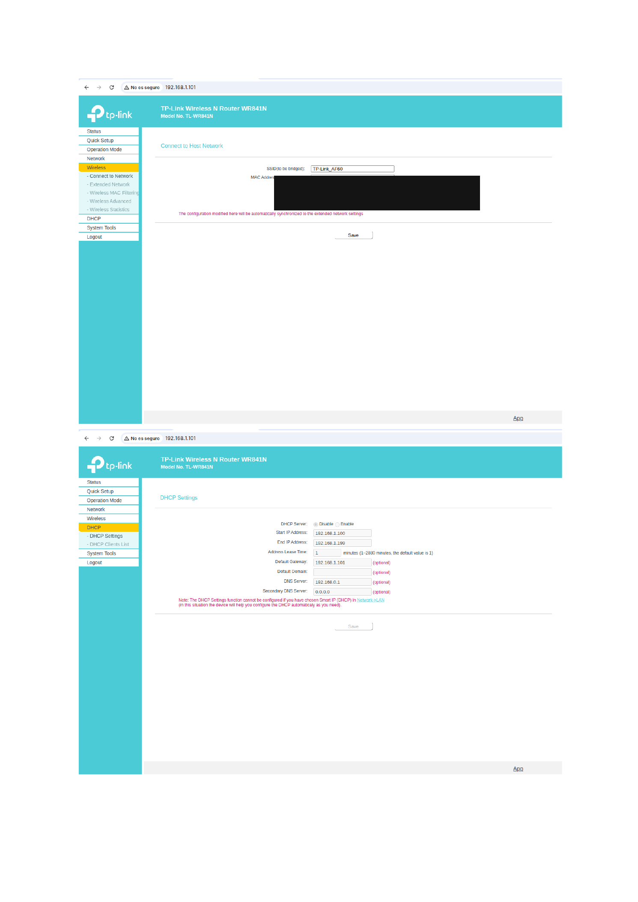

La siguiente captura individual muestra `DHCP Server: Disable`.

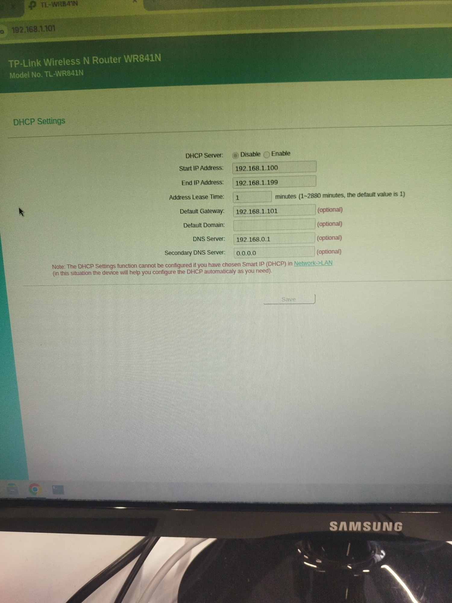

### 2.5. Prueba de conectividad local

Con el PC conectado por Ethernet al router secundario se ejecutó:

```bash
ping -c 4 192.168.1.1
```

El resultado principal fue:

```text
4 packets transmitted, 4 received, 0% packet loss
```

La página del PDF también muestra que `enp2s0` estaba conectada por Ethernet.

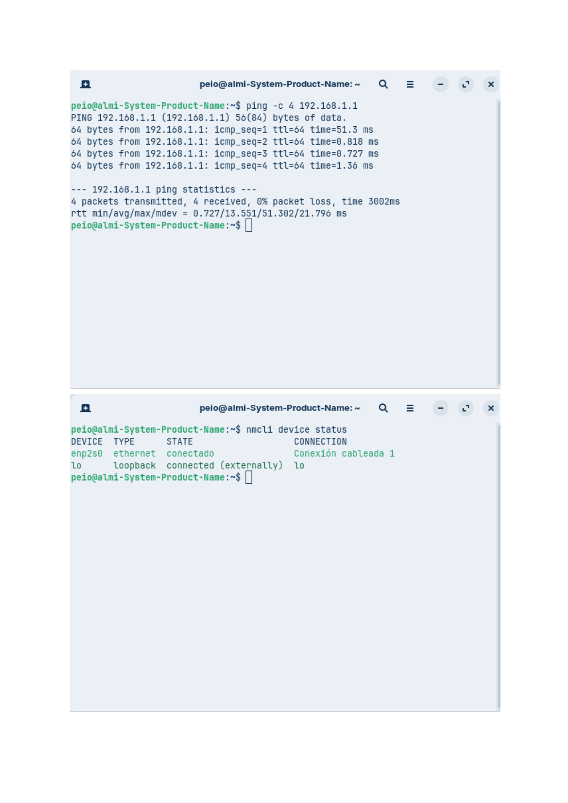

La captura original del ping conserva el contexto completo de la terminal.

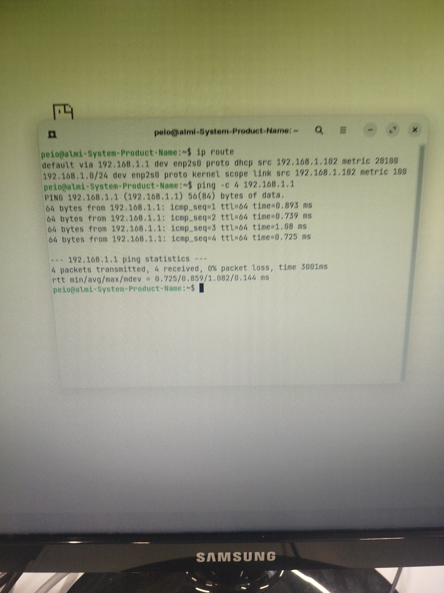

### 2.6. Conexión del móvil

El móvil se conectó a `TP-Link_AF60`. La conexión local estaba activa, aunque Android mostraba `Sin acceso a Internet`.

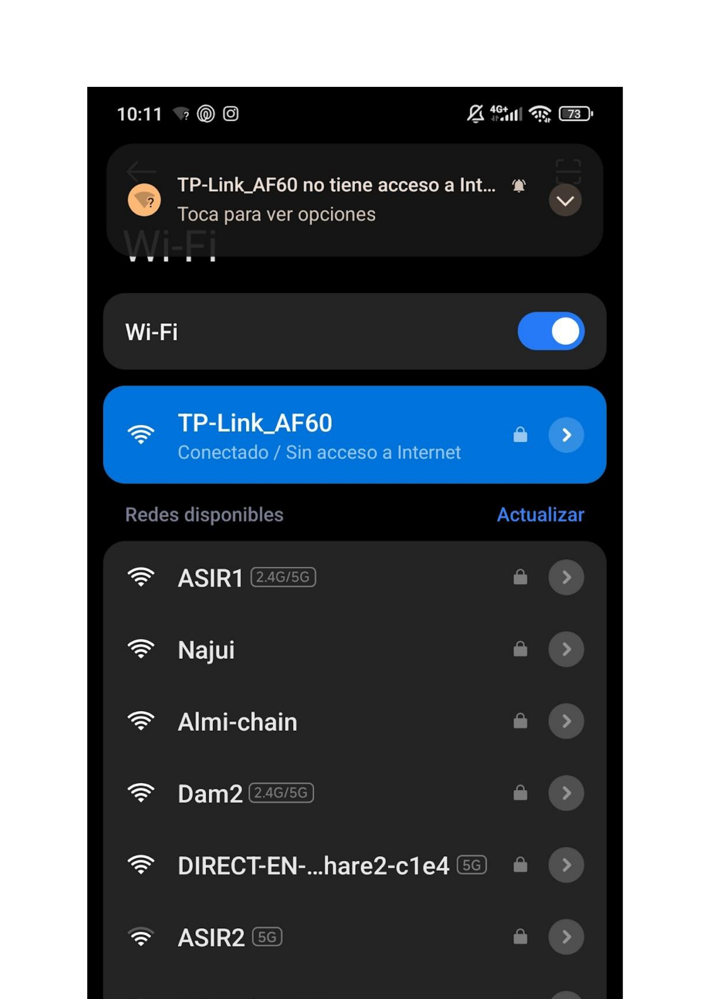

Cerca de los routers se detectaban varias redes inalámbricas.

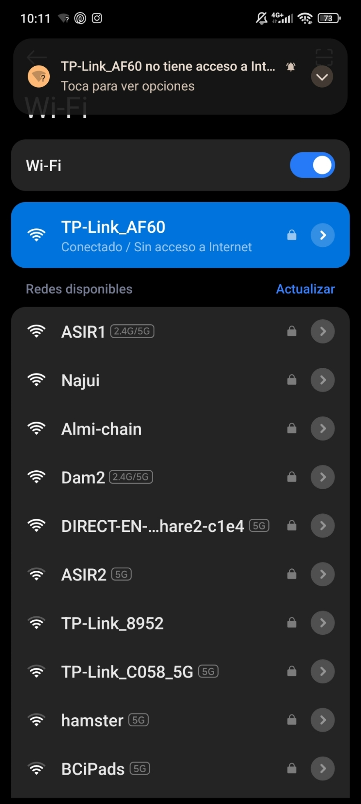

### 2.7. Prueba básica de cobertura

Al alejar el móvil, `TP-Link_AF60` continuaba asociada cuando la lista ya no mostraba otras redes. Más lejos, la conexión terminó perdiéndose. Esta observación identifica un límite práctico, pero no demuestra todavía qué BSSID daba servicio ni ofrece valores en dBm.

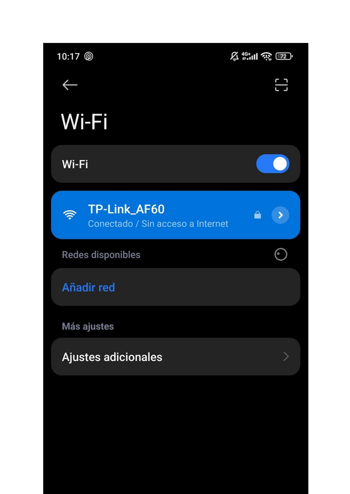

La siguiente captura muestra el punto en el que `TP-Link_AF60` seguía conectada y no aparecían otros SSID.

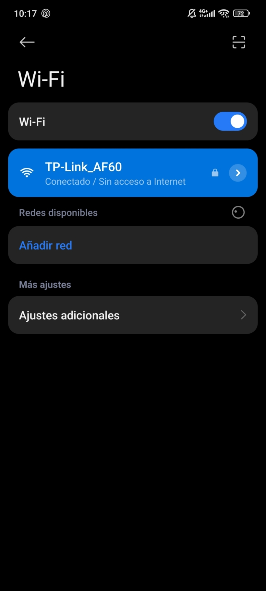

### 2.8. Parámetros del móvil

Los detalles de la conexión mostraron:

| Parámetro | Resultado |
|---|---|
| SSID | `TP-Link_AF60` |
| Tecnología | Wi-Fi 4 |
| Velocidad de enlace | `72 Mbps` |
| Intensidad | Excelente |
| Seguridad | WPA/WPA2-Personal |
| Dirección IPv4 | `192.168.1.100` |
| Máscara | `255.255.255.0` |
| Router | `192.168.1.1` |
| Internet | No disponible durante el ensayo |

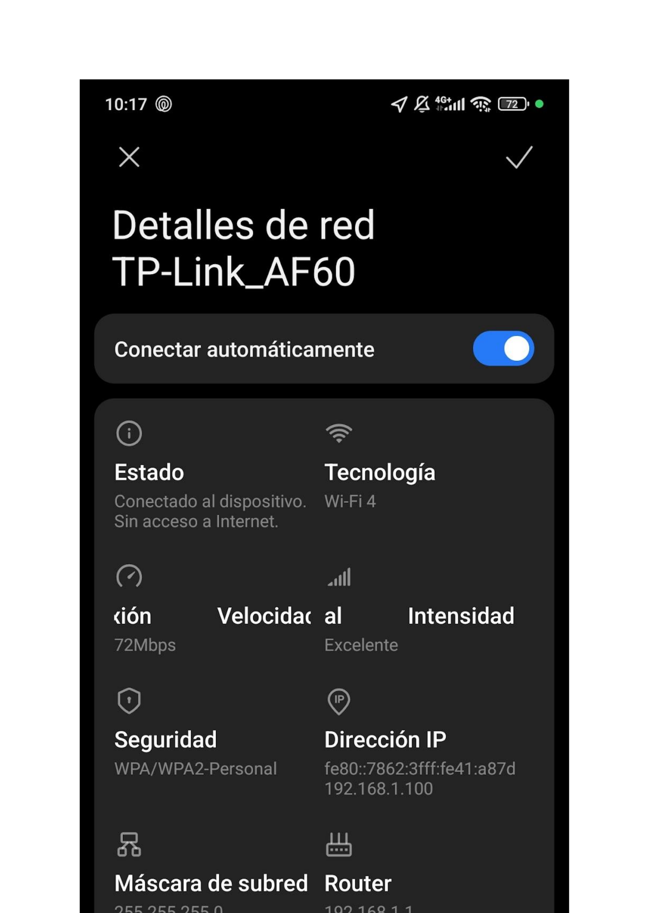

La captura individual facilita la lectura de la dirección IP, la velocidad y la intensidad.


### 2.9. Resultado del laboratorio

| Comprobación | Resultado |
|---|---|
| WDS configurado con el principal | ✅ |
| DHCP del secundario desactivado | ✅ |
| PC con IP de la red principal | ✅ `192.168.1.102` |
| Ping a `192.168.1.1` | ✅ 0 % de pérdida |
| Móvil con IP de la red principal | ✅ `192.168.1.100` |
| Velocidad de enlace | ✅ 72 Mbps |
| Cobertura básica observada | ✅, sin medida en dBm |
| Acceso a Internet | ❌ No disponible |
| Aislamiento de invitados | ⬜ No probado |

### 2.10. Limitaciones

1. Se utilizó `192.168.1.0/24` en lugar de `192.168.10.0/24`.
2. Se utilizó `TP-Link_AF60` en lugar de los SSID definitivos.
3. No se configuró la red de invitados.
4. No se comprobaron W3-W7.
5. No se registró el BSSID del AP al que estaba conectado el móvil.
6. No se realizaron medidas antes/después en P1-P5.
7. No hubo salida a Internet.
8. Los equipos fueron TL-WR841N, sin WPA3.

---

## 3. Valores de la implantación definitiva

| Dato | Router 1 | Router 2 |
|---|---|---|
| IP LAN | `192.168.10.1` | `192.168.10.2` |
| Máscara | `255.255.255.0` | `255.255.255.0` |
| DHCP | Encendido | **Apagado** |
| Banda WDS | 2,4 GHz | 2,4 GHz |
| Canal | Fijo: 1, 6 u 11 | Igual que el router 1 |
| SSID personal | `Restaurante-Almichain` | Mismo SSID y contraseña |
| SSID invitados | `Restaurante-Almichain-Invitados` | Mismo SSID y contraseña |
| Ubicación | Armario del despacho | Comedor, cerca de la barra |

## 4. Procedimiento definitivo

1. Configurar un canal fijo de 2,4 GHz en el router 1.
2. Activar la red de invitados y denegar su acceso a la LAN.
3. Conectar el portátil a un puerto LAN del router 2.
4. Asignar `192.168.10.2/24` al router 2.
5. Desactivar DHCP en el router 2.
6. Activar WDS y seleccionar `Restaurante-Almichain`.
7. Configurar los mismos SSID y contraseñas en ambos equipos.
8. Desactivar WPS y administración remota.
9. Comprobar `WDS Status: Run` o el estado equivalente.
10. Colocar el router 2 cerca de la barra y realizar W1-W10.

## 5. Pruebas W1-W10

| Prueba | Procedimiento | Resultado esperado | Estado |
|---|---|---|---|
| W1 | Estado inalámbrico del router 2 | WDS `Run` | ⬜ |
| W2 | `ping -c 4 192.168.10.2` | 0 % de pérdida | ⬜ |
| W3 | Móvil invitado junto al router 2 | BSSID del router 2 | ⬜ |
| W4 | Abrir web y consultar IP | Navega e IP de invitados | ⬜ |
| W5 | Probar `192.168.10.10` y `192.168.10.31` | No accesibles | ⬜ |
| W6 | Abrir `192.168.10.1` y `192.168.10.2` | No accesibles | ⬜ |
| W7 | Ping entre dos invitados | No responde | ⬜ |
| W8 | Personal junto al router 2 abre Odoo | Accesible | ⬜ |
| W9 | Caminar despacho-barra con vídeo | Cambio de BSSID con corte mínimo | ⬜ |
| W10 | Apagar el router 2 | Conmutación al router 1 | ⬜ |

> [!WARNING]
> Si un invitado obtiene una dirección `192.168.10.x` o accede a Odoo, TPV o paneles, la configuración no es segura y la red de invitados del router 2 debe apagarse hasta resolverlo.

## 6. Cobertura y velocidad

### Puntos de medida

| Punto | Ubicación |
|---|---|
| P1 | Despacho, junto al router 1 |
| P2 | Comedor, mitad izquierda |
| P3 | Barra, junto al TPV 2 |
| P4 | Comedor, mitad derecha |
| P5 | Entrada |

### Resultados pendientes

| Punto | Antes señal dBm | Antes Internet | Antes iperf3 | Después router/BSSID | Después señal dBm | Después Internet | Después iperf3 |
|---|---:|---:|---:|---|---:|---:|---:|
| P1 | Pendiente | Pendiente | Pendiente | Pendiente | Pendiente | Pendiente | Pendiente |
| P2 | Pendiente | Pendiente | Pendiente | Pendiente | Pendiente | Pendiente | Pendiente |
| P3 | Pendiente | Pendiente | Pendiente | Pendiente | Pendiente | Pendiente | Pendiente |
| P4 | Pendiente | Pendiente | Pendiente | Pendiente | Pendiente | Pendiente | Pendiente |
| P5 | Pendiente | Pendiente | Pendiente | Pendiente | Pendiente | Pendiente | Pendiente |

Servidor `iperf3` cableado al router 1:

```bash
iperf3 -s
```

Cliente conectado a la Wi-Fi personal:

```bash
iperf3 -c <IP_SERVIDOR> -t 10
```

## 7. Inventario de evidencias incluidas

| Archivo | Contenido |
|---|---|
| `01-pdf-seleccion-y-configuracion-wds.png` | Página 1 de capturas 2.pdf |
| `02-pdf-wds-y-dhcp-desactivado.png` | Página 2 censurada |
| `03-pdf-ping-y-estado-interfaz.png` | Página 3 |
| `04-pdf-movil-conectado-wifi.png` | Página 4 |
| `05-pdf-prueba-cobertura.png` | Página 5 |
| `06-pdf-detalles-conexion-wifi.png` | Página 6 |
| `07-captura-escaneo-redes-wds.png` | Captura individual del escaneo |
| `08-captura-configuracion-wds-censurada.png` | Configuración WDS censurada |
| `09-captura-dhcp-desactivado.png` | DHCP desactivado |
| `10-captura-ping-router-principal.png` | Ping con 0 % de pérdida |
| `11-captura-cobertura-cerca.png` | Cobertura cerca |
| `12-captura-detalles-wifi.png` | Detalles de la conexión |
| `13-captura-limite-cobertura.png` | Cobertura al alejarse |
| `14-github-estructura-evidencias.png` | Comprobación de estructura en GitHub |
| `15-github-vista-documentacion.png` | Comprobación de visualización en GitHub |

### Control de publicación en GitHub

Las siguientes capturas documentan la colocación de los archivos y la vista previa de la documentación en el repositorio.

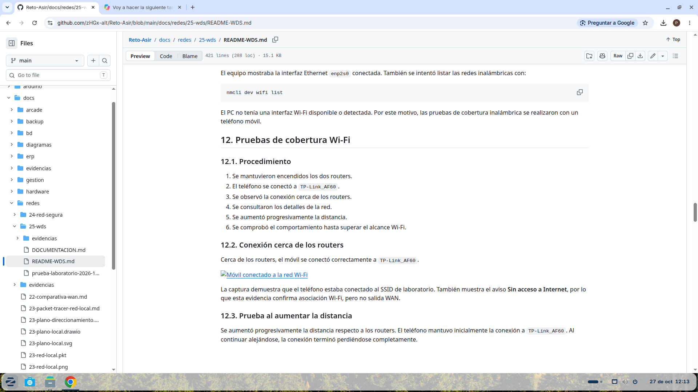

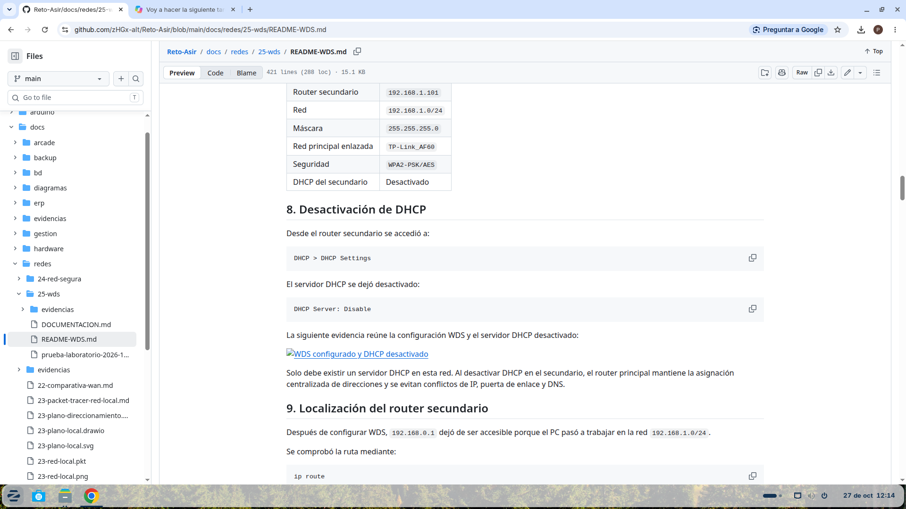

> [!CAUTION]
> No debe subirse el PDF original sin revisar porque una de sus páginas contiene una contraseña visible. Las versiones incluidas en `evidencias/` están preparadas para la documentación pública.

## 8. Conclusión provisional

La prueba de laboratorio confirma que dos TP-Link TL-WR841N pueden establecer un enlace WDS local. El PC conectado al secundario obtuvo `192.168.1.102`, utilizó `192.168.1.1` como puerta de enlace y alcanzó al principal sin pérdida de paquetes. El móvil obtuvo `192.168.1.100`, mostró Wi-Fi 4, intensidad excelente y un enlace de `72 Mbps`.

La tarea sigue abierta porque faltan el direccionamiento `192.168.10.0/24`, los SSID definitivos, la red de invitados, el aislamiento frente a la LAN, la comprobación por BSSID y la comparativa P1-P5.
