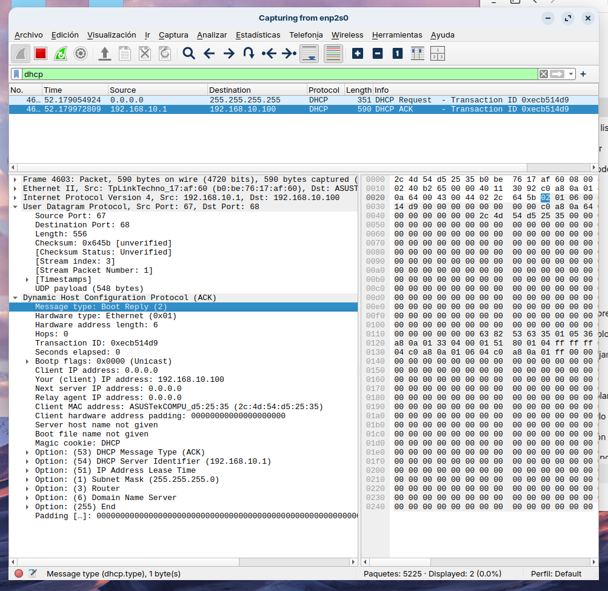
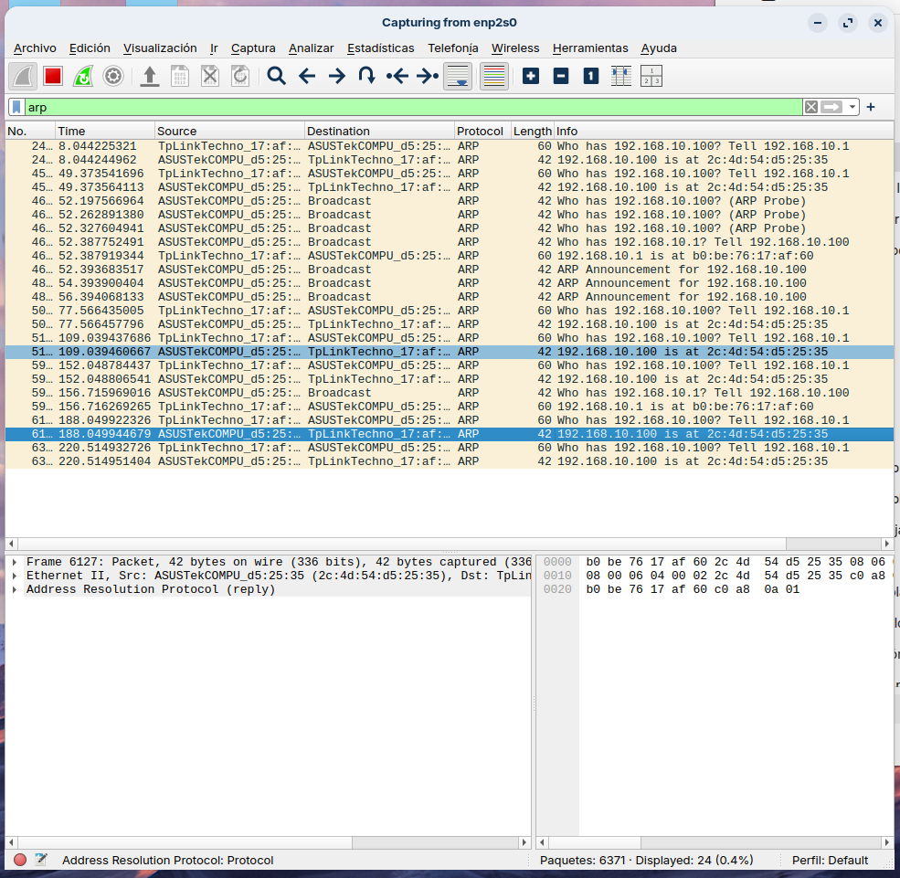
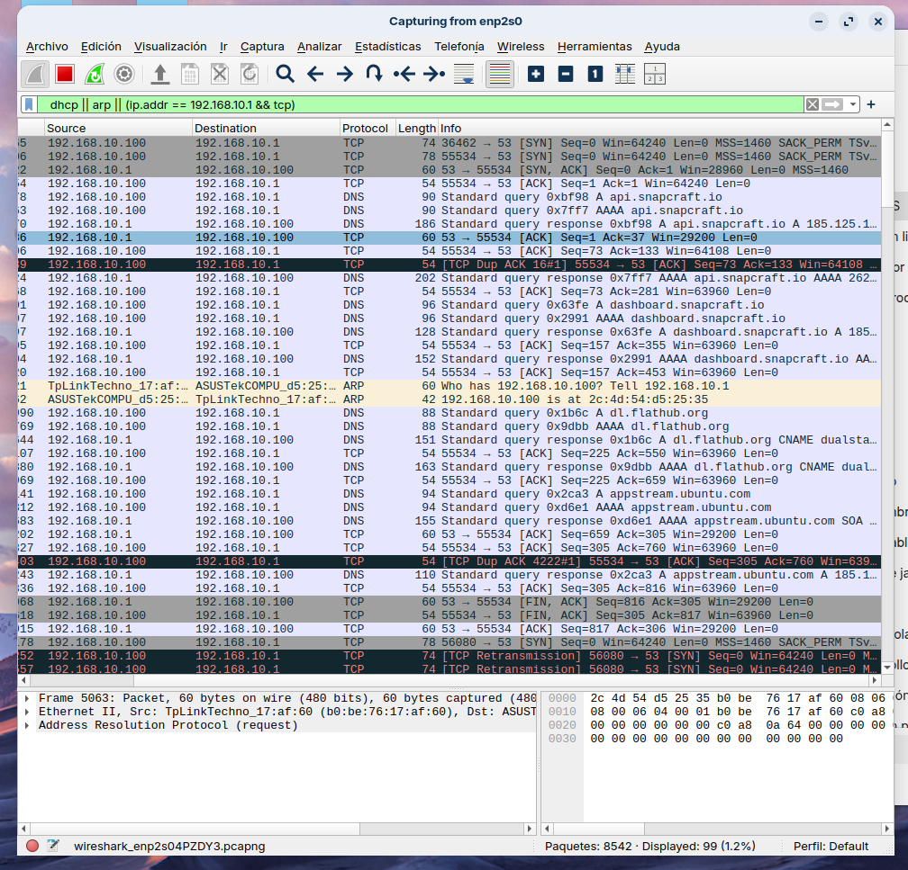
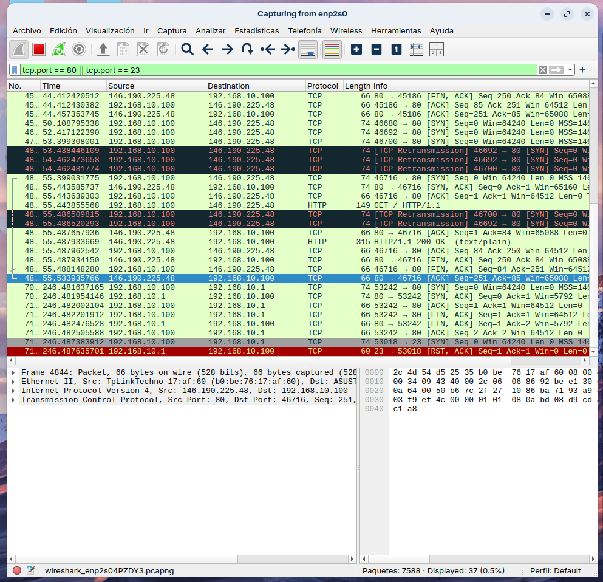

# Tarea 26 · Análisis de conectividad con Wireshark y nmap

**Responsable:** Eneko.S · **Fechas:** 04–05/11/2026 · **Depende de:** tarea 25 (WDS; y antes, la 24: red segura con invitados)
**Estado:** ✅ Hecho el 30/10/2026 con el router real (TL-WR841N): LAN, invitados y Wireshark W1-W4. Pendiente solo lo que depende de que el servidor y los TPV estén en la red (sección 8).

Objetivo: comprobar **con herramientas de análisis**, y no solo con `ping`, que la red se comporta como dice el plan de la [tarea 23](../23-plano-direccionamiento.md):

1. **nmap:** qué equipos y qué puertos se ven desde cada red. Lo importante: desde la Wi-Fi de invitados **no se ve la LAN** (hallazgos S-06 y S-13 de la [tarea 46](../../seguridad/46-revision-seguridad/DOCUMENTACION.md)).
2. **Wireshark:** cómo funciona por dentro lo que usa el restaurante (DHCP, DNS, ARP, TCP) y que el tráfico con Odoo va **cifrado**.

Packet Tracer no tiene Wireshark ni nmap (solo enseña paquetes simulados), así que se hace con los equipos reales. Si el día de la prueba no está montada la red física, la parte LAN se puede hacer con las VM del proyecto en `192.168.10.0/24` (servidor de la tarea 52 y TPV provisional) y la parte de invitados queda pendiente.

> ⚠️ Escanear **solo** la red del reto y con permiso del profesor. Escanear redes ajenas puede ser delito.

## 1. Material

- Portátil con Ubuntu (o el PC del gerente arrancado en Ubuntu), con `nmap` y Wireshark: `sudo apt install nmap wireshark` (al instalar Wireshark, aceptar que los usuarios sin privilegios capturen y añadirse al grupo: `sudo usermod -aG wireshark $USER`, cerrar sesión y volver a entrar).
- Acceso a la LAN (cable o Wi-Fi del personal) y a la Wi-Fi de invitados.
- El script [`analizar-red.sh`](analizar-red.sh) de esta carpeta.

## 2. nmap: pruebas automáticas

```bash
bash docs/redes/26-analisis-conectividad/analizar-red.sh lan         # conectado a la LAN
bash docs/redes/26-analisis-conectividad/analizar-red.sh invitados   # conectado a la Wi-Fi de invitados
```

**Si la red del aula no es la del plan.** La práctica de WDS de la tarea 25 ([documentación](../25-wds/DOCUMENTACION.md)) se hizo con dos TL-WR841N en `192.168.1.0/24` (router 1 en `.1`, router 2 en `.101`), no con los Archer C6 en `192.168.10.0/24`. Si el día de la prueba la red es esa, se indican las direcciones reales y se apunta en la sección 5:

```bash
RED_LAN=192.168.1.0/24 ROUTER=192.168.1.1 ROUTER2=192.168.1.101 SERVIDOR=<IP> TPV1=<IP> TPV2=<IP> GERENTE=<IP> \
  bash docs/redes/26-analisis-conectividad/analizar-red.sh lan
```

Cada ejecución guarda la salida de cada prueba en `evidencias/<rol>-<fecha>/` y un `resumen.txt` con el veredicto: **OK** (lo esperado), **REVISAR** (no coincide con el plan) o **INFO** (dato para la documentación). Las direcciones salen de la tabla 4.3 de la tarea 23; si alguna cambia: `SERVIDOR=192.168.10.11 bash analizar-red.sh lan`.

### 2.1 Desde la LAN

| # | Prueba | Comando de nmap | Esperado | Resultado |
|---|---|---|---|---|
| L1 | Equipos encendidos | `-sn 192.168.10.0/24` | Los de la tabla 4.3 (.1, .2, .3, .10, .20, .31, .32) | |
| L2 | Servidor, todos los puertos | `-Pn -p- 192.168.10.10` | Solo 22, 80 y 443 (tarea 46, comprobación 2) | |
| L3 | Odoo directo y PostgreSQL | `-Pn -p 8069,5432 192.168.10.10` | Cerrados: solo se entra por nginx | |
| L4 | Servicios y versiones | `-Pn -sV -p 22,80,443 192.168.10.10` | OpenSSH y nginx | |
| L5 | Versiones de TLS | `-Pn --script ssl-enum-ciphers -p 443 192.168.10.10` | Solo TLS 1.2 y 1.3 | |
| L6-L8 | TPV 1, TPV 2 y gerente | `-Pn 192.168.10.31` (y .32, .20) | Ningún puerto abierto (cortafuegos de cada equipo) | |
| L9 | Router 1 | `-Pn -p 21,22,23,53,80,443,1900,8080 192.168.10.1` | DNS y panel web; sin Telnet ni FTP | |

### 2.2 Desde la Wi-Fi de invitados

| # | Prueba | Comando de nmap | Esperado | Resultado |
|---|---|---|---|---|
| I1 | ¿Se ve la LAN? | `-sn 192.168.10.0/24` | 0 equipos (tarea 46, comprobación 1) | |
| I2 | Puertos de la LAN | `-Pn -p 22,80,443,8069 192.168.10.0/24` | Ninguno abierto | |
| I3 | Paneles de los routers | `-Pn -p 80,443 192.168.10.1 192.168.10.2` | Cerrados (tarea 25, W6) | |
| I4 | Otros clientes de invitados | `-sn <red de invitados>/24` | Solo el propio equipo y la puerta de enlace (aislamiento, W7) | |
| I5 | Panel desde la puerta de enlace de invitados | `-Pn -p 80,443 <puerta de enlace>` | Cerrado | |

**Si algo sale REVISAR:** no es un fallo de la prueba, es un hallazgo. Se apunta en la sección 5 y se avisa al responsable (red: Peio, tareas 24 y 25; servidor: Adrian, tarea 52; TPV: Markel e Iker, tareas 13 y 15).

## 3. Wireshark: capturas

Abrir Wireshark, elegir la interfaz (la Wi-Fi o la de cable) y capturar mientras se hace cada acción. Aplicar el filtro de la tabla, hacer la captura de pantalla y guardar la captura (`Archivo → Exportar paquetes especificados`, solo los mostrados) como `.pcapng`.

| # | Qué se ve | Cómo provocarlo | Filtro | Qué hay que señalar en la captura |
|---|---|---|---|---|
| W1 | **DHCP** (Discover, Offer, Request, Ack) | Desconectar y volver a conectar la Wi-Fi (o `sudo dhclient -r && sudo dhclient`) | `dhcp` | Los 4 mensajes, la IP ofrecida, la puerta de enlace y el DNS (opción 6) |
| W2 | **ARP** | `ping` a la puerta de enlace después de `sudo ip neigh flush all` | `arp` | Pregunta *Who has* y respuesta con la MAC |
| W3 | **DNS** | Abrir una web cualquiera | `dns` | Consulta y respuesta; a qué servidor se pregunta (el router) |
| W4 | **TCP**: conexión y rechazo | `nc -zv 192.168.10.10 443` y `nc -zv 192.168.10.10 8069` | `tcp.flags.syn == 1 \|\| tcp.flags.reset == 1` | Tres pasos (SYN, SYN-ACK, ACK) en el 443; en el 8069, RST (cerrado) o nada (filtrado) |
| W5 | **HTTPS con Odoo** | Desde la LAN, entrar en `https://192.168.10.10` con un usuario de prueba | `ip.addr == 192.168.10.10 && tls` | *Client Hello* con la versión de TLS; los datos van como *Application Data*: **no se lee la contraseña** |
| W6 | **Aislamiento de invitados** | Desde la Wi-Fi de invitados, `ping -c 4 192.168.10.10` | `icmp` | Salen los *Echo request* y no vuelve ningún *Echo reply* |
| W7 | Durante el escaneo de nmap | Capturar mientras se ejecuta I2 | `ip.dst == 192.168.10.0/24` | Los SYN que envía nmap sin respuesta (filtrado) |

**Seguridad de las capturas:** una captura puede contener datos de otras personas y, si algo va sin cifrar, contraseñas. Capturar solo durante la prueba, usar un usuario de prueba en Odoo y revisar cada `.pcapng` antes de subirlo. Si alguno tuviera algo sensible, se sube solo la captura de pantalla. gitleaks no analiza los `.pcapng` ni las imágenes.

Para hacerlo desde la terminal (sin la interfaz gráfica), `tshark` acepta los mismos filtros:

```bash
tshark -i wlp2s0 -a duration:30 -w evidencias/w1-dhcp.pcapng     # capturar 30 s
tshark -r evidencias/w1-dhcp.pcapng -Y dhcp                         # ver solo DHCP
```

## 4. Evidencias (en `evidencias/`)

| Fichero | Qué |
|---|---|
| `lan-<fecha>/` y `invitados-<fecha>/` | Salida de `analizar-red.sh` (un `.txt` por prueba y `resumen.txt`) |
| `w1-dhcp.png` … `w7-escaneo.png` | Capturas de pantalla de Wireshark con lo señalado |
| `w1-dhcp.pcapng` … | Capturas filtradas (solo si no tienen datos sensibles) |

## 5. Resultados (30/10/2026)

**Red usada:** el router real del equipo, un **TP-Link TL-WR841N v14** (no los Archer C6 del plan), en `192.168.10.0/24`: router en `.1` (MAC `b0:be:76:17:af:60`), DHCP de `.100` a `.199`. Conectados: el PC de Eneko.S por cable (Ubuntu, `enp2s0`, `192.168.10.100`) y un móvil Android con nmap 7.99 en Termux, primero en la Wi-Fi del personal y después en la de invitados. El PC no tiene Wi-Fi, así que las pruebas desde invitados se hicieron con el móvil.

El servidor (`.10`), el gerente (`.20`) y los TPV (`.31`, `.32`) son máquinas virtuales y **no estaban en esta red**, así que las pruebas L2-L8 y W5 no se pudieron hacer (ver 5.4).

### 5.1 nmap desde la LAN (PC por cable)

Salida completa en `evidencias/lan-20261030-085342/` (`resumen.txt`: 5 OK, 2 REVISAR, 2 INFO).

| # | Resultado | ¿Coincide con el plan? |
|---|---|---|
| L1 | Solo 2 equipos: el router (`.1`) y el PC (`.100`) | Sí para lo que había conectado; faltan los equipos que son VM |
| L2-L8 | Sin equipo en esas IP | **No aplicable.** Los «OK» del resumen solo dicen que no responde nadie: no valen como prueba del servidor ni de los TPV |
| L9 | Abiertos 22, 80 y 1900. Sin Telnet (23) ni FTP (21) | Panel web y sin Telnet/FTP, como se esperaba. **SSH y UPnP no estaban previstos** (hallazgos H-01 y H-02) |

Versiones del router (`evidencias/router-versiones.txt` y `router-udp.txt`):

| Puerto | Servicio que detecta nmap |
|---|---|
| 22/tcp | SSH: Dropbear sshd **2012.55** |
| 80/tcp | Panel web de TP-Link (nmap lo confunde con un TD-W8968; el modelo real es el TL-WR841N) |
| 1900/tcp | UPnP: Portable SDK for UPnP devices **1.6.19** sobre Linux 2.6.36 |
| 53/udp | DNS (el router hace de DNS para la LAN) |
| 67/udp | DHCP (`open\|filtered`) |
| 1900/udp | UPnP (SSDP) |

### 5.2 Desde la Wi-Fi de invitados (móvil con Termux)

Red `Restaurante-Almichain-Invitados` (WPA2, 2,4 GHz). El móvil recibió `192.168.10.103`; el PC seguía conectado por cable en `.100`. Captura de la red en `evidencias/movil-red-invitados.jpg` y lo que mostró Termux en `evidencias/movil-termux.txt`.

| # | Comando | Resultado | ¿Coincide con el plan? |
|---|---|---|---|
| I1 | `nmap -sn 192.168.10.0/24` | Solo se ve el propio móvil (`.103`) | **Sí:** desde invitados no se ve la LAN |
| I2/I3/I5 | `nmap -Pn -p 22,80,443 192.168.10.1 192.168.10.100` | Todos los puertos `filtered` | **Sí:** ni el panel ni el SSH del router, ni el PC |
| W6 | `ping -c 4 192.168.10.100` | `Destination Host Unreachable`, 100 % perdidos | **Sí:** el aislamiento funciona |
| I4 | Otros clientes de invitados | No había otro cliente conectado; I1 no ve a nadie más | Sin probar con un segundo cliente |

Como contraste, desde la Wi-Fi del **personal** (`Restaurante_Almichain`, `evidencias/movil-red-personal.jpg`) el mismo móvil sí ve el router y sus puertos 22 y 80 abiertos, que es lo normal en la red de trabajo.

### 5.3 Wireshark (PC por cable)

Capturas filtradas en `evidencias/captura-lan.pcapng` (filtro `dhcp || arp || (ip.addr == 192.168.10.1 && tcp)`); se revisaron antes de subirlas y no tienen contraseñas.

| # | Captura | Qué se ve |
|---|---|---|
| W1 |  | *Request* y *ACK*: el router da `192.168.10.100/24`, puerta de enlace `.1` y DNS `.1`. No salen *Discover* ni *Offer* porque al reconectar (`nmcli device disconnect/connect enp2s0`) el PC pide renovar la IP que ya tenía |
| W2 |  | *Who has 192.168.10.1?* y la respuesta *is at b0:be:76:17:af:60*. También el *ARP Probe* y el *Announcement* del PC (comprueba que nadie más usa su IP) y las preguntas periódicas del router |
| W3 |  | Consultas DNS al router (`.1`): `api.snapcraft.io`, `dl.flathub.org`, `appstream.ubuntu.com` |
| W4 |  | `nc -zv 192.168.10.1 80`: SYN, SYN-ACK, ACK y cierre con FIN (puerto abierto). `nc -zv 192.168.10.1 23`: RST, ACK (cerrado). Además se ve una petición **HTTP sin cifrar** de Ubuntu a `146.190.225.48` con el contenido legible |
| W5 | — | Sin hacer: el servidor Odoo es una VM y no estaba en la red |
| W6 | — | No se pudo capturar desde invitados (el PC no tiene Wi-Fi); se comprobó con `ping` desde el móvil (5.2) |
| W7 | — | Igual que W6: el escaneo se hizo desde el móvil, sin Wireshark |

### 5.4 Hallazgos

| Id | Hallazgo | Riesgo | Acción | Para |
|---|---|---|---|---|
| H-01 | El router tiene **UPnP** activo (libupnp 1.6.19, de 2013) | Cualquier equipo de la LAN puede abrir puertos hacia Internet sin pedir permiso; esa versión tiene fallos conocidos | Desactivar UPnP (*Forwarding → UPnP*) | Peio (24) |
| H-02 | El router tiene **SSH** abierto en la LAN (Dropbear 2012.55) y el firmware es antiguo (Linux 2.6.36) | Software sin actualizar | Actualizar el firmware desde la web de TP-Link. Si el SSH no se puede quitar (lo usa la app Tether), se acepta el riesgo porque la administración ya está limitada | Peio (24), Adrian (46) |
| H-03 | La red de invitados usa el **mismo rango** `192.168.10.0/24` con aislamiento, no `192.168.50.0/24` | Ninguno: el aislamiento funciona (5.2) | Corregir el «a comprobar» de la tarea 23 | Peio (23) |
| H-04 | La Wi-Fi del personal se llama `Restaurante_Almichain` (guion bajo); la documentación pone `Restaurante-Almichain` | Ninguno | Unificar el nombre en la documentación | Peio (24) |
| H-05 | Se ve tráfico **HTTP sin cifrar** (W4) | Lo que vaya por HTTP se lee con Wireshark | Argumento para que Odoo vaya solo por HTTPS (tarea 52) | Adrian (46, 52) |

## 6. Conclusión

- **La Wi-Fi de invitados está aislada:** desde ella nmap no ve ningún equipo de la LAN, el panel y el SSH del router salen filtrados y el `ping` al PC no llega. Las comprobaciones 1 de la tarea 46 y W6 quedan hechas con el router real.
- **El router expone más de lo previsto:** UPnP y SSH con software de hace más de diez años. No es grave en una LAN cerrada, pero UPnP se debe desactivar y conviene actualizar el firmware (H-01, H-02).
- **El servidor, el gerente y los TPV no se han podido analizar** porque son VM fuera de esta red. La comprobación 2 de la tarea 46 (puertos del servidor) y W5 (HTTPS con Odoo) quedan pendientes; `analizar-red.sh lan` sirve tal cual cuando estén conectados.
- **Wireshark** muestra DHCP, ARP, DNS y TCP tal como se explicaron en clase, y deja ver que lo que va por HTTP se lee sin esfuerzo (H-05).

## 7. Pruebas del script (27/10/2026)

`analizar-red.sh` se probó en un Linux con nmap 7.94 contra servicios montados en la propia máquina, sustituyendo las IP por direcciones locales:

| Caso | Resultado |
|---|---|
| «Servidor» con un servicio en el 8069 y otro en el 80 | L2 y L3 dan REVISAR y muestran los puertos abiertos |
| «Servidor» con TLS 1.2 y 1.3 en el 443 (`openssl s_server`) | L5 da OK con `TLSv1.2 TLSv1.3` |
| «TPV», «gerente» y «router» sin servicios | OK |
| Rol `invitados` con los routers sin panel | I2 e I3 dan OK |
| Salida | Un `.txt` por prueba y `resumen.txt` en `evidencias/<rol>-<fecha>/` |

## 8. Pendiente

- [x] Red de invitados aislada (tarea 24) montada en el router real.
- [x] `analizar-red.sh lan` y pruebas desde invitados (con el móvil).
- [x] Capturas W1 a W4 con Wireshark.
- [x] Secciones 5 y 6.
- [x] H-01 a H-05 pasados a la [tarea 46](../../seguridad/46-revision-seguridad/DOCUMENTACION.md) como S-25 (UPnP y SSH y firmware antiguos del router).
- [ ] Cuando el servidor (tarea 52) y los TPV estén en la red: repetir `analizar-red.sh lan` (L2-L8) y W5. Con eso se cierra la comprobación 2 de la tarea 46.
- [ ] WDS (tarea 25): repetir L1 con el segundo router conectado.
