# **Tarea 13: Bastionado de los dos TPV Windows**

> Lo que se hizo a mano en los TPV (26/10). Los scripts que lo dejan igual y añaden lo que falta (tarea 15) están en [DOCUMENTACION.md](../DOCUMENTACION.md).

## **1. Objetivo**

El objetivo de esta tarea es proteger los dos equipos TPV del
restaurante mediante usuarios con permisos limitados, modo quiosco,
bloqueo del almacenamiento USB y activación de las protecciones de
Windows.

Para la simulación se han utilizado dos máquinas virtuales con Windows
11 Pro:

- TPV1-Windows11

- TPV2-Windows11

## **2. Usuario estándar del TPV1**

En el primer TPV se ha creado la cuenta local UsuarioTPV.

Esta cuenta se ha configurado como usuario estándar, por lo que no
dispone de permisos de administrador y no puede realizar cambios
importantes en el sistema sin introducir las credenciales de una cuenta
administradora.

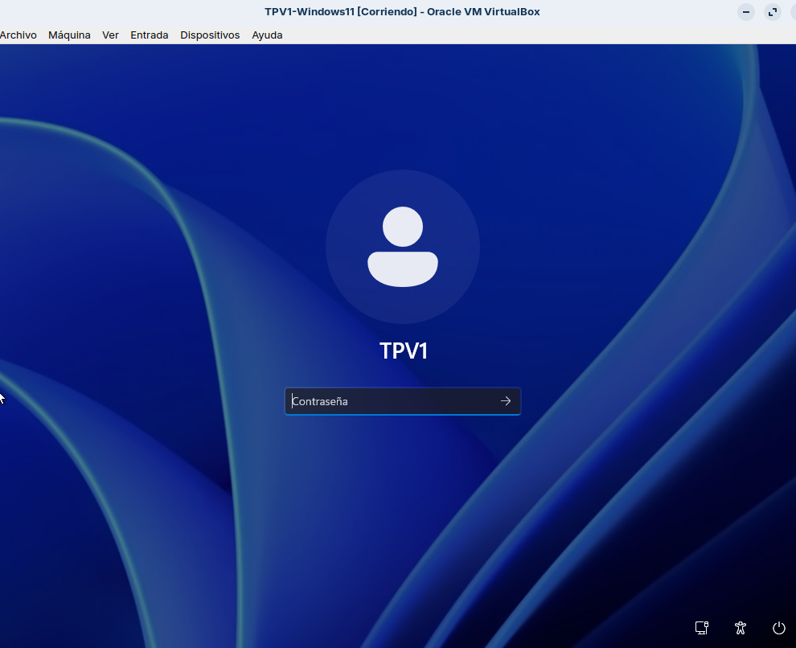

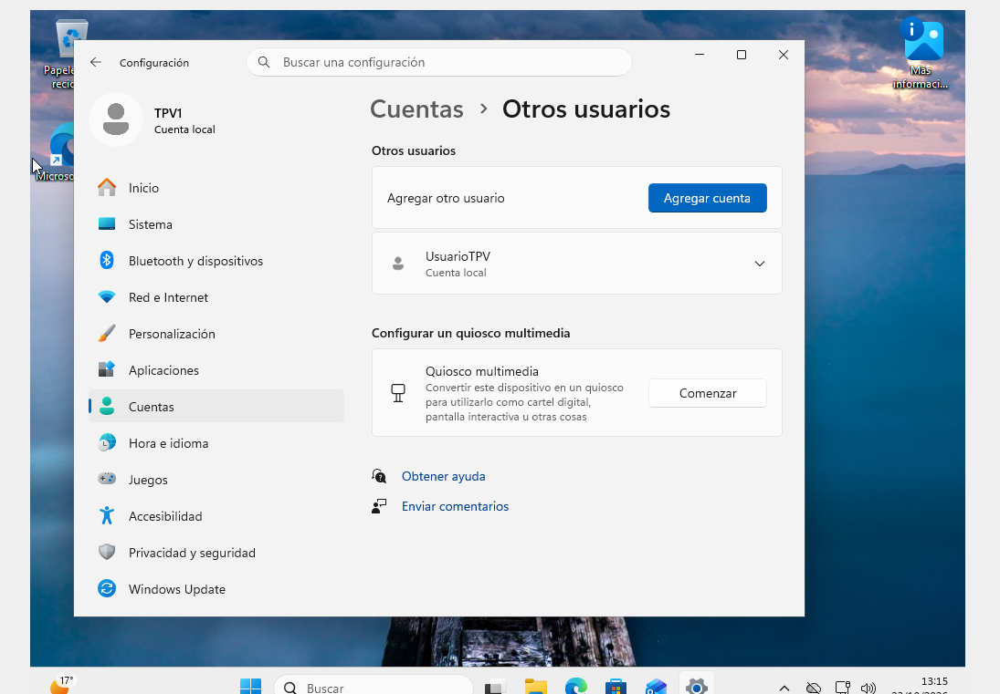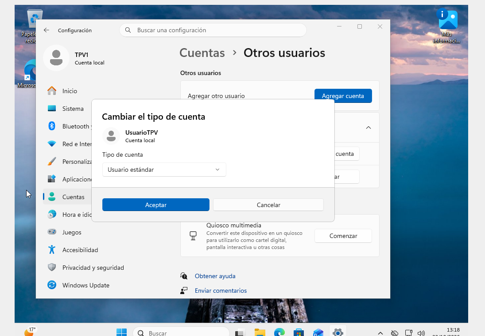

## **3. Configuración del modo quiosco en TPV1**

Se ha creado la cuenta QuioscoTPV y se ha configurado Microsoft Edge
como única aplicación disponible.

El modo quiosco permite que el TPV se utilice únicamente para acceder al
punto de venta de Odoo, evitando el acceso normal al escritorio y a
otras aplicaciones.

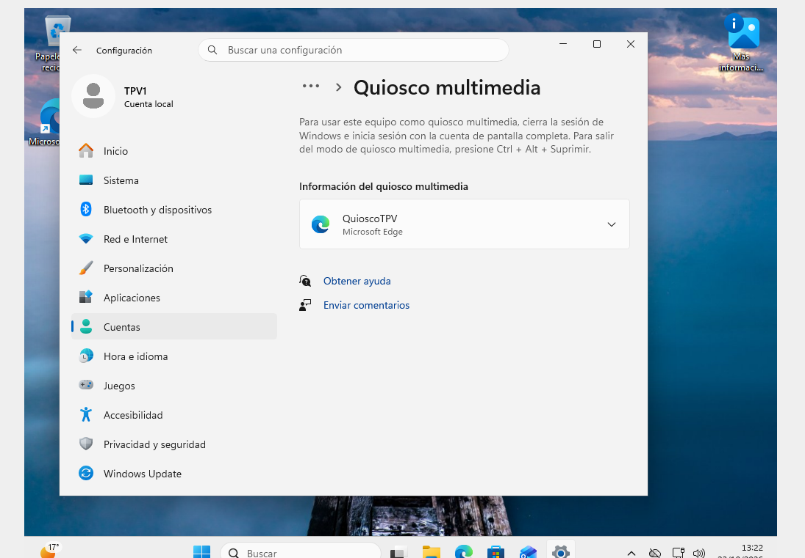

## **4. Prueba del modo quiosco en TPV1**

Al iniciar sesión con la cuenta QuioscoTPV, Microsoft Edge se abre
automáticamente a pantalla completa.

Durante la prueba se utilizó provisionalmente la dirección
http://localhost:8069. La conexión no se completó porque el servidor
Odoo todavía no estaba funcionando en esa dirección. Cuando se conozca
la IP definitiva del servidor, se sustituirá esta dirección.

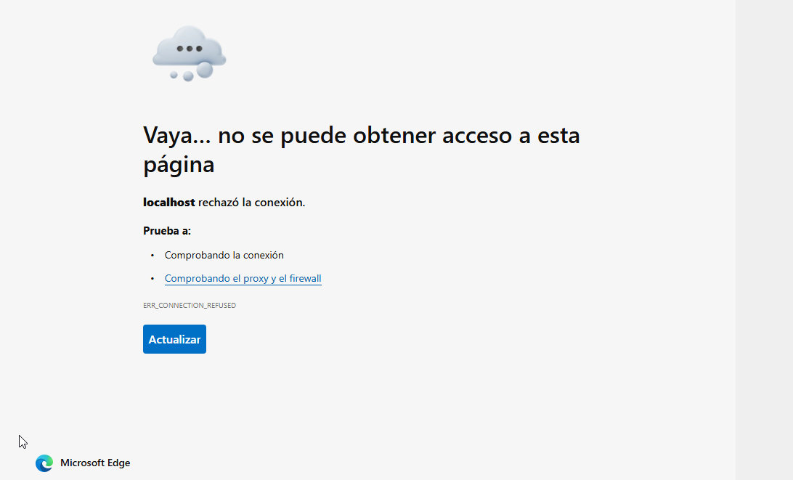

## **5. Bloqueo del almacenamiento USB en TPV1**

Se ha utilizado el Editor de directivas de grupo local para bloquear el
acceso a dispositivos de almacenamiento extraíble.

La directiva utilizada ha sido:

Todas las clases de almacenamiento extraíble: denegar todo acceso

Esta directiva se ha configurado como habilitada.

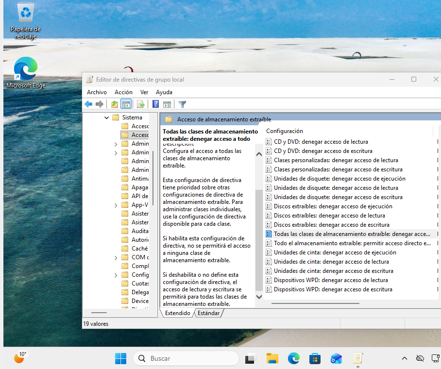

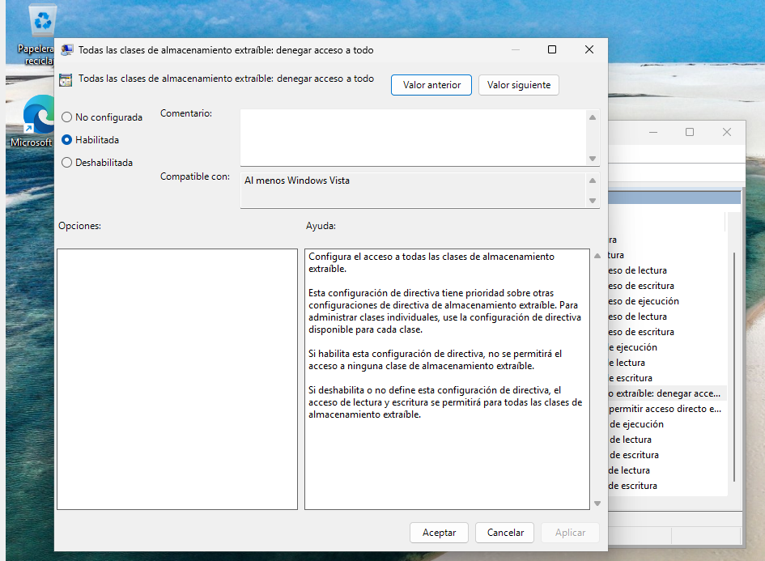

## **6. Prueba del bloqueo USB**

Después de aplicar la directiva, se ha intentado acceder al disco
extraíble desde el Explorador de archivos.

El sistema ha impedido el acceso al dispositivo de almacenamiento, lo
que demuestra que la restricción se ha aplicado correctamente.

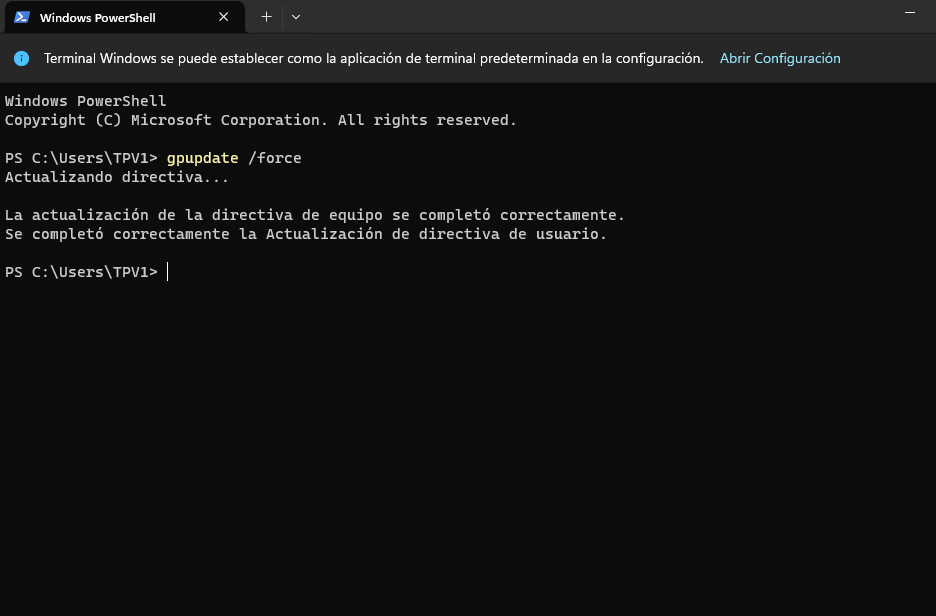

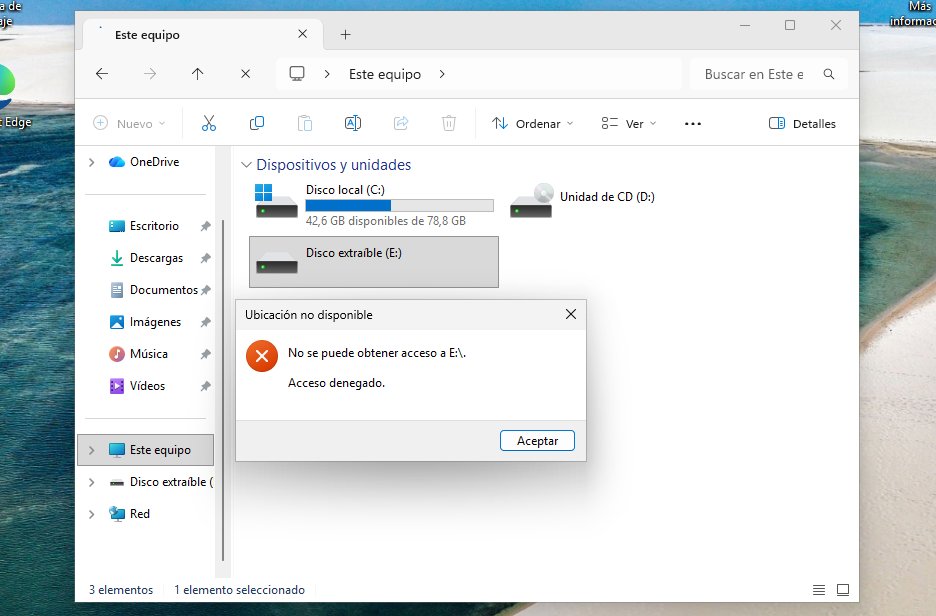

## **7. Firewall y protección de Windows**

Se ha comprobado que el Firewall de Windows permanece activado para
proteger la conexión de red del TPV.

También se ha mantenido activa la protección de Microsoft Defender.

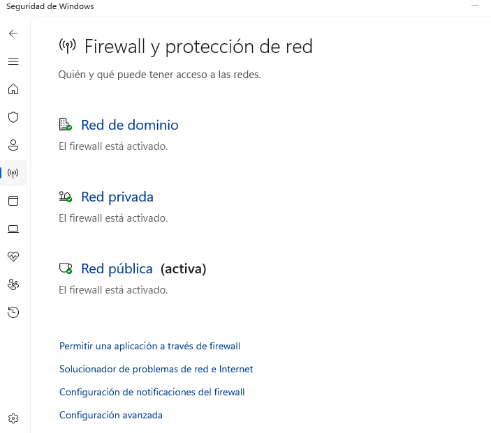

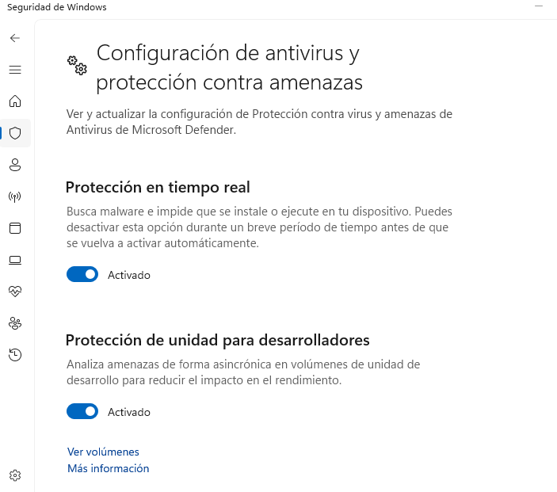

## **8. Configuración del TPV2**

El segundo TPV se ha creado mediante una clonación completa del primer
equipo.

Durante la clonación se han generado nuevas direcciones MAC para evitar
conflictos de red entre las dos máquinas virtuales.

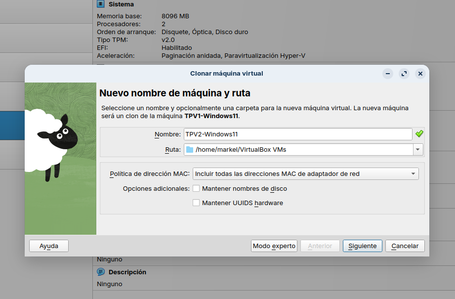

## **9. Usuarios del TPV2**

En el segundo equipo se ha creado la cuenta TPV2 como administradora
para realizar tareas de mantenimiento.

También se han mantenido:

- UsuarioTPV como usuario estándar.

- QuioscoTPV como cuenta del modo quiosco.

La cuenta antigua TPV1 se ha eliminado del segundo equipo después de
comprobar que TPV2 funcionaba correctamente como administradora.

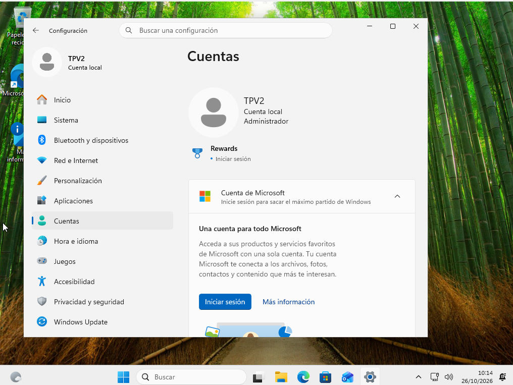

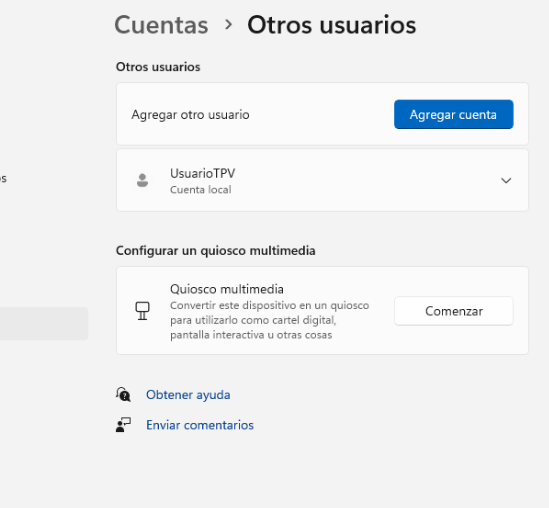

## **10. Modo quiosco en TPV2**

Se ha comprobado que la cuenta QuioscoTPV también está configurada con
Microsoft Edge en el segundo TPV.

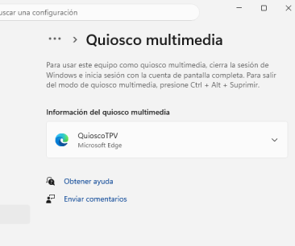

## **11. Bloqueo USB en TPV2**

Debido a que el segundo TPV se ha creado mediante clonación, conserva la
directiva que bloquea el almacenamiento extraíble.

Se ha comprobado que la directiva permanece habilitada.

## **12. Pruebas realizadas**

Se han realizado las siguientes comprobaciones:

- El usuario de trabajo no tiene permisos de administrador.

- Microsoft Edge se abre automáticamente en modo quiosco.

- El usuario del quiosco no accede al escritorio normal.

- El almacenamiento USB está bloqueado.

- El Firewall de Windows está activado.

- Microsoft Defender permanece activado.

- Los dos TPV tienen configuraciones independientes.

- Las máquinas virtuales tienen direcciones MAC diferentes.

## **13. Conclusión**

Los dos TPV se han configurado con usuarios de mínimos privilegios,
acceso mediante modo quiosco y bloqueo de dispositivos de almacenamiento
extraíble.

La configuración limita las funciones disponibles para los usuarios de
caja y reduce el riesgo de instalaciones no autorizadas, cambios en el
sistema o utilización de memorias USB.

Cuando esté disponible el servidor Odoo, se sustituirá la dirección
provisional del quiosco por la dirección IP definitiva del servidor.
