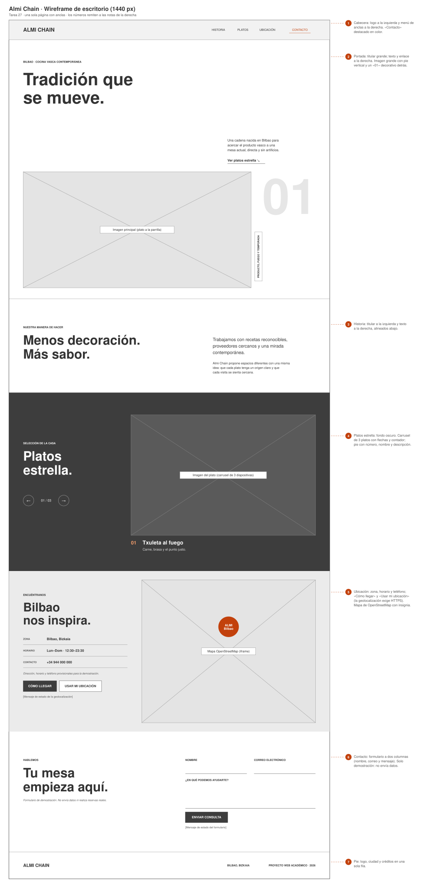
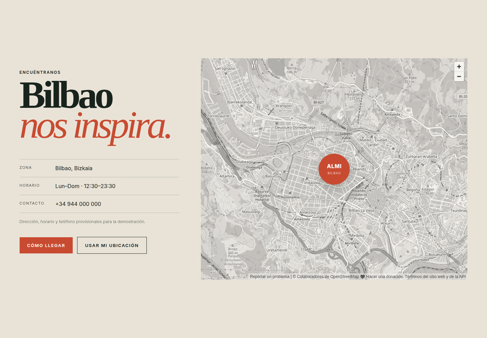

# Tarea 27: Wireframes y diseño conceptual de la web

- **Bloque:** 6 Web
- **Responsable:** Peio · **Revisa:** Eneko.S
- **Reto:** Almi-Chain (ASIR1 2026-27)
- **Estado:** pendiente de revisión
- **Fecha:** 23/10/2026

## 1. Alcance

Wireframes de baja fidelidad de la web del restaurante (tarea 28) en escritorio y en móvil, con la estructura de cada sección y su comportamiento adaptable (*responsive*).

La web se implementó antes que los wireframes. Por eso los wireframes se han sacado de la web ya hecha (`web/index.html` y `web/style.css`): reflejan la estructura real y sirven de referencia para las tareas que siguen (validación, tarea 29, y hosting, tareas 30 y 31).

## 2. Archivos

| Archivo | Contenido |
|---|---|
| [`27-wireframes-web.drawio`](../diagramas/27-wireframes-web.drawio) | Fuente editable en draw.io, con dos páginas: escritorio y móvil |
| [`27-wireframe-escritorio.svg`](../diagramas/27-wireframe-escritorio.svg) | Escritorio, 1440 px de ancho |
| [`27-wireframe-movil.svg`](../diagramas/27-wireframe-movil.svg) | Móvil, 390 px de ancho, y el menú desplegado |

## 3. Escritorio

## 4. Móvil

## 5. La web implementada

Capturas de la web (tarea 28) a 1440 px de ancho, para comparar con el wireframe de escritorio. Se han generado abriendo `web/index.html` con Chrome.

**Portada** (secciones 1 y 2 del wireframe):

**Ubicación con el mapa de OpenStreetMap** (sección 5):

**Formulario de contacto** (sección 6):

## 6. Estructura de la página

Es una sola página: el menú lleva a cada sección mediante anclas (`#historia`, `#platos`, `#ubicacion` y `#contacto`).

| # | Sección | Escritorio | Móvil (800 px o menos) |
|---|---|---|---|
| 1 | Cabecera | Logo a la izquierda y menú a la derecha; «Contacto» destacado | El menú se esconde tras el botón «Menú» y se despliega debajo de la cabecera |
| 2 | Portada | Titular grande, texto y enlace a «Platos» a la derecha, imagen grande con pie vertical y un «01» decorativo | Una columna, sin pie vertical ni «01» |
| 3 | Historia | Titular y texto en dos columnas | Apilados |
| 4 | Platos estrella | Fondo oscuro; carrusel de 3 platos con flechas y contador | Título y controles encima de la imagen |
| 5 | Ubicación | Datos de contacto, «Cómo llegar», «Usar mi ubicación» y mapa de OpenStreetMap con insignia | Mapa debajo de los datos, con 420 px de alto como mínimo |
| 6 | Contacto | Formulario a dos columnas: nombre, correo y mensaje | Formulario a una columna |
| 7 | Pie | Logo, ciudad y créditos en una fila | Apilados |

## 7. Decisiones de diseño

- **Una sola página.** La web es de presentación, con poco contenido; las anclas evitan tener que navegar entre páginas.
- **Un único punto de corte, en 800 px.** Por encima, las secciones van a dos columnas; por debajo, a una.
- **Mapa de OpenStreetMap en lugar de Google Maps.** No necesita clave de API ni cuenta.
- **El formulario es de demostración.** No envía datos, así que la web es estática y se puede alojar sin servidor (tarea 30).
- **Geolocalización.** El botón «Usar mi ubicación» solo funciona con HTTPS, porque los navegadores la bloquean en HTTP. Es otro motivo para que la tarea 30 incluya un certificado.

## 8. Cómo editarlos

Los SVG se ven directamente en GitHub. Para cambiar los wireframes, se abre el `.drawio` en [app.diagrams.net](https://app.diagrams.net) o en draw.io Desktop y, al terminar, se exporta cada página a SVG con el mismo nombre (**Archivo → Exportar como → SVG**).
