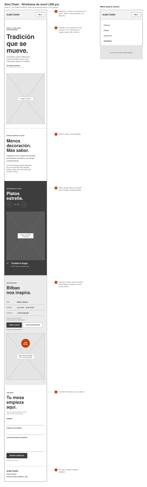
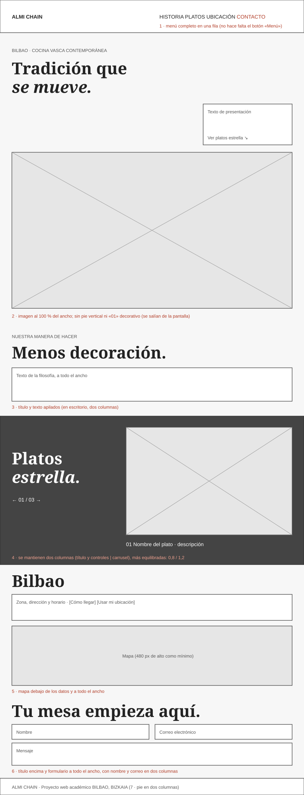
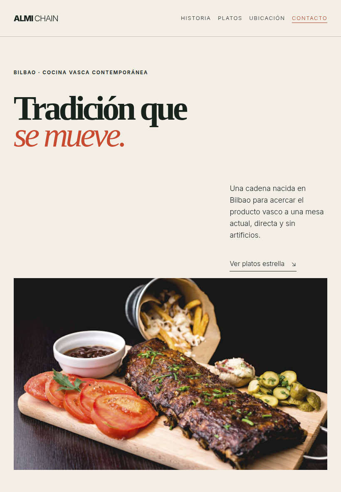
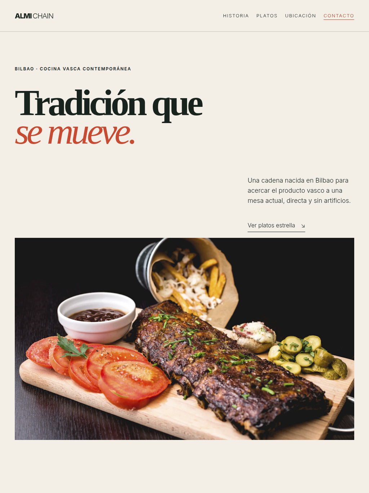
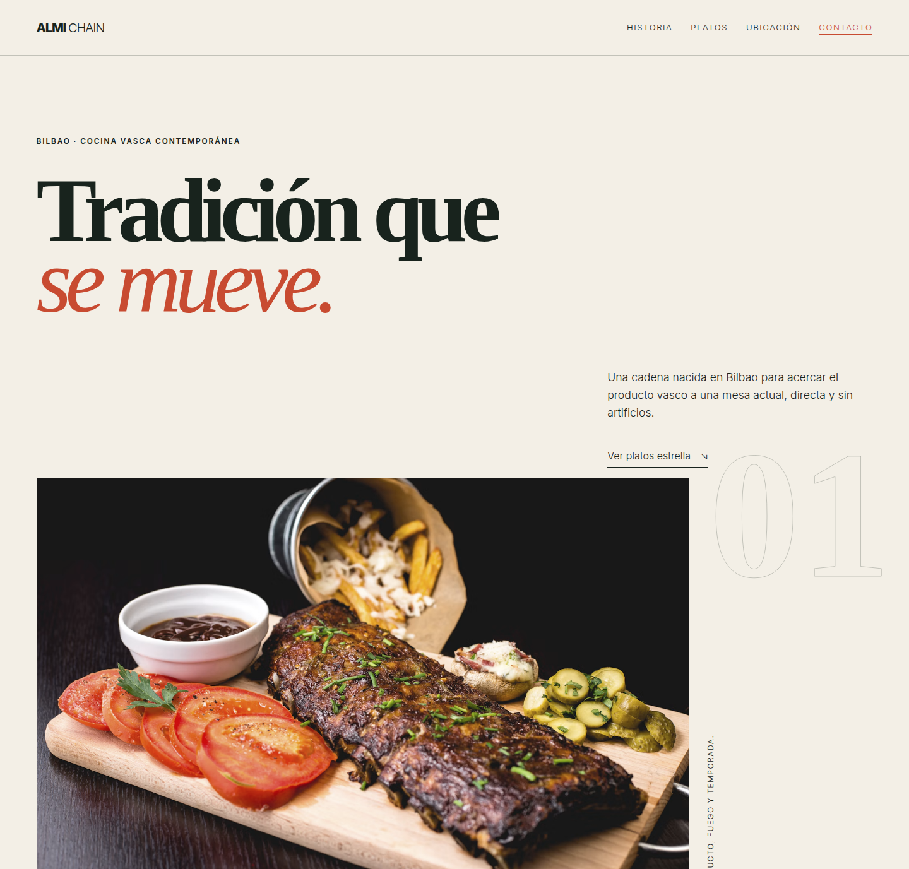
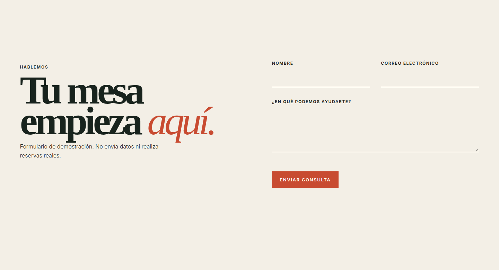

# Tarea 27: Wireframes y diseño conceptual de la web

- **Bloque:** 6 Web
- **Responsable:** Peio
- **Reto:** Almi-Chain (ASIR1 2026-27)
- **Estado:** hecha
- **Fecha:** 23/10/2026 · **Ampliada el 10/11/2026** (tarea 62): tableta, accesibilidad WCAG AA y patrones de UX (secciones 4.1, 9 y 10)

## 1. Alcance

Wireframes de baja fidelidad de la web del restaurante (tarea 28) en escritorio y en móvil, con la estructura de cada sección y su comportamiento adaptable (*responsive*).

La web se implementó antes que los wireframes. Por eso los wireframes se han sacado de la web ya hecha (`web/index.html` y `web/style.css`): reflejan la estructura real y sirven de referencia para las tareas que siguen (validación, tarea 29, y hosting, tareas 30 y 31).

> [!NOTE]
> **Orden de las tareas.** El enunciado pone el «diseño conceptual» antes de la implementación, y aquí se hizo al revés: los wireframes son posteriores a la web. Se reconoce así en la defensa. Lo que sí se decidió antes de programar está en el apartado 1.1.

### 1.1 Diseño conceptual (lo decidido antes de programar)

| Decisión | Qué se eligió | Por qué |
|---|---|---|
| Objetivo | Web unidireccional que da a conocer el restaurante: quiénes son, platos estrella, dónde están y cómo contactar | Es lo que pide el enunciado («solo exponga información») |
| Estructura | Una sola página con anclas: inicio, filosofía, platos estrella (slideshow), ubicación (mapa y geolocalización), contacto (formulario de ejemplo) | Pocas secciones, un solo documento: carga rápida y fácil de mantener sin CMS |
| Paleta | Fondo crema `#f3efe6`, texto verde muy oscuro `#18231d` y acento teja `#c84b31` (`#ad3f28` para texto, por contraste) | Colores cálidos de cocina tradicional; el acento oscuro cumple el contraste AA de accesibilidad |
| Tipografía | Títulos con serifa (Georgia) y texto sin serifa (Inter/Arial), sin fuentes externas | Contraste entre lo tradicional y lo actual, y ninguna descarga de fuentes (rendimiento y privacidad) |
| Adaptable | Móvil primero: a menos de 800 px, una columna y menú desplegable. Desde el 10/11, también tableta (801-1100 px) | Muchos clientes miran la web desde el móvil, en la calle, y la carta desde una tableta en casa |
| Accesibilidad | Enlace «saltar al contenido», textos alternativos, botones del slideshow con nombre, foco visible | Lo pide el enunciado («accesible») y lo mide Lighthouse (tarea 29) |

## 2. Archivos

| Archivo | Contenido |
|---|---|
| [`27-wireframes-web.drawio`](../diagramas/27-wireframes-web.drawio) | Fuente editable en draw.io, con dos páginas: escritorio y móvil |
| [`27-wireframe-escritorio.svg`](../diagramas/27-wireframe-escritorio.svg) | Escritorio, 1440 px de ancho |
| [`27-wireframe-movil.svg`](../diagramas/27-wireframe-movil.svg) | Móvil, 390 px de ancho, y el menú desplegado |
| [`27-wireframe-tableta.svg`](../diagramas/27-wireframe-tableta.svg) | Tableta, 820 px de ancho (10/11). Hecho directamente en SVG, no está en el `.drawio` |

## 3. Escritorio

## 4. Móvil

### 4.1 Tableta (801-1100 px)

Hasta el 10/11 la web solo tenía un punto de corte, en 800 px: una tableta (iPad en vertical, 820 px; en horizontal, 1024 px) recibía el diseño de escritorio. La imagen de la portada tenía un ancho mínimo de 700 px y su pie vertical se cortaba en el borde, el formulario quedaba en media pantalla con campos de 150 px y la portada medía 973 px de alto. Se añadió un segundo punto de corte en `style.css` (`@media (min-width: 801px) and (max-width: 1100px)`):

| Sección | En tableta |
|---|---|
| Cabecera | Menú completo en una fila, como en escritorio (cabe a 820 px) |
| Portada | Imagen a todo el ancho, sin pie vertical ni «01»; el `sizes` de la imagen pide la versión adecuada al ancho |
| Historia | Título y texto apilados |
| Platos | Dos columnas más equilibradas (0,8 / 1,2) |
| Ubicación | Mapa debajo de los datos, a todo el ancho y 480 px de alto |
| Contacto | Título encima; formulario a todo el ancho (campos de 354 px en vez de 150) |
| Pie | Dos columnas |

Comprobado con Chrome a 820 × 1180 y 1024 × 1366: sin desplazamiento horizontal y con todo el contenido visible.

| 820 px (tableta en vertical) | 1024 px (tableta en horizontal) |
|---|---|
|  |  |

## 5. La web implementada

Capturas de la web (tarea 28) a 1440 px de ancho, para comparar con el wireframe de escritorio. Se han generado abriendo `web/index.html` con Chrome.

**Portada** (secciones 1 y 2 del wireframe):

**Ubicación con el mapa de OpenStreetMap** (sección 5):

**Formulario de contacto** (sección 6):

## 6. Estructura de la página

Es una sola página: el menú lleva a cada sección mediante anclas (`#historia`, `#platos`, `#ubicacion` y `#contacto`).

| # | Sección | Escritorio (más de 1100 px; tableta en la sección 4.1) | Móvil (800 px o menos) |
|---|---|---|---|
| 1 | Cabecera | Logo a la izquierda y menú a la derecha; «Contacto» destacado | El menú se esconde tras el botón «Menú» y se despliega debajo de la cabecera |
| 2 | Portada | Titular grande, texto y enlace a «Platos» a la derecha, imagen grande con pie vertical y un «01» decorativo | Una columna, sin pie vertical ni «01» |
| 3 | Historia | Titular y texto en dos columnas | Apilados |
| 4 | Platos estrella | Fondo oscuro; carrusel de 3 platos con flechas y contador | Título y controles encima de la imagen |
| 5 | Ubicación | Datos de contacto, «Cómo llegar», «Usar mi ubicación» y mapa de OpenStreetMap con insignia | Mapa debajo de los datos, con 420 px de alto como mínimo |
| 6 | Contacto | Formulario a dos columnas: nombre, correo y mensaje | Formulario a una columna |
| 7 | Pie | Logo, ciudad y créditos en una fila | Apilados |

## 7. Decisiones de diseño

- **Una sola página.** La web es de presentación, con poco contenido; las anclas evitan tener que navegar entre páginas.
- **Dos puntos de corte: 800 y 1100 px.** Por debajo de 800, móvil (una columna y menú desplegable); de 801 a 1100, tableta (sección 4.1); por encima, escritorio a dos columnas. Hasta el 10/11 solo existía el de 800.
- **Mapa de OpenStreetMap en lugar de Google Maps.** No necesita clave de API ni cuenta.
- **El mapa se carga al pulsar «Ver el mapa»** (26/10/2026). Trae más de 1 MB de JavaScript y bajaba Lighthouse en móvil a 70 contra la URL pública (ahora 94); mientras tanto se ve un fondo de cuadrícula con la insignia. Sin JavaScript, el botón es un enlace a OpenStreetMap.
- **El formulario es de demostración.** No envía datos, así que la web es estática y se puede alojar sin servidor (tarea 30).
- **Geolocalización.** El botón «Usar mi ubicación» solo funciona con HTTPS, porque los navegadores la bloquean en HTTP. Es otro motivo para que la tarea 30 incluya un certificado.

## 8. Cómo editarlos

Los SVG se ven directamente en GitHub. Para cambiar los wireframes, se abre el `.drawio` en [app.diagrams.net](https://app.diagrams.net) o en draw.io Desktop y, al terminar, se exporta cada página a SVG con el mismo nombre (**Archivo → Exportar como → SVG**).

## 9. Accesibilidad: WCAG 2.1 nivel AA

El enunciado pide una web «accesible». La referencia es **WCAG 2.1 nivel AA**, la que exige en España el Real Decreto 1112/2018 a las webs del sector público (a través de la norma EN 301 549) y la que toma como referencia la Ley 11/2023 para los servicios de comercio electrónico. A una web informativa de un restaurante no se le exige por ley, pero es la referencia reconocida. Lighthouse da **100 en accesibilidad** ([tarea 29](../evidencias/web/lighthouse-w3c.txt)), pero Lighthouse solo comprueba lo automático; esta tabla repasa los criterios uno a uno contra el código (`web/index.html`, `web/style.css`, `web/script.js`), comprobados el 10/11:

| Criterio WCAG | Qué pide | Cómo lo cumple la web | Para quién |
|---|---|---|---|
| 1.1.1 Contenido no textual | Texto alternativo en las imágenes | Las 4 imágenes tienen `alt` descriptivo («Txuleta y otras piezas de carne…»); los adornos (flechas, «01») van con `aria-hidden="true"` | Personas ciegas con lector de pantalla |
| 1.3.1 Información y relaciones | La estructura se entiende sin verla | `header`, `nav`, `main`, 5 `section` con `aria-labelledby` y `footer`; títulos en orden (un `h1`, `h2` por sección, `h3` en los platos); cada campo con su `label for` | Lectores de pantalla, que navegan por regiones y títulos |
| 1.3.5 Propósito de los campos | Que el navegador sepa qué es cada campo | `autocomplete="name"` y `autocomplete="email"`, `type="email"` | Personas con problemas motores o de memoria (autorrelleno) |
| 1.4.3 Contraste (mínimo) | 4,5:1 en texto normal; 3:1 en texto grande | Texto `#18231d` sobre crema: **14,1:1**. Acento para texto pequeño `#ad3f28`: **5,2:1**. Botón blanco sobre teja: **4,7:1** (al pasar el ratón, 6,3:1). El teja `#c84b31` solo va en títulos grandes: 4,1:1 sobre crema y 3,5:1 sobre verde (≥ 3:1). Calculado con la fórmula de WCAG | Baja visión, pantallas al sol |
| 1.4.4 y 1.4.10 Cambio de tamaño y *reflow* | Ampliar al 200 % y verse a 320 px sin desplazamiento horizontal | Tamaños en `rem` y `clamp()`; tres diseños (móvil, tableta y escritorio) sin desplazamiento horizontal | Baja visión, móviles pequeños |
| 2.1.1 Teclado | Todo se usa sin ratón | Solo elementos nativos (`a`, `button`, `input`): menú, carrusel, «Ver el mapa», «Usar mi ubicación» y formulario se manejan con Tab, Enter y espacio | Personas que no pueden usar ratón |
| 2.2.2 Poner en pausa | Nada se mueve solo sin poder pararlo | El carrusel **no avanza solo**: cambia solo con los botones | Personas con dificultades de atención o lectura lenta |
| 2.3.3 / preferencias de movimiento | Respetar a quien pide menos animaciones | `@media (prefers-reduced-motion: reduce)` quita transiciones y el desplazamiento suave | Personas con trastornos vestibulares |
| 2.4.1 Evitar bloques | Saltar lo que se repite | Enlace «Saltar al contenido» (primer elemento; aparece al recibir el foco) | Usuarios de teclado y lector de pantalla |
| 2.4.6 Encabezados y etiquetas | Títulos y etiquetas que describen | «Platos estrella», «Nombre», «Correo electrónico»; botones «Plato anterior» y «Plato siguiente» (`aria-label`) | Todos |
| 2.4.7 Foco visible | Se ve dónde está el teclado | Contorno de 2 px en el color de acento en enlaces y campos; los botones cambian de color con `:focus-visible` | Usuarios de teclado |
| 3.1.1 Idioma de la página | Declarar el idioma | `<html lang="es">` | El lector de pantalla pronuncia en español |
| 3.3.2 Etiquetas o instrucciones | Saber qué rellenar | Etiqueta visible en cada campo, `required` en los tres y aviso de que el formulario es de demostración | Todos |
| 4.1.2 Nombre, función, valor | Los controles dicen qué son y en qué estado están | Botón «Menú» con `aria-expanded` y `aria-controls`; contador del carrusel y estado de la geolocalización con `aria-live="polite"` (el lector anuncia el cambio) | Lectores de pantalla |

**Lo que no cumple o no se ha comprobado:** no se ha probado con un lector de pantalla real (NVDA u Orca), solo con Lighthouse y revisando el código; y el mapa de OpenStreetMap es contenido de terceros, cuya accesibilidad no depende de nosotros (por eso al lado van la dirección en texto y el enlace «Cómo llegar»).

## 10. Usabilidad y patrones de diseño

Patrones de diseño web actuales que usa la web, y qué le aportan al cliente del restaurante:

| Patrón | Dónde | Qué aporta |
|---|---|---|
| **Página única con anclas** (*one-page*) | Todo el sitio | Toda la información en un desplazamiento; el menú lleva a cada parte sin cargar páginas |
| **Móvil primero y diseño adaptable** | Tres diseños: móvil, tableta y escritorio | Se lee igual en el móvil en la calle que en el ordenador |
| **Menú hamburguesa** con estado accesible | Móvil | Deja la pantalla para el contenido; `aria-expanded` dice si está abierto |
| **Hero** (portada con titular grande e imagen) | Inicio | En un vistazo: qué es, dónde está y qué se come |
| **Llamada a la acción destacada** | «Contacto» en el menú (color de acento), botones «Cómo llegar» y «Enviar consulta» | Lo que más interesa al negocio, a un clic |
| **Carrusel manual** con contador | Platos estrella | Tres platos en poco espacio, sin que se muevan solos (2.2.2) |
| **Carga diferida** (*facade*) del mapa e imágenes `loading="lazy"` | Ubicación y carrusel | El mapa (más de 1 MB) solo se carga si se pide: Lighthouse móvil pasó de 70 a 94. Las fotos 2 y 3 del carrusel se descargan cuando hacen falta |
| **Imágenes adaptables** (`srcset` y `sizes`, WebP) | Portada y platos | El móvil descarga una imagen de 640 px y no la de 1600 |
| **Mejora progresiva** | Mapa y geolocalización | Sin JavaScript, «Ver el mapa» es un enlace a OpenStreetMap; la geolocalización se pide solo al pulsar el botón, nunca al abrir la página |
| **Formulario corto** | Contacto | Tres campos, con autorrelleno y validación del navegador |

**Criterios de usabilidad (heurísticas de Nielsen) que se han seguido:** *visibilidad del estado* (contador «01 / 03», mensaje de la geolocalización), *control del usuario* (nada se mueve ni se carga sin pedirlo), *consistencia* (mismos colores y tipografías en todas las secciones; el acento siempre indica acción o énfasis), *prevención de errores* (campos obligatorios y tipo `email`) y *diseño minimalista* (cinco secciones, sin ventanas emergentes ni banner de cookies, porque la web no usa cookies).

