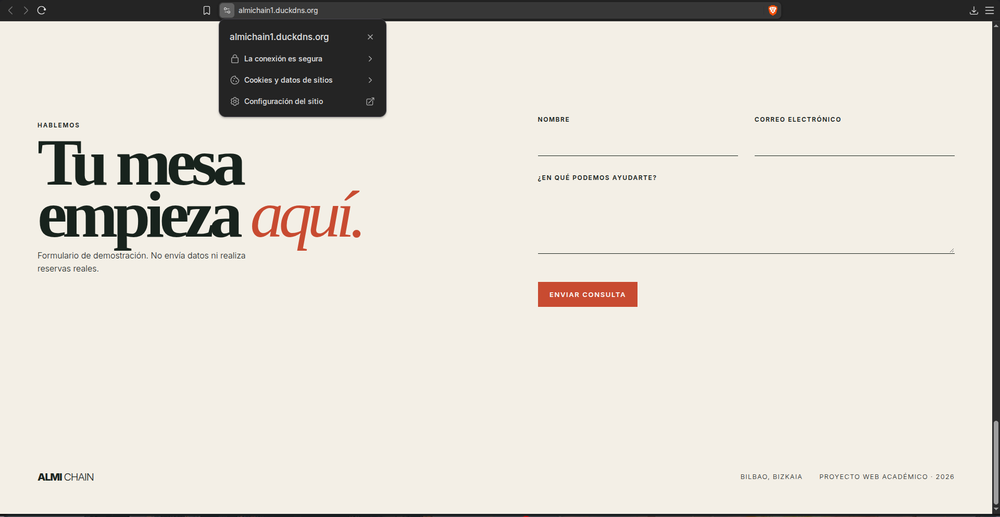
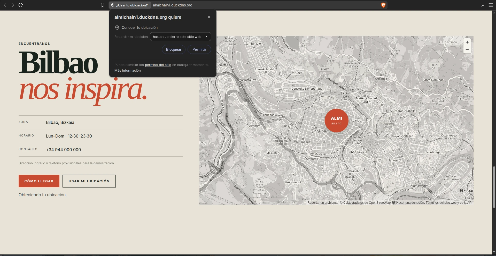
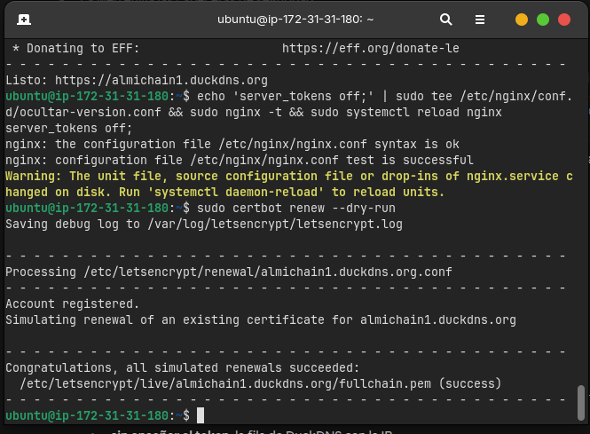
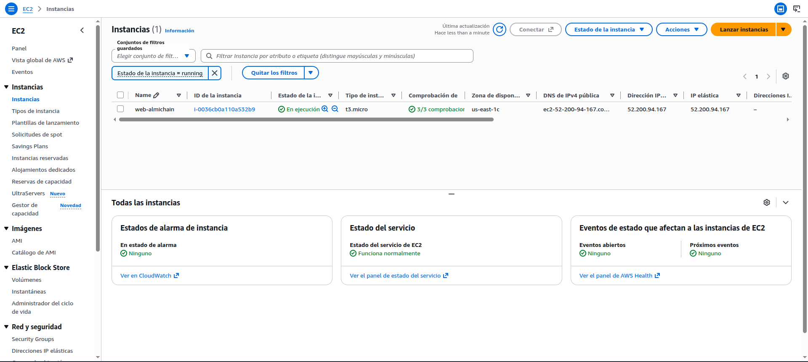
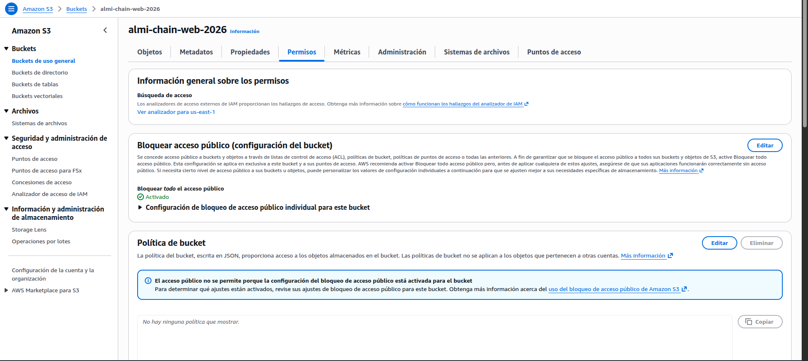
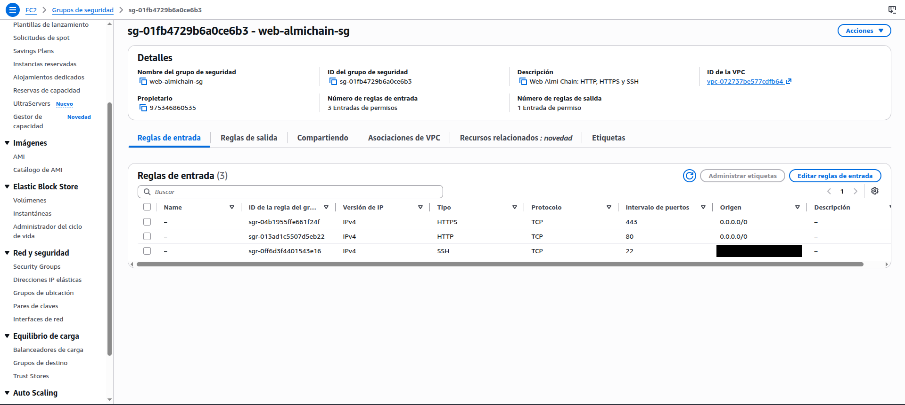
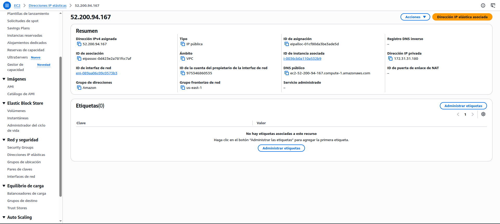

# Tarea 30: Hosting de la web en AWS con dominio y HTTPS

- **Bloque:** 6 Web
- **Depende de:** tarea 28 (web implementada)
- **Responsable:** Adrian
- **Reto:** Almi-Chain (ASIR1 2026-27)
- **Estado:** montado y probado
- **Fecha:** 23/10/2026
- **Web:** <https://almichain1.duckdns.org> (solo con el Learner Lab arrancado; ver sección 8)

## 1. Alcance

El enunciado pide que la web se sirva **por HTTPS, con dominio propio, alojada en la nube y con un despliegue reproducible**. Este documento explica cómo se ha alojado en AWS, cómo se comprueba y dónde están las evidencias. La automatización con Terraform y GitHub Actions es la tarea 31; la sección 9 indica qué recursos tiene que crear.

## 2. Arquitectura

```
                                     EC2 web-almichain (Ubuntu 24.04, IP elástica 52.200.94.167)
Navegador ──HTTPS──▶ almichain1.duckdns.org ──▶ nginx + certificado Let's Encrypt
                                                   ▲
                                                   │ aws s3 sync cada 5 min (rol LabInstanceProfile)
                                                   │
                     Subida de la web ──▶ Bucket S3 privado almi-chain-web-2026
```

| Pieza | Para qué |
|---|---|
| **Bucket S3** | Guarda la versión publicada de la web. Es **privado**: solo lo leen la EC2 (por su rol) y el equipo (con sus credenciales). |
| **EC2 + nginx** | Sirve la web por HTTPS y redirige HTTP a HTTPS. Cada 5 minutos descarga del bucket los cambios. |
| **IP elástica** | Fija la IP pública de la EC2: no cambia aunque la instancia se pare y se vuelva a arrancar. |
| **DuckDNS** | Dominio gratuito `almichain1.duckdns.org`, con un registro A que apunta a la IP elástica. |
| **Let's Encrypt (certbot)** | Certificado TLS gratuito que se renueva solo. |

### Por qué no CloudFront

La primera idea era S3 + CloudFront + un certificado de ACM, sin ningún servidor. Se descartó por el dominio:

- Un dominio propio de pago no entra en el presupuesto del reto, y las alternativas gratuitas (GitHub Student Pack, eu.org) tardan días en aprobarse.
- DuckDNS es gratuito e inmediato, pero solo admite registros A, AAAA y TXT. CloudFront necesita un CNAME porque no tiene IP fija, y ACM valida los certificados también con un CNAME.

Con una EC2 con IP elástica basta un registro A, y Let's Encrypt sí emite certificados para subdominios de DuckDNS.

## 3. Datos del montaje

| Elemento | Valor |
|---|---|
| Cuenta | AWS Academy Learner Lab |
| Región | `us-east-1` (Norte de Virginia) |
| Bucket S3 | `almi-chain-web-2026` |
| Grupo de seguridad | `web-almichain-sg` |
| Instancia EC2 | `web-almichain` · `t3.micro` · Ubuntu Server 24.04 LTS |
| IP elástica | `52.200.94.167` |
| Dominio | `almichain1.duckdns.org` |
| Certificado | Let's Encrypt, renovación automática con `certbot.timer` |

> **Learner Lab.** La clave SSH (`labsuser.pem`) se descarga en **AWS Details → Download PEM**. Si se usa la AWS CLI desde el equipo de trabajo, las credenciales se copian de **AWS Details → AWS CLI** en `~/.aws/credentials`; caducan al terminar cada sesión.

## 4. Procedimiento

Los nombres de los menús son los de la consola de AWS en español.

### 4.1 Bucket S3

1. En el buscador de la consola, escribir **S3** y entrar. Pulsar **Crear bucket**.
2. Rellenar:
   - **Tipo de bucket:** Uso general.
   - **Nombre del bucket:** `almi-chain-web-2026`. Los nombres son únicos en todo AWS; si ya existe, añadirle algo.
   - **Propiedad de objetos:** ACL deshabilitadas.
   - **Bloquear *todo* el acceso público:** marcado. El bucket no se abre al público.
   - Lo demás (control de versiones, cifrado SSE-S3, bloqueo de objetos) se deja como viene.
3. Pulsar **Crear bucket**.
4. Entrar en el bucket, pulsar **Cargar** → **Agregar archivos** y subir `index.html`, `style.css` y `script.js` de la carpeta `web/`. El `README.txt` no se sube: son notas para el equipo, no forman parte de la web. En **Permisos** no se toca nada.

### 4.2 Grupo de seguridad

Es el cortafuegos de la instancia.

1. **EC2 → Red y seguridad → Grupos de seguridad → Crear grupo de seguridad**.
2. **Nombre:** `web-almichain-sg`. AWS no deja que empiece por `sg-`.
3. **Descripción:** `Web Almi Chain: HTTP, HTTPS y SSH`. **VPC:** la que sale por defecto.
4. **Reglas de entrada** → **Agregar regla**, tres veces:

   | Tipo | Tipo de origen | Motivo |
   |---|---|---|
   | HTTP | Anywhere-IPv4 (`0.0.0.0/0`) | Redirección a HTTPS y validación de Let's Encrypt |
   | HTTPS | Anywhere-IPv4 (`0.0.0.0/0`) | La web |
   | SSH | Mi IP | Administración, solo desde nuestra IP |

5. Las **reglas de salida** se dejan como están. Pulsar **Crear grupo de seguridad**.

### 4.3 Instancia EC2

1. **EC2 → Instancias → Lanzar instancias**.
2. Rellenar:
   - **Nombre:** `web-almichain`.
   - **Imágenes de aplicaciones y sistemas operativos:** Ubuntu → **Ubuntu Server 24.04 LTS**. Comprobar en el **Resumen** de la derecha que pone 24.04: la consola puede proponer otra versión.
   - **Tipo de instancia:** `t3.micro`.
   - **Par de claves:** `vockey`.
   - **Configuraciones de red → Firewall:** *Seleccionar un grupo de seguridad existente* → `web-almichain-sg`.
   - **Configurar almacenamiento:** 8 GiB gp3, como viene.
   - **Detalles avanzados → Perfil de instancia de IAM:** `LabInstanceProfile`. Da a la instancia permiso para leer el bucket **sin guardar claves en ella**.
3. Pulsar **Lanzar instancia** y esperar a que esté **En ejecución**.

### 4.4 IP elástica

1. **EC2 → Red y seguridad → Direcciones IP elásticas → Asignar la dirección IP elástica → Asignar**.
2. Con la IP seleccionada: **Acciones → Asociar la dirección IP elástica**. **Tipo de recurso:** Instancia; **Instancia:** `web-almichain`. Pulsar **Asociar**.
3. La IP asignada es `52.200.94.167`.

### 4.5 DuckDNS

1. Entrar en [duckdns.org](https://www.duckdns.org) con una cuenta de GitHub o Google y crear el subdominio `almichain1`.
2. En **current ip**, poner `52.200.94.167` y pulsar **update ip**.
3. Comprobar que resuelve a la IP elástica:
   ```
   nslookup almichain1.duckdns.org 1.1.1.1
   ```
   Se pregunta a un servidor DNS público (`1.1.1.1`) porque el equipo puede tener guardada en caché la IP anterior durante unos minutos.

> El **token** de DuckDNS permite cambiar la IP del dominio. No se sube al repositorio ni se pega en capturas.

### 4.6 Servidor web y certificado

DuckDNS tiene que apuntar ya a la IP elástica: Let's Encrypt comprueba el dominio conectándose a ella.

Desde la carpeta del repositorio, en el equipo de trabajo:

```
chmod 400 ~/Descargas/labsuser.pem
```
```
scp -i ~/Descargas/labsuser.pem scripts/web/instalar-servidor-web.sh ubuntu@52.200.94.167:
```
```
ssh -i ~/Descargas/labsuser.pem ubuntu@52.200.94.167
```

Ya dentro de la instancia (el correo va sin comillas):

```
sudo BUCKET=almi-chain-web-2026 DOMINIO=almichain1.duckdns.org EMAIL=<correo> ./instalar-servidor-web.sh
```

El script [`scripts/web/instalar-servidor-web.sh`](../../scripts/web/instalar-servidor-web.sh) hace lo siguiente:

1. Instala nginx, certbot y la AWS CLI.
2. Descarga la web del bucket a `/var/www/almichain`. Crea `/usr/local/bin/actualizar-web` y una tarea de cron que la vuelve a descargar cada 5 minutos.
3. Configura nginx para el dominio. Oculta la versión del servidor (`server_tokens off`), comprime con gzip el CSS y el JavaScript, y añade las cabeceras de seguridad: HSTS, `X-Content-Type-Options`, `X-Frame-Options` y `Referrer-Policy`.
4. Pide el certificado a Let's Encrypt con certbot, que también configura la redirección de HTTP a HTTPS y deja programada la renovación automática.

Termina con `Listo: https://almichain1.duckdns.org`. El correo solo lo usa Let's Encrypt para avisar si un certificado va a caducar sin renovarse.

## 5. Pruebas

Las pruebas con `curl` y `openssl` se hicieron desde un equipo externo; su salida completa está en [`08-pruebas-curl.txt`](../evidencias/30-hosting-aws/08-pruebas-curl.txt).

| Prueba | Comando o acción | Resultado | Evidencia |
|---|---|---|---|
| HTTP redirige a HTTPS | `curl -I http://almichain1.duckdns.org` | ✅ `301` a `https://almichain1.duckdns.org/` | [08](../evidencias/30-hosting-aws/08-pruebas-curl.txt) |
| HTTPS funciona | `curl -I https://almichain1.duckdns.org` | ✅ `200`, con HSTS, `nosniff`, `X-Frame-Options` y `Referrer-Policy` | [08](../evidencias/30-hosting-aws/08-pruebas-curl.txt) |
| Certificado válido | Candado del navegador y `openssl s_client` | ✅ Emitido por Let's Encrypt para `almichain1.duckdns.org`, válido hasta el 21/01/2027 | [01](../evidencias/30-hosting-aws/01-web-https-candado.png), [08](../evidencias/30-hosting-aws/08-pruebas-curl.txt) |
| Renovación automática | En la EC2: `sudo certbot renew --dry-run` | ✅ `all simulated renewals succeeded` | [03](../evidencias/30-hosting-aws/03-certbot-renovacion.png) |
| Versión del servidor oculta | Cabecera `Server` | ✅ `nginx`, sin número de versión | [08](../evidencias/30-hosting-aws/08-pruebas-curl.txt) |
| Bucket privado | `curl -I https://almi-chain-web-2026.s3.us-east-1.amazonaws.com/index.html` | ✅ `403 Forbidden` | [05](../evidencias/30-hosting-aws/05-s3-bloqueo-publico.png), [08](../evidencias/30-hosting-aws/08-pruebas-curl.txt) |
| Solo se publica la web | Pedir `index.html`, `style.css`, `script.js` y `README.txt` | ✅ `200` los tres primeros y `404` el README | [08](../evidencias/30-hosting-aws/08-pruebas-curl.txt) |
| Geolocalización | Pulsar «Usar mi ubicación» | ✅ El navegador pide permiso (solo funciona con HTTPS) | [02](../evidencias/30-hosting-aws/02-geolocalizacion.png) |
| Instancia en marcha | Consola de EC2 | ✅ En ejecución, 3/3 comprobaciones superadas | [04](../evidencias/30-hosting-aws/04-ec2-instancia.png) |
| Cortafuegos | Reglas de entrada de `web-almichain-sg` | ✅ 80 y 443 abiertos; 22 solo desde nuestra IP | [06](../evidencias/30-hosting-aws/06-grupo-seguridad.png) |
| IP fija | IP elástica asociada a `web-almichain` | ✅ `52.200.94.167` | [07](../evidencias/30-hosting-aws/07-ip-elastica.png) |

La validación W3C, Lighthouse y la accesibilidad son la tarea 29.

> [!NOTE]
> **Publicada la versión actual (26/10/2026).** Hasta ese día el servidor daba el `index.html` del 22/10 (`Content-Length: 7143`) y nginx no tenía la CSP ni la Permissions-Policy. Se subió la web actual al bucket y se volvió a ejecutar `instalar-servidor-web.sh`. Ahora `index.html`, `style.css` y `script.js` publicados son idénticos a los del repositorio y salen las dos cabeceras ([`08-pruebas-curl.txt`](../evidencias/30-hosting-aws/08-pruebas-curl.txt)). Lighthouse y W3C, contra la URL pública ([`lighthouse-w3c.txt`](../evidencias/web/lighthouse-w3c.txt)): móvil 94/100/100/100, escritorio 99/100/100/100 (medianas de 5) y W3C sin errores. En móvil daba 70 hasta que el mapa de OpenStreetMap pasó a cargarse al pulsar «Ver el mapa».

### Capturas

**La web por HTTPS** («La conexión es segura»):



**Geolocalización** (el navegador pide permiso):



**Renovación del certificado** (simulación):



**Instancia EC2 en ejecución:**



**Bucket con el acceso público bloqueado:**



**Reglas de entrada del grupo de seguridad** (la IP de la regla SSH está tapada):



**IP elástica asociada:**



## 6. Actualizar la web

1. Subir al bucket los archivos que hayan cambiado: **S3 → `almi-chain-web-2026` → Cargar**. Se sobrescriben los anteriores. Si se elimina un archivo de la web, hay que borrarlo también del bucket.
2. En menos de 5 minutos, la instancia los descarga sola. Para publicarlos al momento, ejecutar en la instancia:
   ```
   sudo actualizar-web
   ```

Con la AWS CLI, el paso 1 se hace con un solo comando desde la carpeta del repositorio, que además borra del bucket lo que ya no esté en `web/`:

```
aws s3 sync web/ s3://almi-chain-web-2026/ --delete --exclude "README.txt" --exclude ".gitkeep"
```

## 7. Seguridad

- El bucket es privado y tiene activado *Bloquear todo el acceso público*. La instancia lo lee con el rol del laboratorio, sin claves guardadas en la máquina.
- Todo el tráfico va por HTTPS. HSTS hace que el navegador no vuelva a intentarlo por HTTP.
- SSH solo está abierto a nuestra IP. Los puertos 80 y 443 son los únicos públicos.
- nginx no muestra su versión.
- **Content-Security-Policy** (añadida el 24/10/2026): el navegador solo carga los ficheros de la propia web, las fotos (copiadas en `web/img/` desde el 27/10; antes venían de `images.unsplash.com`) y el mapa de `www.openstreetmap.org`; ningún script de otro dominio ni en línea. Si alguien consiguiera inyectar HTML en la página, sus scripts no se ejecutarían.
- **Permissions-Policy** (24/10/2026): solo la propia web puede pedir la ubicación (`geolocation=(self)`); el iframe del mapa, no. Cámara, micrófono, pagos y USB, bloqueados.
- El token de DuckDNS y las credenciales del Learner Lab no se suben al repositorio.
- **Mínimos privilegios en AWS: limitación del laboratorio.** La instancia usa `LabInstanceProfile`, el único rol que deja usar el Learner Lab, y ese rol tiene **permisos amplios** (mucho más que leer un bucket). En una cuenta normal se crearía un rol propio con una sola política: `s3:GetObject` y `s3:ListBucket` sobre `almi-chain-web-2026`. Queda escrito como limitación y como recurso para la tarea 31.

## 8. Limitaciones y coste

- **El Learner Lab para las instancias al acabar cada sesión**, así que la web solo está en línea mientras el laboratorio está arrancado. Al volver a pulsar **Start Lab**, la instancia arranca, nginx se inicia solo y la IP elástica sigue siendo la misma, de modo que no hay que tocar DuckDNS. En producción habría que usar una cuenta de AWS normal.
- **Coste aproximado:** la `t3.micro` cuesta unos 0,01 $ por hora encendida. La IP elástica cuesta unos 0,005 $ por hora, también con la instancia parada: unos 3,6 $ al mes. El bucket cuesta céntimos. Para un mes de reto sale bastante por debajo de los 50 $ del laboratorio. Al terminar el reto, **liberar la IP elástica** para que deje de cobrarse.
- **El dominio es un subdominio de `duckdns.org`.** El enunciado pide «dominio propio» y el equipo decidió el 24/10/2026 que **este subdominio vale**: no se compra un dominio. Si la rúbrica dijera lo contrario, basta con crearle un registro A hacia `52.200.94.167` y volver a ejecutar certbot con el nuevo nombre (`DOMINIO=` del script).

## 9. Para la tarea 31 (Terraform)

**Hecho el 24/10/2026** en [`iac/`](../../iac/README.md) (Terraform validado; falta el `apply` en el Learner Lab) y en [`desplegar-web.yml`](../../.github/workflows/desplegar-web.yml). Recursos que crea:

| Recurso de Terraform | Sección |
|---|---|
| `aws_s3_bucket` + `aws_s3_bucket_public_access_block` | 4.1 |
| `aws_security_group` | 4.2 |
| `aws_instance`, con `iam_instance_profile = "LabInstanceProfile"` y el script de la sección 4.6 como `user_data` | 4.3 y 4.6 |
| `aws_eip` + `aws_eip_association` | 4.4 |

DuckDNS queda fuera de Terraform. La IP se puede actualizar desde el `user_data` con una petición a la API de DuckDNS, pasando el token como secreto y nunca escrito en el código. El despliegue del contenido (sección 6) va en GitHub Actions con `aws s3 sync`.
